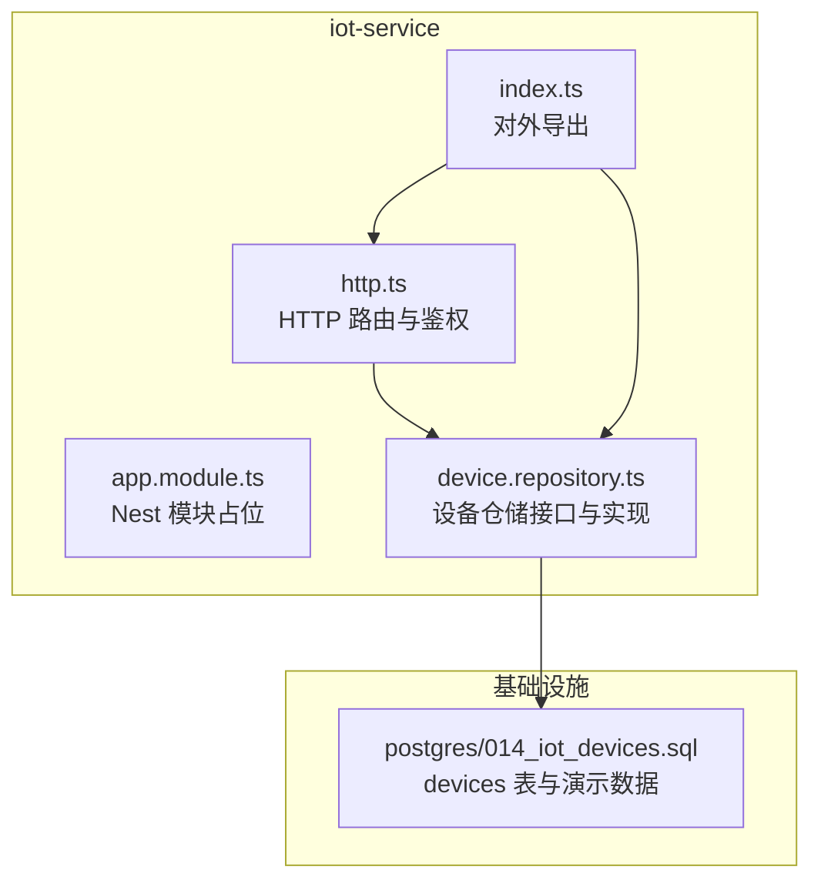
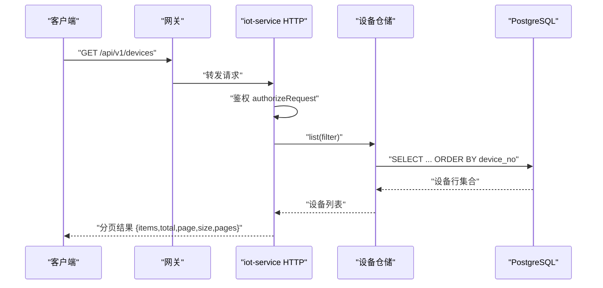
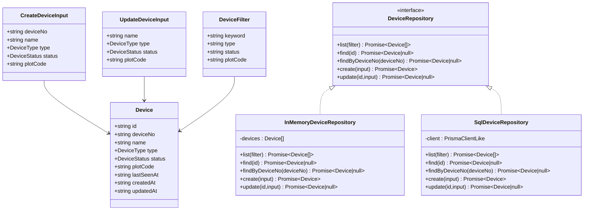
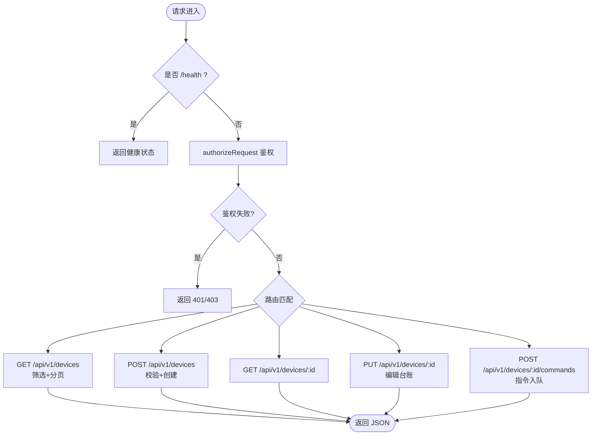
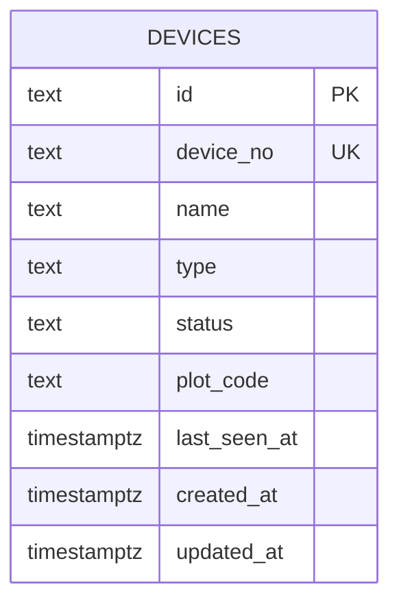
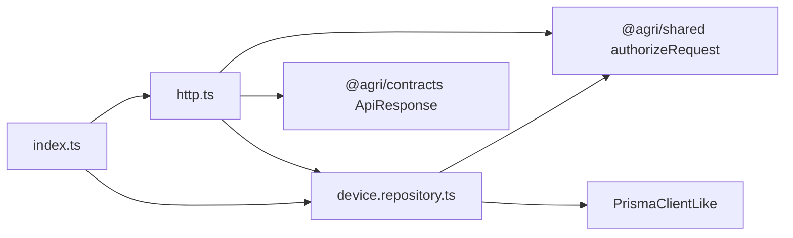

# 物联网设备管理

<cite>
**本文引用的文件**   
- [README.md](file://README.md)
- [iot-service/app.module.ts](file://apps/iot-service/src/app.module.ts)
- [iot-service/device.repository.ts](file://apps/iot-service/src/device.repository.ts)
- [iot-service/http.ts](file://apps/iot-service/src/http.ts)
- [iot-service/index.ts](file://apps/iot-service/src/index.ts)
- [iot-service/test/http.spec.ts](file://apps/iot-service/test/http.spec.ts)
- [postgres/014_iot_devices.sql](file://infra/postgres/migrations/014_iot_devices.sql)
</cite>

## 目录
1. [引言](#引言)
2. [项目结构](#项目结构)
3. [核心组件](#核心组件)
4. [架构总览](#架构总览)
5. [详细组件分析](#详细组件分析)
6. [依赖关系分析](#依赖关系分析)
7. [性能与扩展性](#性能与扩展性)
8. [故障排查指南](#故障排查指南)
9. [结论](#结论)

## 引言
本文件聚焦“物联网设备管理”能力，围绕 iot-service 提供的设备台账、查询筛选、新增编辑、控制指令入队等 HTTP 接口展开。该服务以 Node.js 原生 http 实现路由，通过仓储抽象同时支持内存与 SQL 两种数据后端；数据库层由迁移脚本维护 devices 表，并注入演示设备，保证既有设备 id 与其他业务（遥测、控制、视频）稳定关联。

## 项目结构
iot-service 是平台中负责设备台账与设备侧控制的微服务之一，位于 apps/iot-service。其对外暴露的入口包括：
- Nest 模块占位：用于装配与生命周期托管。
- HTTP 服务器工厂：创建监听器、处理鉴权、解析请求、调用仓储。
- 设备仓储接口与实现：统一设备增删改查与筛选语义。
- 数据库迁移：定义设备表结构与演示数据。

图表来源
- [iot-service/app.module.ts:1-2](file://apps/iot-service/src/app.module.ts#L1-L2)
- [iot-service/http.ts:39-137](file://apps/iot-service/src/http.ts#L39-L137)
- [iot-service/device.repository.ts:78-320](file://apps/iot-service/src/device.repository.ts#L78-L320)
- [postgres/014_iot_devices.sql:16-49](file://infra/postgres/migrations/014_iot_devices.sql#L16-L49)

章节来源
- [README.md:159-190](file://README.md#L159-L190)
- [iot-service/index.ts:1-4](file://apps/iot-service/src/index.ts#L1-L4)

## 核心组件
- 设备仓储接口与实现
  - 定义设备领域模型、枚举常量、筛选条件与仓储方法。
  - 提供 InMemoryDeviceRepository 与 SqlDeviceRepository 两套实现，保证测试与生产一致性。
- HTTP 服务
  - 健康检查、设备列表分页、新增设备、按 id 查询、编辑台账、下发控制指令。
  - 内置网关级权限校验，使用统一的 ApiResponse 响应信封。
- 数据库迁移
  - 定义 devices 表结构、索引与演示数据，确保设备 id 与历史数据一致。

章节来源
- [iot-service/device.repository.ts:4-86](file://apps/iot-service/src/device.repository.ts#L4-L86)
- [iot-service/http.ts:10-15](file://apps/iot-service/src/http.ts#L10-L15)
- [postgres/014_iot_devices.sql:1-14](file://infra/postgres/migrations/014_iot_devices.sql#L1-L14)

## 架构总览
iot-service 采用“仓储 + HTTP 控制器”的轻量分层：
- 控制器层：解析请求、鉴权、参数校验、调用仓储。
- 仓储层：屏蔽内存与 SQL 差异，向上暴露一致的领域操作。
- 持久化层：PostgreSQL devices 表，含类型与状态约束、地块索引与演示数据。

图表来源
- [iot-service/http.ts:42-61](file://apps/iot-service/src/http.ts#L42-L61)
- [iot-service/device.repository.ts:229-253](file://apps/iot-service/src/device.repository.ts#L229-L253)
- [postgres/014_iot_devices.sql:16-33](file://infra/postgres/migrations/014_iot_devices.sql#L16-L33)

## 详细组件分析

### 设备仓储与领域模型
- 领域模型
  - Device：设备主键、出厂编号、名称、类型、状态、绑定地块、最后上报时间、创建与更新时间。
  - CreateDeviceInput / UpdateDeviceInput：新增与编辑入参，强调不直接修改 lastSeenAt，避免手工“点亮”离线设备。
  - DeviceFilter：关键词、类型、状态、地块编码筛选。
- 枚举与常量
  - DEVICE_TYPES：气象站、墒情传感器、综合监测站、遥感节点、虫情灯、施肥阀、灌溉阀、灌溉泵、植保无人机、无人驾驶拖拉机。
  - DEVICE_STATUSES：ONLINE、OFFLINE。
- 内存仓储
  - 基于数组过滤与排序，默认种子为 demoDevices()，与数据库演示数据对齐。
- SQL 仓储
  - 使用 $queryRawUnsafe 执行 SQL，字段映射统一转换为 ISO 时间字符串。
  - 列表查询动态拼接 WHERE 条件并按 device_no 排序。
  - 更新逻辑复用 mergeDevice，保持省略字段不变、空串解绑地块的语义一致。

图表来源
- [iot-service/device.repository.ts:31-86](file://apps/iot-service/src/device.repository.ts#L31-L86)
- [iot-service/device.repository.ts:147-190](file://apps/iot-service/src/device.repository.ts#L147-L190)
- [iot-service/device.repository.ts:211-320](file://apps/iot-service/src/device.repository.ts#L211-L320)

章节来源
- [iot-service/device.repository.ts:4-86](file://apps/iot-service/src/device.repository.ts#L4-L86)
- [iot-service/device.repository.ts:107-145](file://apps/iot-service/src/device.repository.ts#L107-L145)
- [iot-service/device.repository.ts:192-207](file://apps/iot-service/src/device.repository.ts#L192-L207)

### HTTP 接口与流程
- 健康检查
  - GET /health：返回服务名与健康状态。
- 设备列表
  - GET /api/v1/devices：支持 keyword、type、status、plotCode 筛选；page、size 分页；返回 items、total、page、size、pages。
- 新增设备
  - POST /api/v1/devices：校验必填、枚举、唯一编号；未上报设备 lastSeenAt 为 null。
- 设备详情
  - GET /api/v1/devices/:id：不存在返回 404。
- 编辑台账
  - PUT /api/v1/devices/:id：仅允许编辑 name、type、status、plotCode；空对象拒绝；空串表示解绑地块。
- 下发控制指令
  - POST /api/v1/devices/:id/commands：校验设备存在；返回 202 与命令入队信息。

图表来源
- [iot-service/http.ts:42-137](file://apps/iot-service/src/http.ts#L42-L137)

章节来源
- [iot-service/http.ts:17-37](file://apps/iot-service/src/http.ts#L17-L37)
- [iot-service/http.ts:39-137](file://apps/iot-service/src/http.ts#L39-L137)

### 数据库表结构与演示数据
- 表结构
  - devices：主键 id、唯一 device_no、name、type（CHECK）、status（CHECK）、plot_code（空串表示未绑定）、last_seen_at、created_at、updated_at。
  - 索引：按 type、按 plot_code（非空）。
- 演示数据
  - 注入 12 台设备，覆盖多种类型与状态，部分绑定地块，部分离线，last_seen_at 相对当前时间偏移，保证迁移可重复执行且不影响既有 id。

图表来源
- [postgres/014_iot_devices.sql:16-33](file://infra/postgres/migrations/014_iot_devices.sql#L16-L33)

章节来源
- [postgres/014_iot_devices.sql:1-14](file://infra/postgres/migrations/014_iot_devices.sql#L1-L14)
- [postgres/014_iot_devices.sql:34-49](file://infra/postgres/migrations/014_iot_devices.sql#L34-L49)

## 依赖关系分析
- 内部依赖
  - http.ts 依赖 device.repository.ts 的枚举、仓储接口与内存实现。
  - index.ts 统一导出模块、仓储与类型，供外部装配或测试引用。
- 外部依赖
  - @agri/contracts：ApiResponse 响应信封。
  - @agri/shared：authorizeRequest 权限守卫、toIsoTimestamp 时间转换、ulid 标识生成。
- 数据依赖
  - SqlDeviceRepository 依赖 PrismaClientLike 进行原始 SQL 查询。
  - 所有 SQL 仓储的时间列经 toIsoTimestamp 转为 ISO 字符串，避免 pg 驱动 Date 序列化问题。

图表来源
- [iot-service/http.ts:1-8](file://apps/iot-service/src/http.ts#L1-L8)
- [iot-service/device.repository.ts:1-2](file://apps/iot-service/src/device.repository.ts#L1-L2)
- [iot-service/index.ts:1-4](file://apps/iot-service/src/index.ts#L1-L4)

章节来源
- [iot-service/http.ts:1-8](file://apps/iot-service/src/http.ts#L1-L8)
- [iot-service/device.repository.ts:1-2](file://apps/iot-service/src/device.repository.ts#L1-L2)
- [iot-service/index.ts:1-4](file://apps/iot-service/src/index.ts#L1-L4)

## 性能与扩展性
- 列表查询
  - 内存模式：O(n) 过滤后排序；SQL 模式：WHERE 条件 + ORDER BY device_no，适合中等规模设备台账。
  - 分页在应用层裁剪，MAX_PAGE_SIZE 限制最大页大小，防止前端一次性拉取过多数据。
- 筛选策略
  - 关键词对 name 与 device_no 做 ILIKE 子串匹配；类型、状态、地块精确匹配。
- 可扩展点
  - 新增设备类型需同步三处：DEVICE_TYPES、数据库 CHECK、前端选项。
  - 新增筛选维度可在仓库层增加条件拼接，并在 HTTP 层透传参数。
  - 控制指令目前仅入队返回 202，后续可与 control-service 集成完成实际下发与状态回写。

[本节为通用指导，不直接分析具体文件]

## 故障排查指南
- 鉴权失败
  - 现象：返回 401/403。
  - 排查：确认网关已注入身份头，authorizeRequest 能解析到有效会话与权限。
- 参数校验失败
  - 现象：新增或编辑返回 400。
  - 排查：检查必填字段、枚举值、plotCode 是否为字符串；空对象编辑会被拒绝。
- 编号冲突
  - 现象：新增返回 409。
  - 排查：device_no 全局唯一，检查是否重复。
- 设备不存在
  - 现象：详情或编辑返回 404。
  - 排查：确认 id 或 device_no 是否正确；演示设备 id 固定，不要随意更改。
- 控制指令 404
  - 现象：POST /devices/:id/commands 返回 404。
  - 排查：先确认设备在册，再下发指令。
- 时间字段异常
  - 现象：SQL 写入时报时间格式错误。
  - 排查：确保时间字段经 toIsoTimestamp 转换；避免直接使用 Date 的本地化字符串。

章节来源
- [iot-service/http.ts:47-48](file://apps/iot-service/src/http.ts#L47-L48)
- [iot-service/http.ts:72-76](file://apps/iot-service/src/http.ts#L72-L76)
- [iot-service/http.ts:97-129](file://apps/iot-service/src/http.ts#L97-L129)
- [iot-service/device.repository.ts:214-226](file://apps/iot-service/src/device.repository.ts#L214-L226)

## 结论
iot-service 以简洁的仓储抽象与原生 http 路由实现了设备台账的全生命周期管理，并通过迁移脚本将演示数据与领域模型对齐，确保跨服务设备 id 的稳定关联。其鉴权、筛选、分页与错误码遵循平台统一约定，便于与网关、前端及其他业务服务协同。未来可在控制指令链路、指标上报与设备状态同步方面继续扩展，形成更完整的物联闭环。