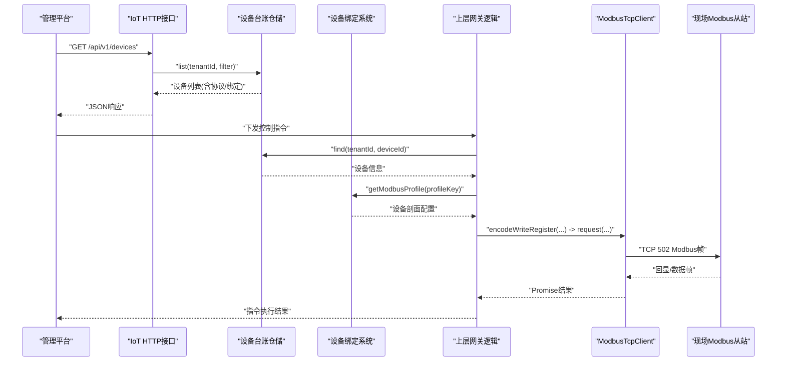
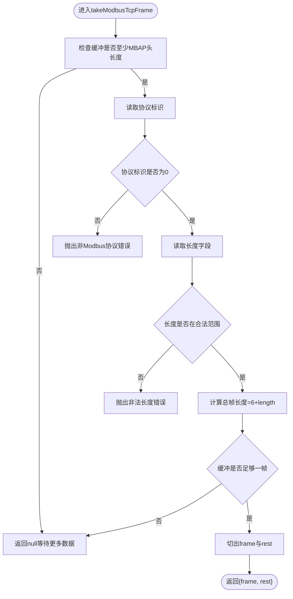
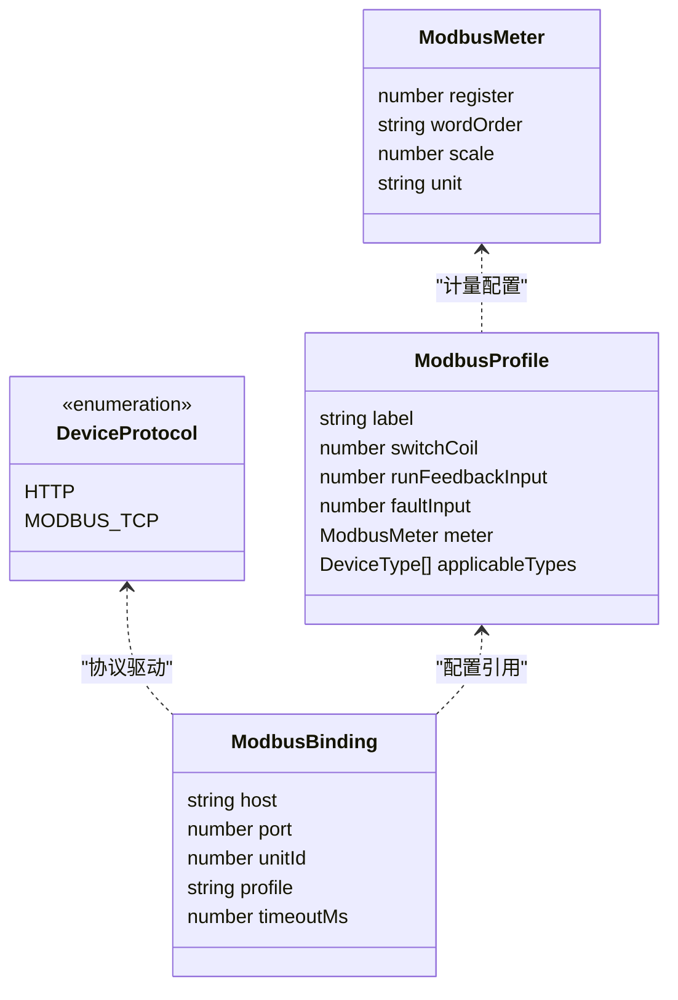
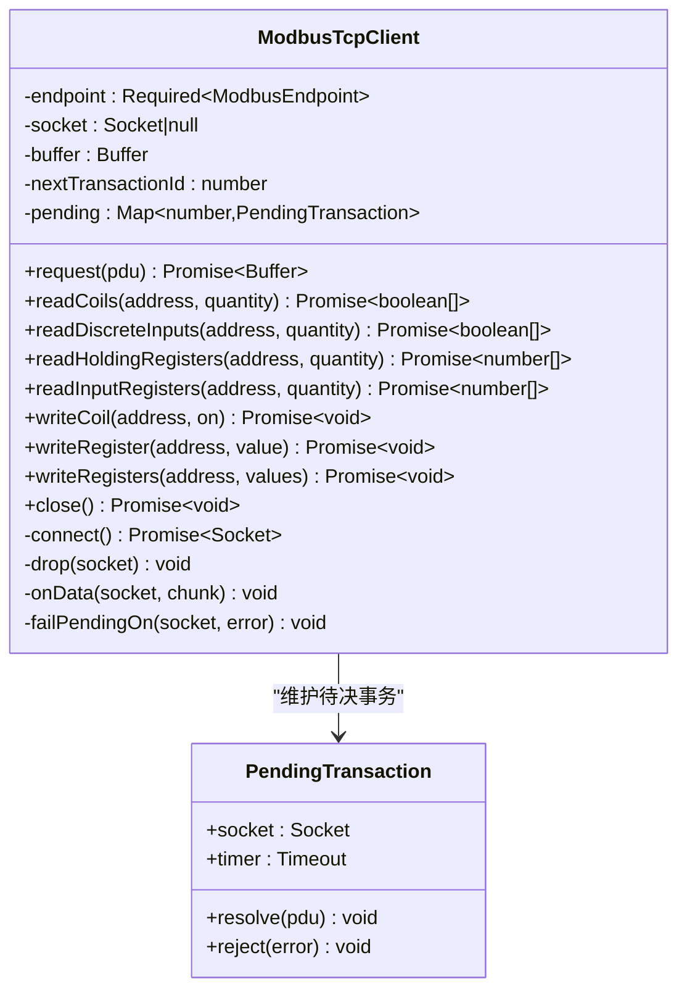
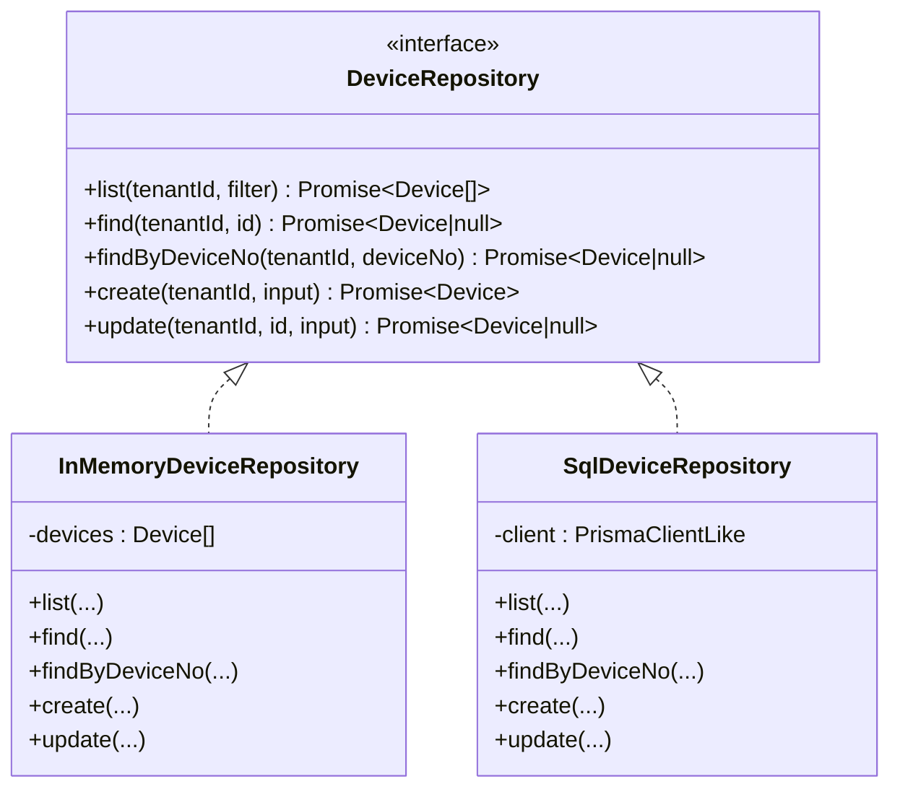
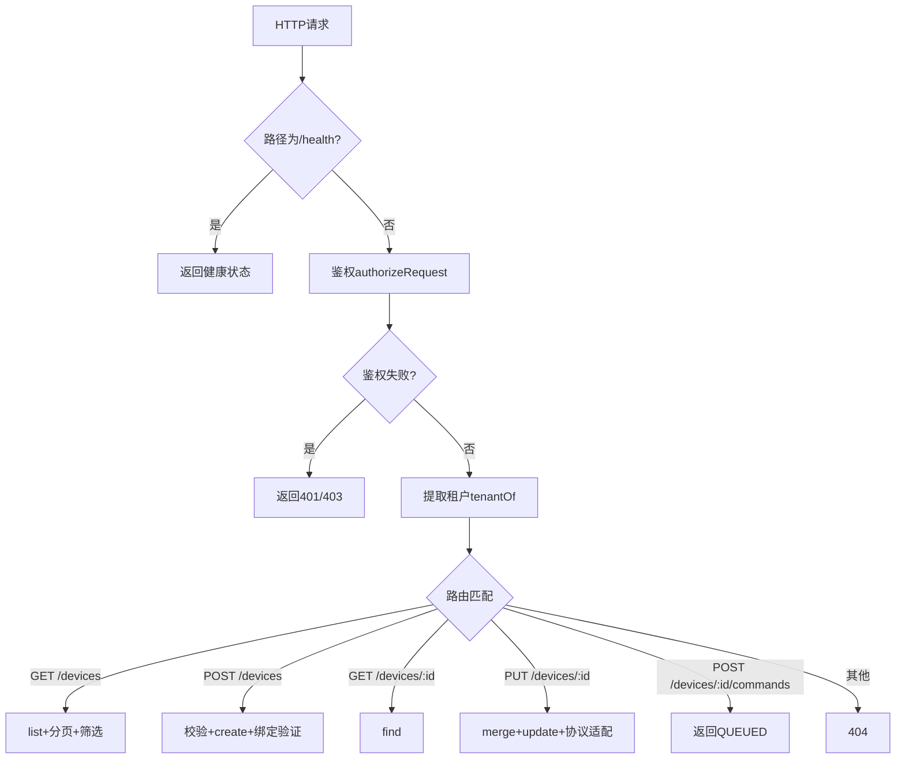
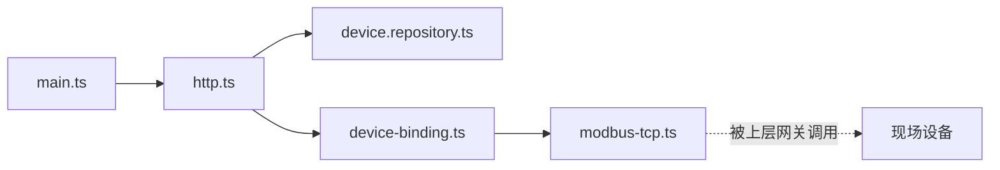

# Modbus TCP主站通信

<cite>
**本文引用的文件**   
- [modbus-tcp.ts](file://apps/iot-service/src/modbus-tcp.ts)
- [device-binding.ts](file://apps/iot-service/src/device-binding.ts)
- [device.repository.ts](file://apps/iot-service/src/device.repository.ts)
- [http.ts](file://apps/iot-service/src/http.ts)
- [main.ts](file://apps/iot-service/src/main.ts)
- [app.module.ts](file://apps/iot-service/src/app.module.ts)
- [modbus-tcp.spec.ts](file://apps/iot-service/test/modbus-tcp.spec.ts)
- [038_device_field_binding.sql](file://infra/postgres/migrations/038_device_field_binding.sql)
</cite>

## 更新摘要
**变更内容**   
- 新增设备绑定系统，支持HTTP和MODBUS_TCP两种协议类型
- 增强Modbus TCP协议支持，实现完整的TCP客户端功能
- 添加三种预定义配置文件：SWITCH_ONLY、WATER_M3、FERTILIZER_L
- 扩展设备台账模型，增加protocol和binding字段
- 完善数据库迁移，支持协议切换和绑定约束

## 目录
1. [引言](#引言)
2. [项目结构](#项目结构)
3. [核心组件](#核心组件)
4. [架构总览](#架构总览)
5. [详细组件分析](#详细组件分析)
6. [依赖关系分析](#依赖关系分析)
7. [性能与可靠性考虑](#性能与可靠性考虑)
8. [故障排查指南](#故障排查指南)
9. [结论](#结论)

## 引言
本文件聚焦 iot-service 中的 Modbus TCP 主站通信能力。平台侧作为网关（主站），主动连接现场设备（从站），按设备台账中的接入地址与协议剖面，轮询或写入线圈/寄存器，完成泵阀控制、水肥机动作以及状态与计量值回读。该模块实现了完整的 Modbus TCP 帧编解码、长连接事务管理、异常响应处理与超时重连策略，并与设备台账仓储和 HTTP 接口解耦，便于在真实现场部署中替换为数据库实现。

**更新** 新增了设备绑定系统和多协议支持，现在支持HTTP回调式和MODBUS_TCP主动式两种接入模式，并提供标准化的设备配置模板。

## 项目结构
iot-service 当前以轻量 Node.js HTTP 服务形式提供设备台账管理能力；Modbus TCP 客户端以独立模块暴露，供上层网关逻辑复用。关键文件职责如下：
- modbus-tcp.ts：Modbus TCP 协议实现与长连接客户端。
- device-binding.ts：设备接入绑定与协议配置管理。
- device.repository.ts：设备台账内存与 SQL 两种仓储实现。
- http.ts：设备台账 HTTP API，负责鉴权、租户隔离与参数校验。
- main.ts：服务启动入口，根据环境变量选择内存或 SQL 模式并监听端口。
- app.module.ts：占位模块，用于 Nest 风格装配（当前未使用）。
- modbus-tcp.spec.ts：对 Modbus TCP 帧与客户端行为的单元测试。

```mermaid
graph TB
subgraph "IoT 服务进程"
Main["main.ts<br/>服务启动"]
Http["http.ts<br/>设备台账HTTP接口"]
Repo["device.repository.ts<br/>设备台账仓储"]
Binding["device-binding.ts<br/>设备绑定配置"]
Modbus["modbus-tcp.ts<br/>Modbus TCP主站客户端"]
end
Main --> Http
Http --> Repo
Http --> Binding
Binding -. "配置驱动" .-> Modbus
Modbus -. "被上层网关调用" .->|"TCP 502"| Device["现场Modbus设备"]
```

**图表来源**
- [main.ts:17-47](file://apps/iot-service/src/main.ts#L17-L47)
- [http.ts:52-154](file://apps/iot-service/src/http.ts#L52-L154)
- [device-binding.ts:1-159](file://apps/iot-service/src/device-binding.ts#L1-L159)
- [device.repository.ts:101-111](file://apps/iot-service/src/device.repository.ts#L101-L111)
- [modbus-tcp.ts:273-432](file://apps/iot-service/src/modbus-tcp.ts#L273-L432)

**章节来源**
- [main.ts:1-48](file://apps/iot-service/src/main.ts#L1-L48)
- [http.ts:1-178](file://apps/iot-service/src/http.ts#L1-L178)
- [device-binding.ts:1-159](file://apps/iot-service/src/device-binding.ts#L1-L159)
- [device.repository.ts:1-398](file://apps/iot-service/src/device.repository.ts#L1-L398)
- [modbus-tcp.ts:1-433](file://apps/iot-service/src/modbus-tcp.ts#L1-L433)

## 核心组件
本节梳理 Modbus TCP 主站通信的关键抽象与数据流。

### 协议常量与功能码
- 默认端口、默认超时、MBAP 头长度。
- 已实现功能码：读线圈、读离散输入、读保持寄存器、读输入寄存器、写单线圈、写单寄存器、写多寄存器。
- 异常码映射，便于日志与告警定位。

### 设备绑定系统
- **协议类型**：支持 HTTP（设备回调）和 MODBUS_TCP（主动轮询）两种接入方式。
- **设备剖面**：预定义三种标准配置模板：
  - `SWITCH_ONLY`：仅开关控制，无计量功能
  - `WATER_M3`：灌溉控制 + 累计流量计量（m³）
  - `FERTILIZER_L`：水肥控制 + 累计出液计量（L）
- **绑定验证**：严格的参数校验，确保设备配置的正确性。

### 帧编解码
- encodeModbusTcpFrame：组装 MBAP 头与 PDU，长度字段按实际 PDU 计算。
- takeModbusTcpFrame：从 TCP 粘包缓冲区中按长度字段切出完整帧。
- readModbusTcpHeader：解析事务标识、单元标识与 PDU。
- 位读取与寄存器读取的编码/解码，支持 LSB 在前展开与 16 位大端解析。
- 写类请求的回显校验，确保地址与值一致。
- combineUint32：将相邻两个 16 位寄存器组合成 32 位无符号整数，字序由接入剖面决定。

### 传输错误与业务异常
- ModbusTransportError：连接失败、超时、断连、帧不合法等传输层问题。
- ModbusException：从站返回异常响应（功能码 | 0x80 + 异常码）。

### 长连接客户端 ModbusTcpClient
- 一个 endpoint 一条 TCP 连接，事务标识递增复用。
- request：封装连接、发送、等待响应、超时清理与断线重连。
- 高层方法：readCoils、readDiscreteInputs、readHoldingRegisters、readInputRegisters、writeCoil、writeRegister、writeRegisters。
- onData：处理拆包粘包、非法帧丢弃、旧连接数据忽略、待决事务匹配与清理。

### 设备台账仓储
- InMemoryDeviceRepository：内存实现，含演示设备种子。
- SqlDeviceRepository：SQL 实现，按租户隔离查询与更新。
- 统一接口 DeviceRepository，包含 list/find/findByDeviceNo/create/update。

### HTTP 接口
- /health：健康检查。
- /api/v1/devices：列表、新增、分页与筛选。
- /api/v1/devices/:id：详情、编辑。
- /api/v1/devices/:id/commands：命令入队（占位，后续由控制服务消费）。
- 鉴权与租户隔离：基于可信身份头与进程配置，拒绝自报 tenantId。

**章节来源**
- [modbus-tcp.ts:19-108](file://apps/iot-service/src/modbus-tcp.ts#L19-L108)
- [device-binding.ts:16-159](file://apps/iot-service/src/device-binding.ts#L16-L159)
- [modbus-tcp.ts:115-258](file://apps/iot-service/src/modbus-tcp.ts#L115-L258)
- [modbus-tcp.ts:260-432](file://apps/iot-service/src/modbus-tcp.ts#L260-L432)
- [device.repository.ts:101-111](file://apps/iot-service/src/device.repository.ts#L101-L111)
- [device.repository.ts:176-229](file://apps/iot-service/src/device.repository.ts#L176-L229)
- [device.repository.ts:251-367](file://apps/iot-service/src/device.repository.ts#L251-L367)
- [http.ts:52-154](file://apps/iot-service/src/http.ts#L52-L154)

## 架构总览
下图展示 IoT 服务内部组件与外部设备的交互关系。HTTP 接口仅负责设备台账管理；Modbus TCP 客户端由上层网关逻辑调用，直接面向现场设备。



**图表来源**
- [http.ts:65-118](file://apps/iot-service/src/http.ts#L65-L118)
- [device-binding.ts:94-99](file://apps/iot-service/src/device-binding.ts#L94-L99)
- [device.repository.ts:298-316](file://apps/iot-service/src/device.repository.ts#L298-L316)
- [modbus-tcp.ts:289-346](file://apps/iot-service/src/modbus-tcp.ts#L289-L346)

## 详细组件分析

### Modbus TCP 协议与帧处理
- 帧结构遵循 Modbus Messaging on TCP/IP V1.1b3：MBAP 头（事务标识、协议标识恒 0、长度、单元标识）+ PDU（功能码 + 数据）。
- 长度字段动态计算，避免硬编码导致与真实从站报文不一致。
- 定界器采用 MBAP 长度字段，支持拆包、粘包与非法协议快速拒绝。
- 位读取按 LSB 在前展开，寄存器读取为大端 16 位数组。
- 写类响应进行回显校验，防止"收到但未落地"的半成功状态。



**图表来源**
- [modbus-tcp.ts:134-143](file://apps/iot-service/src/modbus-tcp.ts#L134-L143)

**章节来源**
- [modbus-tcp.ts:115-258](file://apps/iot-service/src/modbus-tcp.ts#L115-L258)

### 设备绑定系统与协议配置
- **协议类型管理**：DEVICE_PROTOCOLS 枚举支持 HTTP 和 MODBUS_TCP 两种接入方式。
- **设备剖面模板**：MODBUS_PROFILES 提供三种标准化配置：
  - SWITCH_ONLY：基础开关控制，适用于泵阀、无人机等设备
  - WATER_M3：灌溉计量，支持 m³ 单位的高字优先拼接
  - FERTILIZER_L：水肥计量，支持 L 单位的低字优先拼接
- **绑定验证流程**：parseModbusBinding 严格校验 host、port、unitId、profile 等参数。
- **协议适配**：normalizeBinding 根据协议类型自动处理绑定数据的格式转换。



**图表来源**
- [device-binding.ts:16-108](file://apps/iot-service/src/device-binding.ts#L16-L108)

**章节来源**
- [device-binding.ts:16-159](file://apps/iot-service/src/device-binding.ts#L16-L159)

### ModbusTcpClient 长连接与事务
- 连接生命周期：首次请求建立连接，后续复用；超时或断线后自动重连。
- 事务管理：每个 pending 事务记录 socket、resolve/reject 与定时器；超时则清理并拒绝。
- 数据接收：onData 累积缓冲，逐帧解析；若帧头非法则丢弃整条流并重连。
- 旧连接保护：failPendingOn 只拒掉发在当前 socket 上的事务，避免误伤重连后的新事务。



**图表来源**
- [modbus-tcp.ts:260-432](file://apps/iot-service/src/modbus-tcp.ts#L260-L432)

**章节来源**
- [modbus-tcp.ts:260-432](file://apps/iot-service/src/modbus-tcp.ts#L260-L432)

### 设备台账仓储
- 内存实现：构造时拷贝演示种子，所有读写返回深拷贝对象，避免外部修改影响内部状态。
- SQL 实现：按租户过滤，支持关键词模糊匹配（转义 LIKE 通配符），排序稳定。
- 合并更新：mergeDevice 统一省略字段保持原值的语义，plotCode 空串表示解绑。
- **协议支持**：新增 protocol 字段支持 HTTP 和 MODBUS_TCP 两种接入方式。
- **绑定存储**：binding_json JSONB 字段存储 Modbus 设备绑定信息。



**图表来源**
- [device.repository.ts:101-111](file://apps/iot-service/src/device.repository.ts#L101-L111)
- [device.repository.ts:176-229](file://apps/iot-service/src/device.repository.ts#L176-L229)
- [device.repository.ts:251-367](file://apps/iot-service/src/device.repository.ts#L251-L367)

**章节来源**
- [device.repository.ts:101-111](file://apps/iot-service/src/device.repository.ts#L101-L111)
- [device.repository.ts:176-229](file://apps/iot-service/src/device.repository.ts#L176-L229)
- [device.repository.ts:251-367](file://apps/iot-service/src/device.repository.ts#L251-L367)

### HTTP 接口与租户隔离
- 鉴权：authorizeRequest 要求具备 device:read 或 device:control 权限。
- 租户：优先取可信身份头 x-tenant-id，其次进程配置 TENANT_ID，最后回退演示租户。
- 路由：
  - GET /health：健康检查。
  - GET /api/v1/devices：分页列表，支持 keyword/type/status/plotCode/protocol 筛选。
  - POST /api/v1/devices：新增设备，编号唯一性校验，支持协议和绑定配置。
  - GET /api/v1/devices/:id：设备详情。
  - PUT /api/v1/devices/:id：编辑设备名称、类型、状态、地块绑定、协议和绑定。
  - POST /api/v1/devices/:id/commands：命令入队（返回 QUEUED）。



**图表来源**
- [http.ts:52-154](file://apps/iot-service/src/http.ts#L52-L154)

**章节来源**
- [http.ts:52-154](file://apps/iot-service/src/http.ts#L52-L154)

## 依赖关系分析
- 模块内依赖
  - main.ts 依赖 http.ts 与 device.repository.ts，根据环境变量选择仓储实现。
  - http.ts 依赖 device.repository.ts 提供的 DeviceRepository 接口和 device-binding.ts 的绑定验证。
  - device-binding.ts 依赖 modbus-tcp.ts 的常量定义。
  - modbus-tcp.ts 为纯协议与网络层实现，不依赖仓储与 HTTP。
- 外部依赖
  - @agri/db：PgClientAdapter 与数据库 URL 解析。
  - @agri/shared：鉴权 authorizeRequest、工具函数等。
  - node:net：原生 TCP Socket。
- 耦合与内聚
  - ModbusTcpClient 高内聚于协议与连接管理，低耦合于业务层。
  - DeviceRepository 通过接口解耦内存与 SQL 实现，提升可测试性与可替换性。
  - HTTP 层仅关注接口契约与租户隔离，不直接操作网络协议。
  - 设备绑定系统独立于协议实现，提供统一的配置管理接口。



**图表来源**
- [main.ts:17-47](file://apps/iot-service/src/main.ts#L17-L47)
- [http.ts:52-154](file://apps/iot-service/src/http.ts#L52-L154)
- [device-binding.ts:1-159](file://apps/iot-service/src/device-binding.ts#L1-L159)
- [device.repository.ts:101-111](file://apps/iot-service/src/device.repository.ts#L101-L111)
- [modbus-tcp.ts:273-432](file://apps/iot-service/src/modbus-tcp.ts#L273-L432)

**章节来源**
- [main.ts:1-48](file://apps/iot-service/src/main.ts#L1-L48)
- [http.ts:1-178](file://apps/iot-service/src/http.ts#L1-L178)
- [device-binding.ts:1-159](file://apps/iot-service/src/device-binding.ts#L1-L159)
- [device.repository.ts:1-398](file://apps/iot-service/src/device.repository.ts#L1-L398)
- [modbus-tcp.ts:1-433](file://apps/iot-service/src/modbus-tcp.ts#L1-L433)

## 性能与可靠性考虑
- 长连接复用：减少频繁握手开销，降低现场设备连接压力。
- 超时与重连：连接与事务均设超时，避免链路阻塞；超时后断开并重连，提高自愈能力。
- 粘包/拆包处理：按 MBAP 长度字段切分，避免丢帧或错帧。
- 非法帧防护：协议标识非 0 或长度非法直接拒绝，防止污染缓冲区。
- 回显校验：写类响应校验地址与值，避免半成功状态。
- 32 位量拼接：combineUint32 明确字序由接入剖面决定，避免猜测导致的数值错误。
- **协议适配**：HTTP 与 MODBUS_TCP 协议分离，避免不必要的连接开销。
- **配置验证**：设备绑定参数在入库前严格校验，减少运行时错误。

[本节为通用指导，不直接分析具体文件]

## 故障排查指南
- 连接失败或超时
  - 现象：抛出 ModbusTransportError，提示连接或事务超时。
  - 排查：确认设备 IP/端口可达、防火墙放行 502 端口；检查 timeoutMs 配置是否过小。
  - 相关实现：连接超时与事务超时均在 ModbusTcpClient 中处理。

- 从站异常响应
  - 现象：抛出 ModbusException，携带异常码与描述。
  - 排查：对照 MODBUS_EXCEPTION_CODES 定位"非法功能码/地址/值/设备忙/目标无响应"等。
  - 相关实现：decodeReadBits/decodeReadRegisters/decodeWriteEcho 在检测到异常功能码时转换。

- 帧不合法或协议不符
  - 现象：takeModbusTcpFrame 抛出协议标识非 0 或长度字段非法。
  - 排查：确认对端确实是 Modbus TCP 设备；检查是否有其他协议流量混入同一端口。
  - 相关实现：takeModbusTcpFrame 与 onData 的非法帧处理。

- 写回显不一致
  - 现象：写类方法抛出"回显与请求不一致"。
  - 排查：设备可能收到请求但未按请求值落地；核对设备寄存器映射与字序。
  - 相关实现：decodeWriteEcho 与 write* 方法的回显校验。

- 设备台账问题
  - 现象：404 设备不存在、409 编号重复、400 参数校验失败。
  - 排查：确认租户隔离是否正确；检查设备编号唯一性；校验 type/status/plotCode 是否符合枚举。
  - 相关实现：http.ts 的路由校验与 device.repository.ts 的仓储逻辑。

- **设备绑定配置问题**
  - 现象：400 参数错误，提示"接入地址需为设备或现场网关的 IPv4/IPv6 或域名"等。
  - 排查：检查 host/port/unitId/profile 参数格式；确认剖面 key 是否存在且与设备类型匹配。
  - 相关实现：device-binding.ts 的 parseModbusBinding 和 normalizeBinding 函数。

- **协议配置问题**
  - 现象：400 参数错误，提示"HTTP 回调式接入没有现场绑定"或"MODBUS_TCP 接入必须给出绑定"。
  - 排查：确认协议类型与绑定配置的对应关系；HTTP 设备不应有 binding 字段，MODBUS_TCP 设备必须有 binding。
  - 相关实现：http.ts 的协议校验逻辑和 device-binding.ts 的 normalizeBinding 函数。

**章节来源**
- [modbus-tcp.ts:45-72](file://apps/iot-service/src/modbus-tcp.ts#L45-L72)
- [modbus-tcp.ts:134-143](file://apps/iot-service/src/modbus-tcp.ts#L134-L143)
- [modbus-tcp.ts:167-248](file://apps/iot-service/src/modbus-tcp.ts#L167-L248)
- [modbus-tcp.ts:289-346](file://apps/iot-service/src/modbus-tcp.ts#L289-L346)
- [device-binding.ts:117-159](file://apps/iot-service/src/device-binding.ts#L117-L159)
- [http.ts:87-147](file://apps/iot-service/src/http.ts#L87-L147)

## 结论
本实现以清晰的协议分层与接口抽象，提供了稳健的 Modbus TCP 主站通信能力。通过长连接、超时重连、粘包处理与回显校验，有效应对现场设备的常见不稳定状态；同时，设备台账仓储与 HTTP 接口解耦，便于在不同部署环境下切换内存与 SQL 实现。

**更新** 新增的设备绑定系统和多协议支持进一步增强了系统的灵活性和可扩展性。通过标准化的设备配置模板和严格的参数验证，确保了设备接入的可靠性和一致性。建议在网关层结合设备接入剖面，合理设置超时与重试策略，并对异常码进行监控与告警，以提升整体系统的可观测性与可用性。

[本节为总结性内容，不直接分析具体文件]