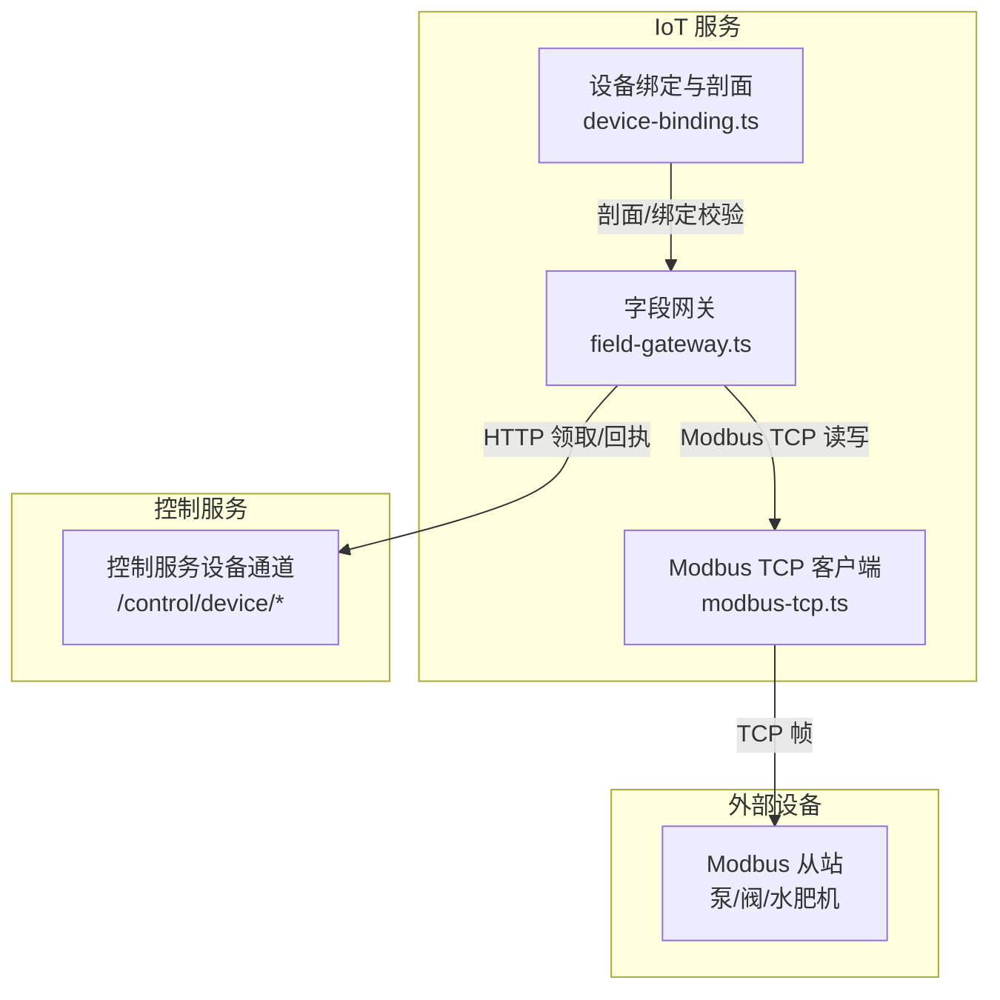
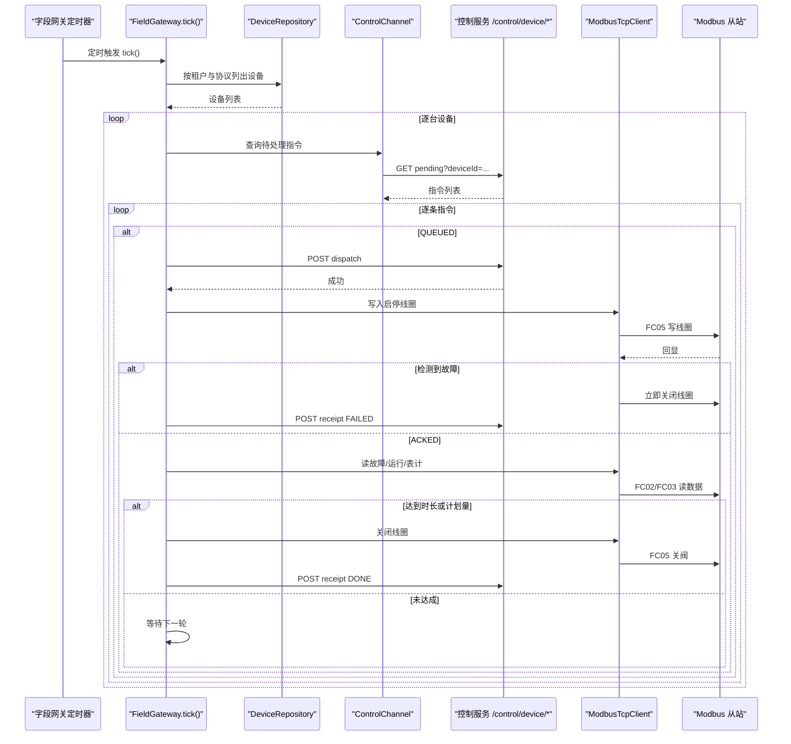
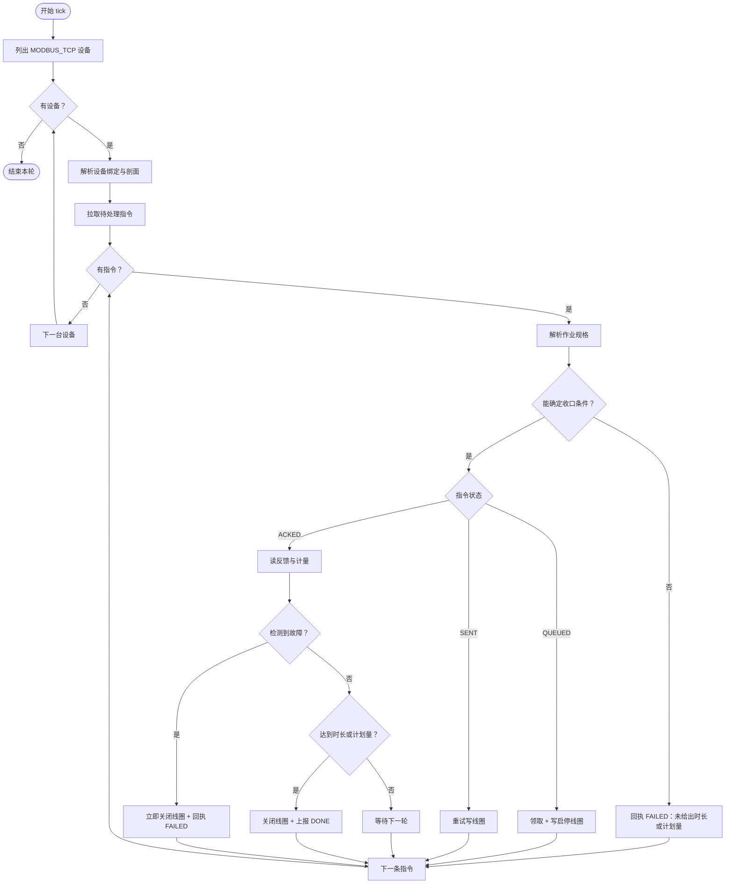
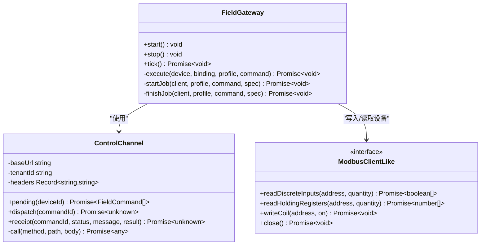
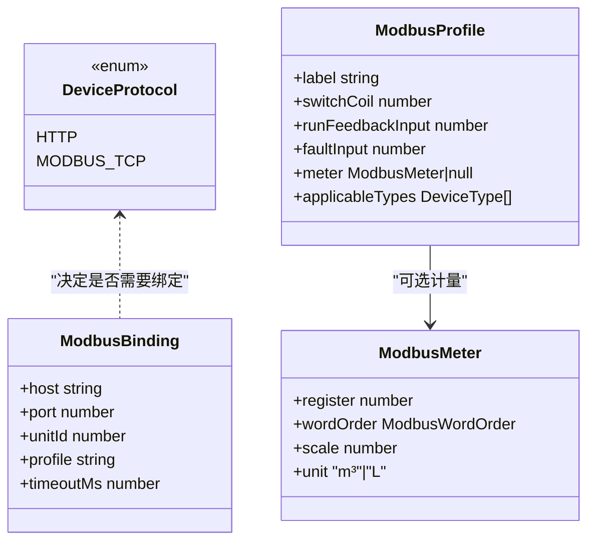
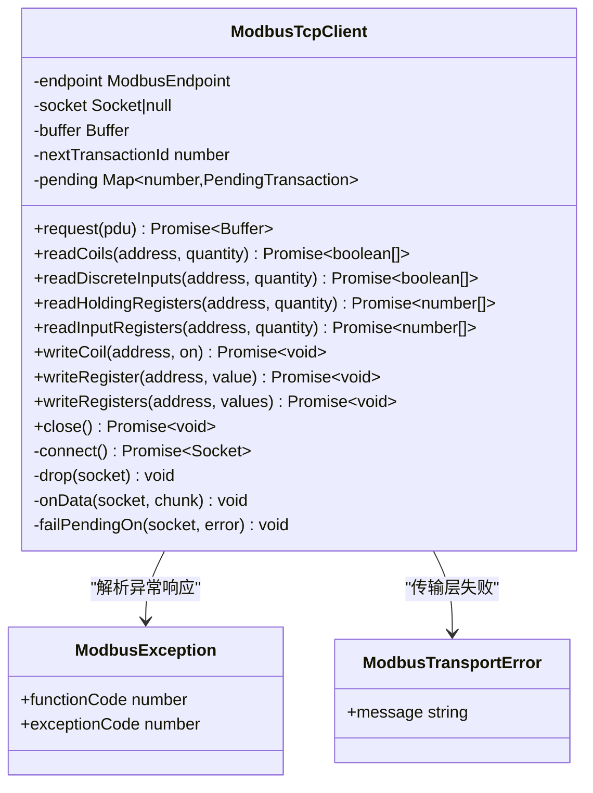
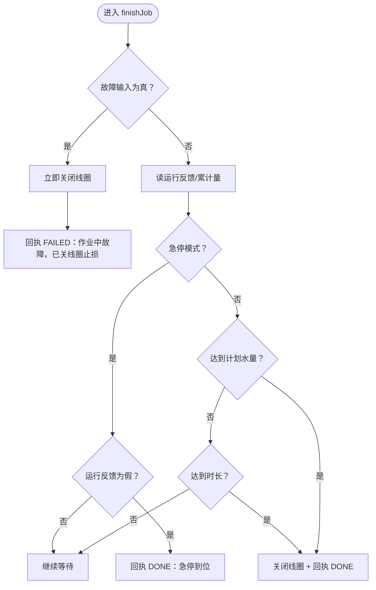
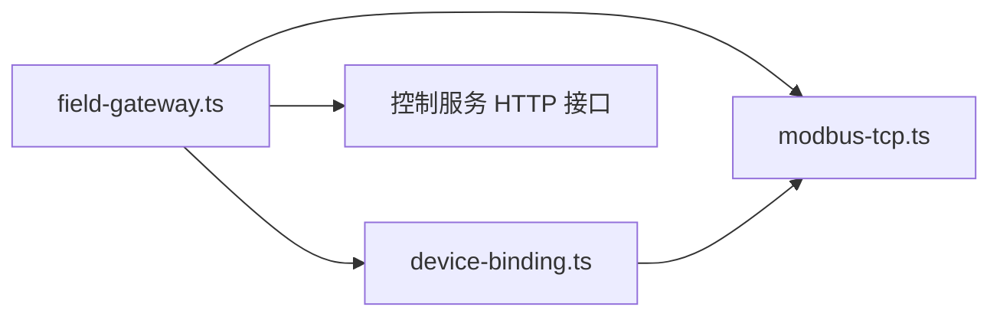

# 字段网关系统

<cite>
**本文引用的文件**   
- [README.md](file://README.md)
- [field-gateway.ts](file://apps/iot-service/src/field-gateway.ts)
- [device-binding.ts](file://apps/iot-service/src/device-binding.ts)
- [modbus-tcp.ts](file://apps/iot-service/src/modbus-tcp.ts)
- [http.ts](file://apps/gateway-service/src/http.ts)
- [field-gateway.spec.ts](file://apps/iot-service/test/field-gateway.spec.ts)
</cite>

## 更新摘要
**已进行的更改**   
- 更新了故障输入处理机制，确保阀门在检测到故障时自动关闭线圈，防止阀门卡在开启位置
- 增强了作业中故障的止损保护逻辑
- 完善了故障处理的测试用例和错误消息

## 目录
1. [引言](#引言)
2. [项目结构](#项目结构)
3. [核心组件](#核心组件)
4. [架构总览](#架构总览)
5. [详细组件分析](#详细组件分析)
6. [依赖关系分析](#依赖关系分析)
7. [性能与可靠性](#性能与可靠性)
8. [故障排查指南](#故障排查指南)
9. [结论](#结论)

## 引言
本文件聚焦"字段网关系统"，即物联网服务中负责把平台控制指令落到现场 Modbus TCP 执行机构的子系统。它解决的核心问题是：平台原本只支持设备主动回调，而泵、阀、水肥机等从站不会主动说话；因此需要由平台侧主动轮询、下发线圈、读取反馈与计量值，并复用既有控制指令状态机与回执通道，保证人工回填、超时收口、结单事件等下游逻辑无需为现场协议改动口径。

**重要更新**：系统现已增强故障输入处理机制，确保在检测到故障时立即关闭线圈，防止阀门因故障而卡在开启位置，提升现场设备的安全性。

## 项目结构
字段网关系统位于 `apps/iot-service`，主要涉及三个文件：
- `field-gateway.ts`：字段网关主流程，负责轮询、领取指令、写线圈、读反馈与计量、上报回执。
- `device-binding.ts`：设备接入绑定与 Modbus 剖面定义，提供协议校验、默认值、前端目录与解析器。
- `modbus-tcp.ts`：Modbus TCP 客户端实现，封装 MBAP/PDU 编解码、长连接、事务、异常与错误类型。

此外，网关服务 `apps/gateway-service/src/http.ts` 作为统一 HTTP 入口，将 `/api/v1/control` 转发到控制服务，字段网关通过该内部接口完成指令领取与回执。

**图表来源**
- [field-gateway.ts:1-380](file://apps/iot-service/src/field-gateway.ts#L1-L380)
- [device-binding.ts:1-213](file://apps/iot-service/src/device-binding.ts#L1-L213)
- [modbus-tcp.ts:1-433](file://apps/iot-service/src/modbus-tcp.ts#L1-L433)
- [http.ts:22-41](file://apps/gateway-service/src/http.ts#L22-L41)

**章节来源**
- [README.md:182-191](file://README.md#L182-L191)

## 核心组件
- 字段网关进程：按固定周期轮询控制服务的待处理指令，逐台设备推进状态。
- 控制通道：对控制服务的最小 HTTP 客户端，仅使用"查询待处理""领取""回执"三个端点。
- 作业规格解析：从指令参数推导时长上限、计划作业量或急停模式，无法推导则拒绝动硬件。
- Modbus 剖面：把启停线圈、运行反馈、故障输入、累计计量寄存器抽象成可配置剖面。
- Modbus TCP 客户端：封装 MBAP/PDU 编解码、长连接、事务标识、超时、断线重连与异常响应。
- **增强的故障保护**：在检测到故障输入时立即关闭线圈，防止设备处于危险状态。

**章节来源**
- [field-gateway.ts:7-25](file://apps/iot-service/src/field-gateway.ts#L7-L25)
- [field-gateway.ts:103-146](file://apps/iot-service/src/field-gateway.ts#L103-L146)
- [field-gateway.ts:148-166](file://apps/iot-service/src/field-gateway.ts#L148-L166)
- [device-binding.ts:4-14](file://apps/iot-service/src/device-binding.ts#L4-L14)
- [modbus-tcp.ts:3-17](file://apps/iot-service/src/modbus-tcp.ts#L3-L17)

## 架构总览
字段网关不是独立对外 API，而是 IoT 服务内的后台调度组件；它与控制服务通过 HTTP 协作，与现场设备通过 Modbus TCP 协作。

**图表来源**
- [field-gateway.ts:198-257](file://apps/iot-service/src/field-gateway.ts#L198-L257)
- [field-gateway.ts:259-342](file://apps/iot-service/src/field-gateway.ts#L259-L342)
- [field-gateway.ts:103-146](file://apps/iot-service/src/field-gateway.ts#L103-L146)
- [modbus-tcp.ts:289-346](file://apps/iot-service/src/modbus-tcp.ts#L289-L346)

## 详细组件分析

### 字段网关主流程
字段网关以 `FieldGateway` 为核心，构造时注入设备仓储、租户、控制服务地址、设备令牌、轮询间隔、测试注入点与错误回调；启动后按间隔执行 `tick()`，每轮最多让每条指令前进一步，避免既写线圈又立刻结单。

关键行为：
- 按租户与协议筛选设备，只处理 `MODBUS_TCP` 设备。
- 对每条指令先解析作业规格；若无法确定时长或计划量，直接失败，不进入硬件链路。
- `QUEUED` 阶段调用控制服务领取，再写入启停线圈并记录作业起点与基线计数。
- `SENT` 阶段允许重复写线圈，应对掉线或从站忙。
- `ACKED` 阶段读故障、运行反馈与累计量，满足条件后关闭线圈并上报 `DONE`。
- **增强的故障保护**：在任何阶段检测到故障输入时，立即关闭线圈并上报失败，防止设备处于危险状态。
- 急停模式只看运行反馈是否消失，并要求结果带确认标志。

**图表来源**
- [field-gateway.ts:227-281](file://apps/iot-service/src/field-gateway.ts#L227-L281)
- [field-gateway.ts:283-342](file://apps/iot-service/src/field-gateway.ts#L283-L342)
- [field-gateway.ts:148-166](file://apps/iot-service/src/field-gateway.ts#L148-L166)

**章节来源**
- [field-gateway.ts:168-216](file://apps/iot-service/src/field-gateway.ts#L168-L216)
- [field-gateway.ts:227-281](file://apps/iot-service/src/field-gateway.ts#L227-L281)
- [field-gateway.ts:283-342](file://apps/iot-service/src/field-gateway.ts#L283-L342)

### 控制通道与指令状态机
字段网关通过 `ControlChannel` 访问控制服务的设备通道，只使用三个最小能力：
- 查询待处理指令：`GET /api/v1/control/device/pending`
- 领取指令：`POST /api/v1/control/device/dispatch`
- 回执：`POST /api/v1/control/device/receipt`

通道在请求头中携带租户 ID 与可选设备令牌，并对非 `OK` 响应抛出错误。字段网关本身不维护完整指令模型，只依赖控制服务返回的字段形状。

**图表来源**
- [field-gateway.ts:103-146](file://apps/iot-service/src/field-gateway.ts#L103-L146)
- [field-gateway.ts:168-216](file://apps/iot-service/src/field-gateway.ts#L168-L216)
- [field-gateway.ts:259-342](file://apps/iot-service/src/field-gateway.ts#L259-L342)

**章节来源**
- [field-gateway.ts:103-146](file://apps/iot-service/src/field-gateway.ts#L103-L146)
- [http.ts:76-100](file://apps/gateway-service/src/http.ts#L76-L100)

### 设备绑定与 Modbus 剖面
设备绑定模块定义了两种接入协议：
- `HTTP`：设备主动回调，不需要现场绑定。
- `MODBUS_TCP`：平台主动轮询，必须提供主机、端口、单元标识、超时与剖面。

剖面把硬件点位抽象为：
- 启停线圈地址
- 运行反馈离散输入地址
- 故障输入离散输入地址
- 累计计量寄存器（可选）
- 适用设备类型白名单

前端通过 `fieldAccessCatalogue` 获取协议、剖面与缺省值，避免界面与服务端各自维护一套地址常量。

**图表来源**
- [device-binding.ts:16-32](file://apps/iot-service/src/device-binding.ts#L16-L32)
- [device-binding.ts:41-68](file://apps/iot-service/src/device-binding.ts#L41-L68)
- [device-binding.ts:76-101](file://apps/iot-service/src/device-binding.ts#L76-L101)
- [device-binding.ts:155-162](file://apps/iot-service/src/device-binding.ts#L155-L162)

**章节来源**
- [device-binding.ts:4-14](file://apps/iot-service/src/device-binding.ts#L4-L14)
- [device-binding.ts:30-32](file://apps/iot-service/src/device-binding.ts#L30-L32)
- [device-binding.ts:76-101](file://apps/iot-service/src/device-binding.ts#L76-L101)
- [device-binding.ts:130-145](file://apps/iot-service/src/device-binding.ts#L130-L145)
- [device-binding.ts:171-212](file://apps/iot-service/src/device-binding.ts#L171-L212)

### Modbus TCP 客户端
`ModbusTcpClient` 实现 Modbus TCP 主站一侧：
- 构建 MBAP 头与 PDU，支持位读写、寄存器读写、单线圈写、多寄存器写。
- 使用长连接，每个 endpoint 一条 Socket。
- 事务标识递增复用，待决事务映射到具体 socket，避免旧连接断开误伤新连接。
- 连接超时、事务超时、异常响应、粘包拆包均有处理。
- 提供 `close()` 清理待决事务与底层 socket。

**图表来源**
- [modbus-tcp.ts:268-433](file://apps/iot-service/src/modbus-tcp.ts#L268-L433)
- [modbus-tcp.ts:45-72](file://apps/iot-service/src/modbus-tcp.ts#L45-L72)

**章节来源**
- [modbus-tcp.ts:3-17](file://apps/iot-service/src/modbus-tcp.ts#L3-L17)
- [modbus-tcp.ts:115-153](file://apps/iot-service/src/modbus-tcp.ts#L115-L153)
- [modbus-tcp.ts:155-258](file://apps/iot-service/src/modbus-tcp.ts#L155-L258)
- [modbus-tcp.ts:268-433](file://apps/iot-service/src/modbus-tcp.ts#L268-L433)

### 作业计量与收口策略
字段网关对作业量的处理遵循"权威数值优先、不猜硬件动作"的原则：
- 急停只看运行反馈消失，并要求 `confirmed=true`。
- 普通作业可基于计划水量或时长收口。
- 有累计寄存器时，先读基线，再读最终值，差值换算为业务单位。
- 没有基线时不报用量，避免把出厂累计值当成本次作业量。
- 关阀后再读一次表，排除管路余量影响。

**新增故障保护机制**：
- 在接单后立即检查故障输入，如果检测到故障，立即关闭线圈并报告失败。
- 在作业过程中持续监控故障输入，一旦检测到故障，立即关闭线圈并报告失败。
- 所有故障处理都包含"止损"信息，明确指示已采取安全措施。

**图表来源**
- [field-gateway.ts:301-342](file://apps/iot-service/src/field-gateway.ts#L301-L342)
- [field-gateway.ts:349-362](file://apps/iot-service/src/field-gateway.ts#L349-L362)

**章节来源**
- [field-gateway.ts:301-342](file://apps/iot-service/src/field-gateway.ts#L301-L342)
- [field-gateway.ts:349-362](file://apps/iot-service/src/field-gateway.ts#L349-L362)

## 依赖关系分析
字段网关系统的依赖方向清晰且单向：
- `field-gateway.ts` 依赖 `device-binding.ts` 获取剖面与绑定解析，依赖 `modbus-tcp.ts` 进行 Modbus 通信，并通过 HTTP 访问控制服务。
- `device-binding.ts` 依赖 `modbus-tcp.ts` 中的默认端口与超时常量。
- `modbus-tcp.ts` 是底层协议实现，不反向依赖上层业务。

**图表来源**
- [field-gateway.ts:1-6](file://apps/iot-service/src/field-gateway.ts#L1-L6)
- [device-binding.ts:1-3](file://apps/iot-service/src/device-binding.ts#L1-L3)

**章节来源**
- [field-gateway.ts:1-6](file://apps/iot-service/src/field-gateway.ts#L1-L6)
- [device-binding.ts:1-3](file://apps/iot-service/src/device-binding.ts#L1-L3)

## 性能与可靠性
- 轮询间隔默认 5 秒，适合阀门级动作节奏，既能跟上状态变化，又避免频繁询问从站。
- 单轮内每条指令最多前进一步，防止并发推进导致重复写线圈或提前结单。
- Modbus 客户端使用长连接与事务标识，减少握手开销；连接断开或超时会丢弃并重连。
- 设备台账问题只影响当前设备，不影响整轮其他设备。
- 作业计量采用基线差值，避免重启后丢失内存状态导致用量失真。
- 控制服务侧已有超时收口与幂等机制，字段网关的回执与之共用同一状态机，降低双轨风险。
- **增强的安全性**：故障输入检测在所有关键路径上都会触发线圈关闭，确保设备不会因为故障而保持在危险状态。

## 故障排查指南
常见故障与定位要点：
- 指令停留在 `QUEUED`：检查字段网关是否启动、轮询间隔是否正常、控制服务地址与设备令牌是否正确。
- 指令进入 `FAILED` 且提示未给出时长或计划量：检查入队参数是否包含 `durationMin` 或 `plan.totalDurationMin`/`plan.totalWaterVolume`。
- 线圈写入后无反馈：检查 Modbus 剖面地址是否与设备手册一致，尤其是启停线圈、故障输入与运行反馈。
- 计量值为零或异常：检查累计寄存器地址、字序、倍率与单位；确认网关是否在写入前读到基线。
- 连接超时或断线：检查设备 IP、端口、防火墙、单元标识与超时配置；观察 `ModbusTransportError` 日志。
- 急停未结单：确认运行反馈输入是否真正消失，以及回执结果是否带 `confirmed=true`。
- **故障输入相关**：如果看到"已关线圈止损"的消息，说明设备检测到故障输入，系统已自动关闭线圈以防止设备处于危险状态。检查设备的故障输入信号和设备本身的故障状态。

**章节来源**
- [field-gateway.ts:148-166](file://apps/iot-service/src/field-gateway.ts#L148-L166)
- [field-gateway.ts:259-342](file://apps/iot-service/src/field-gateway.ts#L259-L342)
- [modbus-tcp.ts:45-72](file://apps/iot-service/src/modbus-tcp.ts#L45-L72)
- [modbus-tcp.ts:289-346](file://apps/iot-service/src/modbus-tcp.ts#L289-L346)
- [field-gateway.spec.ts:297-323](file://apps/iot-service/test/field-gateway.spec.ts#L297-L323)

## 结论
字段网关系统通过"控制服务 HTTP 通道 + Modbus TCP 主站 + 设备剖面绑定"的组合，把平台控制指令安全落地到现场执行机构。它复用既有指令状态机与回执语义，避免为现场协议引入第二套真相；同时通过严格的参数校验、作业规格推导、**增强的故障保护**与计量基线策略，确保硬件操作可预测、可审计、可回溯。

**关键改进**：最新的故障输入处理机制确保在检测到任何故障时立即关闭线圈，防止阀门因故障而卡在开启位置，显著提升了现场设备的安全性和可靠性。对于新增设备类型，应优先扩展剖面与绑定校验，而不是在业务代码中散落地址常量。