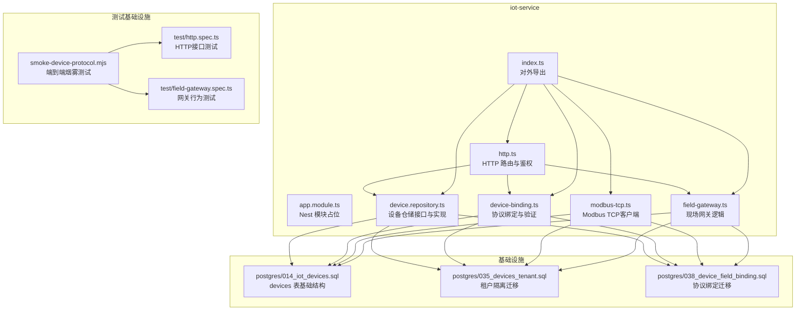
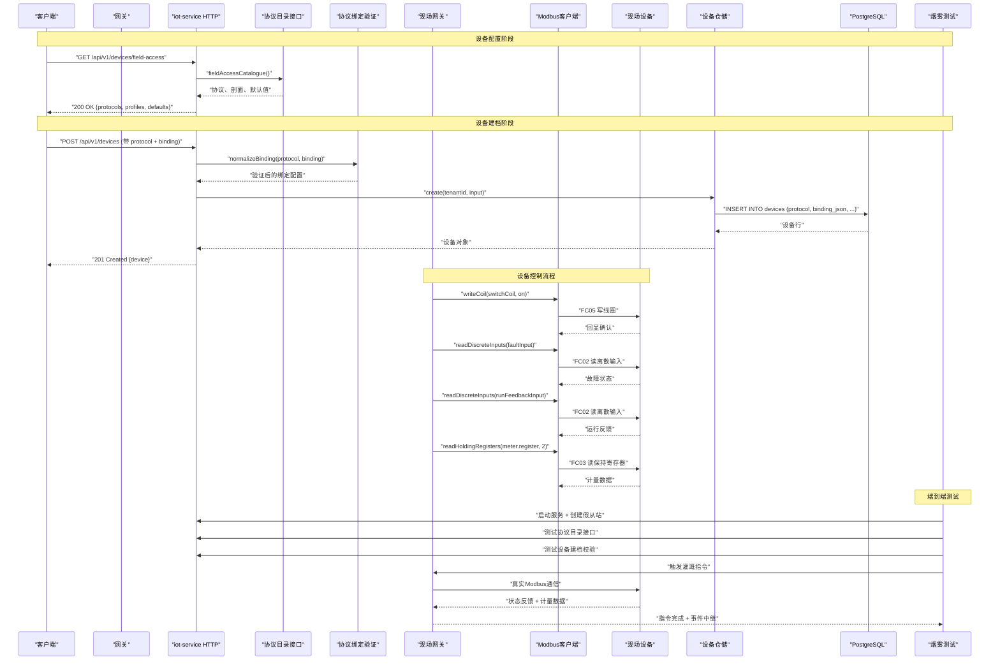
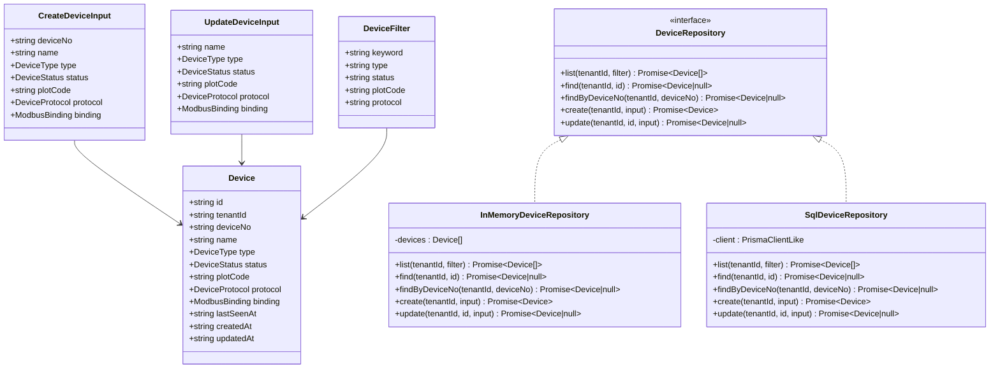
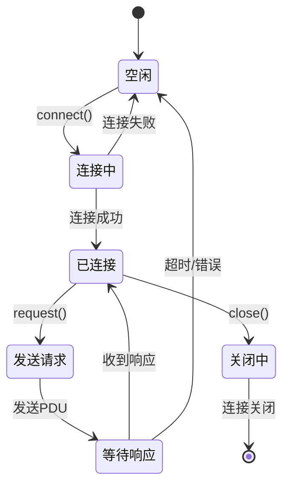
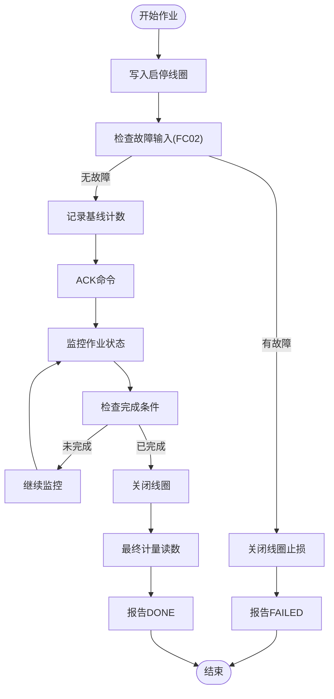
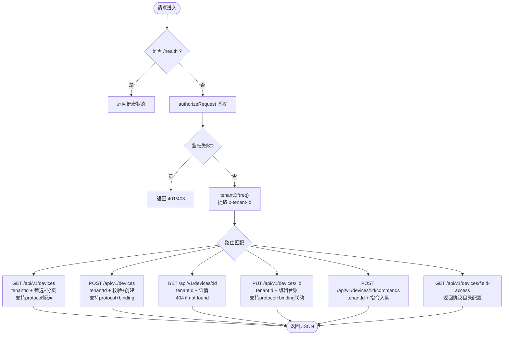
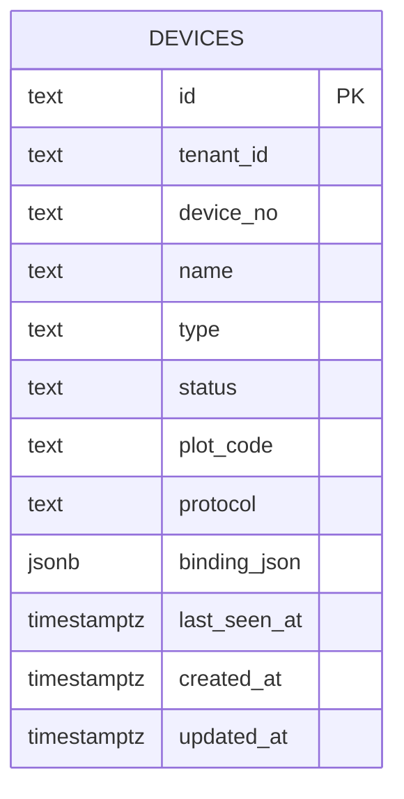
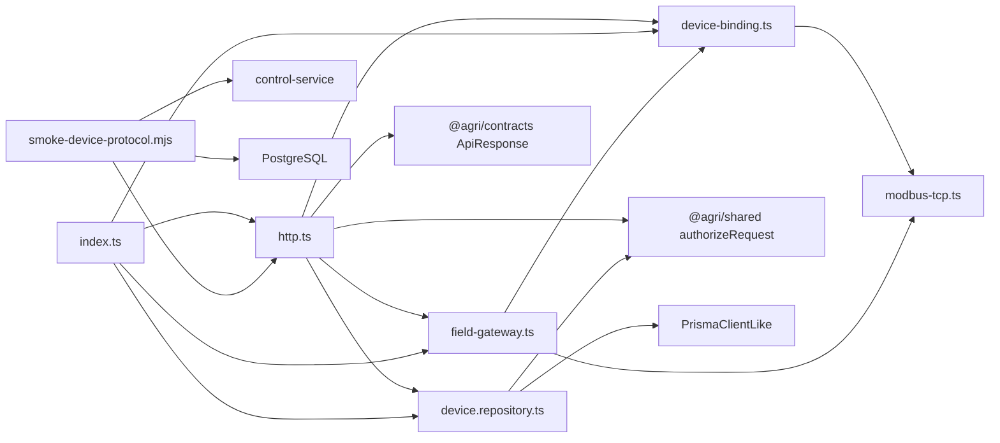

# 物联网设备管理

<cite>
**本文引用的文件**   
- [README.md](file://README.md)
- [iot-service/app.module.ts](file://apps/iot-service/src/app.module.ts)
- [iot-service/device.repository.ts](file://apps/iot-service/src/device.repository.ts)
- [iot-service/http.ts](file://apps/iot-service/src/http.ts)
- [iot-service/index.ts](file://apps/iot-service/src/index.ts)
- [iot-service/device-binding.ts](file://apps/iot-service/src/device-binding.ts)
- [iot-service/modbus-tcp.ts](file://apps/iot-service/src/modbus-tcp.ts)
- [iot-service/field-gateway.ts](file://apps/iot-service/src/field-gateway.ts)
- [iot-service/test/http.spec.ts](file://apps/iot-service/test/http.spec.ts)
- [postgres/014_iot_devices.sql](file://infra/postgres/migrations/014_iot_devices.sql)
- [postgres/035_devices_tenant.sql](file://infra/postgres/migrations/035_devices_tenant.sql)
- [postgres/038_device_field_binding.sql](file://infra/postgres/migrations/038_device_field_binding.sql)
- [scripts/smoke-device-protocol.mjs](file://scripts/smoke-device-protocol.mjs)
</cite>

## 更新摘要
**变更内容**   
- 新增了完整的现场设备接入系统，支持HTTP回调和MODBUS_TCP两种接入协议
- 引入了动态配置接口 `/api/v1/devices/field-access`，提供协议目录、剖面配置和默认值
- 增强了Modbus协议实现，支持FC02反馈和FC03计量数据读取功能
- 重构了Modbus配置系统，正确分离线圈地址和离散输入地址
- 新增了端到端烟雾测试基础设施，验证整个设备控制链路
- 完善了作业执行流程，支持准确的计量数据采集和设备状态确认

## 目录
1. [引言](#引言)
2. [项目结构](#项目结构)
3. [核心组件](#核心组件)
4. [架构总览](#架构总览)
5. [详细组件分析](#详细组件分析)
6. [依赖关系分析](#依赖关系分析)
7. [性能与扩展性](#性能与扩展性)
8. [故障排查指南](#故障排查指南)
9. [结论](#结论)

## 引言
本文件聚焦"物联网设备管理"能力，围绕 iot-service 提供的设备台账、查询筛选、新增编辑、控制指令入队等 HTTP 接口展开。该服务以 Node.js 原生 http 实现路由，通过仓储抽象同时支持内存与 SQL 两种数据后端；数据库层由迁移脚本维护 devices 表，并注入演示设备，保证既有设备 id 与其他业务（遥测、控制、视频）稳定关联。

**重要更新**：系统现已引入完整的租户隔离机制，所有设备操作都通过 `tenantId` 参数进行租户级隔离，确保不同租户之间的设备数据完全隔离，防止跨租户的数据访问和混淆。**重大增强**：系统新增了完整的现场设备接入系统，支持HTTP回调和MODBUS_TCP两种接入协议，以及动态配置接口和设备现场接入绑定功能，显著增强了系统的灵活性和可扩展性。**最新改进**：重构了Modbus配置系统，正确分离了线圈地址和离散输入地址，支持FC02反馈和FC03计量数据读取，提升了设备控制的准确性和可靠性。**新增功能**：提供了端到端的烟雾测试基础设施，验证整个设备控制链路的完整性和稳定性。

## 项目结构
iot-service 是平台中负责设备台账与设备侧控制的微服务之一，位于 apps/iot-service。其对外暴露的入口包括：
- Nest 模块占位：用于装配与生命周期托管。
- HTTP 服务器工厂：创建监听器、处理鉴权、解析请求、调用仓储。
- 设备仓储接口与实现：统一设备增删改查与筛选语义，支持租户隔离。
- 设备协议绑定模块：定义协议类型、验证逻辑和绑定配置。
- Modbus TCP客户端：实现底层Modbus协议通信，支持多种功能码操作。
- 现场网关：处理设备控制逻辑，协调设备状态监控和作业执行。
- 数据库迁移：定义设备表结构与演示数据，包含租户字段和协议绑定字段。
- 烟雾测试脚本：端到端验证设备协议和控制链路。



图表来源
- [iot-service/app.module.ts:1-2](file://apps/iot-service/src/app.module.ts#L1-L2)
- [iot-service/http.ts:39-137](file://apps/iot-service/src/http.ts#L39-L137)
- [iot-service/device.repository.ts:78-320](file://apps/iot-service/src/device.repository.ts#L78-L320)
- [iot-service/device-binding.ts:1-213](file://apps/iot-service/src/device-binding.ts#L1-L213)
- [iot-service/modbus-tcp.ts:1-433](file://apps/iot-service/src/modbus-tcp.ts#L1-L433)
- [iot-service/field-gateway.ts:280-380](file://apps/iot-service/src/field-gateway.ts#L280-L380)
- [scripts/smoke-device-protocol.mjs:1-545](file://scripts/smoke-device-protocol.mjs#L1-L545)
- [postgres/014_iot_devices.sql:16-49](file://infra/postgres/migrations/014_iot_devices.sql#L16-L49)
- [postgres/035_devices_tenant.sql:16-33](file://infra/postgres/migrations/035_devices_tenant.sql#L16-L33)
- [postgres/038_device_field_binding.sql:18-36](file://infra/postgres/migrations/038_device_field_binding.sql#L18-L36)

章节来源
- [README.md:159-190](file://README.md#L159-L190)
- [iot-service/index.ts:1-4](file://apps/iot-service/src/index.ts#L1-L4)

## 核心组件
- 设备仓储接口与实现
  - 定义设备领域模型、枚举常量、筛选条件与仓储方法。
  - 提供 InMemoryDeviceRepository 与 SqlDeviceRepository 两套实现，保证测试与生产一致性。
  - **新增**：所有仓储方法现在都需要 `tenantId` 参数，实现严格的租户隔离。
  - **新增**：支持协议和绑定字段的CRUD操作。
- HTTP 服务
  - 健康检查、设备列表分页、新增设备、按 id 查询、编辑台账、下发控制指令。
  - 内置网关级权限校验，使用统一的 ApiResponse 响应信封。
  - **新增**：从请求头 `x-tenant-id` 获取租户信息，忽略请求体中的 tenantId。
  - **新增**：支持协议和绑定的创建、更新和筛选。
  - **新增**：提供 `/api/v1/devices/field-access` 动态配置接口。
  - **改进**：对不存在的设备返回正确的404状态码，提升API健壮性。
- 设备协议绑定模块
  - 定义设备协议类型（HTTP、MODBUS_TCP）、Modbus绑定配置和验证逻辑。
  - 提供协议验证、绑定归一化和剖面匹配功能。
  - **新增**：支持多种Modbus剖面类型，包括启停型、灌溉计量、水肥计量等。
  - **增强**：重构了Modbus配置，正确分离switchCoil、runFeedbackInput和faultInput地址。
  - **新增**：提供 `fieldAccessCatalogue()` 函数，输出协议目录、剖面配置和默认值。
- Modbus TCP客户端
  - 实现完整的Modbus TCP协议栈，支持多种功能码操作。
  - **新增**：明确区分ReadCoils(FC01)、ReadDiscreteInputs(FC02)、ReadHoldingRegisters(FC03)等功能码。
  - **增强**：支持32位寄存器组合和字序处理。
  - **改进**：完善的异常处理和连接管理。
- 现场网关
  - 处理设备控制逻辑，协调设备状态监控和作业执行。
  - **增强**：使用独立的离散输入地址进行运行反馈和故障检测。
  - **改进**：支持准确的计量数据采集和设备状态确认。
  - **优化**：改进了作业执行流程，确保设备状态的正确判断。
- 数据库迁移
  - 定义 devices 表结构、索引与演示数据，确保设备 id 与历史数据一致。
  - **新增**：租户隔离迁移，添加 `tenant_id` 字段并调整唯一约束。
  - **新增**：协议绑定迁移，添加 `protocol` 和 `binding_json` 字段及约束。
- 烟雾测试基础设施
  - **新增**：端到端测试脚本，验证设备协议、建档校验、网关控制和事件中继。
  - **新增**：模拟Modbus从站，测试真实的TCP通信和协议交互。
  - **新增**：覆盖完整的设备控制流程，从指令下发到状态回写。

章节来源
- [iot-service/device.repository.ts:4-86](file://apps/iot-service/src/device.repository.ts#L4-L86)
- [iot-service/http.ts:10-15](file://apps/iot-service/src/http.ts#L10-L15)
- [iot-service/device-binding.ts:1-213](file://apps/iot-service/src/device-binding.ts#L1-L213)
- [iot-service/modbus-tcp.ts:1-433](file://apps/iot-service/src/modbus-tcp.ts#L1-L433)
- [iot-service/field-gateway.ts:280-380](file://apps/iot-service/src/field-gateway.ts#L280-L380)
- [scripts/smoke-device-protocol.mjs:1-545](file://scripts/smoke-device-protocol.mjs#L1-L545)
- [postgres/014_iot_devices.sql:1-14](file://infra/postgres/migrations/014_iot_devices.sql#L1-L14)
- [postgres/035_devices_tenant.sql:1-15](file://infra/postgres/migrations/035_devices_tenant.sql#L1-L15)
- [postgres/038_device_field_binding.sql:1-36](file://infra/postgres/migrations/038_device_field_binding.sql#L1-L36)

## 架构总览
iot-service 采用"仓储 + HTTP 控制器"的轻量分层，现已全面支持租户隔离、设备协议绑定和现场设备接入：
- 控制器层：解析请求、鉴权、参数校验、调用仓储。
- 仓储层：屏蔽内存与 SQL 差异，向上暴露一致的领域操作，强制租户隔离。
- 协议绑定层：处理设备协议验证、绑定配置和Modbus剖面匹配。
- Modbus协议层：实现底层TCP通信，支持多种功能码操作。
- 现场网关层：协调设备控制逻辑，处理作业执行和状态监控。
- 持久化层：PostgreSQL devices 表，含类型与状态约束、地块索引、演示数据、租户字段和协议绑定字段。
- 测试层：单元测试和端到端烟雾测试，确保功能完整性。



图表来源
- [iot-service/http.ts:42-137](file://apps/iot-service/src/http.ts#L42-L137)
- [iot-service/device-binding.ts:117-152](file://apps/iot-service/src/device-binding.ts#L117-L152)
- [iot-service/field-gateway.ts:284-342](file://apps/iot-service/src/field-gateway.ts#L284-L342)
- [iot-service/modbus-tcp.ts:314-328](file://apps/iot-service/src/modbus-tcp.ts#L314-L328)
- [iot-service/device.repository.ts:342-374](file://apps/iot-service/src/device.repository.ts#L342-L374)
- [scripts/smoke-device-protocol.mjs:300-545](file://scripts/smoke-device-protocol.mjs#L300-L545)
- [postgres/038_device_field_binding.sql:18-36](file://infra/postgres/migrations/038_device_field_binding.sql#L18-L36)

## 详细组件分析

### 设备仓储与领域模型
- 领域模型
  - Device：设备主键、**新增** `tenantId` 归属租户、出厂编号、名称、类型、状态、绑定地块、**新增** `protocol` 接入协议、**新增** `binding` 现场接入绑定、最后上报时间、创建与更新时间。
  - CreateDeviceInput / UpdateDeviceInput：新增与编辑入参，强调不直接修改 lastSeenAt，避免手工"点亮"离线设备。**新增**：支持 protocol 和 binding 字段。
  - DeviceFilter：关键词、类型、状态、地块编码、**新增** protocol 筛选。
- 枚举与常量
  - DEVICE_TYPES：气象站、墒情传感器、综合监测站、遥感节点、虫情灯、施肥阀、灌溉阀、灌溉泵、植保无人机、无人驾驶拖拉机。
  - DEVICE_STATUSES：ONLINE、OFFLINE。
  - **新增**：DEFAULT_TENANT 默认演示租户标识。
- 内存仓储
  - 基于数组过滤与排序，默认种子为 demoDevices()，与数据库演示数据对齐。
  - **新增**：所有查询都按 `tenantId` 过滤，确保租户间数据隔离。
  - **新增**：支持协议和绑定字段的CRUD操作。
- SQL 仓储
  - 使用 $queryRawUnsafe 执行 SQL，字段映射统一转换为 ISO 时间字符串。
  - 列表查询动态拼接 WHERE 条件并按 device_no 排序，**新增** 强制 `tenant_id` 过滤。
  - 更新逻辑复用 mergeDevice，保持省略字段不变、空串解绑地块的语义一致。
  - **新增**：支持 protocol 和 binding_json 字段的读写操作。
  - **改进**：所有SQL查询都使用参数化查询，防止SQL注入攻击。



图表来源
- [iot-service/device.repository.ts:31-86](file://apps/iot-service/src/device.repository.ts#L31-L86)
- [iot-service/device.repository.ts:147-190](file://apps/iot-service/src/device.repository.ts#L147-L190)
- [iot-service/device.repository.ts:211-320](file://apps/iot-service/src/device.repository.ts#L211-L320)

章节来源
- [iot-service/device.repository.ts:4-86](file://apps/iot-service/src/device.repository.ts#L4-L86)
- [iot-service/device.repository.ts:107-145](file://apps/iot-service/src/device.repository.ts#L107-L145)
- [iot-service/device.repository.ts:192-207](file://apps/iot-service/src/device.repository.ts#L192-L207)

### 设备协议绑定模块
- 协议类型定义
  - DEVICE_PROTOCOLS：HTTP、MODBUS_TCP两种接入协议。
  - DEFAULT_DEVICE_PROTOCOL：默认使用HTTP回调协议。
  - Modbus相关常量：端口、超时、单元标识、字序等配置。
- Modbus绑定配置
  - ModbusMeter：累计量寄存器配置，包括地址、倍率、单位。
  - ModbusProfile：设备剖面定义，包括开关线圈、运行反馈、故障输入、计量配置和适用设备类型。
  - MODBUS_PROFILES：预定义的剖面模板，包括SWITCH_ONLY、WATER_M3、FERTILIZER_L等。
  - **增强**：正确分离了switchCoil（FC05写线圈）、runFeedbackInput（FC02读离散输入）、faultInput（FC02读离散输入）地址。
- 绑定验证逻辑
  - parseModbusBinding：验证并归一化Modbus绑定配置。
  - normalizeBinding：根据协议类型处理绑定配置。
  - readModbusBinding：读取并验证已存储的绑定配置。
  - getModbusProfile：根据key获取对应的剖面配置。
- 动态配置接口
  - **新增**：fieldAccessCatalogue() 函数，输出协议目录、剖面配置和默认值。
  - **新增**：FieldAccessCatalogue 接口，定义前端可渲染的配置结构。
  - **新增**：协议可读标签和设备类型适配性检查。

```mermaid
flowchart TD
Start(["接收绑定配置"]) --> CheckType{"协议类型?"}
CheckType --> |HTTP| HttpCheck["检查是否无绑定"]
CheckType --> |MODBUS_TCP| ModbusCheck["验证Modbus绑定"]
HttpCheck --> HttpValid{"绑定为空?"}
HttpValid --> |是| ReturnNull["返回null"]
HttpValid --> |否| HttpError["抛出错误"]
ModbusCheck --> ValidateHost["验证host/port/unitId/profile"]
ValidateHost --> ValidateProfile["验证剖面与设备类型匹配"]
ValidateProfile --> Normalize["归一化配置"]
Normalize --> ReturnBinding["返回绑定对象"]
Note over Start,ReturnBinding: 动态配置流程
CatalogueStart(["fieldAccessCatalogue()"]) --> Protocols["生成协议列表"]
Protocols --> Profiles["生成剖面配置"]
Profiles --> Defaults["生成默认值"]
Defaults --> CatalogueEnd["返回完整目录"]
```

图表来源
- [iot-service/device-binding.ts:117-152](file://apps/iot-service/src/device-binding.ts#L117-L152)
- [iot-service/device-binding.ts:130-145](file://apps/iot-service/src/device-binding.ts#L130-L145)

章节来源
- [iot-service/device-binding.ts:1-213](file://apps/iot-service/src/device-binding.ts#L1-L213)

### Modbus TCP客户端
- 功能码支持
  - ReadCoils (FC01)：读线圈状态
  - ReadDiscreteInputs (FC02)：读离散输入状态
  - ReadHoldingRegisters (FC03)：读保持寄存器
  - ReadInputRegisters (FC04)：读输入寄存器
  - WriteSingleCoil (FC05)：写单个线圈
  - WriteSingleRegister (FC06)：写单个寄存器
  - WriteMultipleCoils (FC15)：写多个线圈
  - WriteMultipleRegisters (FC16)：写多个寄存器
- 数据传输
  - MBAP帧编解码：事务标识、协议标识、长度字段、单元标识
  - PDU数据处理：功能码和数据载荷
  - 字节序处理：大端序传输，支持高低字序配置
- 连接管理
  - 长连接复用：减少TCP握手开销
  - 自动重连：网络异常时自动恢复连接
  - 事务管理：并发请求的事务标识分配和响应匹配
- 异常处理
  - ModbusException：设备返回的异常响应
  - ModbusTransportError：传输层错误
  - 超时处理：连接和请求超时控制



图表来源
- [iot-service/modbus-tcp.ts:273-433](file://apps/iot-service/src/modbus-tcp.ts#L273-L433)

章节来源
- [iot-service/modbus-tcp.ts:1-433](file://apps/iot-service/src/modbus-tcp.ts#L1-L433)

### 现场网关
- 作业执行流程
  - startJob：写入启停线圈，检查故障输入，记录基线计数
  - finishJob：检查作业完成条件，关闭线圈，计算实际作业量
  - isFaulted：读取故障输入状态
  - readMeterCounts：读取累计量寄存器值
  - readMeterValue：计算作业期间的增量
- 设备状态监控
  - 使用FC02读离散输入进行故障检测
  - 使用FC02读离散输入进行运行反馈确认
  - 使用FC03读保持寄存器进行计量数据采集
- 安全保护机制
  - 故障时自动关闭线圈止损
  - 作业中故障检测和安全停机
  - 急停操作的到位确认



图表来源
- [iot-service/field-gateway.ts:284-342](file://apps/iot-service/src/field-gateway.ts#L284-L342)

章节来源
- [iot-service/field-gateway.ts:280-380](file://apps/iot-service/src/field-gateway.ts#L280-L380)

### HTTP 接口与流程
- 健康检查
  - GET /health：返回服务名与健康状态。
- 设备列表
  - GET /api/v1/devices：支持 keyword、type、status、plotCode、**新增** protocol 筛选；page、size 分页；返回 items、total、page、size、pages。
  - **新增**：从请求头 `x-tenant-id` 获取租户信息，只返回该租户的设备。
- 新增设备
  - POST /api/v1/devices：校验必填、枚举、唯一编号；未上报设备 lastSeenAt 为 null。
  - **新增**：支持 protocol 和 binding 字段，自动验证绑定配置。
  - **新增**：设备编号在租户内唯一，跨租户可重复。
- 设备详情
  - GET /api/v1/devices/:id：不存在返回 404。
  - **改进**：对不存在的设备返回正确的404状态码，而不是200 + null。
  - **新增**：跨租户的 id 一律当作不存在。
- 编辑台账
  - PUT /api/v1/devices/:id：仅允许编辑 name、type、status、plotCode、**新增** protocol、binding；空对象拒绝；空串表示解绑地块。
  - **新增**：只能编辑属于当前租户的设备。
  - **新增**：协议和绑定字段联动更新，保持协议与绑定的配套关系。
- 下发控制指令
  - POST /api/v1/devices/:id/commands：校验设备存在；返回 202 与命令入队信息。
  - **新增**：只接受当前租户内的在册设备。
- 动态配置接口
  - **新增**：GET /api/v1/devices/field-access：返回协议目录、剖面配置和默认值。
  - **新增**：提供前端可渲染的配置结构，包括协议选项、剖面类型和默认参数。



图表来源
- [iot-service/http.ts:42-137](file://apps/iot-service/src/http.ts#L42-L137)
- [iot-service/http.ts:114-117](file://apps/iot-service/src/http.ts#L114-L117)

章节来源
- [iot-service/http.ts:17-37](file://apps/iot-service/src/http.ts#L17-L37)
- [iot-service/http.ts:39-137](file://apps/iot-service/src/http.ts#L39-L137)

### 数据库表结构与演示数据
- 表结构
  - devices：主键 id、**新增** `tenant_id` 租户标识、唯一 device_no（现为租户内唯一）、name、type（CHECK）、status（CHECK）、plot_code（空串表示未绑定）、**新增** `protocol` 接入协议、**新增** `binding_json` 现场接入绑定、last_seen_at、created_at、updated_at。
  - 索引：按 `tenant_id, type` 复合索引、按 `tenant_id, plot_code` 复合索引（非空）、**新增** `idx_devices_field_protocol` 部分索引（仅针对非HTTP协议设备）。
- 约束
  - **新增**：`devices_protocol_check` 约束，限制protocol只能是'HTTP'或'MODBUS_TCP'。
  - **新增**：`devices_binding_check` 约束，确保HTTP协议设备无绑定，非HTTP协议设备必须有绑定。
- 演示数据
  - 注入 12 台设备，覆盖多种类型与状态，部分绑定地块，部分离线，last_seen_at 相对当前时间偏移，保证迁移可重复执行且不影响既有 id。
  - **新增**：所有演示设备都属于 `tenant-demo` 演示租户，且默认使用HTTP协议。



图表来源
- [postgres/014_iot_devices.sql:16-33](file://infra/postgres/migrations/014_iot_devices.sql#L16-L33)
- [postgres/035_devices_tenant.sql:16-33](file://infra/postgres/migrations/035_devices_tenant.sql#L16-L33)
- [postgres/038_device_field_binding.sql:18-36](file://infra/postgres/migrations/038_device_field_binding.sql#L18-L36)

章节来源
- [postgres/014_iot_devices.sql:1-14](file://infra/postgres/migrations/014_iot_devices.sql#L1-L14)
- [postgres/014_iot_devices.sql:34-49](file://infra/postgres/migrations/014_iot_devices.sql#L34-L49)
- [postgres/035_devices_tenant.sql:1-33](file://infra/postgres/migrations/035_devices_tenant.sql#L1-L33)
- [postgres/038_device_field_binding.sql:1-36](file://infra/postgres/migrations/038_device_field_binding.sql#L1-L36)

### 烟雾测试基础设施
- 端到端测试流程
  - **新增**：启动control-service和iot-service服务进程。
  - **新增**：创建模拟Modbus从站，响应真实的协议请求。
  - **新增**：测试协议目录接口的完整性和准确性。
  - **新增**：验证设备建档时的协议和绑定校验逻辑。
  - **新增**：测试现场设备的完整控制流程，从指令下发到状态回写。
  - **新增**：验证事件中继和数据库落库的完整性。
- 模拟从站功能
  - **新增**：实现最小化的Modbus从站，支持FC05写线圈、FC02读离散输入、FC03读保持寄存器。
  - **新增**：模拟设备状态变化，包括线圈状态、故障状态和累计计量。
  - **新增**：记录所有协议交互，便于测试断言和调试。
- 测试覆盖范围
  - **新增**：协议目录接口测试，验证协议选项、剖面配置和默认值。
  - **新增**：设备建档校验测试，包括缺失绑定、无效地址、剖面不匹配等场景。
  - **新增**：现场设备控制测试，包括正常灌溉、急停、故障处理等场景。
  - **新增**：回调式设备隔离测试，确保网关不会处理回调式设备。

```mermaid
flowchart TD
Start(["启动烟雾测试"]) --> InitServices["初始化服务进程"]
InitServices --> CreateSlave["创建模拟Modbus从站"]
CreateSlave --> TestCatalogue["测试协议目录接口"]
TestCatalogue --> TestValidation["测试设备建档校验"]
TestValidation --> TestControl["测试现场设备控制"]
TestControl --> TestEvents["测试事件中继"]
TestEvents --> Cleanup["清理测试数据"]
Cleanup --> End(["测试完成"])
Note over TestControl: 控制流程
TestControl --> Irrigation["灌溉指令测试"]
TestControl --> Estop["急停指令测试"]
TestControl --> Fault["故障处理测试"]
TestControl --> Callback["回调设备隔离测试"]
```

图表来源
- [scripts/smoke-device-protocol.mjs:300-545](file://scripts/smoke-device-protocol.mjs#L300-L545)

章节来源
- [scripts/smoke-device-protocol.mjs:1-545](file://scripts/smoke-device-protocol.mjs#L1-L545)

## 依赖关系分析
- 内部依赖
  - http.ts 依赖 device.repository.ts 的枚举、仓储接口与内存实现，以及 device-binding.ts 的协议验证逻辑。
  - index.ts 统一导出模块、仓储与类型，供外部装配或测试引用。
  - device-binding.ts 依赖 modbus-tcp.ts 的常量定义。
  - field-gateway.ts 依赖 modbus-tcp.ts 的客户端实现和 device-binding.ts 的剖面配置。
  - smoke-device-protocol.mjs 依赖 iot-service 的编译产物和数据库连接。
- 外部依赖
  - @agri/contracts：ApiResponse 响应信封。
  - @agri/shared：authorizeRequest 权限守卫、toIsoTimestamp 时间转换、ulid 标识生成。
- 数据依赖
  - SqlDeviceRepository 依赖 PrismaClientLike 进行原始 SQL 查询。
  - 所有 SQL 仓储的时间列经 toIsoTimestamp 转为 ISO 字符串，避免 pg 驱动 Date 序列化问题。



图表来源
- [iot-service/http.ts:1-8](file://apps/iot-service/src/http.ts#L1-L8)
- [iot-service/device.repository.ts:1-2](file://apps/iot-service/src/device.repository.ts#L1-L2)
- [iot-service/device-binding.ts:1-2](file://apps/iot-service/src/device-binding.ts#L1-L2)
- [iot-service/field-gateway.ts:1-10](file://apps/iot-service/src/field-gateway.ts#L1-L10)
- [iot-service/index.ts:1-4](file://apps/iot-service/src/index.ts#L1-L4)
- [scripts/smoke-device-protocol.mjs:1-8](file://scripts/smoke-device-protocol.mjs#L1-L8)

章节来源
- [iot-service/http.ts:1-8](file://apps/iot-service/src/http.ts#L1-L8)
- [iot-service/device.repository.ts:1-2](file://apps/iot-service/src/device.repository.ts#L1-L2)
- [iot-service/device-binding.ts:1-2](file://apps/iot-service/src/device-binding.ts#L1-L2)
- [iot-service/field-gateway.ts:1-10](file://apps/iot-service/src/field-gateway.ts#L1-L10)
- [iot-service/index.ts:1-4](file://apps/iot-service/src/index.ts#L1-L4)

## 性能与扩展性
- 列表查询
  - 内存模式：O(n) 过滤后排序；SQL 模式：WHERE 条件 + ORDER BY device_no，适合中等规模设备台账。
  - 分页在应用层裁剪，MAX_PAGE_SIZE 限制最大页大小，防止前端一次性拉取过多数据。
  - **新增**：所有查询都包含 `tenant_id` 过滤，利用复合索引提升性能。
  - **新增**：protocol筛选可利用部分索引优化非HTTP协议设备的查询性能。
- 筛选策略
  - 关键词对 name 与 device_no 做 ILIKE 子串匹配；类型、状态、地块精确匹配。
  - **新增**：协议筛选支持精确匹配，便于区分不同接入方式的设备。
  - **新增**：租户隔离作为最外层过滤条件，确保数据安全。
- 可扩展点
  - 新增设备类型需同步三处：DEVICE_TYPES、数据库 CHECK、前端选项。
  - 新增筛选维度可在仓库层增加条件拼接，并在 HTTP 层透传参数。
  - 控制指令目前仅入队返回 202，后续可与 control-service 集成完成实际下发与状态回写。
  - **新增**：租户隔离机制已完善，无需额外配置即可支持多租户场景。
  - **新增**：协议绑定机制支持扩展新的接入协议和Modbus剖面类型。
  - **改进**：SQL查询参数化处理增强了安全性，防止SQL注入攻击。
  - **增强**：Modbus协议栈支持更多功能码，便于扩展新的设备控制方式。
  - **优化**：现场网关的作业执行流程支持更复杂的设备状态监控逻辑。
  - **新增**：动态配置接口支持前端自适应渲染，无需硬编码协议和剖面选项。
  - **新增**：烟雾测试基础设施支持新功能的端到端验证。

[本节为通用指导，不直接分析具体文件]

## 故障排查指南
- 鉴权失败
  - 现象：返回 401/403。
  - 排查：确认网关已注入身份头，authorizeRequest 能解析到有效会话与权限。
- 租户相关错误
  - 现象：跨租户访问返回 404。
  - 排查：确认请求头 `x-tenant-id` 是否正确设置；跨租户的设备 id 和编号都视为不存在。
- 参数校验失败
  - 现象：新增或编辑返回 400。
  - 排查：检查必填字段、枚举值、plotCode 是否为字符串；空对象编辑会被拒绝。
- 编号冲突
  - 现象：新增返回 409。
  - 排查：device_no 在租户内唯一，检查同一租户内是否重复；跨租户可重复。
- 设备不存在
  - 现象：详情或编辑返回 404。
  - 排查：确认 id 或 device_no 是否正确；检查是否属于当前租户；演示设备 id 固定，不要随意更改。
  - **改进**：现在会返回明确的404状态码，便于前端正确处理。
- 控制指令 404
  - 现象：POST /devices/:id/commands 返回 404。
  - 排查：先确认设备在册且属于当前租户，再下发指令。
- 时间字段异常
  - 现象：SQL 写入时报时间格式错误。
  - 排查：确保时间字段经 toIsoTimestamp 转换；避免直接使用 Date 的本地化字符串。
- SQL查询问题
  - 现象：查询性能下降或安全警告。
  - 排查：确认所有SQL查询都使用参数化查询，避免SQL注入风险。
- 协议绑定相关错误
  - 现象：新增或编辑设备时返回400，提示协议或绑定配置错误。
  - 排查：检查protocol是否为HTTP或MODBUS_TCP；MODBUS_TCP设备必须提供有效的binding配置；binding中的host、port、unitId、profile等字段是否符合规范；profile是否与设备类型匹配。
  - **新增**：HTTP协议设备不能提供binding配置，MODBUS_TCP设备必须提供binding配置。
  - **新增**：检查动态配置接口返回的协议选项和剖面配置是否与设备类型兼容。
- 数据库约束错误
  - 现象：数据库插入或更新失败，提示约束违反。
  - 排查：检查protocol字段是否为'HTTP'或'MODBUS_TCP'；检查binding_json与protocol的配套关系是否符合约束要求。
- Modbus通信问题
  - 现象：设备控制失败或状态读取异常。
  - 排查：检查网络连接是否正常；确认Modbus地址配置是否正确；验证功能码使用是否恰当（FC01读线圈、FC02读离散输入、FC03读保持寄存器）；检查设备响应是否正常。
  - **增强**：注意区分线圈地址和离散输入地址的使用场景，避免混用导致的状态误判。
  - **改进**：检查作业执行流程中的故障检测和运行反馈逻辑，确保设备状态的正确判断。
- 作业执行问题
  - 现象：设备控制指令执行后状态不正确。
  - 排查：检查启停线圈写入是否成功；确认故障输入和运行反馈地址配置正确；验证计量数据读取是否正常；查看作业执行日志中的状态变化。
  - **优化**：关注作业完成条件的判断逻辑，确保体积和时间条件都能正确触发作业结束。
- 动态配置接口问题
  - 现象：前端无法正确渲染设备配置界面。
  - 排查：检查 `/api/v1/devices/field-access` 接口是否正常返回；确认返回的协议选项、剖面配置和默认值是否完整；验证前端是否正确处理返回的配置结构。
- 烟雾测试失败
  - 现象：端到端测试无法通过。
  - 排查：检查服务进程是否正常启动；确认模拟Modbus从站是否正常运行；验证数据库连接和迁移是否成功；查看详细错误日志定位具体问题。
  - **新增**：检查协议目录接口返回的剖面配置是否与模拟从站的实现一致。
  - **新增**：验证设备建档时的绑定配置是否被正确保存和读取。

章节来源
- [iot-service/http.ts:47-48](file://apps/iot-service/src/http.ts#L47-L48)
- [iot-service/http.ts:72-76](file://apps/iot-service/src/http.ts#L72-L76)
- [iot-service/http.ts:97-129](file://apps/iot-service/src/http.ts#L97-L129)
- [iot-service/http.ts:114-117](file://apps/iot-service/src/http.ts#L114-L117)
- [iot-service/device.repository.ts:214-226](file://apps/iot-service/src/device.repository.ts#L214-L226)
- [iot-service/device-binding.ts:117-152](file://apps/iot-service/src/device-binding.ts#L117-L152)
- [iot-service/modbus-tcp.ts:314-328](file://apps/iot-service/src/modbus-tcp.ts#L314-L328)
- [iot-service/field-gateway.ts:284-342](file://apps/iot-service/src/field-gateway.ts#L284-L342)
- [scripts/smoke-device-protocol.mjs:300-545](file://scripts/smoke-device-protocol.mjs#L300-L545)

## 结论
iot-service 以简洁的仓储抽象与原生 http 路由实现了设备台账的全生命周期管理，并通过迁移脚本将演示数据与领域模型对齐，确保跨服务设备 id 的稳定关联。**现已全面支持租户隔离机制、设备协议绑定功能和完整的现场设备接入系统**。所有设备操作都通过 `tenantId` 参数进行严格隔离，确保不同租户之间的设备数据完全独立，防止跨租户的数据访问和混淆。**重大增强**包括：新增完整的现场设备接入系统，支持HTTP回调和MODBUS_TCP两种接入协议；新增动态配置接口 `/api/v1/devices/field-access`，提供协议目录、剖面配置和默认值；新增设备现场接入绑定功能，支持Modbus地址与寄存器剖面配置；重构了Modbus配置系统，正确分离了线圈地址和离散输入地址，支持FC02反馈和FC03计量数据读取；新增了端到端烟雾测试基础设施，验证整个设备控制链路的完整性和稳定性。**最新改进**包括：HTTP端点为不存在的设备提供正确的404响应；SQL查询参数处理得到增强，提升了系统的健壮性和安全性；前端可通过动态配置接口自适应渲染设备配置界面，无需硬编码协议和剖面选项。其鉴权、筛选、分页与错误码遵循平台统一约定，便于与网关、前端及其他业务服务协同。未来可在控制指令链路、指标上报与设备状态同步方面继续扩展，形成更完整的物联闭环。