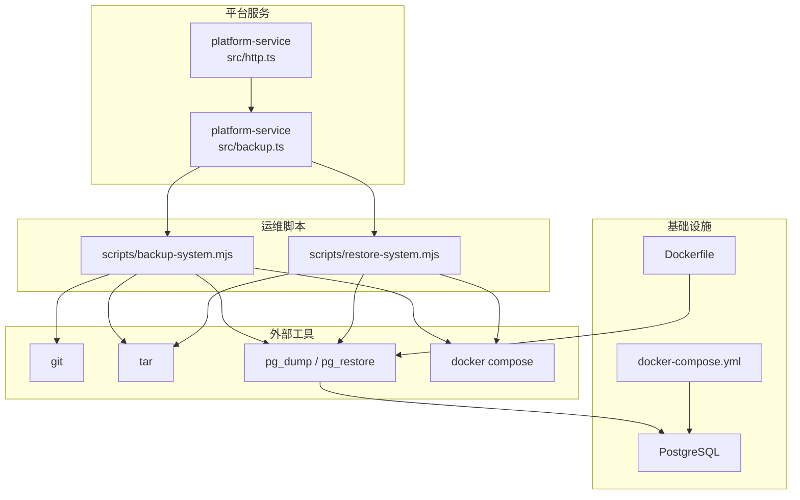
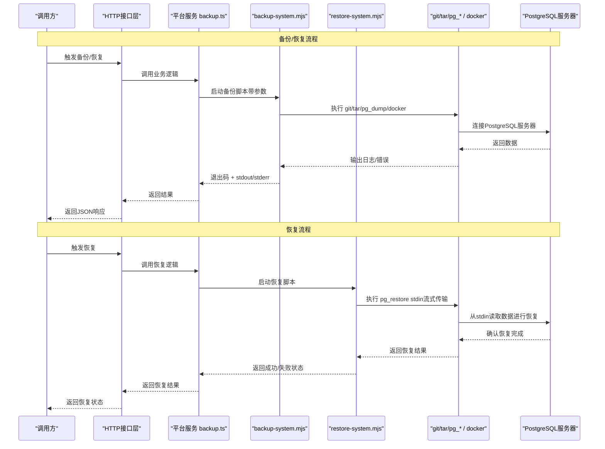
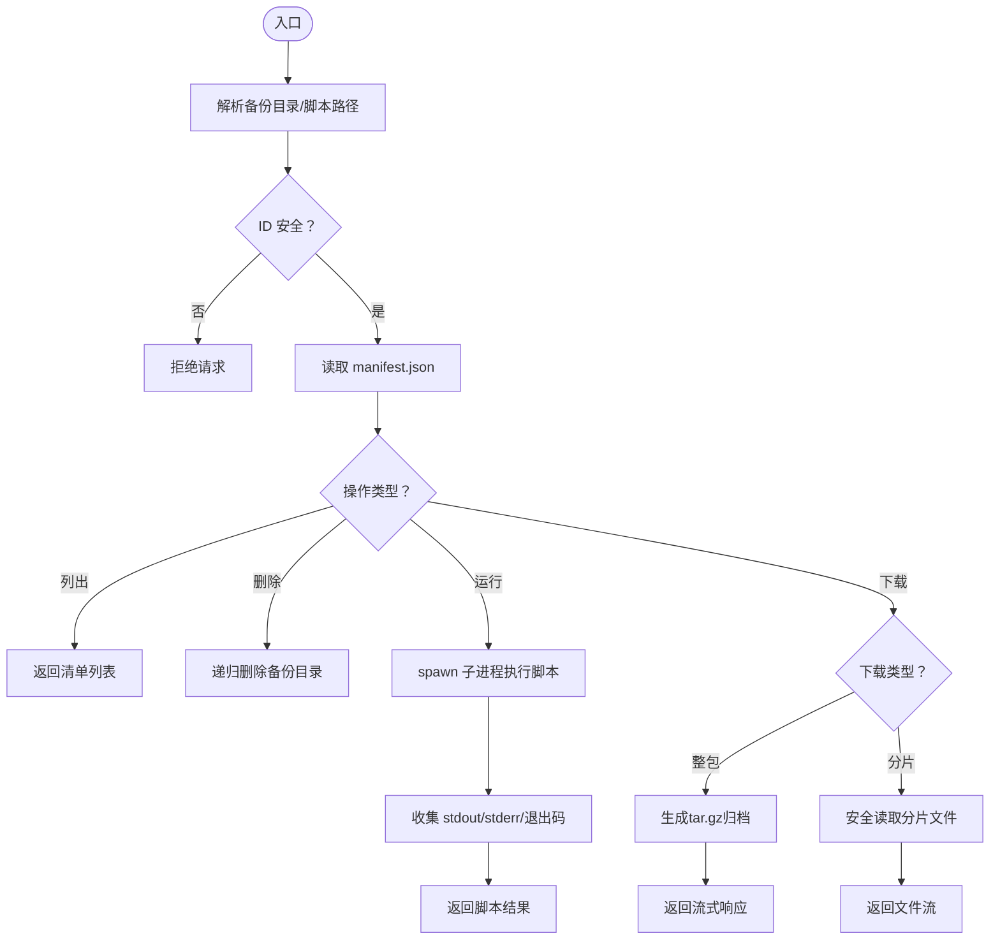
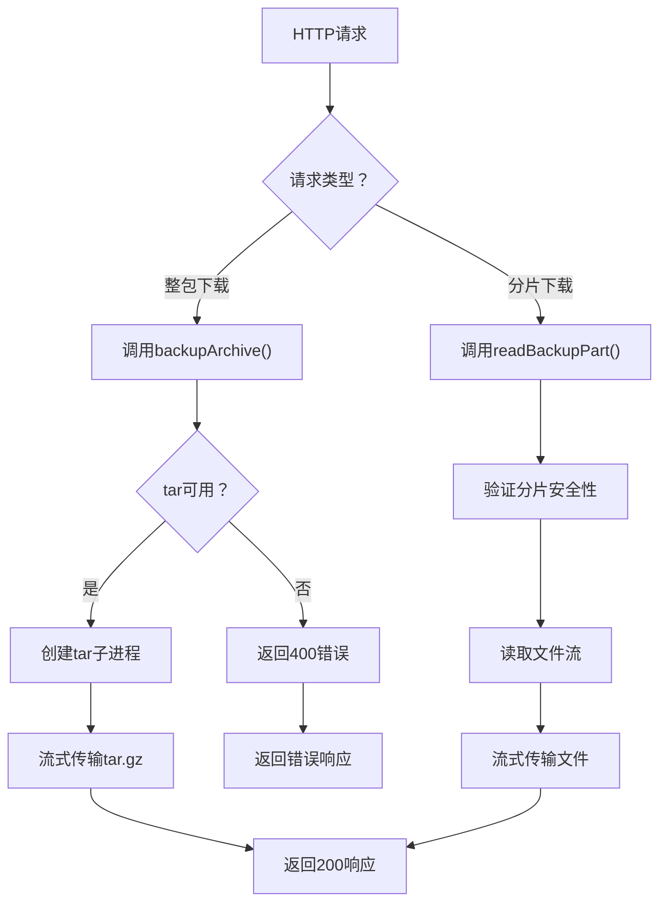
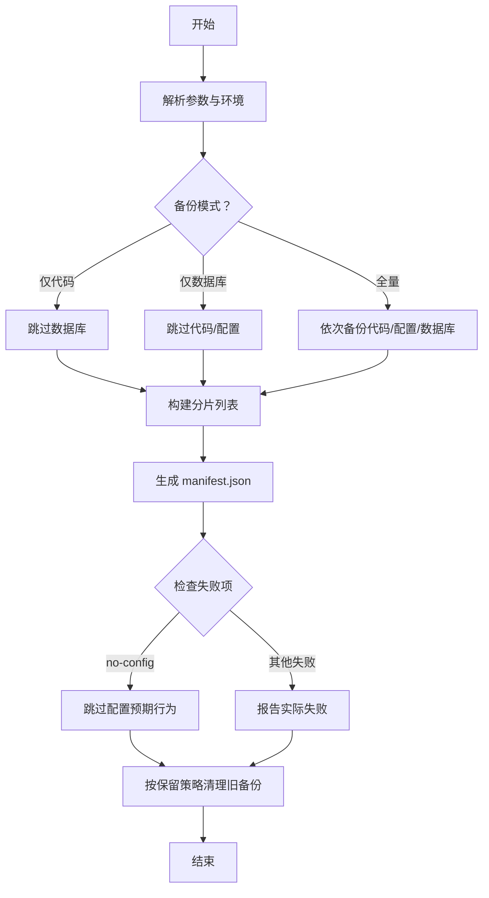
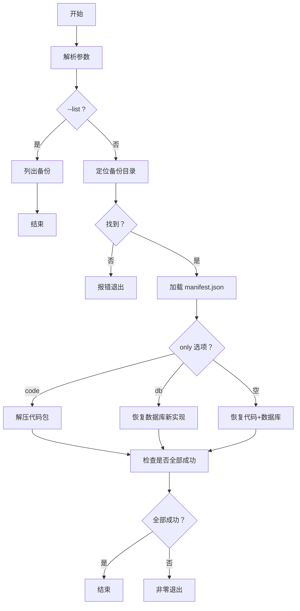
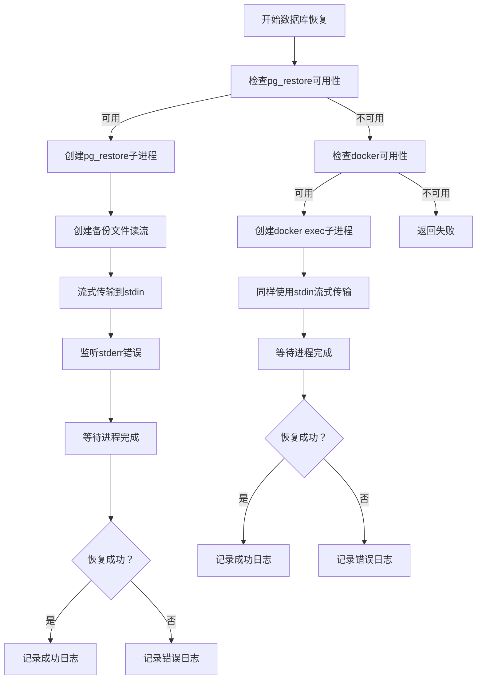
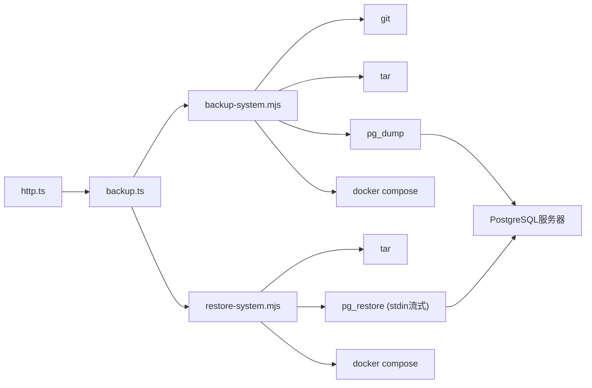

# 系统备份与恢复

<cite>
**本文引用的文件**   
- [apps/platform-service/src/backup.ts](file://apps/platform-service/src/backup.ts)
- [apps/platform-service/src/http.ts](file://apps/platform-service/src/http.ts)
- [scripts/backup-system.mjs](file://scripts/backup-system.mjs)
- [scripts/restore-system.mjs](file://scripts/restore-system.mjs)
- [apps/platform-service/test/backup.spec.ts](file://apps/platform-service/test/backup.spec.ts)
- [Dockerfile](file://Dockerfile)
- [infra/docker-compose.yml](file://infra/docker-compose.yml)
</cite>

## 更新摘要
**变更内容**   
- 增强配置文件缺失的错误处理：在备份脚本中正确处理缺少配置文件的场景，避免误报备份失败
- 完全重写PostgreSQL数据库恢复逻辑：使用正确的stdin流式传输替代无效的文件输出参数
- 新增 --clean 和 --if-exists 标志：pg_restore命令现在支持覆盖目标数据库行为，提升恢复到现有数据库时的可靠性
- 改进错误处理机制：区分预期跳过和实际失败的备份项
- 优化数据库恢复流程：确保pg_restore命令正确使用stdin参数而非文件参数

## 目录
1. [简介](#简介)
2. [项目结构中的备份与恢复位置](#项目结构中的备份与恢复位置)
3. [核心组件](#核心组件)
4. [架构总览](#架构总览)
5. [详细组件分析](#详细组件分析)
6. [依赖关系分析](#依赖关系分析)
7. [性能与可靠性考虑](#性能与可靠性考虑)
8. [故障排查指南](#故障排查指南)
9. [结论](#结论)

## 简介
本仓库实现了"系统级"的备份与恢复能力，覆盖代码、数据库与配置三类资产。整体设计分为两层：
- 服务侧封装层：平台服务提供统一的接口，负责校验参数、调用运维脚本、读取清单并返回结果。
- 运维脚本层：纯 Node.js 脚本实现具体备份与恢复逻辑，包括 Git 归档、tar 打包、pg_dump/pg_restore 或 docker compose exec 执行等。

该方案强调可观测性（清单 manifest）、安全性（路径安全校验、敏感配置可选包含）与可移植性（优先本机工具，回退到容器内工具）。

**重要更新**：增强了配置文件缺失的错误处理能力，完全重写了PostgreSQL数据库恢复逻辑以使用正确的stdin流式传输，新增了 --clean 和 --if-exists 标志来支持覆盖目标数据库行为，解决了之前因参数使用不当导致的恢复失败问题。

## 项目结构中的备份与恢复位置
- 服务侧封装：`apps/platform-service/src/backup.ts`
- HTTP接口层：`apps/platform-service/src/http.ts`
- 备份脚本：`scripts/backup-system.mjs`
- 恢复脚本：`scripts/restore-system.mjs`
- 单元测试：`apps/platform-service/test/backup.spec.ts`
- Docker镜像构建：`Dockerfile`
- 基础设施编排：`infra/docker-compose.yml`

**图表来源**
- [apps/platform-service/src/backup.ts:1-227](file://apps/platform-service/src/backup.ts#L1-L227)
- [apps/platform-service/src/http.ts:1-245](file://apps/platform-service/src/http.ts#L1-L245)
- [scripts/backup-system.mjs:1-344](file://scripts/backup-system.mjs#L1-L344)
- [scripts/restore-system.mjs:1-242](file://scripts/restore-system.mjs#L1-L242)
- [Dockerfile:46-56](file://Dockerfile#L46-L56)
- [infra/docker-compose.yml:2-18](file://infra/docker-compose.yml#L2-L18)

**章节来源**
- [apps/platform-service/src/backup.ts:1-227](file://apps/platform-service/src/backup.ts#L1-L227)
- [apps/platform-service/src/http.ts:1-245](file://apps/platform-service/src/http.ts#L1-L245)
- [scripts/backup-system.mjs:1-344](file://scripts/backup-system.mjs#L1-L344)
- [scripts/restore-system.mjs:1-242](file://scripts/restore-system.mjs#L1-L242)

## 核心组件
- 平台服务备份模块
  - 暴露备份目录、脚本路径解析方法。
  - 提供列出备份、读取备份元信息、删除备份的能力。
  - 支持备份分片读取和整包归档生成。
  - 通过子进程调用备份/恢复脚本，收集 stdout/stderr 与退出码。
- HTTP接口层
  - 提供备份下载API端点，支持整包和分片下载。
  - 实现流式响应处理，避免内存溢出。
  - 增强安全验证，防止路径穿越攻击。
- 备份脚本
  - 支持全量、仅数据库、仅代码、保留策略、是否包含敏感配置等选项。
  - 生成统一清单 `manifest.json`，记录提交、分支、脏状态、分片摘要等。
  - 代码备份优先使用 `git archive`，否则回退工作区 tar 打包。
  - 数据库备份优先使用本机 `pg_dump`，否则通过 `docker compose exec postgres pg_dump`。
  - **新增** 增强的配置文件缺失错误处理，避免误报备份失败。
- 恢复脚本
  - 支持列出备份、按 ID 定位备份目录。
  - 代码恢复解压代码包到目标目录。
  - **完全重写** 数据库恢复逻辑，使用正确的stdin流式传输替代无效的文件输出参数。
  - **新增** --clean 和 --if-exists 标志，支持覆盖目标数据库行为。
  - 数据库恢复优先本机 `pg_restore`，否则通过 `docker compose exec postgres pg_restore`。

**章节来源**
- [apps/platform-service/src/backup.ts:22-227](file://apps/platform-service/src/backup.ts#L22-L227)
- [apps/platform-service/src/http.ts:158-245](file://apps/platform-service/src/http.ts#L158-L245)
- [scripts/backup-system.mjs:33-40](file://scripts/backup-system.mjs#L33-L40)
- [scripts/backup-system.mjs:131-186](file://scripts/backup-system.mjs#L131-L186)
- [scripts/backup-system.mjs:213-255](file://scripts/backup-system.mjs#L213-L255)
- [scripts/restore-system.mjs:59-118](file://scripts/restore-system.mjs#L59-L118)
- [scripts/restore-system.mjs:120-205](file://scripts/restore-system.mjs#L120-L205)

## 架构总览
平台服务作为控制面，不直接操作文件系统与数据库，而是委托给运维脚本；运维脚本再调用系统工具完成实际 I/O。清单贯穿备份与恢复流程，确保一致性。新增的下载功能通过HTTP接口提供，支持流式传输以提高大文件处理的效率。**重要更新**：配置文件缺失的错误处理得到增强，PostgreSQL恢复逻辑完全重写以确保正确的stdin流式传输，并新增了 --clean 和 --if-exists 标志来支持覆盖目标数据库行为。

**图表来源**
- [apps/platform-service/src/http.ts:158-245](file://apps/platform-service/src/http.ts#L158-L245)
- [apps/platform-service/src/backup.ts:112-227](file://apps/platform-service/src/backup.ts#L112-L227)
- [scripts/backup-system.mjs:68-83](file://scripts/backup-system.mjs#L68-L83)
- [scripts/restore-system.mjs:135-205](file://scripts/restore-system.mjs#L135-L205)

## 详细组件分析

### 平台服务备份模块（backup.ts）
职责边界
- 路径与环境解析：备份目录、备份脚本、恢复脚本均可通过环境变量覆盖。
- 清单读写：读取每个备份目录下的 `manifest.json`，提供列表、读取、删除能力。
- 分片读取：安全地读取备份分片文件，防止路径穿越攻击。
- 整包归档：使用系统tar命令将备份目录打包为tar.gz流。
- 脚本调度：将业务选项转换为脚本参数，捕获子进程输出与退出码。

关键设计点
- 安全目录名校验：对备份 ID 进行白名单校验，防止路径穿越。
- 分片安全验证：严格验证分片名称和路径，确保只访问允许的备份目录内的文件。
- 子进程隔离：以仓库根为工作目录，继承环境并合并传入的环境变量。
- 参数映射：将布尔与枚举选项映射为脚本命令行参数。

**图表来源**
- [apps/platform-service/src/backup.ts:66-227](file://apps/platform-service/src/backup.ts#L66-L227)

**章节来源**
- [apps/platform-service/src/backup.ts:22-32](file://apps/platform-service/src/backup.ts#L22-L32)
- [apps/platform-service/src/backup.ts:66-110](file://apps/platform-service/src/backup.ts#L66-L110)
- [apps/platform-service/src/backup.ts:112-227](file://apps/platform-service/src/backup.ts#L112-L227)

### HTTP接口层（http.ts）
功能要点
- 备份下载接口：提供 `/api/v1/platform/backups/{id}/download` 端点，支持整包下载。
- 分片下载接口：提供 `/api/v1/platform/backups/{id}/download/{partName}` 端点，支持单个分片下载。
- 流式响应处理：使用Node.js流式API处理大文件传输，避免内存溢出。
- 安全响应头：设置适当的缓存控制和内容类型选项。

关键特性
- 权限验证：所有下载接口都需要 `system:backup` 权限。
- 流式传输：整包下载使用tar命令流式输出，分片下载直接读取文件流。
- 错误处理：对非法请求、缺失文件和系统错误进行适当处理。

**图表来源**
- [apps/platform-service/src/http.ts:187-226](file://apps/platform-service/src/http.ts#L187-L226)

**章节来源**
- [apps/platform-service/src/http.ts:158-245](file://apps/platform-service/src/http.ts#L158-L245)

### 备份脚本（backup-system.mjs）
功能要点
- 参数解析：支持 `--db-only`、`--code-only`、`--include-secrets`、`--keep`、`--list`、`--dir`、`--tag` 等。
- 代码备份：
  - 优先 `git archive` 基于 HEAD 归档，附带提交短哈希。
  - 无 Git 时回退工作区 tar 打包，排除依赖与临时目录。
- 配置备份：
  - 始终包含示例配置，可选包含敏感配置（如 `.env`、私钥）。
  - **新增** 增强的错误处理：当配置文件缺失时，标记为"no-config"原因但不视为失败。
- 数据库备份：
  - 解析连接串，检测可用执行器（本机 `pg_dump` 或 `docker compose exec postgres pg_dump`）。
  - 流式写入 dump 文件，避免内存膨胀。
- 清单与清理：
  - 生成 `manifest.json`，记录各分片名称、大小、SHA256、数据库信息与模式。
  - 根据保留数清理旧备份。
  - **新增** 改进的错误分类：区分"skipped"、"no-config"和其他实际失败情况。

**更新** 配置文件缺失的错误处理得到显著增强，现在能够正确识别容器环境中缺少配置文件的预期情况，避免误报备份失败。

**图表来源**
- [scripts/backup-system.mjs:33-40](file://scripts/backup-system.mjs#L33-L40)
- [scripts/backup-system.mjs:131-186](file://scripts/backup-system.mjs#L131-L186)
- [scripts/backup-system.mjs:213-255](file://scripts/backup-system.mjs#L213-L255)
- [scripts/backup-system.mjs:297-337](file://scripts/backup-system.mjs#L297-L337)

**章节来源**
- [scripts/backup-system.mjs:1-16](file://scripts/backup-system.mjs#L1-L16)
- [scripts/backup-system.mjs:33-40](file://scripts/backup-system.mjs#L33-L40)
- [scripts/backup-system.mjs:117-160](file://scripts/backup-system.mjs#L117-L160)
- [scripts/backup-system.mjs:162-186](file://scripts/backup-system.mjs#L162-L186)
- [scripts/backup-system.mjs:188-255](file://scripts/backup-system.mjs#L188-L255)
- [scripts/backup-system.mjs:257-295](file://scripts/backup-system.mjs#L257-L295)
- [scripts/backup-system.mjs:297-337](file://scripts/backup-system.mjs#L297-L337)
- [scripts/backup-system.mjs:328-331](file://scripts/backup-system.mjs#L328-L331)

### 恢复脚本（restore-system.mjs）
功能要点
- 备份定位：支持绝对路径或相对 `BACKUP_DIR` 的 ID 定位，要求存在 `manifest.json`。
- 代码恢复：从清单中定位代码分片，解压到目标目录。
- **完全重写** 数据库恢复：
  - 使用正确的stdin流式传输方式，避免无效的-f参数冲突。
  - 通过fs.createReadStream创建输入流，pipe到pg_restore的stdin。
  - **新增** --clean 和 --if-exists 标志，实现"覆盖目标库"功能：先删除目标库中已存在的对象再重建，避免恢复到已有数据的库时因关系已存在而失败。
  - 同时支持本机pg_restore和docker compose exec两种方式。
- 列表与校验：提供 `--list` 列出可用备份，缺失必要分片时报错。

**重大更新** 数据库恢复逻辑被完全重写，解决了之前因错误使用-f参数导致的"options -d/--dbname and -f/--file cannot be used together"错误。现在使用标准的stdin流式传输方式，并添加了 --clean 和 --if-exists 标志来支持覆盖目标数据库行为，确保pg_restore命令能够正确接收备份数据。

**图表来源**
- [scripts/restore-system.mjs:21-31](file://scripts/restore-system.mjs#L21-L31)
- [scripts/restore-system.mjs:59-86](file://scripts/restore-system.mjs#L59-L86)
- [scripts/restore-system.mjs:103-118](file://scripts/restore-system.mjs#L103-L118)
- [scripts/restore-system.mjs:120-205](file://scripts/restore-system.mjs#L120-L205)
- [scripts/restore-system.mjs:207-237](file://scripts/restore-system.mjs#L207-L237)

**章节来源**
- [scripts/restore-system.mjs:1-12](file://scripts/restore-system.mjs#L1-L12)
- [scripts/restore-system.mjs:21-31](file://scripts/restore-system.mjs#L21-L31)
- [scripts/restore-system.mjs:59-86](file://scripts/restore-system.mjs#L59-L86)
- [scripts/restore-system.mjs:103-118](file://scripts/restore-system.mjs#L103-L118)
- [scripts/restore-system.mjs:120-205](file://scripts/restore-system.mjs#L120-L205)
- [scripts/restore-system.mjs:207-237](file://scripts/restore-system.mjs#L207-L237)

### PostgreSQL数据库恢复逻辑重写
**重大更新** PostgreSQL数据库恢复逻辑被完全重写，解决了关键的参数使用问题，并新增了覆盖目标数据库的功能。

关键改进
- **stdin流式传输**：使用fs.createReadStream创建备份文件流，通过pipe方法传输到pg_restore的stdin。
- **参数修正**：移除无效的-f参数，只使用-d参数指定目标数据库。
- **新增 --clean 和 --if-exists 标志**：实现"覆盖目标库"功能，先删除目标库中已存在的对象再重建，避免恢复到已有数据的库时因关系已存在而失败。
- **错误处理**：改进错误捕获和日志记录，提供更详细的错误信息。
- **兼容性保证**：同时支持本机pg_restore和docker compose exec两种方式。

**图表来源**
- [scripts/restore-system.mjs:135-205](file://scripts/restore-system.mjs#L135-L205)

**章节来源**
- [scripts/restore-system.mjs:135-205](file://scripts/restore-system.mjs#L135-L205)

## 依赖关系分析
- 平台服务模块依赖 Node 标准库（fs、path、child_process、crypto、os），并通过环境变量与脚本解耦。
- HTTP接口层依赖流式API和权限验证机制。
- 备份脚本依赖外部命令：git、tar、pg_dump、pg_restore、docker。
- 恢复脚本依赖外部命令：tar、pg_restore、docker。
- 清单格式在备份与恢复两侧保持一致，保证跨阶段一致性。

**图表来源**
- [apps/platform-service/src/backup.ts:112-227](file://apps/platform-service/src/backup.ts#L112-L227)
- [apps/platform-service/src/http.ts:158-245](file://apps/platform-service/src/http.ts#L158-L245)
- [scripts/backup-system.mjs:68-83](file://scripts/backup-system.mjs#L68-L83)
- [scripts/restore-system.mjs:135-205](file://scripts/restore-system.mjs#L135-L205)

**章节来源**
- [apps/platform-service/src/backup.ts:112-227](file://apps/platform-service/src/backup.ts#L112-L227)
- [apps/platform-service/src/http.ts:158-245](file://apps/platform-service/src/http.ts#L158-L245)
- [scripts/backup-system.mjs:68-83](file://scripts/backup-system.mjs#L68-L83)
- [scripts/restore-system.mjs:135-205](file://scripts/restore-system.mjs#L135-L205)

## 性能与可靠性考虑
- 大文件处理
  - 数据库备份/恢复采用流式写入/读取，避免一次性加载到内存。
  - 代码归档优先使用 `git archive`，减少无关文件体积。
  - 备份下载使用流式传输，整包下载通过tar命令流式输出，分片下载直接读取文件流。
- 工具可用性回退
  - 数据库备份优先本机 `pg_dump`，否则走 `docker compose exec postgres pg_dump`。
  - 数据库恢复优先本机 `pg_restore`，否则走 `docker compose exec postgres pg_restore`。
  - 整包下载优先使用系统tar命令，不可用时返回明确错误。
- 一致性与可审计
  - 清单记录分片 SHA256、大小、数据库名与模式、Git 提交与分支、是否包含敏感配置等。
  - 保留策略自动清理旧备份，避免磁盘增长失控。
- 安全性
  - 备份 ID 白名单校验，防止路径穿越。
  - 分片下载严格验证文件路径，确保只访问允许的备份目录。
  - 敏感配置仅在显式开启时纳入备份。
  - 下载接口需要 `system:backup` 权限验证。
- **新增** 错误处理增强
  - 配置文件缺失被视为预期跳过而非失败，避免误报备份失败。
  - 数据库恢复使用正确的stdin流式传输，避免因参数错误导致的恢复失败。
  - **新增** --clean 和 --if-exists 标志支持覆盖目标数据库，提升恢复到现有数据库时的可靠性。

## 故障排查指南
常见问题与定位建议
- 未找到可用的数据库备份方式
  - 现象：备份脚本报告既没有 `pg_dump`，也没有 docker 与 `infra/docker-compose.yml`。
  - 排查：确认本机已安装 `pg_dump`，或在仓库根有 `infra/docker-compose.yml` 且 docker 可用。
  - 参考：[scripts/backup-system.mjs:203-211](file://scripts/backup-system.mjs#L203-L211)、[scripts/backup-system.mjs:220-255](file://scripts/backup-system.mjs#L220-L255)
- 无法解析数据库连接串
  - 现象：备份/恢复脚本提示无法解析 `DB_URL` 或 `DATABASE_URL`。
  - 排查：检查环境变量是否为合法 PostgreSQL URL。
  - 参考：[scripts/backup-system.mjs:188-201](file://scripts/backup-system.mjs#L188-L201)、[scripts/restore-system.mjs:88-101](file://scripts/restore-system.mjs#L88-L101)
- 代码备份失败
  - 现象：git archive 失败或 tar 工作区打包失败。
  - 排查：确认当前目录为仓库根，具备 Git 历史；若无 Git，检查 tar 命令可用性与权限。
  - 参考：[scripts/backup-system.mjs:131-160](file://scripts/backup-system.mjs#L131-L160)
- 代码恢复失败
  - 现象：tar 解压失败。
  - 排查：确认备份清单中存在代码分片，目标目录可写。
  - 参考：[scripts/restore-system.mjs:103-118](file://scripts/restore-system.mjs#L103-L118)
- 数据库恢复失败
  - 现象：pg_restore 或 docker compose exec 失败。
  - 排查：确认本机已安装 `pg_restore`，或 docker 与 compose 可用；检查目标数据库是否存在及权限。
  - **新增** 如果看到"options -d/--dbname and -f/--file cannot be used together"错误，说明使用了旧版本的恢复逻辑。
  - **新增** 新的恢复逻辑已添加 --clean 和 --if-exists 标志，可以覆盖目标数据库中的现有对象。
  - 参考：[scripts/restore-system.mjs:135-205](file://scripts/restore-system.mjs#L135-L205)
- 平台服务调用脚本异常
  - 现象：子进程启动失败或退出码非 0。
  - 排查：查看 stdout/stderr 与 command 字段，确认脚本路径与工作目录正确。
  - 参考：[apps/platform-service/src/backup.ts:112-128](file://apps/platform-service/src/backup.ts#L112-L128)
- 备份下载失败
  - 现象：整包下载返回400错误，提示tar命令不可用。
  - 排查：确认系统已安装tar命令，或改用分片下载方式。
  - 参考：[apps/platform-service/src/backup.ts:214-226](file://apps/platform-service/src/backup.ts#L214-L226)
- 分片下载权限不足
  - 现象：下载接口返回401或403错误。
  - 排查：确认用户具有 `system:backup` 权限。
  - 参考：[apps/platform-service/src/http.ts:39](file://apps/platform-service/src/http.ts#L39)
- **新增** 配置文件缺失警告
  - 现象：备份脚本显示"配置备份跳过：未找到 .env.example 等配置文件"。
  - 排查：这是预期行为，特别是在容器环境中。不影响备份完整性，只是跳过配置部分。
  - 参考：[scripts/backup-system.mjs:169-171](file://scripts/backup-system.mjs#L169-L171)、[scripts/backup-system.mjs:328-331](file://scripts/backup-system.mjs#L328-L331)
- **新增** 数据库恢复参数错误
  - 现象：恢复时出现"options -d/--dbname and -f/--file cannot be used together"错误。
  - 排查：确认使用的是最新版本的恢复脚本，该版本已修复参数使用问题并添加了 --clean 和 --if-exists 标志。
  - 参考：[scripts/restore-system.mjs:136-137](file://scripts/restore-system.mjs#L136-L137)

**章节来源**
- [scripts/backup-system.mjs:203-255](file://scripts/backup-system.mjs#L203-L255)
- [scripts/restore-system.mjs:103-205](file://scripts/restore-system.mjs#L103-L205)
- [apps/platform-service/src/backup.ts:112-227](file://apps/platform-service/src/backup.ts#L112-L227)
- [apps/platform-service/src/http.ts:158-245](file://apps/platform-service/src/http.ts#L158-L245)

## 结论
该备份与恢复方案以服务侧封装与运维脚本解耦的方式，提供了稳定、可审计、可扩展的系统级数据保护能力。通过清单驱动与工具回退机制，能够在不同部署环境中保持一致行为；同时通过保留策略与安全校验，兼顾了运维效率与风险控制。

**重大更新**：本次更新显著增强了系统的健壮性和可靠性。配置文件缺失的错误处理得到完善，避免了容器环境中的误报问题；PostgreSQL数据库恢复逻辑被完全重写，使用正确的stdin流式传输方式，彻底解决了参数冲突导致的恢复失败问题；新增了 --clean 和 --if-exists 标志，支持覆盖目标数据库行为，提升了恢复到现有数据库时的可靠性。这些改进使得系统在复杂部署环境下更加稳定和可靠，建议在生产环境中立即应用这些更新以获得更好的备份恢复体验。