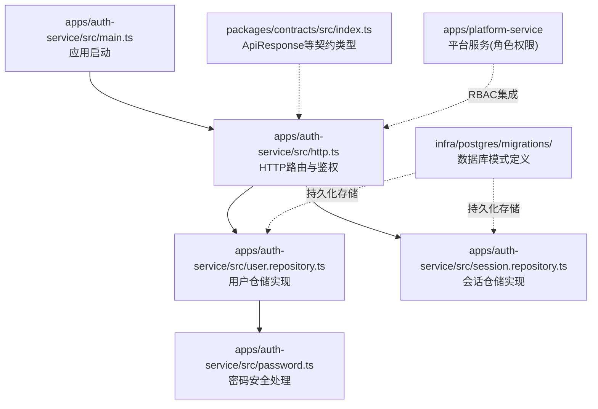
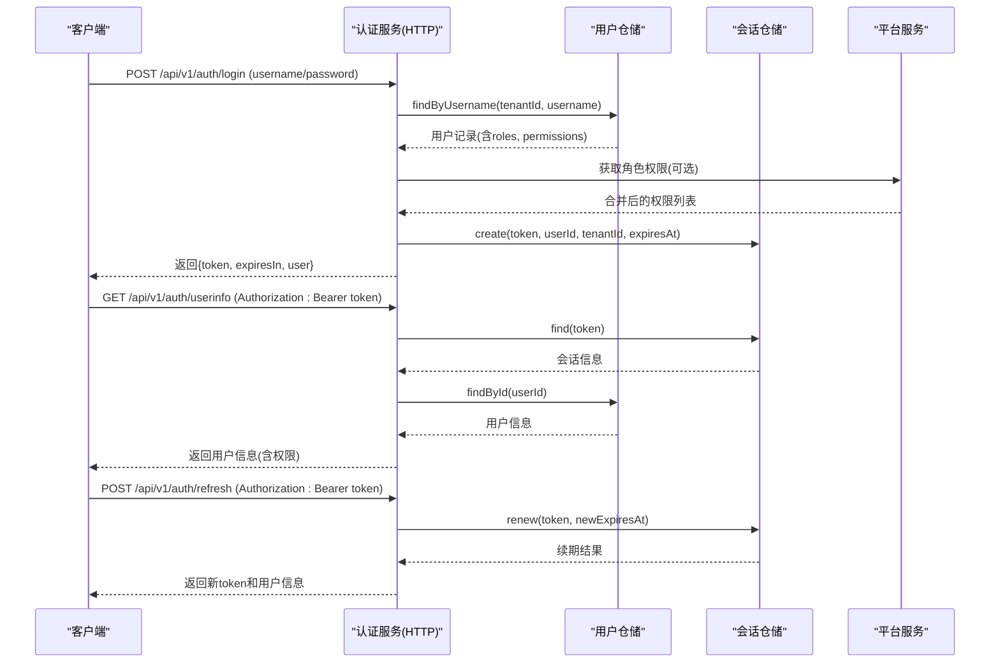
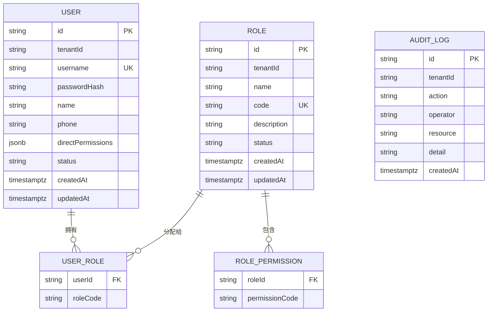
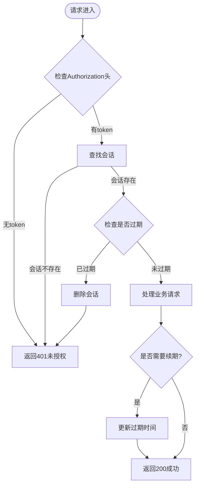
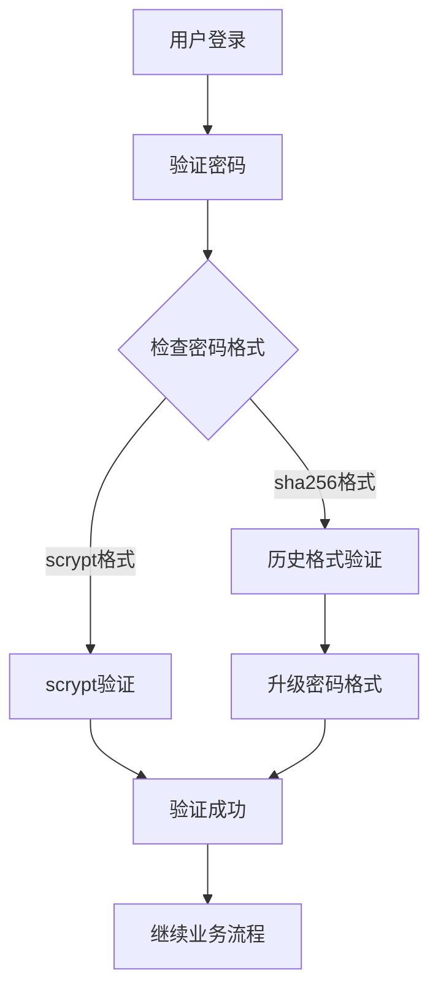
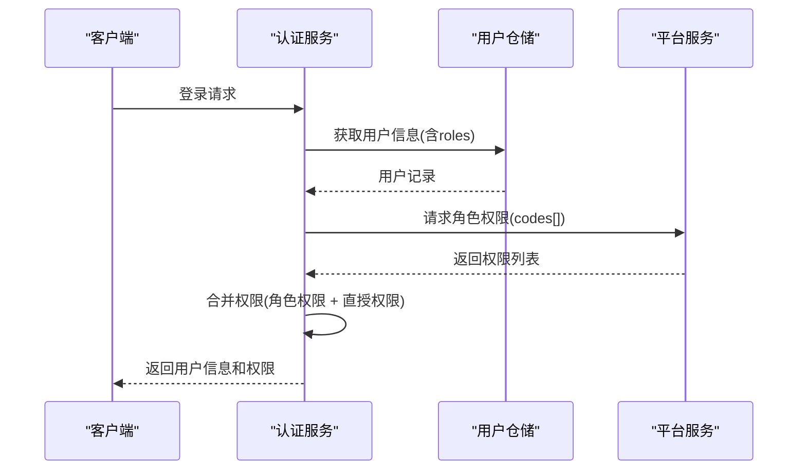
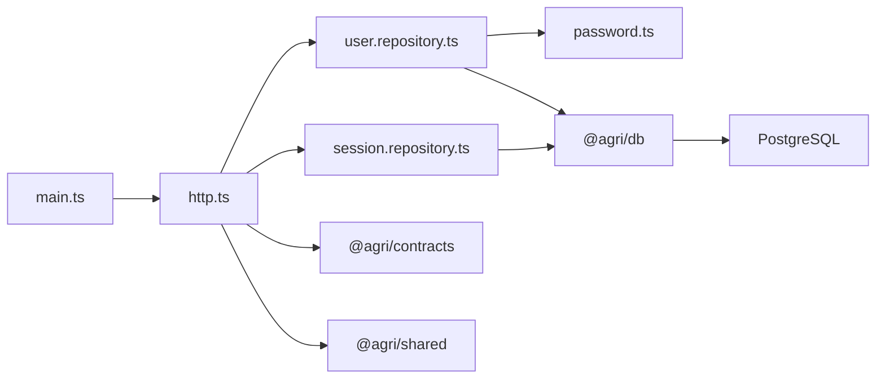

# 认证授权服务

<cite>
**本文引用的文件**   
- [apps/auth-service/src/main.ts](file://apps/auth-service/src/main.ts)
- [apps/auth-service/src/http.ts](file://apps/auth-service/src/http.ts)
- [apps/auth-service/src/app.module.ts](file://apps/auth-service/src/app.module.ts)
- [apps/auth-service/src/user.repository.ts](file://apps/auth-service/src/user.repository.ts)
- [apps/auth-service/src/session.repository.ts](file://apps/auth-service/src/session.repository.ts)
- [apps/auth-service/src/password.ts](file://apps/auth-service/src/password.ts)
- [infra/postgres/migrations/004_identity_accounts.sql](file://infra/postgres/migrations/004_identity_accounts.sql)
- [infra/postgres/migrations/007_auth_sessions.sql](file://infra/postgres/migrations/007_auth_sessions.sql)
- [packages/contracts/src/index.ts](file://packages/contracts/src/index.ts)
</cite>

## 更新摘要
**变更内容**   
- 新增用户仓库实现，支持完整的CRUD操作和租户隔离
- 实现会话仓库，提供持久化会话管理和滑动续期功能
- 增强密码安全策略，采用scrypt算法进行密码哈希
- 扩展数据库模式，支持身份管理和审计日志
- 完善RBAC模型，集成平台服务获取角色权限
- 添加全面的用户管理API接口

## 目录
1. [简介](#简介)
2. [项目结构](#项目结构)
3. [核心组件](#核心组件)
4. [架构总览](#架构总览)
5. [详细组件分析](#详细组件分析)
6. [依赖关系分析](#依赖关系分析)
7. [性能考虑](#性能考虑)
8. [故障排查指南](#故障排查指南)
9. [结论](#结论)
10. [附录](#附录)

## 简介
本文件为认证授权服务的权威技术文档，聚焦以下目标：
- 用户身份认证与权限管理核心机制
- JWT令牌签发、验证与刷新流程（当前实现为持久化会话令牌，后续可演进为JWT）
- RBAC（基于角色的访问控制）模型设计与落地实现
- OAuth2.0协议集成方案（第三方登录与单点登录）
- 密码安全策略（scrypt加密存储、盐值生成、强度校验）
- 服务间认证机制（微服务可信通信）
- 会话管理与登录审计、安全日志记录

当前仓库中的认证授权服务已发展为完整的企业级认证系统，提供用户管理、会话管理、密码安全、租户隔离等核心功能，并支持与平台服务集成实现细粒度权限控制。

## 项目结构
认证授权服务位于 apps/auth-service，采用模块化设计，包含HTTP服务层、用户仓储层、会话仓储层和密码安全模块。服务支持内存和SQL两种存储后端，便于本地开发和生产部署。

**图表来源**
- [apps/auth-service/src/main.ts:1-15](file://apps/auth-service/src/main.ts#L1-L15)
- [apps/auth-service/src/http.ts:1-20](file://apps/auth-service/src/http.ts#L1-L20)
- [apps/auth-service/src/user.repository.ts:1-20](file://apps/auth-service/src/user.repository.ts#L1-L20)
- [apps/auth-service/src/session.repository.ts:1-16](file://apps/auth-service/src/session.repository.ts#L1-L16)

## 核心组件

### 用户仓储层
- **UserRepository接口**：定义用户数据的CRUD操作规范
- **InMemoryUserRepository**：内存实现，用于本地开发和测试
- **SqlUserRepository**：PostgreSQL实现，支持分页查询、租户隔离、角色关联
- **UserRecord类型**：定义用户数据结构，包含租户ID、用户名、密码哈希、角色、权限等字段

### 会话仓储层
- **SessionRepository接口**：定义会话管理的CRUD操作规范
- **InMemorySessionRepository**：内存实现，Map存储token到用户映射
- **SqlSessionRepository**：PostgreSQL实现，持久化会话存储，支持滑动续期
- **SessionRecord类型**：定义会话数据结构，包含token哈希、用户ID、过期时间等

### 密码安全模块
- **hashPassword**：使用scrypt算法生成强密码哈希
- **verifyPassword**：验证密码，兼容历史sha256格式
- **needsRehash**：检测是否需要升级密码哈希格式
- **seedUsers**：内置管理员账号生成器

### HTTP服务层
- **createAuthHttpServer**：创建认证HTTP服务器
- **用户管理API**：完整的RESTful接口支持用户CRUD操作
- **认证API**：登录、登出、用户信息、会话刷新
- **内部API**：网关服务间认证接口

**章节来源**
- [apps/auth-service/src/user.repository.ts:1-58](file://apps/auth-service/src/user.repository.ts#L1-L58)
- [apps/auth-service/src/session.repository.ts:1-39](file://apps/auth-service/src/session.repository.ts#L1-L39)
- [apps/auth-service/src/password.ts:1-74](file://apps/auth-service/src/password.ts#L1-L74)
- [apps/auth-service/src/http.ts:146-255](file://apps/auth-service/src/http.ts#L146-L255)

## 架构总览
认证授权服务在当前实现中承担以下职责：
- **用户认证**：用户名/密码校验，成功后颁发会话令牌（短期有效，支持滑动续期）
- **用户管理**：完整的CRUD操作，支持租户隔离、状态管理、角色分配
- **会话管理**：持久化会话存储，支持过期判断、滑动续期、批量回收
- **权限控制**：与平台服务集成，动态获取角色权限，支持细粒度访问控制
- **密码安全**：scrypt强哈希存储，自动升级历史密码格式
- **可观测性**：traceId追踪，结构化日志记录

**图表来源**
- [apps/auth-service/src/http.ts:165-194](file://apps/auth-service/src/http.ts#L165-L194)
- [apps/auth-service/src/http.ts:196-197](file://apps/auth-service/src/http.ts#L196-L197)

## 详细组件分析

### 用户管理系统

#### 用户仓储实现
用户仓储提供了完整的用户数据管理能力，支持内存和SQL两种实现方式：

- **内存实现**：适用于本地开发和单元测试，提供快速响应的用户操作
- **SQL实现**：生产环境使用，支持分页查询、租户隔离、角色关联管理
- **租户隔离**：所有用户操作都基于tenantId进行数据隔离
- **角色管理**：支持用户角色分配，角色信息从platform_service动态获取

**图表来源**
- [infra/postgres/migrations/004_identity_accounts.sql:8-59](file://infra/postgres/migrations/004_identity_accounts.sql#L8-L59)

#### 用户CRUD操作
- **创建用户**：支持用户名、姓名、密码、角色、权限等字段，自动生成用户ID和时间戳
- **查询用户**：支持按租户、状态、关键词分页查询，避免N+1查询问题
- **更新用户**：支持部分更新，只修改传入的字段，保持其他字段不变
- **删除用户**：级联删除用户角色关联，保护内置管理员账户
- **密码重置**：支持管理员重置用户密码，自动回收相关会话

**章节来源**
- [apps/auth-service/src/user.repository.ts:74-127](file://apps/auth-service/src/user.repository.ts#L74-L127)
- [apps/auth-service/src/user.repository.ts:162-303](file://apps/auth-service/src/user.repository.ts#L162-L303)

### 会话管理系统

#### 会话仓储实现
会话仓储提供安全的会话管理机制，支持内存和SQL两种存储后端：

- **内存实现**：Map存储，适用于单进程场景，支持会话过期自动清理
- **SQL实现**：PostgreSQL存储，支持分布式部署，会话持久化存储
- **安全存储**：仅存储token的SHA256哈希值，防止数据库泄露导致的安全风险
- **滑动续期**：支持会话有效期延长，提升用户体验

**图表来源**
- [apps/auth-service/src/session.repository.ts:57-100](file://apps/auth-service/src/session.repository.ts#L57-L100)
- [apps/auth-service/src/session.repository.ts:117-162](file://apps/auth-service/src/session.repository.ts#L117-L162)

#### 会话生命周期管理
- **创建会话**：生成32字节随机token，设置默认2小时过期时间
- **查找会话**：通过token哈希查找，自动过滤过期会话
- **续期会话**：滑动续期机制，延长会话有效期
- **删除会话**：支持单个删除和按用户批量删除
- **清理会话**：定期清理过期会话，释放存储空间

**章节来源**
- [apps/auth-service/src/session.repository.ts:57-100](file://apps/auth-service/src/session.repository.ts#L57-L100)
- [apps/auth-service/src/session.repository.ts:117-162](file://apps/auth-service/src/session.repository.ts#L117-L162)

### 密码安全策略

#### 密码哈希算法
采用scrypt算法进行密码哈希，提供强大的抗暴力破解能力：

- **算法选择**：scrypt算法，具有CPU和内存双重成本，有效抵御GPU攻击
- **参数配置**：N=16384, R=8, P=1，符合OWASP安全建议
- **盐值生成**：每个密码使用独立的16字节随机盐值
- **格式兼容**：支持历史sha256格式，自动升级到scrypt格式

**图表来源**
- [apps/auth-service/src/password.ts:40-74](file://apps/auth-service/src/password.ts#L40-L74)

#### 密码安全特性
- **强哈希算法**：scrypt算法，抗GPU和ASIC攻击
- **独立盐值**：每个密码使用唯一盐值，防止彩虹表攻击
- **定时比较**：使用timingSafeEqual防止时序攻击
- **自动升级**：历史密码在登录时自动升级到scrypt格式
- **强度验证**：最小长度6位，支持复杂度要求

**章节来源**
- [apps/auth-service/src/password.ts:1-74](file://apps/auth-service/src/password.ts#L1-L74)

### RBAC权限控制模型

#### 权限模型设计
实现了完整的基于角色的访问控制（RBAC）模型：

- **用户-角色多对多关系**：一个用户可以拥有多个角色，一个角色可以分配给多个用户
- **角色-权限多对多关系**：一个角色包含多个权限，一个权限可以被多个角色拥有
- **直接权限**：支持给用户直接授予特定权限，绕过角色继承
- **租户隔离**：所有权限数据按租户隔离，确保数据安全

#### 权限获取机制
- **动态权限加载**：登录时从平台服务获取用户的角色权限
- **权限合并**：将角色权限与用户直接权限合并，形成最终权限集合
- **缓存优化**：管理员用户跳过远程调用，直接使用直授权限
- **降级处理**：平台服务不可用时，回退到直授权限，保证服务可用性

**图表来源**
- [apps/auth-service/src/http.ts:63-83](file://apps/auth-service/src/http.ts#L63-L83)

**章节来源**
- [apps/auth-service/src/http.ts:63-83](file://apps/auth-service/src/http.ts#L63-L83)
- [infra/postgres/migrations/004_identity_accounts.sql:30-47](file://infra/postgres/migrations/004_identity_accounts.sql#L30-L47)

### API接口设计

#### 认证接口
- **POST /api/v1/auth/login**：用户登录，返回会话token和用户信息
- **GET /api/v1/auth/userinfo**：获取当前用户信息，需要Bearer token
- **POST /api/v1/auth/logout**：登出，删除会话
- **POST /api/v1/auth/refresh**：刷新会话，延长有效期

#### 用户管理接口
- **GET /api/v1/auth/users**：分页查询用户列表，支持租户、状态、关键词筛选
- **POST /api/v1/auth/users**：创建新用户，自动生成用户ID
- **PUT /api/v1/auth/users/{id}**：更新用户信息，支持部分更新
- **DELETE /api/v1/auth/users/{id}**：删除用户，保护内置管理员
- **POST /api/v1/auth/users/{id}/password**：重置用户密码

#### 内部接口
- **POST /api/v1/internal/auth/session**：网关服务间认证，凭token换取用户信息

**章节来源**
- [apps/auth-service/src/http.ts:146-255](file://apps/auth-service/src/http.ts#L146-L255)

## 依赖关系分析

### 模块依赖
- **main.ts**：应用入口，根据环境变量选择启动模式
- **http.ts**：HTTP服务层，处理所有API请求和鉴权逻辑
- **user.repository.ts**：用户仓储层，抽象用户数据访问
- **session.repository.ts**：会话仓储层，抽象会话数据访问
- **password.ts**：密码安全模块，提供密码哈希和验证功能

### 外部依赖
- **@agri/contracts**：契约包，提供统一的响应格式和类型定义
- **@agri/shared**：共享工具库，提供通用函数和常量
- **@agri/db**：数据库抽象层，提供PrismaClientLike接口
- **PostgreSQL**：生产环境数据库，存储用户数据和会话信息

**图表来源**
- [apps/auth-service/src/main.ts:1-15](file://apps/auth-service/src/main.ts#L1-L15)
- [apps/auth-service/src/http.ts:1-12](file://apps/auth-service/src/http.ts#L1-L12)
- [apps/auth-service/src/user.repository.ts:1-5](file://apps/auth-service/src/user.repository.ts#L1-L5)

**章节来源**
- [apps/auth-service/src/main.ts:1-15](file://apps/auth-service/src/main.ts#L1-L15)
- [apps/auth-service/src/http.ts:1-12](file://apps/auth-service/src/http.ts#L1-L12)

## 性能考虑

### 数据库优化
- **索引设计**：为用户表和会话表创建合适的索引，优化查询性能
- **分页查询**：用户列表查询支持分页，避免大数据量传输
- **批量操作**：角色关联查询使用批量加载，避免N+1问题
- **连接池**：使用数据库连接池，提高并发处理能力

### 会话管理优化
- **滑动续期**：减少频繁重新登录，提升用户体验
- **过期清理**：定期清理过期会话，释放存储空间
- **哈希存储**：会话token使用哈希存储，减少存储空间和安全风险

### 密码安全优化
- **异步处理**：密码哈希计算可能耗时，考虑异步处理
- **参数调优**：根据硬件性能调整scrypt参数，平衡安全性和性能
- **缓存策略**：考虑对常用用户信息进行缓存，减少数据库压力

## 故障排查指南

### 常见问题
- **401未授权**：检查Authorization头是否正确携带Bearer token，确认会话未过期
- **404接口不存在**：确认请求路径和方法正确
- **用户名或密码错误**：核对凭据，检查用户数据是否初始化
- **租户隔离问题**：确认x-tenant-id头是否正确传递
- **权限不足**：检查用户角色和权限配置，确认平台服务正常

### 诊断步骤
- **查看traceId**：定位请求链路，跟踪请求处理过程
- **检查会话状态**：确认会话是否存在且未过期
- **验证用户状态**：检查用户是否被禁用或锁定
- **监控平台服务**：确认平台服务可用性和响应时间
- **查看数据库连接**：检查数据库连接池状态和查询性能

### 恢复措施
- **清理过期会话**：重启服务或手动清理过期会话
- **修正客户端配置**：修正Authorization头格式和租户ID
- **重置用户密码**：管理员重置用户密码并重新登录
- **重启依赖服务**：重启平台服务等依赖服务

**章节来源**
- [apps/auth-service/src/http.ts:146-255](file://apps/auth-service/src/http.ts#L146-L255)

## 结论
认证授权服务已从简单的HTTP服务器发展为完整的企业级认证系统，提供了用户管理、会话管理、密码安全、租户隔离、RBAC权限控制等核心功能。系统采用模块化设计，支持内存和SQL两种存储后端，便于本地开发和生产部署。

主要成就包括：
- **完整的用户管理**：支持CRUD操作、租户隔离、角色分配
- **安全的会话管理**：持久化存储、滑动续期、批量回收
- **强大的密码安全**：scrypt算法、自动升级、强度验证
- **灵活的权限控制**：RBAC模型、动态权限加载、租户隔离
- **完善的API设计**：RESTful接口、内部服务认证、错误处理

未来改进方向：
- **JWT支持**：考虑引入JWT令牌，支持无状态认证
- **OAuth2.0集成**：实现第三方登录和单点登录功能
- **性能优化**：引入Redis缓存、消息队列等组件
- **监控告警**：完善日志记录和监控告警机制

## 附录

### 环境变量
- **SERVICE_MODE**：http | demo，控制启动模式
- **PORT**：HTTP服务监听端口，默认3001
- **AUTH_SESSION_TTL_SECONDS**：会话有效期秒数，默认7200
- **INTERNAL_TOKEN**：内部服务认证token
- **PLATFORM_SERVICE_URL**：平台服务地址

### 数据库模式
- **auth_users**：用户主表，存储用户基本信息和权限
- **auth_user_roles**：用户角色关联表
- **platform_roles**：平台角色定义表
- **platform_role_permissions**：角色权限关联表
- **platform_audit_logs**：审计日志表
- **auth_sessions**：会话存储表

### 接口清单
- **GET /health**：健康检查
- **POST /api/v1/auth/login**：用户登录
- **GET /api/v1/auth/userinfo**：获取用户信息
- **POST /api/v1/auth/logout**：用户登出
- **POST /api/v1/auth/refresh**：刷新会话
- **GET /api/v1/auth/users**：查询用户列表
- **POST /api/v1/auth/users**：创建用户
- **PUT /api/v1/auth/users/{id}**：更新用户
- **DELETE /api/v1/auth/users/{id}**：删除用户
- **POST /api/v1/auth/users/{id}/password**：重置密码
- **POST /api/v1/internal/auth/session**：内部服务认证

**章节来源**
- [apps/auth-service/src/main.ts:1-15](file://apps/auth-service/src/main.ts#L1-L15)
- [apps/auth-service/src/http.ts:146-255](file://apps/auth-service/src/http.ts#L146-L255)
- [infra/postgres/migrations/004_identity_accounts.sql:1-59](file://infra/postgres/migrations/004_identity_accounts.sql#L1-L59)
- [infra/postgres/migrations/007_auth_sessions.sql:1-21](file://infra/postgres/migrations/007_auth_sessions.sql#L1-L21)