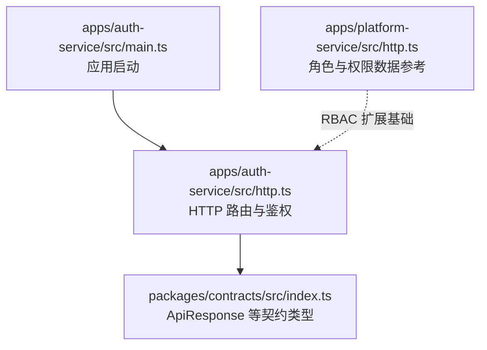
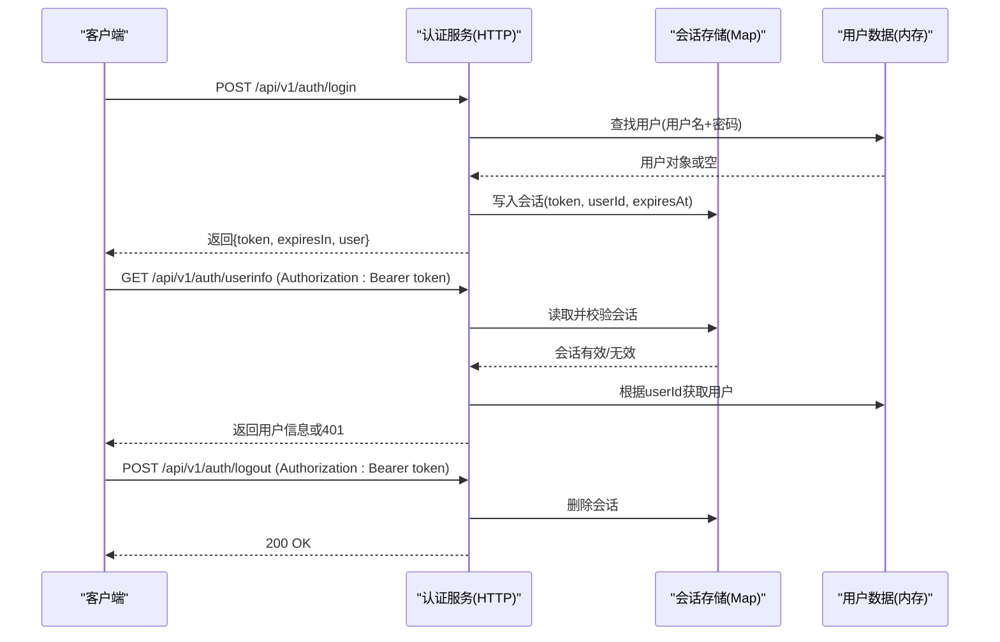
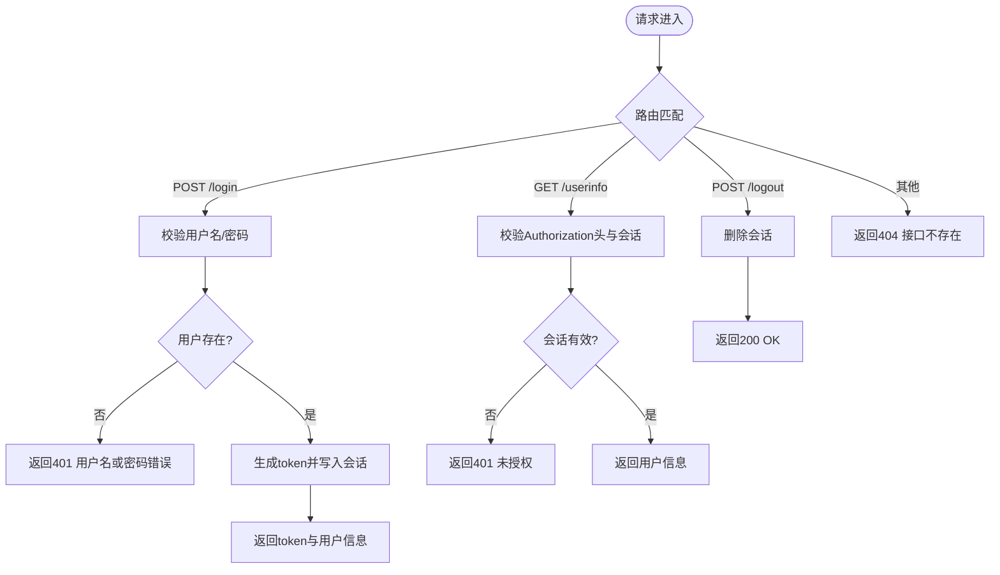
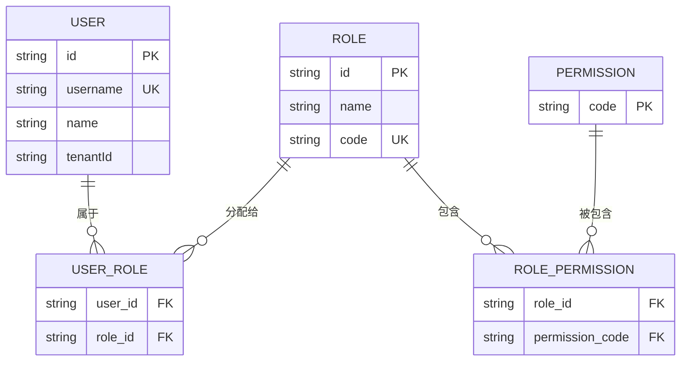
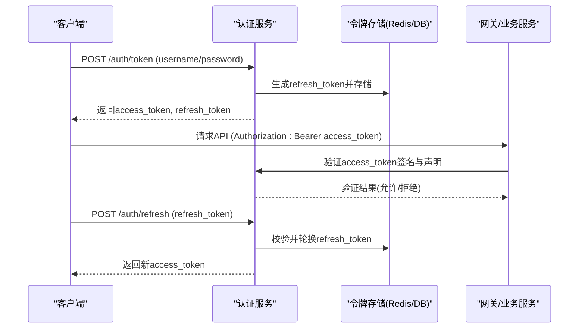
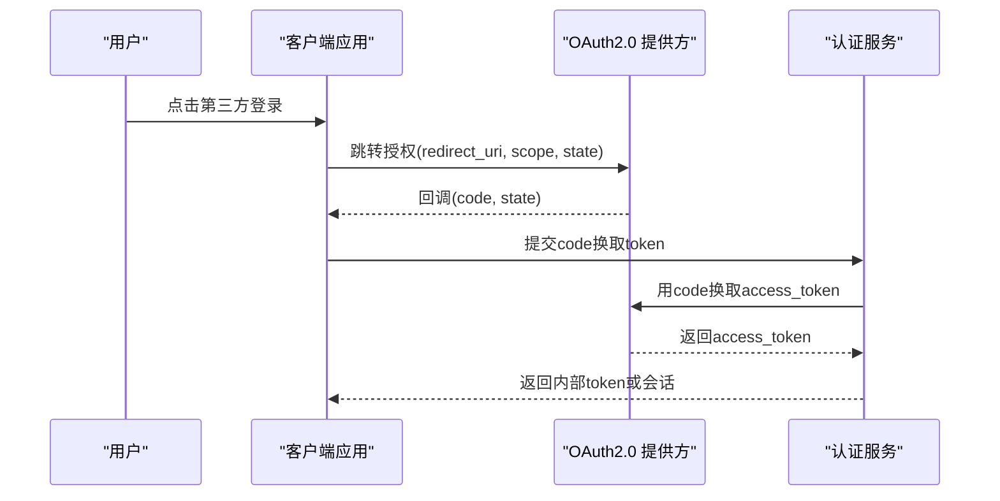
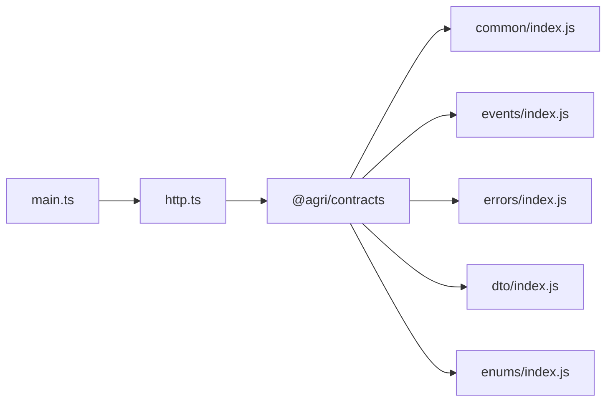

# 认证授权服务

<cite>
**本文引用的文件**   
- [apps/auth-service/src/main.ts](file://apps/auth-service/src/main.ts)
- [apps/auth-service/src/http.ts](file://apps/auth-service/src/http.ts)
- [apps/auth-service/src/app.module.ts](file://apps/auth-service/src/app.module.ts)
- [packages/contracts/src/index.ts](file://packages/contracts/src/index.ts)
- [apps/platform-service/src/http.ts](file://apps/platform-service/src/http.ts)
</cite>

## 目录
1. [简介](#简介)
2. [项目结构](#项目结构)
3. [核心组件](#核心组件)
4. [架构总览](#架构总览)
5. [详细组件分析](#详细组件分析)
6. [依赖关系分析](#依赖关系分析)
7. [性能考虑](#性能考虑)
8. [故障排查指南](#故障排查指南)
9. [结论](#结论)
10. [附录](#附录)

## 简介
本文件为认证授权服务的权威技术文档，聚焦以下目标：
- 用户身份认证与权限管理核心机制
- JWT 令牌签发、验证与刷新流程（当前实现为内存会话令牌，后续可演进为 JWT）
- RBAC（基于角色的访问控制）模型设计说明与落地建议
- OAuth2.0 协议集成方案（第三方登录与单点登录）
- 密码安全策略（加密存储、盐值生成、强度校验）
- 服务间认证机制（微服务可信通信）
- 会话管理与登录审计、安全日志记录

当前仓库中的认证授权服务以轻量 HTTP 服务器形态提供最小可用能力，包括健康检查、登录、获取用户信息、登出与会话管理。权限与角色在平台服务中另有定义，可作为 RBAC 扩展的基础。

## 项目结构
认证授权服务位于 apps/auth-service，采用极简 Node.js HTTP 服务器实现，入口 main.ts 根据环境变量选择 HTTP 模式或演示模式；HTTP 路由与鉴权逻辑集中在 http.ts。契约包 packages/contracts 作为全平台接口真相来源，被认证服务引用用于统一响应格式。

图表来源
- [apps/auth-service/src/main.ts:1-15](file://apps/auth-service/src/main.ts#L1-L15)
- [apps/auth-service/src/http.ts:1-21](file://apps/auth-service/src/http.ts#L1-L21)
- [packages/contracts/src/index.ts:1-12](file://packages/contracts/src/index.ts#L1-L12)
- [apps/platform-service/src/http.ts:7-20](file://apps/platform-service/src/http.ts#L7-L20)

章节来源
- [apps/auth-service/src/main.ts:1-15](file://apps/auth-service/src/main.ts#L1-L15)
- [apps/auth-service/src/http.ts:1-21](file://apps/auth-service/src/http.ts#L1-L21)
- [packages/contracts/src/index.ts:1-12](file://packages/contracts/src/index.ts#L1-L12)

## 核心组件
- 应用引导模块
  - main.ts：根据 SERVICE_MODE 决定启动 HTTP 服务或演示模式，监听端口并输出日志。
  - app.module.ts：NestJS 模块占位，当前未使用。
- HTTP 服务与鉴权
  - http.ts：提供健康检查、登录、获取用户信息、登出接口；维护内存会话 Map；解析 Authorization 头进行鉴权；统一 ApiResponse 响应体；注入 traceId 追踪。
- 契约类型
  - contracts/index.ts：导出 ApiResponse 等跨服务共享的契约类型，确保认证服务与其他服务保持一致的响应结构。

章节来源
- [apps/auth-service/src/main.ts:1-15](file://apps/auth-service/src/main.ts#L1-L15)
- [apps/auth-service/src/app.module.ts:1-2](file://apps/auth-service/src/app.module.ts#L1-L2)
- [apps/auth-service/src/http.ts:1-21](file://apps/auth-service/src/http.ts#L1-L21)
- [packages/contracts/src/index.ts:1-12](file://packages/contracts/src/index.ts#L1-L12)

## 架构总览
认证授权服务在当前实现中承担以下职责：
- 用户认证：用户名/密码校验，成功后颁发会话令牌（短期有效）。
- 会话管理：内存 Map 存储 token -> {userId, expiresAt}，支持过期判断与登出清理。
- 鉴权中间逻辑：从 Authorization 头提取 Bearer token，校验会话有效性后返回用户信息。
- 可观测性：通过 x-request-id 或随机 UUID 生成 traceId，贯穿请求生命周期。

图表来源
- [apps/auth-service/src/http.ts:14-20](file://apps/auth-service/src/http.ts#L14-L20)

## 详细组件分析

### 认证与鉴权流程
- 登录
  - 输入：JSON 包含 username/password。
  - 处理：匹配内存用户表，若成功则生成随机 token，设置过期时间（2小时），写入会话 Map。
  - 输出：返回 token、有效期秒数、脱敏后的用户信息。
- 获取用户信息
  - 鉴权：从 Authorization 头提取 Bearer token，查会话是否有效且未过期。
  - 输出：返回脱敏用户信息，否则返回 401。
- 登出
  - 鉴权：携带 Authorization 头，服务端删除对应会话。
  - 输出：200 OK。
- 健康检查
  - 输出：返回服务状态与健康信息。

图表来源
- [apps/auth-service/src/http.ts:14-20](file://apps/auth-service/src/http.ts#L14-L20)

章节来源
- [apps/auth-service/src/http.ts:1-21](file://apps/auth-service/src/http.ts#L1-L21)

### RBAC（基于角色的访问控制）模型设计
当前认证服务内嵌了用户对象的 roles 与 permissions 字段，但鉴权逻辑尚未使用这些字段进行细粒度控制。平台服务提供了角色与权限的数据结构与示例，可作为 RBAC 扩展的基础。

- 实体与关系
  - 用户(User)：id、username、name、roles[]、permissions[]、tenantId
  - 角色(Role)：id、name、code、permissions[]
  - 权限(Permission)：字符串标识，如 dashboard:read、telemetry:read、decision:read
  - 多对多映射：用户-角色、角色-权限
- 鉴权策略建议
  - 资源级权限：将 API 路径与方法映射到权限码集合。
  - 角色继承：管理员角色拥有通配符权限 "*"。
  - 租户隔离：所有鉴权决策需结合 tenantId 进行隔离。
- 扩展步骤
  - 在认证服务中引入角色与权限服务，加载持久化数据。
  - 在鉴权中间件中进行权限判定，拒绝无权限访问。
  - 在网关或服务间调用时透传租户上下文。

图表来源
- [apps/auth-service/src/http.ts:6-7](file://apps/auth-service/src/http.ts#L6-L7)
- [apps/platform-service/src/http.ts:7-20](file://apps/platform-service/src/http.ts#L7-L20)

章节来源
- [apps/auth-service/src/http.ts:6-7](file://apps/auth-service/src/http.ts#L6-L7)
- [apps/platform-service/src/http.ts:7-20](file://apps/platform-service/src/http.ts#L7-L20)

### JWT 令牌签发、验证与刷新流程（规划）
当前实现使用内存会话令牌，非 JWT。建议按如下方式演进：
- 签发
  - 使用 HS256/RS256 算法签发 access_token，包含子声明 sub、租户 tenantId、角色 roles、权限 permissions、过期时间 exp。
  - 同时签发 refresh_token，独立存储于后端（Redis/数据库），绑定用户与设备指纹。
- 验证
  - 网关或业务服务通过公钥或共享密钥验证签名，校验 exp、nbf、iss、aud 等标准声明。
  - 可选黑名单/撤销列表用于强制失效。
- 刷新
  - 使用 refresh_token 换取新的 access_token，必要时轮换 refresh_token。
  - 刷新失败时要求重新登录。

图表来源
- [apps/auth-service/src/http.ts:14-20](file://apps/auth-service/src/http.ts#L14-L20)

章节来源
- [apps/auth-service/src/http.ts:14-20](file://apps/auth-service/src/http.ts#L14-L20)

### OAuth2.0 集成方案（第三方登录与单点登录）
- 授权码模式（Authorization Code）
  - 适用于 Web 应用，前端跳转至第三方授权页，回调携带 code，后端交换 access_token。
- 隐式模式（Implicit）
  - 不推荐，仅兼容旧版客户端。
- 客户端凭证模式（Client Credentials）
  - 适用于服务间调用，使用 client_id/client_secret 获取 access_token。
- 单点登录（SSO）
  - 通过 OIDC Provider 实现统一身份源，各服务信任同一 issuer。
- 安全要点
  - 使用 HTTPS、PKCE（移动端）、state 防 CSRF、nonce 防重放。
  - 限制 redirect_uri、scope 白名单。

图表来源
- [apps/auth-service/src/http.ts:14-20](file://apps/auth-service/src/http.ts#L14-L20)

章节来源
- [apps/auth-service/src/http.ts:14-20](file://apps/auth-service/src/http.ts#L14-L20)

### 密码安全策略
- 加密存储
  - 禁止明文存储密码，使用 bcrypt/scrypt/argon2 等强哈希算法加盐存储。
- 盐值生成
  - 每次密码更新生成唯一盐值，避免彩虹表攻击。
- 密码强度校验
  - 长度、复杂度（大小写、数字、特殊字符）、常见弱口令黑名单。
- 传输安全
  - 全站 HTTPS，防止中间人窃听。
- 当前实现现状
  - 当前用户密码为明文比较，应尽快迁移至哈希比对。

章节来源
- [apps/auth-service/src/http.ts:6-7](file://apps/auth-service/src/http.ts#L6-L7)

### 服务间认证机制
- 客户端凭证模式
  - 服务使用 client_id/client_secret 向认证服务申请 access_token，并在后续调用中携带 Authorization 头。
- 网关前置校验
  - 网关统一验证 token 签名与权限，转发可信上下文（tenantId、traceId、scopes）。
- 双向 TLS（mTLS）
  - 在敏感链路启用 mTLS，增强服务间通信可信度。
- 当前实现现状
  - 认证服务未提供服务间令牌签发端点，可在现有登录/鉴权基础上扩展客户端凭证模式。

章节来源
- [apps/auth-service/src/http.ts:14-20](file://apps/auth-service/src/http.ts#L14-L20)

### 会话管理与登录审计、安全日志
- 会话管理
  - 使用内存 Map 存储 token -> {userId, expiresAt}，支持过期判断与登出清理。
  - 建议迁移至 Redis 以实现水平扩展与分布式一致性。
- 登录审计
  - 记录登录成功/失败、IP、UA、时间戳、traceId。
- 安全日志
  - 统一结构化日志，包含请求 ID、租户、操作主体、结果与风险等级。
- 当前实现现状
  - 已注入 traceId，但未记录审计日志；建议在鉴权关键路径增加审计事件。

章节来源
- [apps/auth-service/src/http.ts:1-21](file://apps/auth-service/src/http.ts#L1-L21)

## 依赖关系分析
- 模块依赖
  - main.ts 依赖 http.ts 提供的 createAuthHttpServer。
  - http.ts 依赖 node:http、node:crypto 与 @agri/contracts 的 ApiResponse。
  - contracts/index.ts 汇总导出 common/events/errors/dto/enums，作为契约真相来源。
- 外部耦合
  - 当前为内存实现，无数据库与缓存依赖，便于本地开发。
  - 未来扩展需引入 Redis/PostgreSQL 与消息队列。

图表来源
- [apps/auth-service/src/main.ts:1-15](file://apps/auth-service/src/main.ts#L1-L15)
- [apps/auth-service/src/http.ts:1-21](file://apps/auth-service/src/http.ts#L1-L21)
- [packages/contracts/src/index.ts:1-12](file://packages/contracts/src/index.ts#L1-L12)

章节来源
- [apps/auth-service/src/main.ts:1-15](file://apps/auth-service/src/main.ts#L1-L15)
- [apps/auth-service/src/http.ts:1-21](file://apps/auth-service/src/http.ts#L1-L21)
- [packages/contracts/src/index.ts:1-12](file://packages/contracts/src/index.ts#L1-L12)

## 性能考虑
- 会话存储
  - 内存 Map 在高并发下存在丢失与不一致风险，建议替换为 Redis。
- 鉴权开销
  - 当前鉴权为 O(1) 查表，未来引入 JWT 验证时需考虑 CPU 开销与缓存策略。
- 日志与审计
  - 异步落盘，避免阻塞主流程；批量写入与采样降低 I/O 压力。
- 限流与防暴破
  - 对登录接口实施速率限制与账户锁定策略。

[本节为通用指导，不涉及具体文件]

## 故障排查指南
- 常见问题
  - 401 未授权：检查 Authorization 头是否正确携带 Bearer token，确认会话未过期。
  - 404 接口不存在：确认请求路径与方法正确。
  - 用户名或密码错误：核对凭据，检查用户数据是否初始化。
- 诊断步骤
  - 查看 traceId 定位请求链路。
  - 检查会话 Map 是否存在对应 token 且未过期。
  - 开启更详细的日志输出，记录请求头与响应体摘要。
- 恢复措施
  - 清理过期会话或重启服务（内存实现）。
  - 修正客户端 Authorization 头格式。

章节来源
- [apps/auth-service/src/http.ts:14-20](file://apps/auth-service/src/http.ts#L14-L20)

## 结论
当前认证授权服务提供了最小可用的认证与会话管理能力，并通过 ApiResponse 契约保证与其他服务的一致性。为实现企业级安全与可扩展性，建议优先完成以下演进：
- 引入 JWT 签发与验证，支持令牌刷新与撤销。
- 完善 RBAC 鉴权中间件，结合租户隔离。
- 集成 OAuth2.0/OIDC，支持第三方登录与 SSO。
- 强化密码安全策略，迁移至哈希存储与强度校验。
- 升级会话存储至 Redis，并完善审计与安全日志。

[本节为总结性内容，不涉及具体文件]

## 附录
- 环境变量
  - SERVICE_MODE：http | demo，控制启动模式。
  - PORT：HTTP 服务监听端口，默认 3001。
- 接口清单
  - GET /health：健康检查
  - POST /api/v1/auth/login：登录
  - GET /api/v1/auth/userinfo：获取用户信息
  - POST /api/v1/auth/logout：登出

章节来源
- [apps/auth-service/src/main.ts:1-15](file://apps/auth-service/src/main.ts#L1-L15)
- [apps/auth-service/src/http.ts:14-20](file://apps/auth-service/src/http.ts#L14-L20)