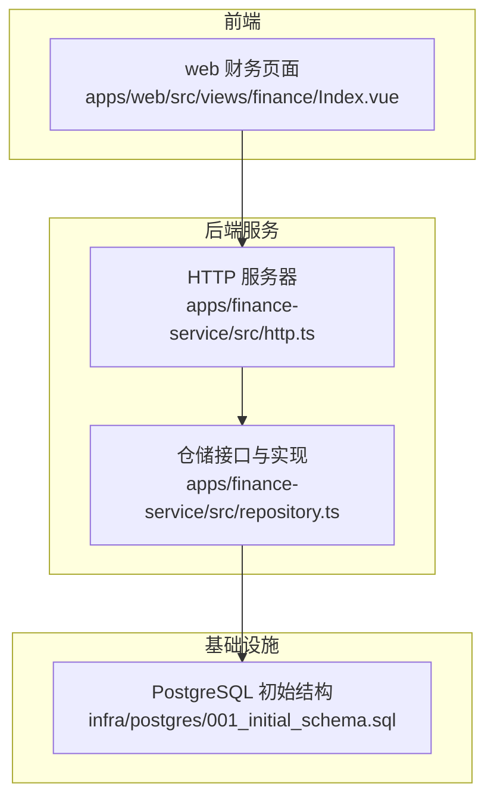
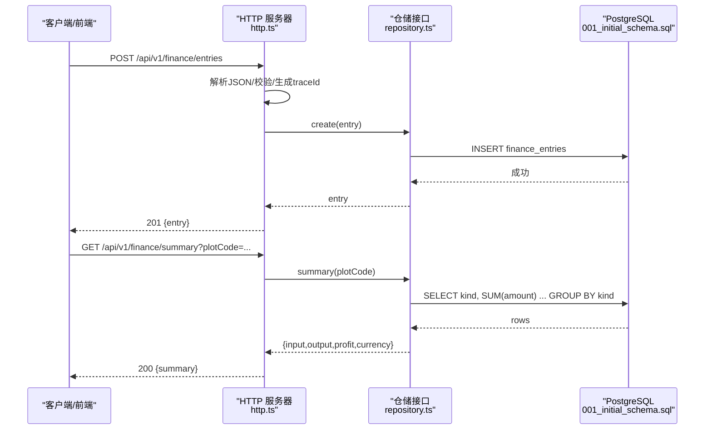
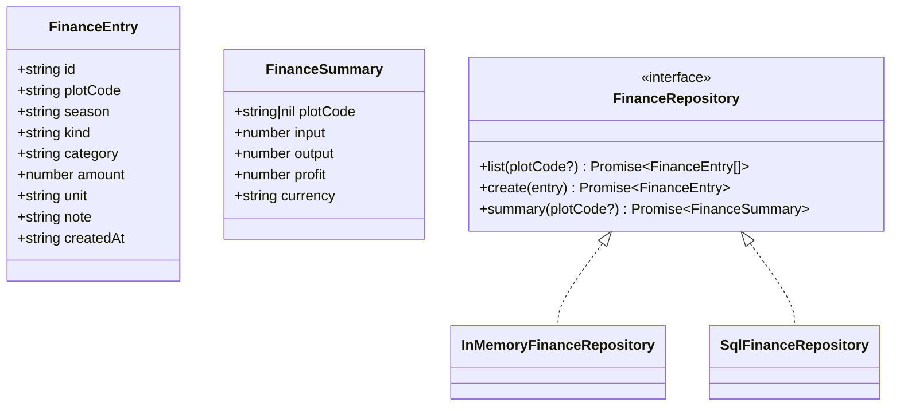
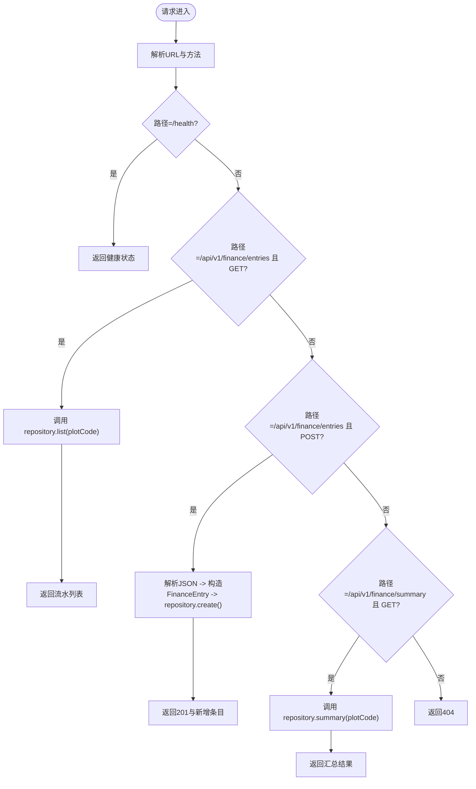
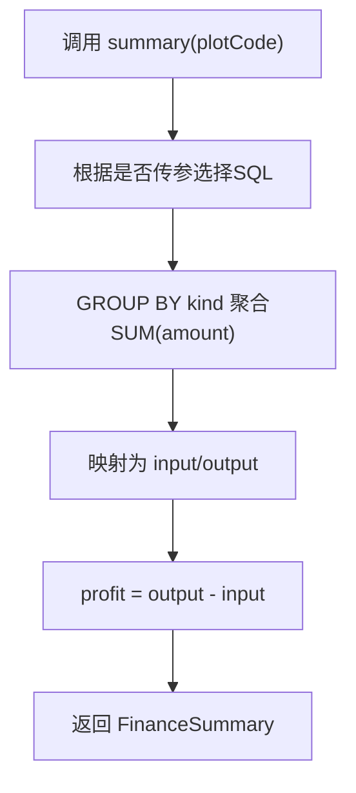
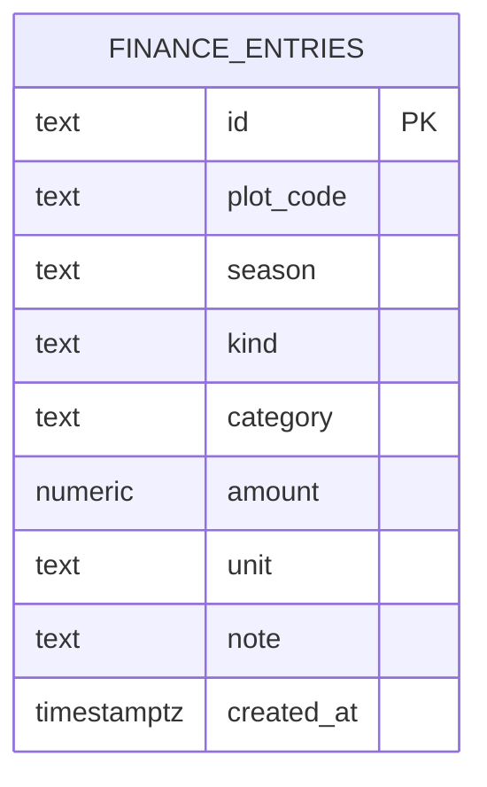
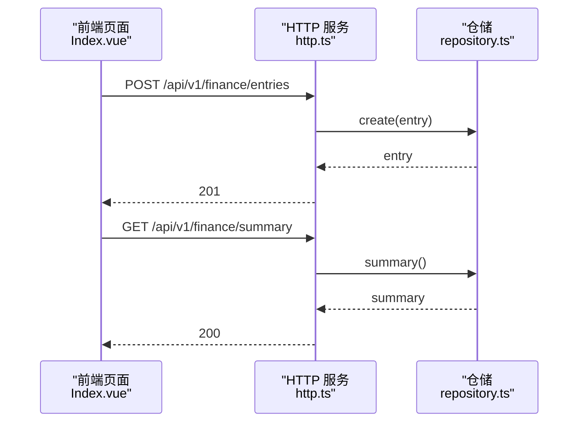
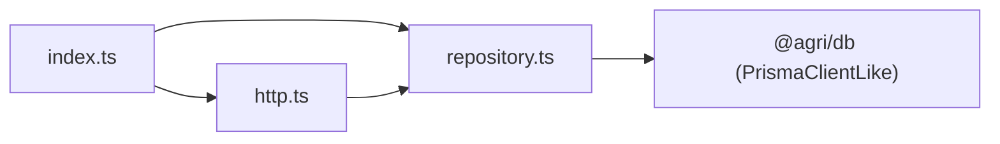

# 财务管理服务

<cite>
**本文引用的文件**   
- [apps/finance-service/src/http.ts](file://apps/finance-service/src/http.ts)
- [apps/finance-service/src/repository.ts](file://apps/finance-service/src/repository.ts)
- [apps/finance-service/src/index.ts](file://apps/finance-service/src/index.ts)
- [infra/postgres/001_initial_schema.sql](file://infra/postgres/001_initial_schema.sql)
- [apps/web/src/views/finance/Index.vue](file://apps/web/src/views/finance/Index.vue)
</cite>

## 目录
1. [引言](#引言)
2. [项目结构](#项目结构)
3. [核心组件](#核心组件)
4. [架构总览](#架构总览)
5. [详细组件分析](#详细组件分析)
6. [依赖关系分析](#依赖关系分析)
7. [性能与扩展性](#性能与扩展性)
8. [故障排查指南](#故障排查指南)
9. [结论](#结论)
10. [附录：接口定义与数据模型](#附录接口定义与数据模型)

## 引言
本文件面向农业财务管理系统中的“财务管理服务”，聚焦以下目标：
- 收支记录、成本核算、利润分析与财务报表生成
- FinanceEntry 数据模型设计（收入分类、支出类别、会计科目、凭证管理）
- 复式记账法的实现原理与落地方案
- 统计分析能力（月度报表、年度汇总、成本分析、预算对比）
- 数据导出接口（Excel、PDF 等）
- 审计追踪与异常检测机制

当前仓库已提供最小可用的财务服务实现，包括 HTTP 接口、内存与 PostgreSQL 两种仓储实现、数据库表结构与前端页面。后续章节将基于现有代码进行系统化说明，并给出扩展建议以满足更完整的财务业务需求。

## 项目结构
财务管理服务位于 apps/finance-service 模块，对外暴露 HTTP API；数据持久化通过 PostgreSQL 迁移脚本维护；前端在 apps/web 中提供登记与查询界面。

图表来源
- [apps/finance-service/src/http.ts:1-17](file://apps/finance-service/src/http.ts#L1-L17)
- [apps/finance-service/src/repository.ts:1-22](file://apps/finance-service/src/repository.ts#L1-L22)
- [infra/postgres/001_initial_schema.sql:18-29](file://infra/postgres/001_initial_schema.sql#L18-L29)
- [apps/web/src/views/finance/Index.vue:1-47](file://apps/web/src/views/finance/Index.vue#L1-L47)

章节来源
- [apps/finance-service/src/http.ts:1-17](file://apps/finance-service/src/http.ts#L1-L17)
- [apps/finance-service/src/repository.ts:1-22](file://apps/finance-service/src/repository.ts#L1-L22)
- [infra/postgres/001_initial_schema.sql:18-29](file://infra/postgres/001_initial_schema.sql#L18-L29)
- [apps/web/src/views/finance/Index.vue:1-47](file://apps/web/src/views/finance/Index.vue#L1-L47)

## 核心组件
- HTTP 层：统一请求解析、响应封装、链路追踪、路由分发
- 仓储层：FinanceRepository 接口 + InMemoryFinanceRepository + SqlFinanceRepository
- 数据模型：FinanceEntry、FinanceSummary
- 数据库：finance_entries 表及索引
- 前端：财务登记与汇总展示

章节来源
- [apps/finance-service/src/http.ts:1-17](file://apps/finance-service/src/http.ts#L1-L17)
- [apps/finance-service/src/repository.ts:1-22](file://apps/finance-service/src/repository.ts#L1-L22)
- [infra/postgres/001_initial_schema.sql:18-29](file://infra/postgres/001_initial_schema.sql#L18-L29)
- [apps/web/src/views/finance/Index.vue:1-47](file://apps/web/src/views/finance/Index.vue#L1-L47)

## 架构总览
服务采用轻量 Node.js HTTP 服务 + 仓储抽象的架构，便于在测试环境使用内存实现，在生产环境切换为 PostgreSQL 实现。

图表来源
- [apps/finance-service/src/http.ts:10-16](file://apps/finance-service/src/http.ts#L10-L16)
- [apps/finance-service/src/repository.ts:15-21](file://apps/finance-service/src/repository.ts#L15-L21)
- [infra/postgres/001_initial_schema.sql:18-29](file://infra/postgres/001_initial_schema.sql#L18-L29)

## 详细组件分析

### 数据模型与领域概念
- FinanceEntry：单笔财务流水，包含地块编码、季节、类型（投入/产出）、类别、金额、单位、备注、创建时间
- FinanceSummary：按地块或全局汇总的投入合计、产出合计、利润、币种
- 领域语义：
  - 类型 kind：INPUT 表示投入（成本），OUTPUT 表示产出（收入）
  - 类别 category：用于区分不同成本或收入来源（如农资、人工、销售等）
  - 季节 season：用于季节性核算（如作物季）
  - 单位 unit：默认元，可支持其他货币单位

图表来源
- [apps/finance-service/src/repository.ts:3-21](file://apps/finance-service/src/repository.ts#L3-L21)

章节来源
- [apps/finance-service/src/repository.ts:3-21](file://apps/finance-service/src/repository.ts#L3-L21)

### HTTP 接口与处理流程
- 健康检查：GET /health
- 流水列表：GET /api/v1/finance/entries?plotCode=...
- 新增流水：POST /api/v1/finance/entries
- 汇总查询：GET /api/v1/finance/summary?plotCode=...

图表来源
- [apps/finance-service/src/http.ts:10-16](file://apps/finance-service/src/http.ts#L10-L16)

章节来源
- [apps/finance-service/src/http.ts:1-17](file://apps/finance-service/src/http.ts#L1-L17)

### 仓储实现与数据流
- InMemoryFinanceRepository：内存数组存储，适合单元测试与快速验证
- SqlFinanceRepository：基于 PrismaClientLike 执行原生 SQL，生产环境使用
- 关键逻辑：
  - list：按 plotCode 过滤并按 created_at 倒序
  - create：插入 finance_entries 表
  - summary：按 kind 分组求和，计算利润 = 产出合计 - 投入合计

图表来源
- [apps/finance-service/src/repository.ts:15-21](file://apps/finance-service/src/repository.ts#L15-L21)

章节来源
- [apps/finance-service/src/repository.ts:7-21](file://apps/finance-service/src/repository.ts#L7-L21)

### 数据库设计与约束
- finance_entries 表字段：id、plot_code、season、kind、category、amount、unit、note、created_at
- 约束：
  - kind 仅允许 INPUT 或 OUTPUT
  - amount >= 0
- 索引：idx_finance_entries_plot_created(plot_code, created_at DESC) 优化按地块和时间排序查询

图表来源
- [infra/postgres/001_initial_schema.sql:18-29](file://infra/postgres/001_initial_schema.sql#L18-L29)

章节来源
- [infra/postgres/001_initial_schema.sql:18-29](file://infra/postgres/001_initial_schema.sql#L18-L29)

### 前端集成与交互
- 功能：
  - 表单登记：输入地块编码、类型、类别、金额、单位、备注
  - 刷新列表：调用 entries 接口
  - 显示汇总：展示投入合计、产出合计、利润
- 交互流程：提交后调用 createEntry，成功后刷新列表与汇总

图表来源
- [apps/web/src/views/finance/Index.vue:32-39](file://apps/web/src/views/finance/Index.vue#L32-L39)
- [apps/finance-service/src/http.ts:10-16](file://apps/finance-service/src/http.ts#L10-L16)

章节来源
- [apps/web/src/views/finance/Index.vue:1-47](file://apps/web/src/views/finance/Index.vue#L1-L47)

## 依赖关系分析
- 模块导出：index.ts 统一导出 HTTP 服务工厂、仓储实现与类型
- 外部依赖：
  - @agri/db 提供 PrismaClientLike
  - @agri/contracts 提供 ApiResponse 类型
- 耦合点：
  - http.ts 依赖 repository.ts 的 FinanceRepository 接口
  - SqlFinanceRepository 依赖数据库连接对象

图表来源
- [apps/finance-service/src/index.ts:1-5](file://apps/finance-service/src/index.ts#L1-L5)
- [apps/finance-service/src/http.ts:1-7](file://apps/finance-service/src/http.ts#L1-L7)
- [apps/finance-service/src/repository.ts:1-2](file://apps/finance-service/src/repository.ts#L1-L2)

章节来源
- [apps/finance-service/src/index.ts:1-5](file://apps/finance-service/src/index.ts#L1-L5)
- [apps/finance-service/src/http.ts:1-7](file://apps/finance-service/src/http.ts#L1-L7)
- [apps/finance-service/src/repository.ts:1-2](file://apps/finance-service/src/repository.ts#L1-L2)

## 性能与扩展性
- 查询性能：
  - 使用 plot_code + created_at 复合索引优化列表查询
  - 汇总使用数据库侧 GROUP BY + SUM，减少应用层计算开销
- 可扩展点：
  - 增加分页参数到 list 接口
  - 增加批量写入接口以提升吞吐
  - 引入缓存层（如 Redis）缓存热点汇总数据
  - 增加事务边界确保多写一致性

[本节为通用指导，不直接分析具体文件]

## 故障排查指南
- 常见错误：
  - 请求体非 JSON 对象：HTTP 层会抛出错误并返回 400
  - 未找到接口：返回 404
  - 数据库写入失败：需检查连接与表结构
- 排查步骤：
  - 查看 traceId 定位请求链路
  - 检查数据库表是否存在 finance_entries 及索引
  - 校验传入字段是否符合约束（kind、amount>=0）

章节来源
- [apps/finance-service/src/http.ts:7-16](file://apps/finance-service/src/http.ts#L7-L16)
- [infra/postgres/001_initial_schema.sql:18-29](file://infra/postgres/001_initial_schema.sql#L18-L29)

## 结论
当前财务管理服务提供了最小可用的收支登记与汇总能力，具备清晰的接口与仓储抽象，并通过 PostgreSQL 保证数据持久化。为满足完整财务业务需求，建议在现有基础上扩展复式记账、审计追踪、统计报表与导出能力，同时完善校验与事务控制，提升准确性与可追溯性。

[本节为总结性内容，不直接分析具体文件]

## 附录：接口定义与数据模型

### HTTP 接口清单
- GET /health
  - 返回服务健康状态
- GET /api/v1/finance/entries?plotCode=...
  - 返回流水列表
- POST /api/v1/finance/entries
  - 请求体：plotCode、season、kind、category、amount、unit、note
  - 返回新增流水
- GET /api/v1/finance/summary?plotCode=...
  - 返回汇总：input、output、profit、currency

章节来源
- [apps/finance-service/src/http.ts:10-16](file://apps/finance-service/src/http.ts#L10-L16)

### 数据模型要点
- FinanceEntry：id、plotCode、season、kind、category、amount、unit、note、createdAt
- FinanceSummary：plotCode、input、output、profit、currency
- 数据库表：finance_entries（含约束与索引）

章节来源
- [apps/finance-service/src/repository.ts:3-21](file://apps/finance-service/src/repository.ts#L3-L21)
- [infra/postgres/001_initial_schema.sql:18-29](file://infra/postgres/001_initial_schema.sql#L18-L29)