# 财务管理服务

<cite>
**本文引用的文件**   
- [apps/finance-service/src/http.ts](file://apps/finance-service/src/http.ts)
- [apps/finance-service/src/repository.ts](file://apps/finance-service/src/repository.ts)
- [apps/finance-service/src/index.ts](file://apps/finance-service/src/index.ts)
- [apps/finance-service/test/http-report.spec.ts](file://apps/finance-service/test/http-report.spec.ts)
- [infra/postgres/001_initial_schema.sql](file://infra/postgres/001_initial_schema.sql)
- [apps/web/src/views/finance/Index.vue](file://apps/web/src/views/finance/Index.vue)
- [apps/web/src/api/index.ts](file://apps/web/src/api/index.ts)
</cite>

## 更新摘要
**变更内容**   
- 新增三维聚合报表系统（月度投入产出、类别构成、地块利润排行）
- 新增 GET /api/v1/finance/report 接口，支持 Asia/Shanghai 时区
- 增强前端财务报告展示，集成 ECharts 图表可视化
- 实现按 kind/category/season/keyword/from/to 的动态筛选联动

## 目录
1. [引言](#引言)
2. [项目结构](#项目结构)
3. [核心组件](#核心组件)
4. [架构总览](#架构总览)
5. [详细组件分析](#详细组件分析)
6. [依赖关系分析](#依赖关系分析)
7. [性能与扩展性](#性能与扩展性)
8. [故障排查指南](#故障排查指南)
9. [结论](#结论)
10. [附录：接口定义与数据模型](#附录接口定义与数据模型)

## 引言
本文件面向农业财务管理系统中的"财务管理服务"，聚焦以下目标：
- 收支记录、成本核算、利润分析与财务报表生成
- FinanceEntry 数据模型设计（收入分类、支出类别、会计科目、凭证管理）
- 复式记账法的实现原理与落地方案
- **新增** 三维聚合统计分析能力（月度报表、类别分析、地块利润排行）
- **新增** 基于 Asia/Shanghai 时区的业务月计算
- 数据导出接口（Excel、PDF 等）
- 审计追踪与异常检测机制

当前仓库已提供完整的财务服务实现，包括 HTTP 接口、内存与 PostgreSQL 两种仓储实现、数据库表结构与前端页面。**最新更新**包含了全面的财务报告功能，支持三维聚合分析和时区处理。

## 项目结构
财务管理服务位于 apps/finance-service 模块，对外暴露 HTTP API；数据持久化通过 PostgreSQL 迁移脚本维护；前端在 apps/web 中提供登记、查询与可视化报表界面。

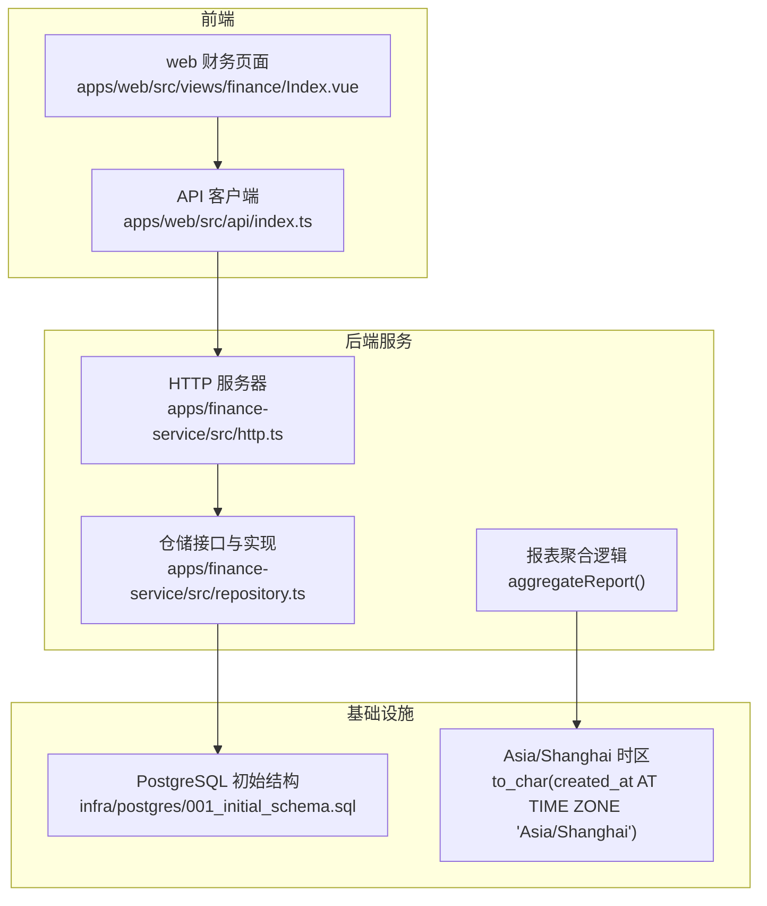

**图表来源**
- [apps/finance-service/src/http.ts:1-58](file://apps/finance-service/src/http.ts#L1-L58)
- [apps/finance-service/src/repository.ts:1-94](file://apps/finance-service/src/repository.ts#L1-L94)
- [apps/web/src/views/finance/Index.vue:1-276](file://apps/web/src/views/finance/Index.vue#L1-L276)
- [apps/web/src/api/index.ts:762-795](file://apps/web/src/api/index.ts#L762-L795)

## 核心组件
- HTTP 层：统一请求解析、响应封装、链路追踪、路由分发
- 仓储层：FinanceRepository 接口 + InMemoryFinanceRepository + SqlFinanceRepository
- **新增** 报表聚合层：aggregateReport() 函数与 FinanceReport 类型
- 数据模型：FinanceEntry、FinanceSummary、**FinanceReport**（包含 months、categories、plots）
- 数据库：finance_entries 表及索引
- 前端：财务登记、查询、汇总展示与**三维报表可视化**

**章节来源**
- [apps/finance-service/src/http.ts:1-58](file://apps/finance-service/src/http.ts#L1-L58)
- [apps/finance-service/src/repository.ts:1-94](file://apps/finance-service/src/repository.ts#L1-L94)
- [apps/web/src/views/finance/Index.vue:1-276](file://apps/web/src/views/finance/Index.vue#L1-L276)

## 架构总览
服务采用轻量 Node.js HTTP 服务 + 仓储抽象的架构，**新增三维报表聚合能力**，便于在测试环境使用内存实现，在生产环境切换为 PostgreSQL 实现。

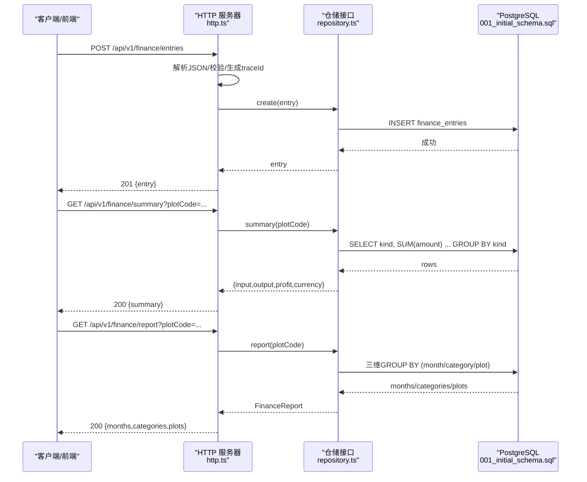

**图表来源**
- [apps/finance-service/src/http.ts:33-55](file://apps/finance-service/src/http.ts#L33-L55)
- [apps/finance-service/src/repository.ts:64-92](file://apps/finance-service/src/repository.ts#L64-L92)

## 详细组件分析

### 数据模型与领域概念
- FinanceEntry：单笔财务流水，包含地块编码、季节、类型（投入/产出）、类别、金额、单位、备注、创建时间
- FinanceSummary：按地块或全局汇总的投入合计、产出合计、利润、币种
- **FinanceReport**：**新增** 三维聚合报表，包含月份维度、类别维度、地块维度
- **FinanceReportMonth**：**新增** 月度聚合数据（month、input、output、profit）
- **FinanceReportCategory**：**新增** 类别聚合数据（kind、category、amount）
- **FinanceReportPlot**：**新增** 地块聚合数据（plotCode、input、output、profit）
- 领域语义：
  - 类型 kind：INPUT 表示投入（成本），OUTPUT 表示产出（收入）
  - 类别 category：用于区分不同成本或收入来源（如农资、人工、销售等）
  - 季节 season：用于季节性核算（如作物季）
  - 单位 unit：默认元，可支持其他货币单位

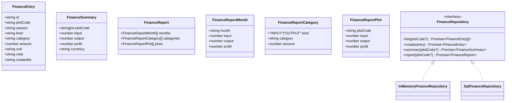

**图表来源**
- [apps/finance-service/src/repository.ts:4-11](file://apps/finance-service/src/repository.ts#L4-L11)

**章节来源**
- [apps/finance-service/src/repository.ts:4-11](file://apps/finance-service/src/repository.ts#L4-L11)

### HTTP 接口与处理流程
- 健康检查：GET /health
- 流水列表：GET /api/v1/finance/entries?plotCode=...
- 新增流水：POST /api/v1/finance/entries
- 汇总查询：GET /api/v1/finance/summary?plotCode=...
- **新增** 报表查询：GET /api/v1/finance/report?plotCode=...

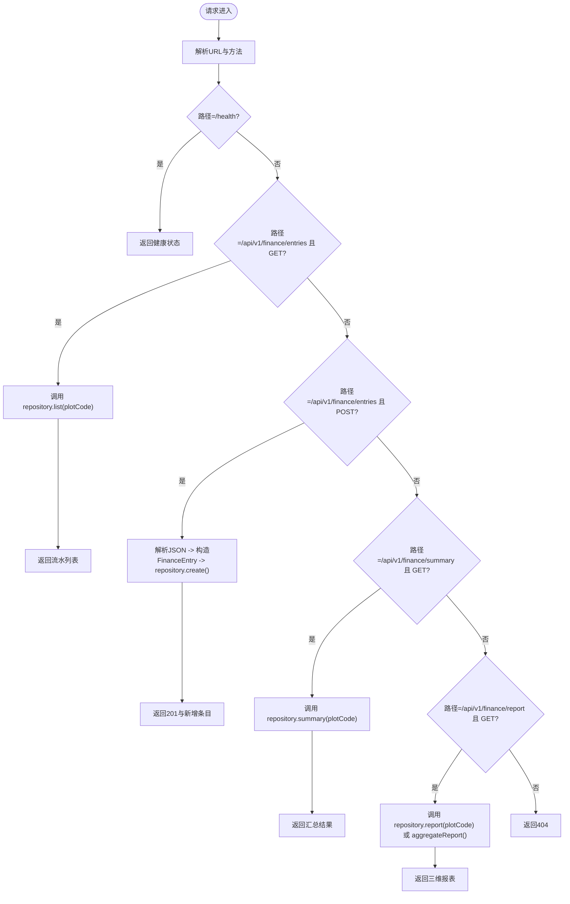

**图表来源**
- [apps/finance-service/src/http.ts:33-55](file://apps/finance-service/src/http.ts#L33-L55)

**章节来源**
- [apps/finance-service/src/http.ts:1-58](file://apps/finance-service/src/http.ts#L1-L58)

### 仓储实现与数据流
- InMemoryFinanceRepository：内存数组存储，适合单元测试与快速验证
- SqlFinanceRepository：基于 PrismaClientLike 执行原生 SQL，生产环境使用
- **新增** aggregateReport()：内存聚合函数，用于带筛选条件的动态报表计算
- 关键逻辑：
  - list：按 plotCode 过滤并按 created_at 倒序
  - create：插入 finance_entries 表
  - summary：按 kind 分组求和，计算利润 = 产出合计 - 投入合计
  - **report**：**新增** 三维聚合，分别按 month、category、plotCode 分组统计

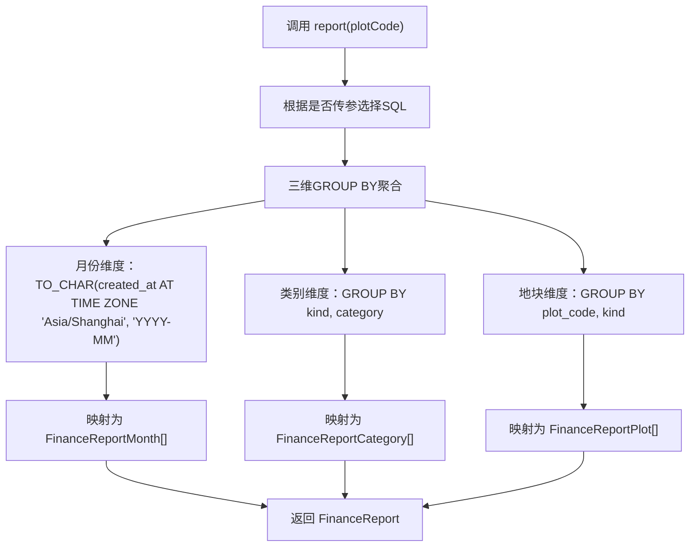

**图表来源**
- [apps/finance-service/src/repository.ts:64-92](file://apps/finance-service/src/repository.ts#L64-L92)

**章节来源**
- [apps/finance-service/src/repository.ts:48-94](file://apps/finance-service/src/repository.ts#L48-L94)

### 三维聚合报表系统
**新增** 完整的三维聚合报表系统，支持三种维度的财务数据分析：

#### 月份维度（FinanceReportMonth）
- 使用 Asia/Shanghai 时区计算业务月份
- 按月统计投入、产出和利润
- 支持跨年数据处理（东八区日历日）

#### 类别维度（FinanceReportCategory）  
- 按 kind 和 category 组合统计
- 显示各类别的投入产出金额
- 支持多种费用类型（农资、人工、机械、销售等）

#### 地块维度（FinanceReportPlot）
- 按 plotCode 统计各块地投入产出
- 计算每块地的净利润
- 支持未关联地块的处理

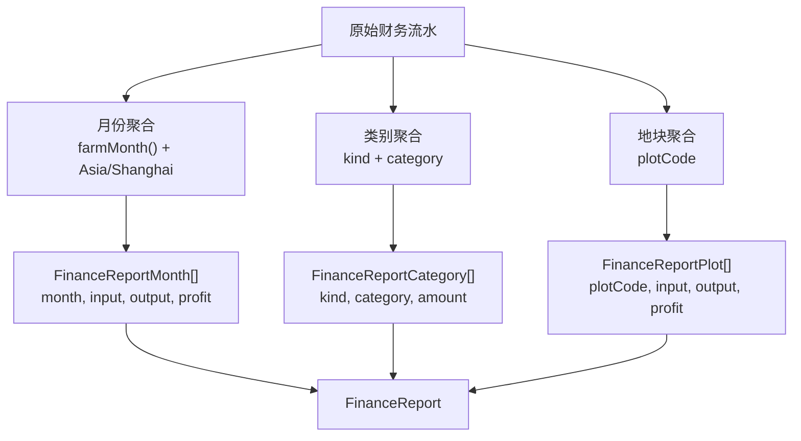

**图表来源**
- [apps/finance-service/src/repository.ts:13-46](file://apps/finance-service/src/repository.ts#L13-L46)

**章节来源**
- [apps/finance-service/src/repository.ts:13-46](file://apps/finance-service/src/repository.ts#L13-L46)

### 时区处理与业务月计算
**新增** 基于 Asia/Shanghai 时区的业务月计算逻辑：

- 使用 `Intl.DateTimeFormat` 配合 `timeZone: "Asia/Shanghai"` 确保跨时区一致性
- 将 UTC 时间转换为东八区日期后提取 YYYY-MM 格式的业务月份
- 解决跨年问题（如 2025-12-31T16:30:00.000Z 在东八区属于 2026-01）
- 与数据库侧 `to_char(created_at AT TIME ZONE 'Asia/Shanghai', 'YYYY-MM')` 保持一致

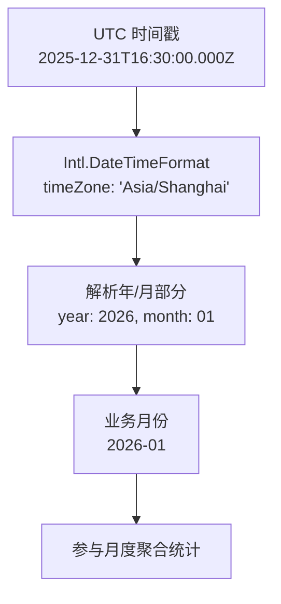

**图表来源**
- [apps/finance-service/src/repository.ts:13-19](file://apps/finance-service/src/repository.ts#L13-L19)

**章节来源**
- [apps/finance-service/src/repository.ts:13-19](file://apps/finance-service/src/repository.ts#L13-L19)

### 数据库设计与约束
- finance_entries 表字段：id、plot_code、season、kind、category、amount、unit、note、created_at
- 约束：
  - kind 仅允许 INPUT 或 OUTPUT
  - amount >= 0
- 索引：idx_finance_entries_plot_created(plot_code, created_at DESC) 优化按地块和时间排序查询
- **新增** 报表查询优化：
  - 月份维度：`to_char(created_at AT TIME ZONE 'Asia/Shanghai', 'YYYY-MM')`
  - 类别维度：`GROUP BY kind, category`
  - 地块维度：`GROUP BY plot_code, kind`

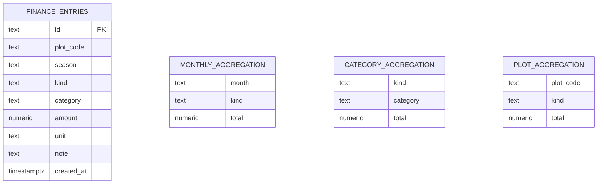

**图表来源**
- [infra/postgres/001_initial_schema.sql:18-29](file://infra/postgres/001_initial_schema.sql#L18-L29)
- [apps/finance-service/src/repository.ts:67-72](file://apps/finance-service/src/repository.ts#L67-L72)

**章节来源**
- [infra/postgres/001_initial_schema.sql:18-29](file://infra/postgres/001_initial_schema.sql#L18-L29)

### 前端集成与交互
- 功能：
  - 表单登记：输入地块编码、类型、类别、金额、单位、备注
  - 刷新列表：调用 entries 接口
  - 显示汇总：展示投入合计、产出合计、利润
  - **新增** 三维报表可视化：月度趋势图、类别饼图、地块利润排行图
- 交互流程：提交后调用 createEntry，成功后刷新列表、汇总与报表

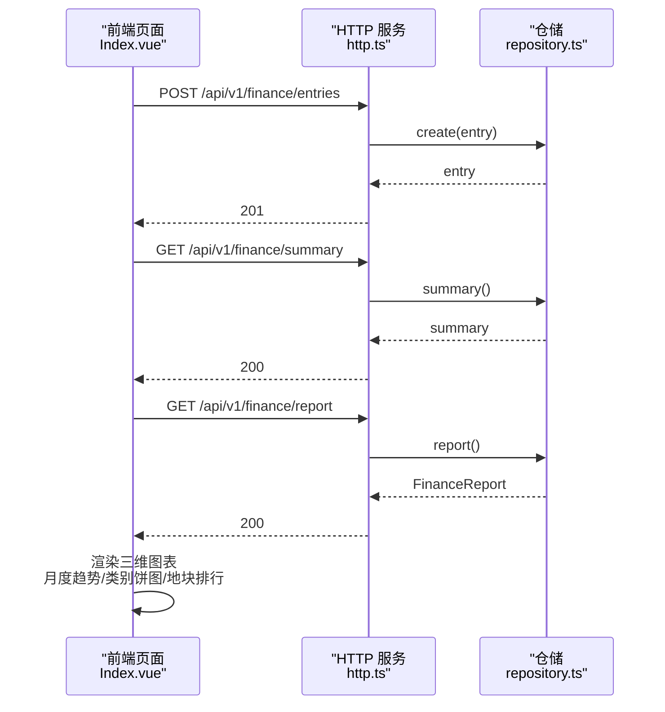

**图表来源**
- [apps/web/src/views/finance/Index.vue:183-190](file://apps/web/src/views/finance/Index.vue#L183-L190)
- [apps/web/src/views/finance/Index.vue:192-223](file://apps/web/src/views/finance/Index.vue#L192-L223)

**章节来源**
- [apps/web/src/views/finance/Index.vue:1-276](file://apps/web/src/views/finance/Index.vue#L1-L276)

### 动态筛选与联动机制
**新增** 智能筛选联动机制，支持多种筛选条件：

- 筛选参数：kind、category、season、keyword、from、to
- 联动逻辑：当存在附加筛选条件时，报表改用内存聚合保证与列表数据一致
- 性能优化：无筛选时走数据库 GROUP BY，有筛选时走内存聚合
- 用户体验：卡片数字、图表数据与列表数据实时联动

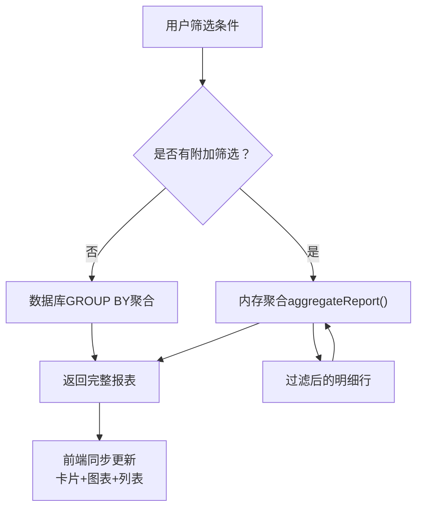

**图表来源**
- [apps/finance-service/src/http.ts:29-54](file://apps/finance-service/src/http.ts#L29-L54)

**章节来源**
- [apps/finance-service/src/http.ts:11-54](file://apps/finance-service/src/http.ts#L11-L54)

## 依赖关系分析
- 模块导出：index.ts 统一导出 HTTP 服务工厂、仓储实现与类型
- 外部依赖：
  - @agri/db 提供 PrismaClientLike
  - @agri/contracts 提供 ApiResponse 类型
  - @agri/shared 提供 toIsoTimestamp 等工具函数
- 耦合点：
  - http.ts 依赖 repository.ts 的 FinanceRepository 接口
  - SqlFinanceRepository 依赖数据库连接对象
  - **新增** frontend 依赖 financeApi.getReport() 获取三维报表数据

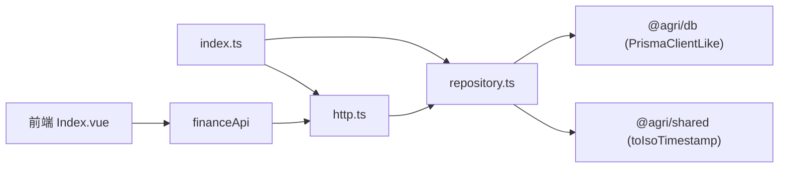

**图表来源**
- [apps/finance-service/src/index.ts:1-4](file://apps/finance-service/src/index.ts#L1-L4)
- [apps/finance-service/src/http.ts:1-7](file://apps/finance-service/src/http.ts#L1-L7)
- [apps/finance-service/src/repository.ts:1-2](file://apps/finance-service/src/repository.ts#L1-L2)
- [apps/web/src/views/finance/Index.vue:141-144](file://apps/web/src/views/finance/Index.vue#L141-L144)

**章节来源**
- [apps/finance-service/src/index.ts:1-4](file://apps/finance-service/src/index.ts#L1-L4)
- [apps/finance-service/src/http.ts:1-7](file://apps/finance-service/src/http.ts#L1-L7)
- [apps/finance-service/src/repository.ts:1-2](file://apps/finance-service/src/repository.ts#L1-L2)

## 性能与扩展性
- 查询性能：
  - 使用 plot_code + created_at 复合索引优化列表查询
  - 汇总使用数据库侧 GROUP BY + SUM，减少应用层计算开销
  - **新增** 三维报表使用三次独立 GROUP BY 查询，避免复杂 JOIN
  - **新增** 时区转换在数据库层完成，减少数据传输量
- 可扩展点：
  - 增加分页参数到 list 接口
  - 增加批量写入接口以提升吞吐
  - 引入缓存层（如 Redis）缓存热点汇总数据
  - 增加事务边界确保多写一致性
  - **新增** 支持更多维度聚合（如季度、年度汇总）
  - **新增** 支持自定义时区配置

[本节为通用指导，不直接分析具体文件]

## 故障排查指南
- 常见错误：
  - 请求体非 JSON 对象：HTTP 层会抛出错误并返回 400
  - 未找到接口：返回 404
  - 数据库写入失败：需检查连接与表结构
  - **新增** 时区计算异常：检查系统时区设置和 Asia/Shanghai 支持
- 排查步骤：
  - 查看 traceId 定位请求链路
  - 检查数据库表是否存在 finance_entries 及索引
  - 校验传入字段是否符合约束（kind、amount>=0）
  - **新增** 验证报表数据时区是否正确（东八区 vs UTC）
  - **新增** 检查筛选条件是否导致空结果集

**章节来源**
- [apps/finance-service/src/http.ts:7-57](file://apps/finance-service/src/http.ts#L7-L57)
- [infra/postgres/001_initial_schema.sql:18-29](file://infra/postgres/001_initial_schema.sql#L18-L29)

## 结论
当前财务管理服务提供了完整的收支登记、汇总查询与三维报表分析能力，具备清晰的接口与仓储抽象，并通过 PostgreSQL 保证数据持久化。**最新更新**增加了全面的财务报告功能，支持基于 Asia/Shanghai 时区的业务月计算，以及月度、类别、地块三个维度的聚合分析。为满足完整财务业务需求，建议在现有基础上继续扩展复式记账、审计追踪、预算对比与导出能力，同时完善校验与事务控制，提升准确性与可追溯性。

[本节为总结性内容，不直接分析具体文件]

## 附录：接口定义与数据模型

### HTTP 接口清单
- GET /health
  - 返回服务健康状态
- GET /api/v1/finance/entries?plotCode=...
  - 返回流水列表
- POST /api/v1/finance/entries
  - 请求体：plotCode、season、kind、category、amount、unit、note
  - 返回新增流水
- GET /api/v1/finance/summary?plotCode=...
  - 返回汇总：input、output、profit、currency
- **新增** GET /api/v1/finance/report?plotCode=...
  - 返回三维报表：months、categories、plots
  - 支持筛选参数：kind、category、season、keyword、from、to

**章节来源**
- [apps/finance-service/src/http.ts:33-55](file://apps/finance-service/src/http.ts#L33-L55)

### 数据模型要点
- FinanceEntry：id、plotCode、season、kind、category、amount、unit、note、createdAt
- FinanceSummary：plotCode、input、output、profit、currency
- **FinanceReport**：**新增** months、categories、plots 三维聚合数据
- **FinanceReportMonth**：**新增** month、input、output、profit
- **FinanceReportCategory**：**新增** kind、category、amount  
- **FinanceReportPlot**：**新增** plotCode、input、output、profit
- 数据库表：finance_entries（含约束与索引）

**章节来源**
- [apps/finance-service/src/repository.ts:4-11](file://apps/finance-service/src/repository.ts#L4-L11)
- [infra/postgres/001_initial_schema.sql:18-29](file://infra/postgres/001_initial_schema.sql#L18-L29)

### 前端 API 定义
- FinanceQuery：查询参数接口（plotCode、kind、category、season、keyword、from、to）
- FinanceReport：三维报表接口（months、categories、plots）
- financeApi：
  - getEntries(params): 获取流水列表
  - getSummary(params): 获取汇总数据
  - **新增** getReport(params): 获取三维报表
  - createEntry(data): 创建财务流水

**章节来源**
- [apps/web/src/api/index.ts:762-795](file://apps/web/src/api/index.ts#L762-L795)

### 测试用例覆盖
- 无筛选走聚合报表，返回月份/类别/地块三维
- 带附加筛选时按过滤后的行现算，与列表联动
- plotCode 过滤只统计该地块
- 报表聚合与展示层月份口径一致（东八区跨年）

**章节来源**
- [apps/finance-service/test/http-report.spec.ts:32-59](file://apps/finance-service/test/http-report.spec.ts#L32-L59)