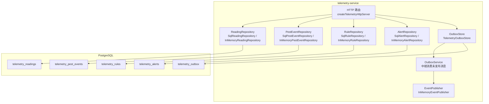
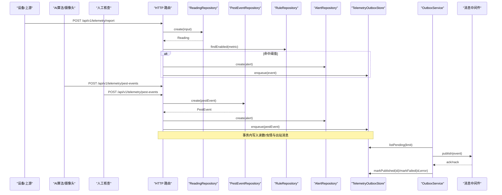
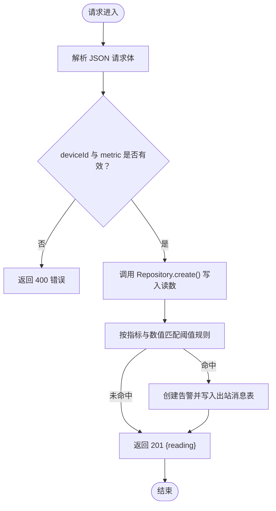
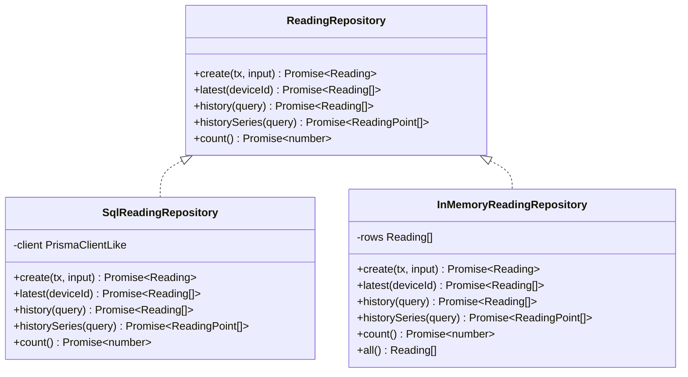
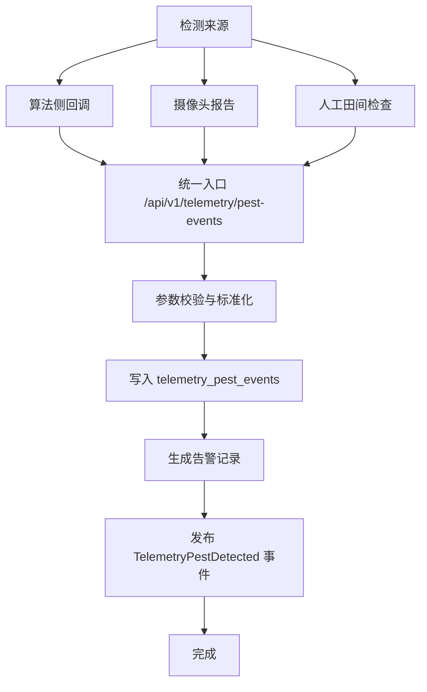
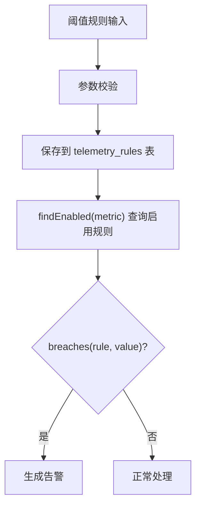
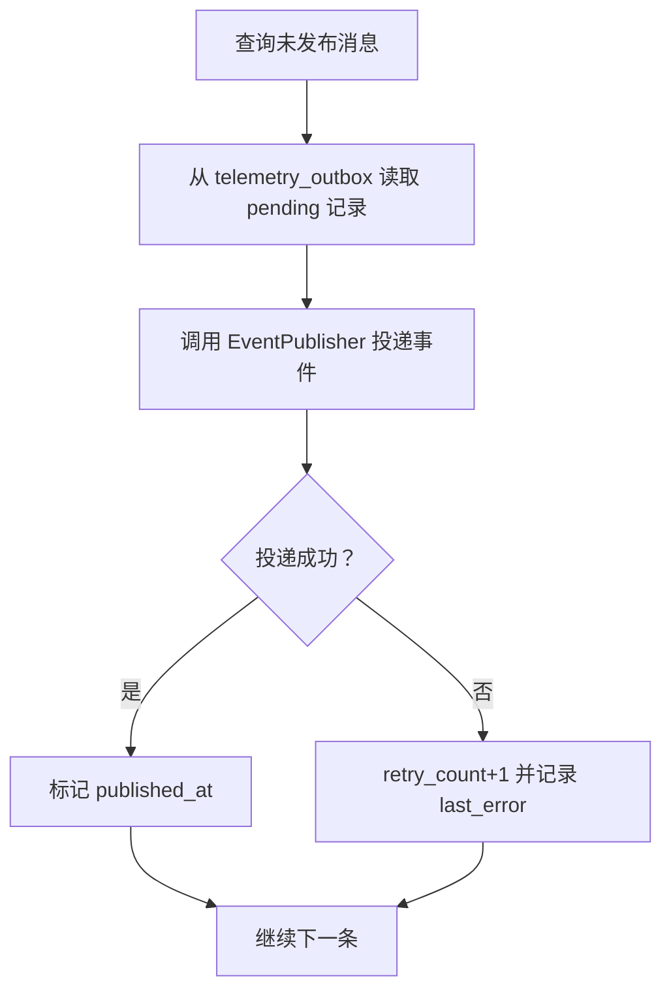
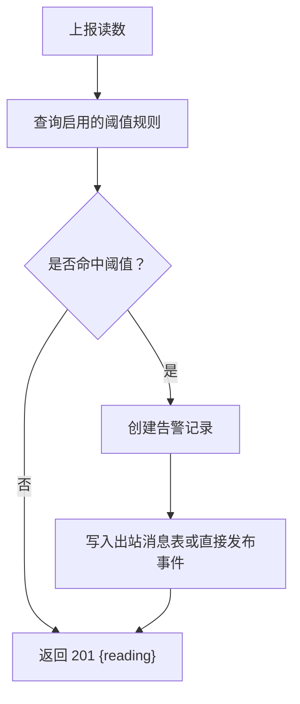
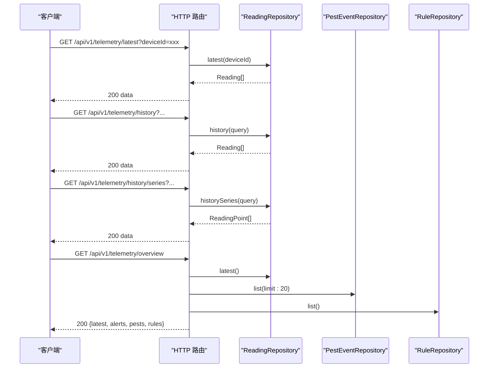
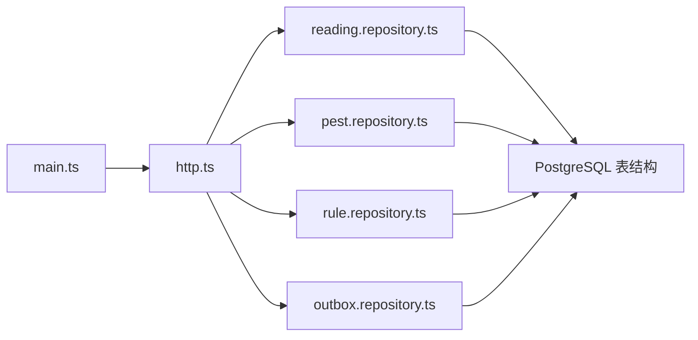

# 遥测数据服务

<cite>
**本文引用的文件**   
- [apps/telemetry-service/src/main.ts](file://apps/telemetry-service/src/main.ts)
- [apps/telemetry-service/src/http.ts](file://apps/telemetry-service/src/http.ts)
- [apps/telemetry-service/src/reading.repository.ts](file://apps/telemetry-service/src/reading.repository.ts)
- [apps/telemetry-service/src/outbox.repository.ts](file://apps/telemetry-service/src/outbox.repository.ts)
- [apps/telemetry-service/src/pest.repository.ts](file://apps/telemetry-service/src/pest.repository.ts)
- [apps/telemetry-service/src/rule.repository.ts](file://apps/telemetry-service/src/rule.repository.ts)
- [infra/postgres/migrations/002_decision_telemetry.sql](file://infra/postgres/migrations/002_decision_telemetry.sql)
- [infra/postgres/migrations/008_agro_monitoring.sql](file://infra/postgres/migrations/008_agro_monitoring.sql)
</cite>

## 更新摘要
**变更内容**   
- 新增虫情监测模块，支持算法回调、摄像头报告、人工田间检查三种检测来源
- 引入决策规则集成，将阈值规则从硬编码迁移到数据库表管理
- 扩展HTTP接口以支持虫情事件管理和规则配置
- 增强四情监测能力（苗情、虫情、灾情、气象）

## 目录
1. [简介](#简介)
2. [项目结构](#项目结构)
3. [核心组件](#核心组件)
4. [架构总览](#架构总览)
5. [详细组件分析](#详细组件分析)
6. [依赖关系分析](#依赖关系分析)
7. [性能与优化](#性能与优化)
8. [故障排查指南](#故障排查指南)
9. [结论](#结论)

## 简介
本文件面向"遥测数据服务"，围绕物联网设备数据采集的完整流程展开，覆盖数据接收、校验、存储、告警触发、事件可靠投递以及历史查询等关键环节。重点说明：
- ReadingRepository 的数据访问设计与时序数据优化策略
- PestEventRepository 在虫情监测中的作用，支持算法回调、摄像头报告、人工田间检查三种检测来源
- RuleRepository 在决策规则集成中的实现，支持动态阈值配置
- OutboxRepository 在事件驱动架构中的可靠投递机制
- 告警机制的实现原理（阈值配置、规则匹配、通知渠道）
- 数据聚合与分析接口（最新读数、历史序列、趋势曲线）
- 设备接入协议适配与数据格式标准化方案

## 项目结构
遥测服务位于 apps/telemetry-service，采用 Node.js 原生 HTTP 服务器暴露 REST 接口，并通过仓库模式对接 PostgreSQL 或内存实现；同时通过本地消息表与 OutboxService 完成事件的可靠投递。

图表来源
- [apps/telemetry-service/src/http.ts:122-131](file://apps/telemetry-service/src/http.ts#L122-L131)
- [apps/telemetry-service/src/reading.repository.ts:97-202](file://apps/telemetry-service/src/reading.repository.ts#L97-L202)
- [apps/telemetry-service/src/pest.repository.ts:64-113](file://apps/telemetry-service/src/pest.repository.ts#L64-L113)
- [apps/telemetry-service/src/rule.repository.ts:81-133](file://apps/telemetry-service/src/rule.repository.ts#L81-L133)
- [apps/telemetry-service/src/outbox.repository.ts:11-63](file://apps/telemetry-service/src/outbox.repository.ts#L11-L63)
- [infra/postgres/migrations/002_decision_telemetry.sql:36-87](file://infra/postgres/migrations/002_decision_telemetry.sql#L36-L87)
- [infra/postgres/migrations/008_agro_monitoring.sql:11-49](file://infra/postgres/migrations/008_agro_monitoring.sql#L11-L49)

章节来源
- [apps/telemetry-service/src/main.ts:17-57](file://apps/telemetry-service/src/main.ts#L17-L57)
- [apps/telemetry-service/src/http.ts:122-131](file://apps/telemetry-service/src/http.ts#L122-L131)

## 核心组件
- HTTP 路由层：提供健康检查、最新读数、历史读数、历史曲线、待处理告警、告警处理、遥测上报、虫情事件管理、规则配置、四情总览等接口。
- 读取仓库层：定义统一接口，提供 SQL 与内存两种实现，负责时序数据的写入、最新值查询、历史查询与趋势点生成。
- 虫情仓库层：管理虫情识别记录的生命周期（创建、列表查询、标记已处理），支持算法回调、摄像头报告、人工田间检查三种检测来源。
- 规则仓库层：管理阈值规则的生命周期（列表、查找启用规则、保存、删除、种子数据），支持动态阈值配置。
- 告警仓库层：管理告警记录的生命周期（创建、待处理列表、标记已处理）。
- 出站消息表：将越限事件和虫情事件持久化到本地消息表，由 OutboxService 定时拉取并投递至消息中间件。
- 启动装配：根据环境变量选择 SQL 或内存模式，初始化数据库连接、OutboxService、默认事件发布者与服务监听端口。

章节来源
- [apps/telemetry-service/src/http.ts:26-36](file://apps/telemetry-service/src/http.ts#L26-L36)
- [apps/telemetry-service/src/reading.repository.ts:53-67](file://apps/telemetry-service/src/reading.repository.ts#L53-L67)
- [apps/telemetry-service/src/pest.repository.ts:40-45](file://apps/telemetry-service/src/pest.repository.ts#L40-L45)
- [apps/telemetry-service/src/rule.repository.ts:40-49](file://apps/telemetry-service/src/rule.repository.ts#L40-L49)
- [apps/telemetry-service/src/outbox.repository.ts:5-10](file://apps/telemetry-service/src/outbox.repository.ts#L5-L10)
- [apps/telemetry-service/src/main.ts:17-57](file://apps/telemetry-service/src/main.ts#L17-L57)

## 架构总览
遥测服务的整体调用链如下：设备通过网关或服务端 SDK 调用 /api/v1/telemetry/report 上报数据；服务端校验后落库，若命中阈值则生成告警并写入出站消息表；虫情识别结果通过 /api/v1/telemetry/pest-events 统一入口接收，支持算法回调、摄像头报告、人工田间检查三种来源；OutboxService 周期性扫描未发布消息并投递事件；前端或下游系统通过历史与最新接口获取时序数据用于监控与可视化。

图表来源
- [apps/telemetry-service/src/http.ts:195-233](file://apps/telemetry-service/src/http.ts#L195-L233)
- [apps/telemetry-service/src/http.ts:257-283](file://apps/telemetry-service/src/http.ts#L257-L283)
- [apps/telemetry-service/src/outbox.repository.ts:18-31](file://apps/telemetry-service/src/outbox.repository.ts#L18-L31)

## 详细组件分析

### 数据接收与校验
- 入口接口：POST /api/v1/telemetry/report
- 输入字段：deviceId、plotCode、metric、value、unit、recordedAt
- 校验逻辑：必填 deviceId 与 metric；其他字段具备默认值与类型转换
- 响应：返回写入后的 Reading 与可能生成的 TelemetryAlert

图表来源
- [apps/telemetry-service/src/http.ts:195-233](file://apps/telemetry-service/src/http.ts#L195-L233)

章节来源
- [apps/telemetry-service/src/http.ts:195-233](file://apps/telemetry-service/src/http.ts#L195-L233)

### ReadingRepository 数据访问设计与优化
- 数据模型：Reading 包含 id、deviceId、plotCode、metric、value、unit、recordedAt
- 写入：使用 ULID 作为主键，直接 INSERT 到 telemetry_readings
- 最新值查询：使用窗口函数 ROW_NUMBER() 按 device_id、metric 分区排序取最近一条
- 历史查询：支持按 deviceId、metric、时间窗过滤，限制最大返回条数防止大结果集
- 趋势点：historySeries 对 history 结果反转并按 (recordedAt, value) 输出，便于前端直接绑定

图表来源
- [apps/telemetry-service/src/reading.repository.ts:53-67](file://apps/telemetry-service/src/reading.repository.ts#L53-L67)
- [apps/telemetry-service/src/reading.repository.ts:97-162](file://apps/telemetry-service/src/reading.repository.ts#L97-L162)
- [apps/telemetry-service/src/reading.repository.ts:205-248](file://apps/telemetry-service/src/reading.repository.ts#L205-L248)

章节来源
- [apps/telemetry-service/src/reading.repository.ts:53-67](file://apps/telemetry-service/src/reading.repository.ts#L53-L67)
- [apps/telemetry-service/src/reading.repository.ts:97-162](file://apps/telemetry-service/src/reading.repository.ts#L97-L162)
- [apps/telemetry-service/src/reading.repository.ts:205-248](file://apps/telemetry-service/src/reading.repository.ts#L205-L248)

### PestEventRepository 虫情监测模块
- 目标：统一管理虫情识别记录，支持算法回调、摄像头报告、人工田间检查三种检测来源
- 数据模型：PestEvent 包含 id、plotCode、deviceId、pestType、level、confidence、imageFileId、detectedAt、handled
- 检测来源：
  - 算法侧回调：AI算法识别虫害后通过API上报
  - 摄像头报告：摄像头设备直接上报识别结果
  - 人工田间检查：工作人员手动录入虫情信息
- 等级分类：1-轻微、2-中等、3-严重
- 置信度：0-1之间的数值，表示识别结果的可靠性
- 生命周期：创建、列表查询（支持地块、状态、类型筛选）、标记已处理、统计计数

图表来源
- [apps/telemetry-service/src/pest.repository.ts:4-10](file://apps/telemetry-service/src/pest.repository.ts#L4-L10)
- [apps/telemetry-service/src/http.ts:257-283](file://apps/telemetry-service/src/http.ts#L257-L283)

章节来源
- [apps/telemetry-service/src/pest.repository.ts:4-10](file://apps/telemetry-service/src/pest.repository.ts#L4-L10)
- [apps/telemetry-service/src/pest.repository.ts:40-45](file://apps/telemetry-service/src/pest.repository.ts#L40-L45)
- [apps/telemetry-service/src/pest.repository.ts:64-113](file://apps/telemetry-service/src/pest.repository.ts#L64-L113)
- [apps/telemetry-service/src/http.ts:257-283](file://apps/telemetry-service/src/http.ts#L257-L283)

### RuleRepository 决策规则集成
- 目标：将阈值规则从硬编码迁移到数据库表管理，支持动态配置
- 数据模型：TelemetryRule 包含 id、metric、direction、threshold、level、message、enabled、updatedAt
- 规则方向：above（高于上限）、below（低于下限）
- 告警级别：INFO（信息）、WARNING（警告）、CRITICAL（严重）
- 默认规则：包含土壤含水率、空气温度、风速、降雨量、苗情覆盖度、虫口密度、病情指数等7条规则
- 判定函数：breaches(rule, value) 判断数值是否越限
- 生命周期：列表查询、查找启用规则、保存（幂等操作）、删除、种子数据填充

图表来源
- [apps/telemetry-service/src/rule.repository.ts:52-65](file://apps/telemetry-service/src/rule.repository.ts#L52-L65)
- [apps/telemetry-service/src/http.ts:207-230](file://apps/telemetry-service/src/http.ts#L207-L230)

章节来源
- [apps/telemetry-service/src/rule.repository.ts:52-65](file://apps/telemetry-service/src/rule.repository.ts#L52-L65)
- [apps/telemetry-service/src/rule.repository.ts:81-133](file://apps/telemetry-service/src/rule.repository.ts#L81-L133)
- [apps/telemetry-service/src/http.ts:207-230](file://apps/telemetry-service/src/http.ts#L207-L230)

### OutboxRepository 在事件驱动架构中的作用
- 目标：保证"读数落库"与"越限事件发布"的最终一致性
- 机制：
  - 当阈值命中时，将事件写入 telemetry_outbox（本地消息表）
  - OutboxService 定期拉取 published_at 为空的记录并尝试投递
  - 成功则标记 published_at，失败则增加 retry_count 并记录 last_error
- 优势：即使消息中间件短暂不可用，也不会丢失事件；具备重试与可观测性

图表来源
- [apps/telemetry-service/src/outbox.repository.ts:18-31](file://apps/telemetry-service/src/outbox.repository.ts#L18-L31)
- [apps/telemetry-service/src/outbox.repository.ts:33-62](file://apps/telemetry-service/src/outbox.repository.ts#L33-L62)

章节来源
- [apps/telemetry-service/src/outbox.repository.ts:5-10](file://apps/telemetry-service/src/outbox.repository.ts#L5-L10)
- [apps/telemetry-service/src/outbox.repository.ts:18-62](file://apps/telemetry-service/src/outbox.repository.ts#L18-L62)

### 告警机制实现原理
- 阈值规则：内置七条规则（土壤含水率、空气温度、风速、降雨量、苗情覆盖度、虫口密度、病情指数），分别对应不同阈值与告警级别
- 触发条件：当上报的 metric 与 value 满足 breaches 函数时，生成 TelemetryAlert
- 告警生命周期：
  - 创建：写入 telemetry_alerts，handled=false
  - 查询：GET /api/v1/telemetry/alerts 返回待处理告警
  - 处理：POST /api/v1/telemetry/alerts/{id}/handle 标记 handled=true 并记录 handled_at
- 通知渠道：
  - 可选通过 OutboxService 将 TelemetryThresholdBreached 事件投递到消息中间件
  - 也可通过默认 EventPublisher 直接发布事件（需启用 publishEvents）

图表来源
- [apps/telemetry-service/src/http.ts:207-230](file://apps/telemetry-service/src/http.ts#L207-L230)

章节来源
- [apps/telemetry-service/src/http.ts:207-230](file://apps/telemetry-service/src/http.ts#L207-L230)

### 数据聚合与分析接口
- 最新读数：GET /api/v1/telemetry/latest?deviceId=...
  - 返回每个设备每个指标的最新一次读数
- 历史读数：GET /api/v1/telemetry/history?deviceId=&metric=&from=&to=&size=...
  - 返回原始时序记录，按 recorded_at 降序，带 limit 保护
- 历史曲线：GET /api/v1/telemetry/history/series?deviceId=&metric=&from=&to=&size=...
  - 返回 (recordedAt, value) 升序数组，适合前端折线图直接绑定
- 四情总览：GET /api/v1/telemetry/overview
  - 一次拉齐最新读数、待处置告警、虫情记录与规则，减少看板请求数

图表来源
- [apps/telemetry-service/src/http.ts:153-174](file://apps/telemetry-service/src/http.ts#L153-L174)
- [apps/telemetry-service/src/http.ts:304-322](file://apps/telemetry-service/src/http.ts#L304-L322)

章节来源
- [apps/telemetry-service/src/http.ts:153-174](file://apps/telemetry-service/src/http.ts#L153-L174)
- [apps/telemetry-service/src/http.ts:304-322](file://apps/telemetry-service/src/http.ts#L304-L322)

### 设备接入协议适配与数据格式标准化
- 当前实现：HTTP REST 接口接收结构化 JSON 负载
- 标准化字段：deviceId、plotCode、metric、value、unit、recordedAt
- 虫情事件标准化字段：plotCode、deviceId、pestType、level、confidence、imageFileId、detectedAt
- 扩展建议：
  - 在网关层增加协议适配器（如 MQTT、CoAP、TCP 自定义协议），将不同协议报文转换为统一的 CreateReadingInput
  - 在入库前进行单位换算与指标映射，确保 metric 与 unit 的一致性
  - 对高频上报场景，可在网关侧做批量化压缩与去抖，减少后端压力
  - 支持算法回调、摄像头报告、人工田间检查三种虫情检测来源的统一接入

[本节为概念性说明，不直接分析具体代码文件]

## 依赖关系分析
- main.ts 负责环境解析、数据库连接、OutboxService 启动与 HTTP 服务启动
- http.ts 提供路由与业务编排，依赖 ReadingRepository、PestEventRepository、RuleRepository、AlertRepository、OutboxStore 与 EventPublisher
- reading.repository.ts 定义统一接口并提供 SQL 与内存实现
- pest.repository.ts 定义虫情事件仓库接口并提供 SQL 与内存实现
- rule.repository.ts 定义规则仓库接口并提供 SQL 与内存实现
- outbox.repository.ts 实现本地消息表持久化与状态更新
- 数据库迁移脚本定义 telemetry_readings、telemetry_alerts、telemetry_outbox、telemetry_pest_events、telemetry_rules 表结构与索引

图表来源
- [apps/telemetry-service/src/main.ts:17-57](file://apps/telemetry-service/src/main.ts#L17-L57)
- [apps/telemetry-service/src/http.ts:122-131](file://apps/telemetry-service/src/http.ts#L122-L131)
- [apps/telemetry-service/src/reading.repository.ts:97-202](file://apps/telemetry-service/src/reading.repository.ts#L97-L202)
- [apps/telemetry-service/src/pest.repository.ts:64-113](file://apps/telemetry-service/src/pest.repository.ts#L64-L113)
- [apps/telemetry-service/src/rule.repository.ts:81-133](file://apps/telemetry-service/src/rule.repository.ts#L81-L133)
- [apps/telemetry-service/src/outbox.repository.ts:11-63](file://apps/telemetry-service/src/outbox.repository.ts#L11-L63)
- [infra/postgres/migrations/002_decision_telemetry.sql:36-87](file://infra/postgres/migrations/002_decision_telemetry.sql#L36-L87)
- [infra/postgres/migrations/008_agro_monitoring.sql:11-49](file://infra/postgres/migrations/008_agro_monitoring.sql#L11-L49)

章节来源
- [apps/telemetry-service/src/main.ts:17-57](file://apps/telemetry-service/src/main.ts#L17-L57)
- [apps/telemetry-service/src/http.ts:122-131](file://apps/telemetry-service/src/http.ts#L122-L131)
- [apps/telemetry-service/src/reading.repository.ts:97-202](file://apps/telemetry-service/src/reading.repository.ts#L97-L202)
- [apps/telemetry-service/src/pest.repository.ts:64-113](file://apps/telemetry-service/src/pest.repository.ts#L64-L113)
- [apps/telemetry-service/src/rule.repository.ts:81-133](file://apps/telemetry-service/src/rule.repository.ts#L81-L133)
- [apps/telemetry-service/src/outbox.repository.ts:11-63](file://apps/telemetry-service/src/outbox.repository.ts#L11-L63)
- [infra/postgres/migrations/002_decision_telemetry.sql:36-87](file://infra/postgres/migrations/002_decision_telemetry.sql#L36-L87)
- [infra/postgres/migrations/008_agro_monitoring.sql:11-49](file://infra/postgres/migrations/008_agro_monitoring.sql#L11-L49)

## 性能与优化
- 时序数据写入
  - 使用 ULID 主键避免热点集中
  - 单条 INSERT 简单高效；未来可按 plot_code 或 metric 分区分表提升写入吞吐
- 最新值查询
  - 使用窗口函数 ROW_NUMBER() 按 device_id、metric 分区排序，避免全表扫描
  - 建议在 device_id、metric、recorded_at 上建立复合索引以加速排序与过滤
- 历史查询
  - 强制 limit（默认 200，上限 2000）防止大结果集拖慢网络与渲染
  - 建议对 recorded_at 建立降序索引以优化 ORDER BY
- 虫情事件查询
  - 支持按 plot_code、handled 状态、pest_type 等多维度筛选
  - 建议使用 (plot_code, detected_at DESC) 和 (handled, detected_at DESC) 复合索引
- 规则查询
  - 按 metric 精确查找启用规则，避免全表扫描
  - 建议在 metric 列上建立唯一索引以确保查询性能
- 告警查询
  - 仅返回 handled=false 的记录，且限制数量，降低冷数据影响
  - 建议在 (handled, created_at DESC) 上建立索引
- 出站消息表
  - 使用 WHERE published_at IS NULL 的索引快速定位待投递消息
  - 建议合理设置 OutboxService 拉取批次大小与重试间隔，平衡吞吐与延迟

章节来源
- [apps/telemetry-service/src/reading.repository.ts:120-156](file://apps/telemetry-service/src/reading.repository.ts#L120-L156)
- [apps/telemetry-service/src/pest.repository.ts:89-103](file://apps/telemetry-service/src/pest.repository.ts#L89-L103)
- [apps/telemetry-service/src/rule.repository.ts:91-99](file://apps/telemetry-service/src/rule.repository.ts#L91-L99)
- [infra/postgres/migrations/002_decision_telemetry.sql:45-46](file://infra/postgres/migrations/002_decision_telemetry.sql#L45-L46)
- [infra/postgres/migrations/002_decision_telemetry.sql:59](file://infra/postgres/migrations/002_decision_telemetry.sql#L59)
- [infra/postgres/migrations/002_decision_telemetry.sql:87](file://infra/postgres/migrations/002_decision_telemetry.sql#L87)
- [infra/postgres/migrations/008_agro_monitoring.sql:23](file://infra/postgres/migrations/008_agro_monitoring.sql#L23)
- [infra/postgres/migrations/008_agro_monitoring.sql:48-49](file://infra/postgres/migrations/008_agro_monitoring.sql#L48-L49)

## 故障排查指南
- 无法连接数据库
  - 检查 TELEMETRY_REPOSITORY_MODE 与 DB_URL 环境变量
  - 确认 PgClientAdapter.fromUrl 与 $connect/$disconnect 生命周期
- 事件未投递
  - 检查 publishEvents 开关与 OutboxStore 是否正确注入
  - 查看 telemetry_outbox 中 retry_count 与 last_error 字段定位失败原因
- 告警未生成
  - 核对上报 metric 与启用的阈值规则是否一致
  - 检查 breaches 函数是否符合预期
- 虫情事件未处理
  - 检查 pestType、level、confidence 参数是否合法
  - 确认 telemetry_pest_events 表是否正确插入记录
- 规则配置无效
  - 检查 telemetry_rules 表中是否存在对应 metric 的规则
  - 确认 enabled 字段是否为 TRUE
- 历史查询无数据或数据不全
  - 确认 from/to 时间窗与 recordedAt 时区
  - 检查 limit 是否过小导致截断

章节来源
- [apps/telemetry-service/src/main.ts:17-57](file://apps/telemetry-service/src/main.ts#L17-L57)
- [apps/telemetry-service/src/http.ts:195-233](file://apps/telemetry-service/src/http.ts#L195-L233)
- [apps/telemetry-service/src/http.ts:257-283](file://apps/telemetry-service/src/http.ts#L257-L283)
- [apps/telemetry-service/src/outbox.repository.ts:33-62](file://apps/telemetry-service/src/outbox.repository.ts#L33-L62)

## 结论
遥测数据服务通过简洁的 HTTP 接口与清晰的仓库分层，实现了设备数据的稳定采集、可靠的告警与事件投递，以及便捷的历史查询能力。新增的虫情监测模块支持算法回调、摄像头报告、人工田间检查三种检测来源，决策规则集成将阈值配置从硬编码迁移到数据库管理，增强了系统的灵活性和可维护性。结合合理的数据库索引与 Outbox 机制，系统在可扩展性与可靠性之间取得良好平衡。后续可在协议适配层与批量写入方面进一步增强，以支撑更大规模的设备接入与更高的数据吞吐。