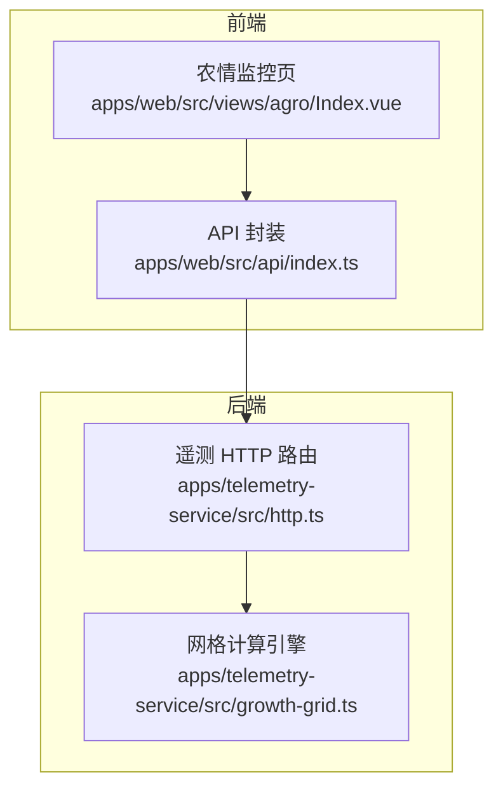
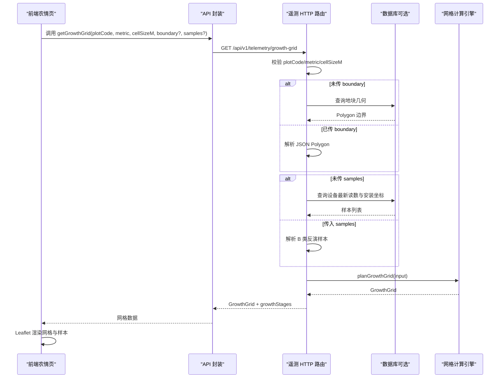
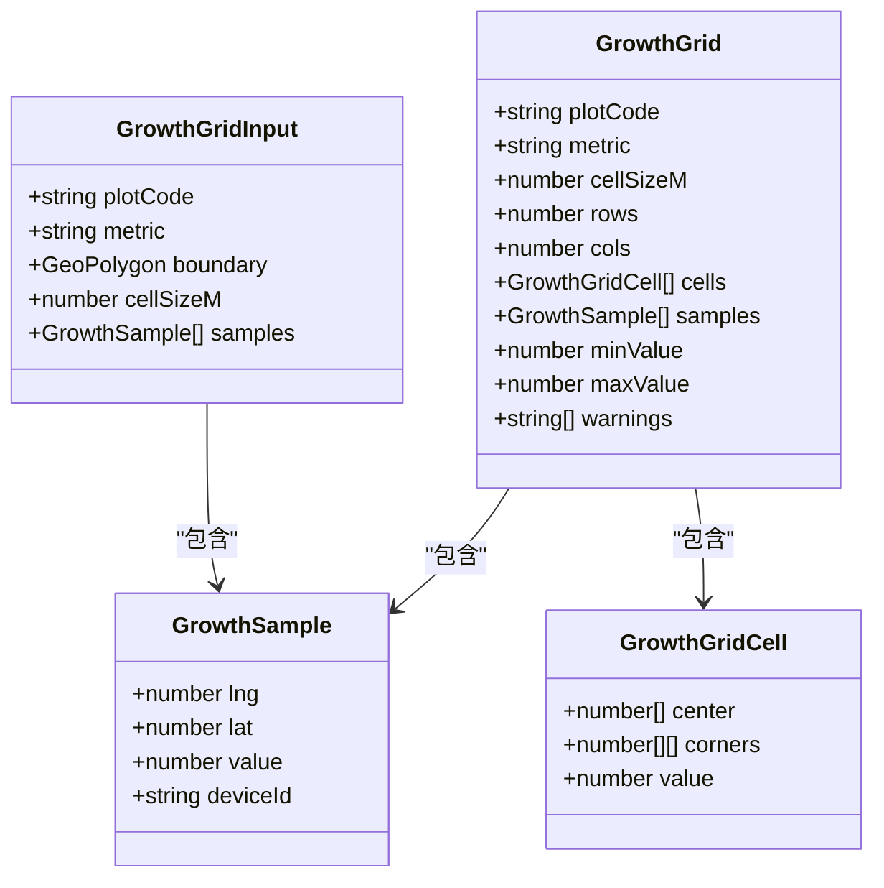
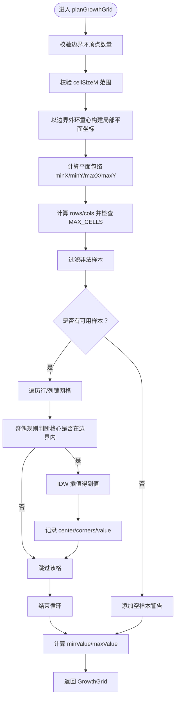
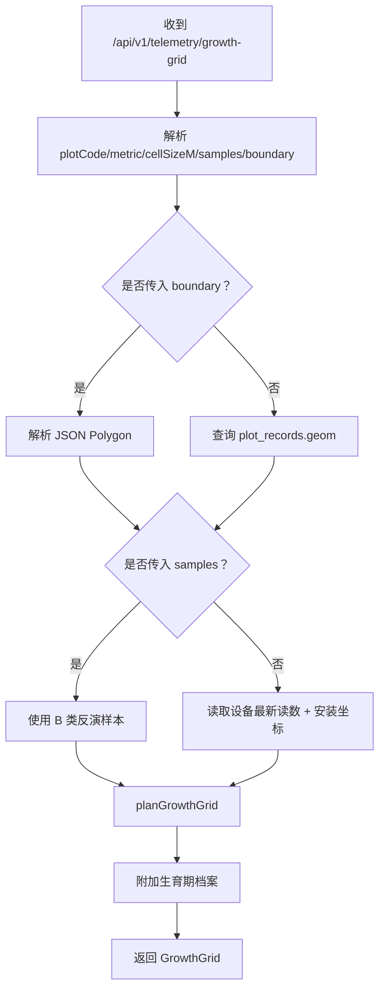
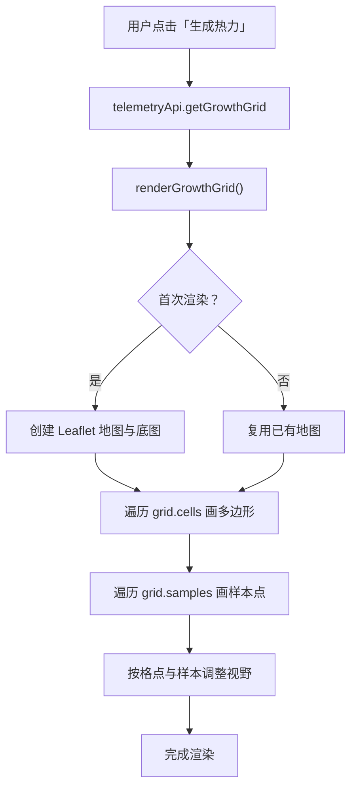
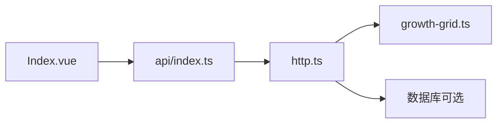

# 地块生长网格热力图

<cite>
**本文引用的文件**   
- [apps/telemetry-service/src/growth-grid.ts](file://apps/telemetry-service/src/growth-grid.ts)
- [apps/telemetry-service/src/http.ts](file://apps/telemetry-service/src/http.ts)
- [apps/web/src/views/agro/Index.vue](file://apps/web/src/views/agro/Index.vue)
- [apps/web/src/api/index.ts](file://apps/web/src/api/index.ts)
</cite>

## 目录
1. [引言](#引言)
2. [项目结构定位](#项目结构定位)
3. [核心组件](#核心组件)
4. [架构总览](#架构总览)
5. [详细组件分析](#详细组件分析)
6. [依赖关系分析](#依赖关系分析)
7. [性能与复杂度](#性能与复杂度)
8. [故障排查指南](#故障排查指南)
9. [结论](#结论)

## 引言
本文件聚焦“地块生长网格热力图”功能，说明从前端交互、HTTP 接口到服务端插值算法的完整链路。该能力用于在选定地块上，基于设备读数或外部反演样本，生成可渲染到地图上的网格长势分布面，并附带生育期信息供时间轴回看。

## 项目结构定位
该功能横跨两个应用：
- 前端：农情监控页面负责用户选择指标、格边长，调用遥测服务并渲染 Leaflet 多边形热力。
- 后端：遥测服务提供 `/api/v1/telemetry/growth-grid` 端点，负责边界校验、样本装配、IDW 插值与网格输出。

**图表来源**
- [apps/web/src/views/agro/Index.vue:1152-1204](file://apps/web/src/views/agro/Index.vue#L1152-L1204)
- [apps/web/src/api/index.ts:537-546](file://apps/web/src/api/index.ts#L537-L546)
- [apps/telemetry-service/src/http.ts:376-435](file://apps/telemetry-service/src/http.ts#L376-L435)
- [apps/telemetry-service/src/growth-grid.ts:135-202](file://apps/telemetry-service/src/growth-grid.ts#L135-L202)

**章节来源**
- [apps/web/src/views/agro/Index.vue:63-86](file://apps/web/src/views/agro/Index.vue#L63-L86)
- [apps/web/src/api/index.ts:537-546](file://apps/web/src/api/index.ts#L537-L546)
- [apps/telemetry-service/src/http.ts:376-435](file://apps/telemetry-service/src/http.ts#L376-L435)
- [apps/telemetry-service/src/growth-grid.ts:1-14](file://apps/telemetry-service/src/growth-grid.ts#L1-L14)

## 核心组件
- 网格计算引擎：实现等距圆柱平面局部坐标转换、奇偶规则点面判断、IDW 反距离加权插值，以及网格上限保护。
- 遥测 HTTP 层：解析查询参数、装配地块边界与样本、调用网格引擎、附加生育期档案返回。
- 前端农情页：维护指标与格边长状态，调用接口后使用 Leaflet 绘制网格多边形与样本点，并提供色阶与警告提示。
- API 封装：统一清理空参数、序列化 GeoJSON 边界与 samples，暴露 `getGrowthGrid`。

**章节来源**
- [apps/telemetry-service/src/growth-grid.ts:16-56](file://apps/telemetry-service/src/growth-grid.ts#L16-L56)
- [apps/telemetry-service/src/http.ts:376-435](file://apps/telemetry-service/src/http.ts#L376-L435)
- [apps/web/src/views/agro/Index.vue:1131-1204](file://apps/web/src/views/agro/Index.vue#L1131-L1204)
- [apps/web/src/api/index.ts:537-546](file://apps/web/src/api/index.ts#L537-L546)

## 架构总览
下图展示一次“生成热力”请求的端到端流程：前端发起 GET 请求，后端校验参数、读取边界与样本、执行 IDW 插值，最后返回网格与生育期。

**图表来源**
- [apps/web/src/views/agro/Index.vue:1152-1204](file://apps/web/src/views/agro/Index.vue#L1152-L1204)
- [apps/web/src/api/index.ts:537-546](file://apps/web/src/api/index.ts#L537-L546)
- [apps/telemetry-service/src/http.ts:376-435](file://apps/telemetry-service/src/http.ts#L376-L435)
- [apps/telemetry-service/src/growth-grid.ts:135-202](file://apps/telemetry-service/src/growth-grid.ts#L135-L202)

## 详细组件分析

### 网格计算引擎
职责：
- 将经纬度转换为局部平面坐标，保证面积与距离口径一致。
- 按给定边长铺正方形网格，仅保留格心落在地块边界内的格子。
- 对每个有效格子用 IDW（幂次为 2）插值得到值；若格心与样本重合则取重合样本均值。
- 空样本不编造数据，返回空网格与降级警告。
- 限制网格总数上限，防止小格导致响应过大。

关键数据结构：
- GrowthSample：坐标 lng/lat、value、可选 deviceId。
- GrowthGridInput：plotCode、metric、boundary、cellSizeM、samples。
- GrowthGridCell：center、corners、value。
- GrowthGrid：包含行列数、cells、samples、minValue/maxValue、warnings。

**图表来源**
- [apps/telemetry-service/src/growth-grid.ts:16-53](file://apps/telemetry-service/src/growth-grid.ts#L16-L53)

核心算法流程（planGrowthGrid）：

**图表来源**
- [apps/telemetry-service/src/growth-grid.ts:135-202](file://apps/telemetry-service/src/growth-grid.ts#L135-L202)

**章节来源**
- [apps/telemetry-service/src/growth-grid.ts:58-133](file://apps/telemetry-service/src/growth-grid.ts#L58-L133)
- [apps/telemetry-service/src/growth-grid.ts:135-202](file://apps/telemetry-service/src/growth-grid.ts#L135-L202)

### 遥测 HTTP 层
职责：
- 校验 plotCode、metric、cellSizeM。
- 获取边界：优先前端传入 GeoJSON Polygon，否则从数据库查地块几何。
- 获取样本：优先前端传入 B 类反演 samples，否则拉取该地块该指标的最新干净读数，并关联设备安装坐标。
- 调用 planGrowthGrid，附加生育期档案返回。

**图表来源**
- [apps/telemetry-service/src/http.ts:376-435](file://apps/telemetry-service/src/http.ts#L376-L435)

**章节来源**
- [apps/telemetry-service/src/http.ts:376-435](file://apps/telemetry-service/src/http.ts#L376-L435)

### 前端农情页
职责：
- 提供“长势分布热力”控件：指标下拉、格边长输入、生成按钮。
- 调用 telemetryApi.getGrowthGrid，接收 GrowthGrid。
- 根据 warnings 显示降级提示。
- 使用 Leaflet 渲染网格多边形与样本点，设置色阶与图例。

**图表来源**
- [apps/web/src/views/agro/Index.vue:1152-1204](file://apps/web/src/views/agro/Index.vue#L1152-L1204)

**章节来源**
- [apps/web/src/views/agro/Index.vue:63-86](file://apps/web/src/views/agro/Index.vue#L63-L86)
- [apps/web/src/views/agro/Index.vue:1131-1204](file://apps/web/src/views/agro/Index.vue#L1131-L1204)

### API 封装
职责：
- 清理空参数，避免无意义查询条件。
- 将 boundary 与 samples 序列化为字符串传给后端。
- 暴露 getGrowthGrid，类型定义 GrowthGrid/GrowthGridCell。

**章节来源**
- [apps/web/src/api/index.ts:19-28](file://apps/web/src/api/index.ts#L19-L28)
- [apps/web/src/api/index.ts:537-546](file://apps/web/src/api/index.ts#L537-L546)
- [apps/web/src/api/index.ts:694-713](file://apps/web/src/api/index.ts#L694-L713)

## 依赖关系分析
- 前端依赖 API 封装，API 封装依赖 HTTP 协议路径与数据类型。
- 后端 HTTP 层依赖数据库（可选）与网格计算引擎。
- 网格计算引擎依赖 GeoPolygon 类型与数学工具函数（局部平面坐标、点面判断、IDW）。

**图表来源**
- [apps/web/src/views/agro/Index.vue:1152-1204](file://apps/web/src/views/agro/Index.vue#L1152-L1204)
- [apps/web/src/api/index.ts:537-546](file://apps/web/src/api/index.ts#L537-L546)
- [apps/telemetry-service/src/http.ts:376-435](file://apps/telemetry-service/src/http.ts#L376-L435)
- [apps/telemetry-service/src/growth-grid.ts:135-202](file://apps/telemetry-service/src/growth-grid.ts#L135-L202)

**章节来源**
- [apps/web/src/views/agro/Index.vue:1131-1204](file://apps/web/src/views/agro/Index.vue#L1131-L1204)
- [apps/web/src/api/index.ts:537-546](file://apps/web/src/api/index.ts#L537-L546)
- [apps/telemetry-service/src/http.ts:376-435](file://apps/telemetry-service/src/http.ts#L376-L435)
- [apps/telemetry-service/src/growth-grid.ts:135-202](file://apps/telemetry-service/src/growth-grid.ts#L135-L202)

## 性能与复杂度
- 网格规模：rows × cols 受 MAX_CELLS 限制，默认最大 4000 格，防止恶意小格撑爆响应。
- 插值复杂度：每格遍历所有样本，时间复杂度 O(C×S)，C 为有效格数，S 为样本数。
- 空间复杂度：O(C+S)，存储 cells 与 samples。
- 前端渲染：Leaflet 多边形与圆点数量等于 cells+samples，建议合理设置 cellSizeM 控制渲染量。

优化建议：
- 增大 cellSizeM 降低网格密度。
- 减少无效样本（如缺失坐标或数值）。
- 前端仅在必要时重建地图实例，复用图层。

**章节来源**
- [apps/telemetry-service/src/growth-grid.ts:64-67](file://apps/telemetry-service/src/growth-grid.ts#L64-L67)
- [apps/telemetry-service/src/growth-grid.ts:150-152](file://apps/telemetry-service/src/growth-grid.ts#L150-L152)
- [apps/telemetry-service/src/growth-grid.ts:165-184](file://apps/telemetry-service/src/growth-grid.ts#L165-L184)
- [apps/web/src/views/agro/Index.vue:1176-1204](file://apps/web/src/views/agro/Index.vue#L1176-L1204)

## 故障排查指南
常见问题与处理：
- 边界非法：后端抛出 GrowthGridError，HTTP 层返回 400，提示边界环顶点不足。
- cellSizeM 越界：不在 2~100 米之间，返回 400。
- 网格超限：rows×cols > 4000，返回 400，需增大 cellSizeM。
- 空样本：返回空网格与警告，前端显示等待上报，不编造长势。
- 单样本：返回警告，整块地均一显示，需更多监测点。
- 边界内无格：返回警告，需核对边界几何。
- 前端渲染失败：确认 grid.cells 非空且 gridMapEl 存在，避免重复创建地图实例。

定位要点：
- 检查 HTTP 入参：plotCode、metric、cellSizeM、boundary、samples。
- 检查数据库：plot_records.geom 是否存在；devices.install_lng/install_lat 是否登记。
- 检查前端：gridMetric/gridCellSizeM 状态是否正确；Leaflet 容器 ref 是否挂载。

**章节来源**
- [apps/telemetry-service/src/growth-grid.ts:136-186](file://apps/telemetry-service/src/growth-grid.ts#L136-L186)
- [apps/telemetry-service/src/http.ts:378-435](file://apps/telemetry-service/src/http.ts#L378-L435)
- [apps/web/src/views/agro/Index.vue:1152-1204](file://apps/web/src/views/agro/Index.vue#L1152-L1204)

## 结论
“地块生长网格热力图”通过前后端协作，将设备读数或外部反演样本映射到地块网格，并以 IDW 插值生成可视化热力面。系统在设计上强调：
- 数据真实性：空样本不编造，降级提示清晰。
- 安全性：边界与样本校验、网格上限保护。
- 可扩展性：支持 B 类反演样本覆盖口，便于接入多光谱影像反演。
- 可观测性：返回 warnings 与生长阶段，辅助业务判断。