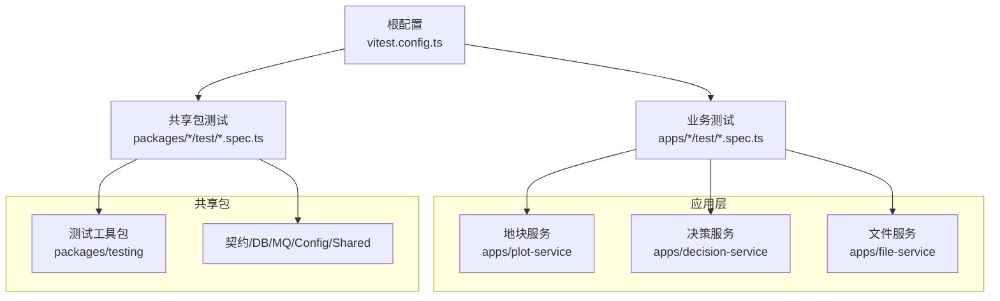
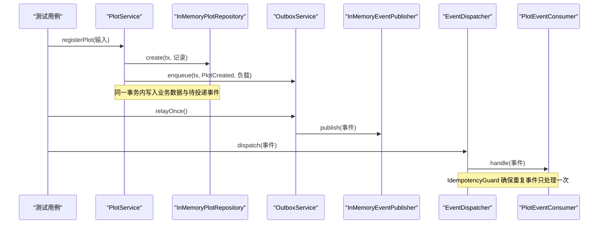
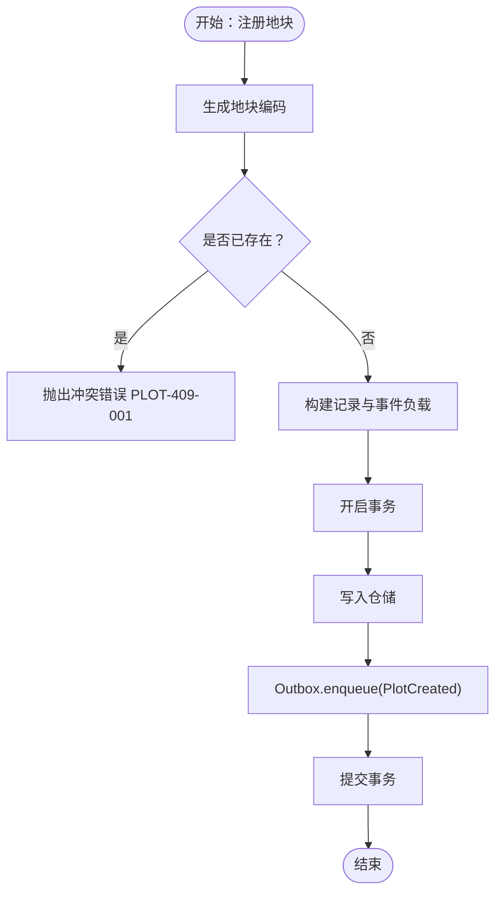
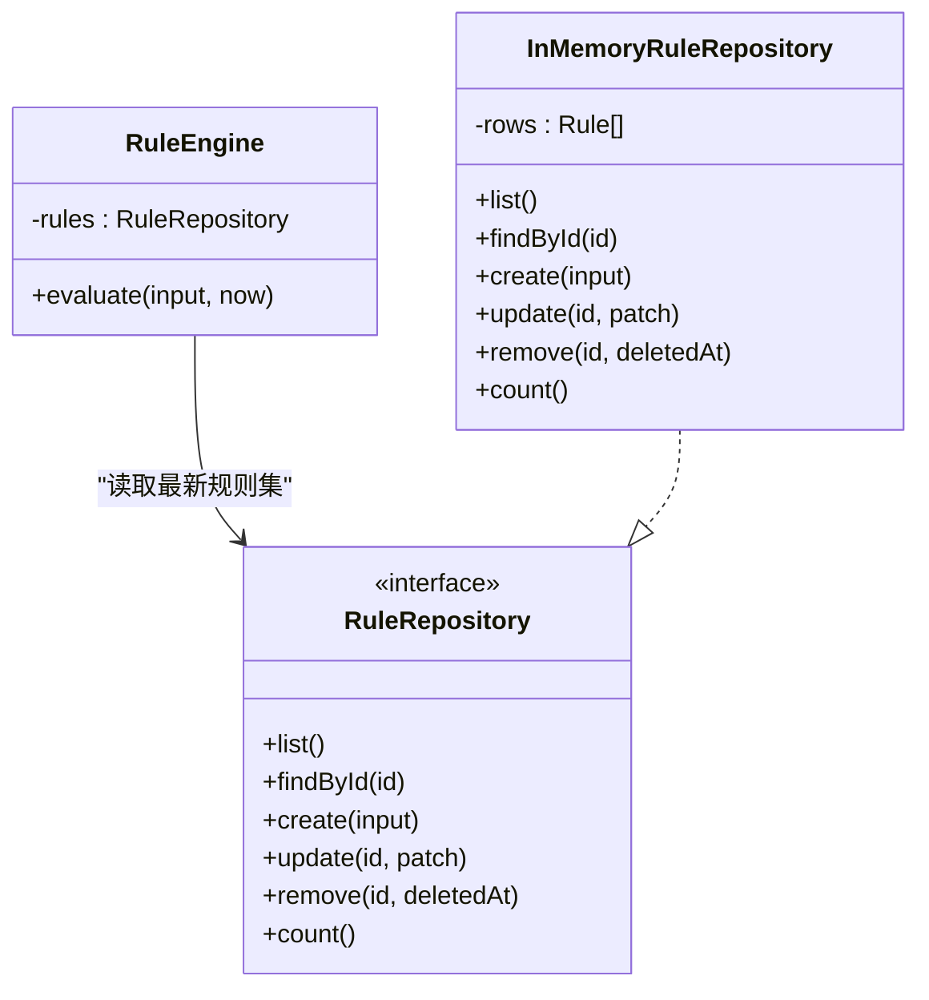
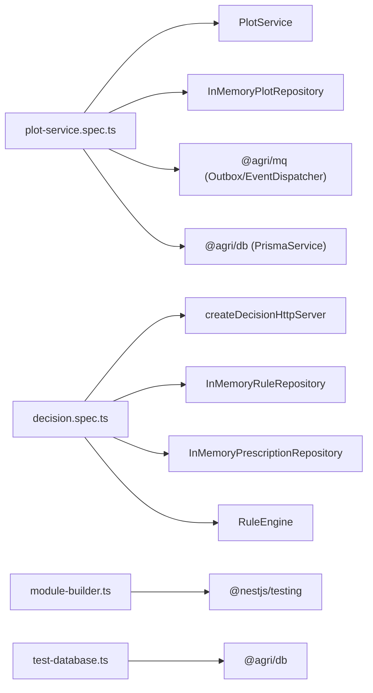

# 单元测试

<cite>
**本文引用的文件**   
- [vitest.config.ts](file://vitest.config.ts)
- [plot-service.spec.ts](file://apps/plot-service/test/plot-service.spec.ts)
- [plot.service.ts](file://apps/plot-service/src/plot.service.ts)
- [plot.repository.ts](file://apps/plot-service/src/plot.repository.ts)
- [decision.spec.ts](file://apps/decision-service/test/decision.spec.ts)
- [rule.engine.ts](file://apps/decision-service/src/rule.engine.ts)
- [rule.repository.ts](file://apps/decision-service/src/rule.repository.ts)
- [index.ts（测试包）](file://packages/testing/src/index.ts)
- [module-builder.ts（测试包）](file://packages/testing/src/module-builder.ts)
- [test-database.ts（测试包）](file://packages/testing/src/test-database.ts)
- [s3-storage.spec.ts](file://apps/file-service/test/s3-storage.spec.ts)
</cite>

## 目录
1. [引言](#引言)
2. [项目结构](#项目结构)
3. [核心组件](#核心组件)
4. [架构总览](#架构总览)
5. [详细组件分析](#详细组件分析)
6. [依赖分析](#依赖分析)
7. [性能考虑](#性能考虑)
8. [故障排查指南](#故障排查指南)
9. [结论](#结论)
10. [附录](#附录)

## 引言
本文件面向智慧农业平台的单元测试实践，聚焦 Vitest 配置与使用、装饰器支持、模块别名与环境设置；总结 PlotService、DecisionService 等核心服务的测试模式；文档化 Mock 策略（外部依赖、数据库连接、消息队列）；给出异步与并发测试最佳实践；明确覆盖率要求、命名规范与代码组织方式；并通过成功场景、异常处理与边界条件示例帮助快速上手。

## 项目结构
仓库采用多应用+多包的 Monorepo 结构：
- apps/*：各微服务应用，包含 src 与 test 目录，测试用例位于 apps/*/test/*.spec.ts。
- packages/*：共享包，如 contracts、db、mq、config、shared、testing、plot-core 等，测试用例位于 packages/*/test/*.spec.ts。
- vitest.config.ts：根级 Vitest 配置，统一装饰器、别名与测试入口。

图表来源
- [vitest.config.ts:10-40](file://vitest.config.ts#L10-L40)

章节来源
- [vitest.config.ts:10-40](file://vitest.config.ts#L10-L40)

## 核心组件
- Vitest 配置
  - 启用 esbuild 的 experimentalDecorators，保证测试期装饰器可登记。
  - 通过 resolve.alias 将 @agri/* 子路径直连源码，避免构建顺序问题。
  - 测试环境为 node，匹配 packages/**/test 与 apps/**/test 下的 .spec.ts。
- 测试工具包 packages/testing
  - 提供 TestModuleBuilder、createTestDatabase、InMemoryEventBus、fixtures 等通用能力。
- 核心服务与仓储
  - PlotService：地块建档、查询、更新、软删除，结合 Outbox 实现事务内写事件表。
  - RuleEngine：规则求值引擎，按优先级命中并生成处方项。
  - InMemory*Repository：内存仓储用于单元测试，隔离外部依赖。

章节来源
- [vitest.config.ts:10-40](file://vitest.config.ts#L10-L40)
- [index.ts（测试包）:1-25](file://packages/testing/src/index.ts#L1-L25)
- [plot.service.ts:13-139](file://apps/plot-service/src/plot.service.ts#L13-L139)
- [rule.engine.ts:1-97](file://apps/decision-service/src/rule.engine.ts#L1-L97)

## 架构总览
下图展示“建档 → 事务内写消息表 → 中继投递 → 消费者幂等”的端到端链路在测试中的验证方式。

图表来源
- [plot.service.ts:53-105](file://apps/plot-service/src/plot.service.ts#L53-L105)
- [plot-service.spec.ts:88-156](file://apps/plot-service/test/plot-service.spec.ts#L88-L156)

## 详细组件分析

### Vitest 配置与使用
- 装饰器支持
  - 通过 esbuild.tsconfigRaw.compilerOptions.experimentalDecorators=true 开启，确保 Nest 风格的订阅声明与处理器能正确登记。
- 模块别名
  - 将 @agri/contracts、@agri/db、@agri/mq、@agri/config、@agri/shared、@agri/testing、@agri/plot-core 等别名指向源码路径，避免测试依赖构建产物顺序。
- 环境与入口
  - environment=node，include 覆盖 packages 与 apps 下所有 .spec.ts。

章节来源
- [vitest.config.ts:10-40](file://vitest.config.ts#L10-L40)

### 服务单元测试编写模式

#### PlotService 测试要点
- 目标
  - 验证建档编码生成、落库、重复建档冲突、查询未找到、更新与软删除、Outbox 事务内写与中继投递、消费者幂等。
- 装配策略
  - 使用 InMemoryPlotRepository 替代真实数据库。
  - 使用 InMemoryEventPublisher、InMemoryOutboxStore、OutboxService 模拟消息出队与投递。
  - 使用 EventDispatcher + IdempotencyGuard + InMemoryIdempotencyStore 模拟事件分发与去重。
  - PrismaService 配合 createExamplePrismaFactory 构造最小可用客户端。
- 关键断言
  - 编码格式与 ID 生成。
  - 错误码（如 PLOT-409-001、PLOT-404-001）。
  - Outbox 中 Pending 事件与已发布事件数量。
  - 消费者 handledEventIds 仅包含唯一 eventId。

图表来源
- [plot.service.ts:53-105](file://apps/plot-service/src/plot.service.ts#L53-L105)

章节来源
- [plot-service.spec.ts:24-69](file://apps/plot-service/test/plot-service.spec.ts#L24-L69)
- [plot-service.spec.ts:88-156](file://apps/plot-service/test/plot-service.spec.ts#L88-L156)
- [plot.service.ts:53-105](file://apps/plot-service/src/plot.service.ts#L53-L105)

#### DecisionService 测试要点
- 目标
  - 验证规则仓储 CRUD、规则热更新、RuleEngine 求值命中逻辑、HTTP 接口增改查与处方留痕。
- 装配策略
  - 使用 InMemoryRuleRepository、InMemoryPrescriptionRepository 替代持久化。
  - 使用 createDecisionHttpServer 启动本地 HTTP 服务器进行集成式请求测试。
- 关键断言
  - 新增规则后 list 可见、停用后不再命中。
  - evaluate 返回 matchedRules 与 items，且受优先级影响。
  - HTTP 接口返回状态码、处方状态（RECOMMENDED/NO_ACTION）、命中规则留痕。

图表来源
- [rule.repository.ts:76-179](file://apps/decision-service/src/rule.repository.ts#L76-L179)
- [rule.engine.ts:81-95](file://apps/decision-service/src/rule.engine.ts#L81-L95)

章节来源
- [decision.spec.ts:33-63](file://apps/decision-service/test/decision.spec.ts#L33-L63)
- [decision.spec.ts:65-104](file://apps/decision-service/test/decision.spec.ts#L65-L104)
- [decision.spec.ts:106-145](file://apps/decision-service/test/decision.spec.ts#L106-L145)
- [rule.engine.ts:47-95](file://apps/decision-service/src/rule.engine.ts#L47-L95)
- [rule.repository.ts:132-179](file://apps/decision-service/src/rule.repository.ts#L132-L179)

### Mock 策略

#### 外部依赖与 HTTP
- 使用 vi.fn 替换 fetch 或自定义 fetchImpl，断言签名请求参数与响应行为。
- 示例：S3ObjectStorage 上传时校验 URL 路径与方法头；404 读对象返回空。

章节来源
- [s3-storage.spec.ts:4-19](file://apps/file-service/test/s3-storage.spec.ts#L4-L19)

#### 数据库连接
- 使用 packages/testing 提供的 createTestDatabase 与 TestModuleBuilder：
  - createTestDatabase 提供假客户端，记录 executedSql，便于断言 SQL 与事务语义（BEGIN/COMMIT/ROLLBACK）。
  - resetDatabase/stopTestDatabase 管理数据复位与连接释放。
  - DEFAULT_TEST_TABLES 定义默认清空表清单。
- 适用场景：需要贴近真实事务与 SQL 行为的测试；纯逻辑单元优先用 InMemory*Repository。

章节来源
- [test-database.ts:1-138](file://packages/testing/src/test-database.ts#L1-L138)
- [module-builder.ts:1-69](file://packages/testing/src/module-builder.ts#L1-L69)
- [index.ts（测试包）:1-25](file://packages/testing/src/index.ts#L1-L25)

#### 消息队列
- 使用 InMemoryEventPublisher、InMemoryOutboxStore、OutboxService 组合模拟消息生产与投递。
- 使用 EventDispatcher + IdempotencyGuard + InMemoryIdempotencyStore 模拟消费侧幂等。
- 典型断言：Outbox pending 列表、已发布事件数、消费者 handledEventIds 唯一性。

章节来源
- [plot-service.spec.ts:53-68](file://apps/plot-service/test/plot-service.spec.ts#L53-L68)
- [plot-service.spec.ts:124-156](file://apps/plot-service/test/plot-service.spec.ts#L124-L156)

### 异步与并发测试最佳实践
- 异步测试
  - 使用 async/await 与 Vitest 的 expect().rejects.toMatchObject 断言错误码与结构化错误。
  - 对 Outbox 中继与消费者处理使用 await 确保完成后再断言。
- 并发测试
  - 对于幂等消费，重复 dispatch 同一事件应仅被处理一次；通过 handledEventIds 长度与内容断言。
  - 对 Outbox 多次 relayOnce 调用，需断言已投递事件累计增长符合预期。
- 资源清理
  - HTTP 服务器测试使用 withServer 封装 listen/close，确保端口释放。
  - 数据库测试使用 stopTestDatabase 释放连接。

章节来源
- [plot-service.spec.ts:135-156](file://apps/plot-service/test/plot-service.spec.ts#L135-L156)
- [decision.spec.ts:9-21](file://apps/decision-service/test/decision.spec.ts#L9-L21)

### 测试命名规范与代码组织
- 命名规范
  - 文件名：*.spec.ts，与服务/仓储一一对应，如 plot-service.spec.ts、sql-plot-repository.spec.ts。
  - describe 块：以中文描述被测功能域，如“地块服务”、“决策服务规则仓储”。
  - it 块：以“场景描述 + 期望结果”形式表达，如“建档生成编码并落库”、“同一编码重复建档被拒绝”。
- 代码组织
  - 每个测试文件自包含 buildSut/withServer 等装配函数，避免用例间互相污染。
  - 使用 makeInput 等工厂方法集中构造输入，减少样板代码。
  - 对外部依赖（仓储、消息、数据库）使用 InMemory 实现或测试工具包提供的假实现。

章节来源
- [plot-service.spec.ts:24-86](file://apps/plot-service/test/plot-service.spec.ts#L24-L86)
- [decision.spec.ts:33-63](file://apps/decision-service/test/decision.spec.ts#L33-L63)

### 具体测试示例

#### 成功场景
- 地块建档
  - 断言 parcelCode 格式、parcelId 数字、repository.all 长度为 1、按编码查询名称一致。
- 规则求值
  - 初始命中 rule-soil-dry，新增高优先级规则后命中两条，停用后仅命中一条。
- HTTP 接口
  - 创建规则返回 201，列出规则包含新规则，停用后处方不再包含该规则。

章节来源
- [plot-service.spec.ts:88-97](file://apps/plot-service/test/plot-service.spec.ts#L88-L97)
- [decision.spec.ts:65-96](file://apps/decision-service/test/decision.spec.ts#L65-L96)
- [decision.spec.ts:106-145](file://apps/decision-service/test/decision.spec.ts#L106-L145)

#### 异常处理
- 重复建档
  - 断言错误码 PLOT-409-001，repository 仍保持单条记录。
- 查询不存在
  - 断言错误码 PLOT-404-001。
- 条件不满足
  - RuleEngine.evaluate 返回 matchedRules 与 items 为空数组。

章节来源
- [plot-service.spec.ts:99-110](file://apps/plot-service/test/plot-service.spec.ts#L99-L110)
- [decision.spec.ts:98-103](file://apps/decision-service/test/decision.spec.ts#L98-L103)

#### 边界条件
- Outbox 与中继
  - 建档后 publisher.published 为空，store.listPending 有 PlotCreated 事件；relayOnce 后 published 数量为 1。
- 消费者幂等
  - 重复 dispatch 同一事件，consumer.handledEventIds 仅包含一个 eventId。
- S3 存储
  - 404 读取对象返回 null；PUT 签名请求包含 AWS4-HMAC-SHA256。

章节来源
- [plot-service.spec.ts:124-156](file://apps/plot-service/test/plot-service.spec.ts#L124-L156)
- [s3-storage.spec.ts:14-19](file://apps/file-service/test/s3-storage.spec.ts#L14-L19)

## 依赖分析
- 测试对业务代码的依赖
  - plot-service.spec.ts 依赖 PlotService、PlotCodeService、PlotEventConsumer、InMemoryPlotRepository、PrismaService、OutboxService、EventDispatcher、IdempotencyGuard、InMemoryOutboxStore、InMemoryIdempotencyStore、InMemoryEventPublisher。
  - decision.spec.ts 依赖 createDecisionHttpServer、InMemoryRuleRepository、InMemoryPrescriptionRepository、RuleEngine。
- 测试工具包依赖
  - module-builder.ts 依赖 @nestjs/testing 与 Nest 元数据类型，提供统一的模块装配与 Provider 覆盖。
  - test-database.ts 依赖 @agri/db 的 PrismaClientLike/Tx 契约，提供假客户端与事务语义记录。

图表来源
- [plot-service.spec.ts:1-22](file://apps/plot-service/test/plot-service.spec.ts#L1-L22)
- [decision.spec.ts:1-8](file://apps/decision-service/test/decision.spec.ts#L1-L8)
- [module-builder.ts:1-69](file://packages/testing/src/module-builder.ts#L1-L69)
- [test-database.ts:1-138](file://packages/testing/src/test-database.ts#L1-L138)

章节来源
- [plot-service.spec.ts:1-22](file://apps/plot-service/test/plot-service.spec.ts#L1-L22)
- [decision.spec.ts:1-8](file://apps/decision-service/test/decision.spec.ts#L1-L8)
- [module-builder.ts:1-69](file://packages/testing/src/module-builder.ts#L1-L69)
- [test-database.ts:1-138](file://packages/testing/src/test-database.ts#L1-L138)

## 性能考虑
- 单元测试尽量使用 InMemory 实现，避免 I/O 开销。
- 对需要验证事务与 SQL 的场景，使用 createTestDatabase 的假客户端，避免真实数据库连接。
- HTTP 集成测试仅在必要时启动本地服务器，并在 finally 中关闭，避免端口占用。
- 事件与 Outbox 测试应避免无界循环，使用 relayOnce 控制投递次数。

[本节为通用指导，不涉及具体文件]

## 故障排查指南
- 装饰器未生效
  - 检查 vitest.config.ts 中 esbuild.tsconfigRaw.compilerOptions.experimentalDecorators 是否开启。
- 模块别名解析失败
  - 确认 @agri/* 别名在 vitest.config.ts 中指向正确的源码路径。
- 事务断言失败
  - 使用 createTestDatabase.executedSql 检查 BEGIN/COMMIT/ROLLBACK 顺序与 SQL 语句。
- 事件重复消费
  - 检查 IdempotencyGuard 与 InMemoryIdempotencyStore 是否正确注入，handledEventIds 是否唯一。
- HTTP 端口占用
  - 使用 withServer 封装 listen/close，或在测试结束后显式 server.close。

章节来源
- [vitest.config.ts:10-20](file://vitest.config.ts#L10-L20)
- [test-database.ts:50-87](file://packages/testing/src/test-database.ts#L50-L87)
- [plot-service.spec.ts:135-156](file://apps/plot-service/test/plot-service.spec.ts#L135-L156)
- [decision.spec.ts:9-21](file://apps/decision-service/test/decision.spec.ts#L9-L21)

## 结论
本仓库通过 Vitest 统一配置与 packages/testing 工具包，构建了稳定、可维护的单元测试体系。PlotService 与 DecisionService 的测试覆盖了成功、异常与边界场景，并结合 Outbox 与 IdempotencyGuard 验证了分布式一致性关键点。建议持续遵循现有命名与组织规范，逐步提升覆盖率，优先保障核心业务流程与关键边界的测试完备性。

[本节为总结，不涉及具体文件]

## 附录

### 测试覆盖率要求
- 建议目标
  - 核心服务（PlotService、RuleEngine、HTTP 控制器）行覆盖率 ≥ 80%。
  - 仓储与领域逻辑分支覆盖率 ≥ 70%。
  - 关键异常路径（冲突、未找到、条件不满足）必须覆盖。
- 执行建议
  - 在 CI 中运行 Vitest 并输出覆盖率报告，未达标则阻断合并。

[本节为通用指导，不涉及具体文件]

### 测试命名规范与代码组织模式
- 文件命名
  - *.spec.ts，与服务/仓储同名对应。
- describe/it 命名
  - describe 使用中文功能域名；it 使用“场景 + 期望”句式。
- 装配与工厂
  - 每个测试文件自包含 buildSut/withServer 等装配函数；使用 makeInput 等工厂方法构造输入。
- 依赖替换
  - 优先使用 InMemory*Repository 与 packages/testing 提供的工具；必要时使用 TestModuleBuilder.overrideProvider。

章节来源
- [plot-service.spec.ts:24-86](file://apps/plot-service/test/plot-service.spec.ts#L24-L86)
- [module-builder.ts:11-58](file://packages/testing/src/module-builder.ts#L11-L58)