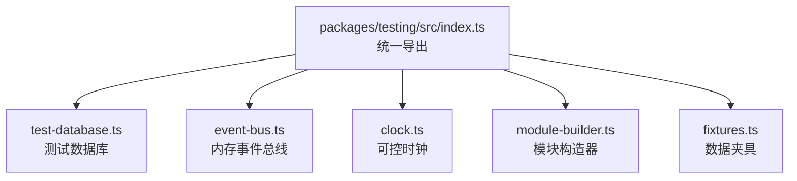
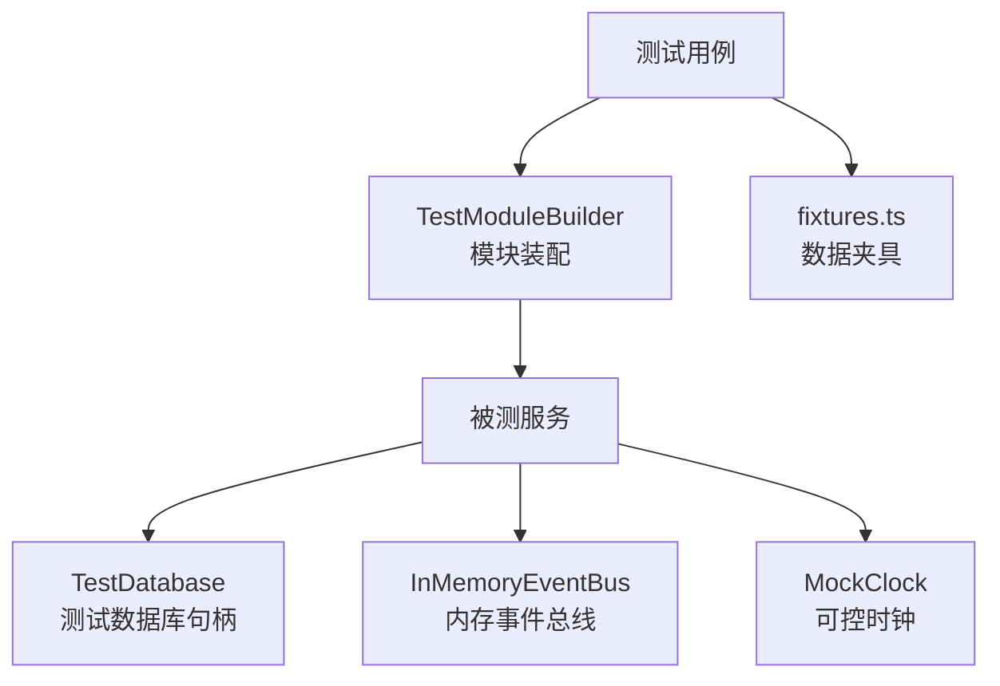
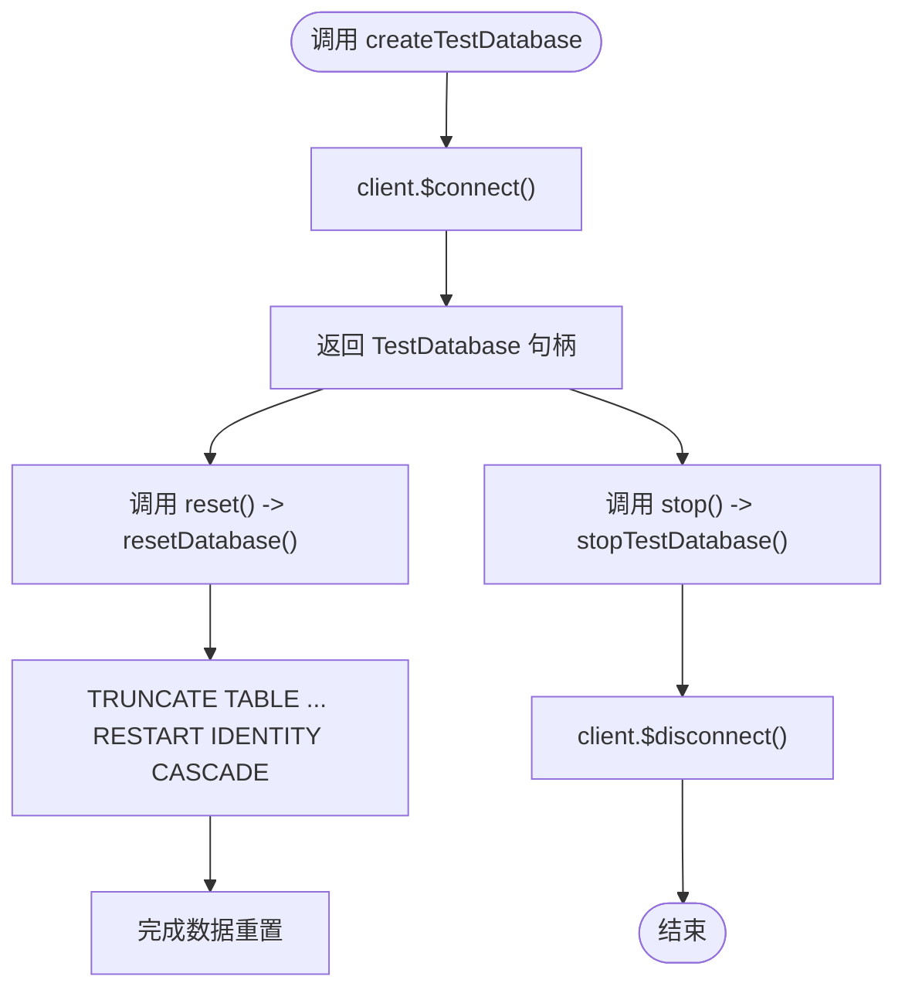
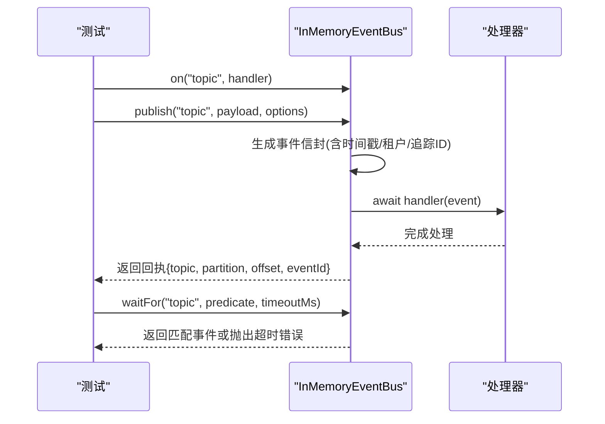
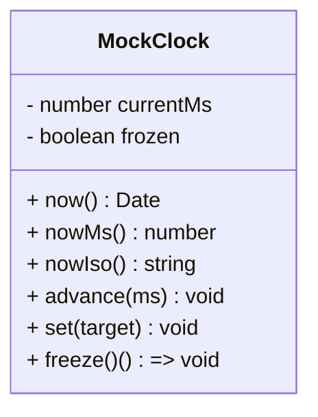
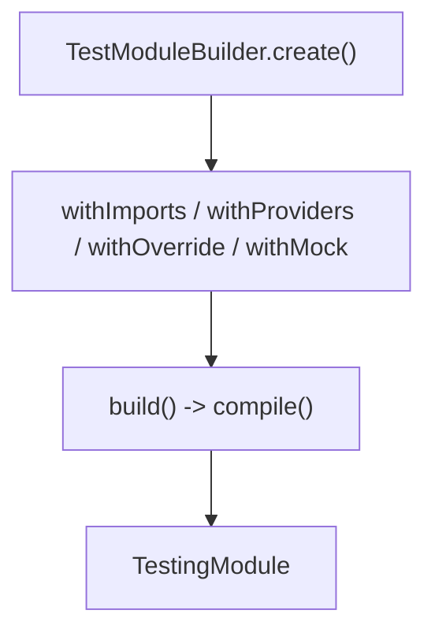
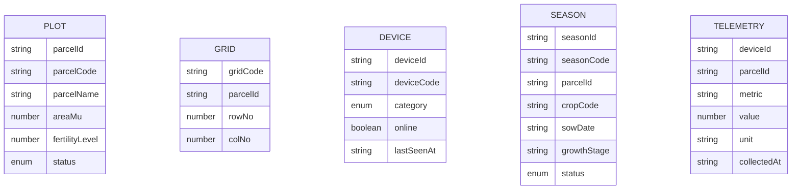
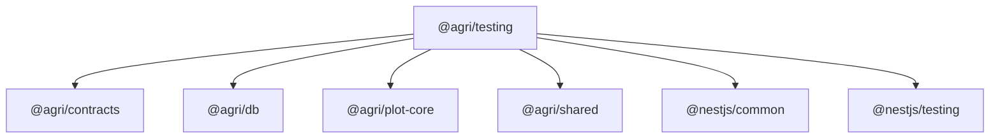

# 测试工具

<cite>
**本文引用的文件**   
- [packages/testing/src/index.ts](file://packages/testing/src/index.ts)
- [packages/testing/src/test-database.ts](file://packages/testing/src/test-database.ts)
- [packages/testing/src/event-bus.ts](file://packages/testing/src/event-bus.ts)
- [packages/testing/src/clock.ts](file://packages/testing/src/clock.ts)
- [packages/testing/src/module-builder.ts](file://packages/testing/src/module-builder.ts)
- [packages/testing/src/fixtures.ts](file://packages/testing/src/fixtures.ts)
- [packages/testing/package.json](file://packages/testing/package.json)
</cite>

## 目录
1. [简介](#简介)
2. [项目结构](#项目结构)
3. [核心组件](#核心组件)
4. [架构总览](#架构总览)
5. [详细组件分析](#详细组件分析)
6. [依赖关系分析](#依赖关系分析)
7. [性能与稳定性考虑](#性能与稳定性考虑)
8. [测试环境配置与最佳实践](#测试环境配置与最佳实践)
9. [常见问题与排错](#常见问题与排错)
10. [结论](#结论)

## 简介
本文件为智慧农业平台测试工具包 `@agri/testing` 的详细使用文档。该工具包聚焦于测试阶段的数据库管理、事件总线模拟、时间控制、模块装配与数据夹具生成，帮助单元测试和集成测试在不引入真实外部依赖的前提下，稳定、可观测地验证业务逻辑。

主要能力包括：
- 测试数据库管理器：提供假客户端、SQL 执行记录、事务边界观察、表级数据清理与连接释放。
- 内存事件总线：实现发布订阅契约，支持事件历史、分区偏移模拟、失败注入与等待断言。
- 可控时钟：统一时间来源，支持推进、冻结全局时间，避免时间相关测试不稳定。
- 模块构造器：集中声明导入、提供者与依赖替换，简化 NestJS 测试模块装配。
- 数据夹具：生成贴近真实场景的地块、网格、设备、作物季与遥测数据。

## 项目结构
`@agri/testing` 是一个独立的内部包，通过主入口统一导出所有测试能力。其源码按职责拆分为多个模块：

**图表来源**
- [packages/testing/src/index.ts:1-25](file://packages/testing/src/index.ts#L1-L25)

**章节来源**
- [packages/testing/src/index.ts:1-25](file://packages/testing/src/index.ts#L1-L25)
- [packages/testing/package.json:1-31](file://packages/testing/package.json#L1-L31)

## 核心组件
本节概览各组件的职责与典型用法，后续章节将深入实现细节与最佳实践。

- 测试数据库管理器
  - 创建句柄：`createTestDatabase(options)`
  - 重置数据：`resetDatabase(db, tables?)`
  - 释放连接：`stopTestDatabase(db)`
  - 句柄属性：`client`、`executedSql`、`stopped`、`url`、`schema`、`reset()`、`stop()`

- 内存事件总线
  - 订阅/取消：`on(topic, handler)`、`off(topic)`
  - 发布：`publish(topic, payload, options?)`
  - 批量发布：`publishBatch(events[])`
  - 直接投递：`deliver(event)`
  - 等待事件：`waitFor(topic, predicate?, timeoutMs?)`
  - 清空状态：`reset()`、`close()`

- 可控时钟
  - 获取时间：`now()`、`nowMs()`、`nowIso()`
  - 推进时间：`advance(ms)`、`set(target)`
  - 接管全局时间：`freeze()` 返回恢复函数

- 模块构造器
  - 链式装配：`withImports()`、`withProviders()`
  - 依赖替换：`withOverride(token, value)`、`withMock(type, partial)`
  - 编译模块：`build()`
  - 快捷构建：`buildTestModule(metadata)`

- 数据夹具
  - 地块编码：`buildPlotCodeFixture(input?)`
  - 实体夹具：`plotFixture()`、`gridFixture()`、`deviceFixture()`、`seasonFixture()`
  - 遥测夹具：`telemetryFixture()`

**章节来源**
- [packages/testing/src/test-database.ts:1-138](file://packages/testing/src/test-database.ts#L1-L138)
- [packages/testing/src/event-bus.ts:1-157](file://packages/testing/src/event-bus.ts#L1-L157)
- [packages/testing/src/clock.ts:1-88](file://packages/testing/src/clock.ts#L1-L88)
- [packages/testing/src/module-builder.ts:1-69](file://packages/testing/src/module-builder.ts#L1-L69)
- [packages/testing/src/fixtures.ts:1-101](file://packages/testing/src/fixtures.ts#L1-L101)

## 架构总览
下图展示测试工具包在测试中的整体交互：测试用例通过模块构造器装配被测服务，注入测试数据库句柄与内存事件总线；被测服务通过可控时钟读取时间；夹具用于准备测试数据。

**图表来源**
- [packages/testing/src/module-builder.ts:1-69](file://packages/testing/src/module-builder.ts#L1-L69)
- [packages/testing/src/test-database.ts:1-138](file://packages/testing/src/test-database.ts#L1-L138)
- [packages/testing/src/event-bus.ts:1-157](file://packages/testing/src/event-bus.ts#L1-L157)
- [packages/testing/src/clock.ts:1-88](file://packages/testing/src/clock.ts#L1-L88)
- [packages/testing/src/fixtures.ts:1-101](file://packages/testing/src/fixtures.ts#L1-L101)

## 详细组件分析

### 测试数据库管理器
测试数据库管理器提供一个行为收敛的“假客户端”，既能观察 SQL 与事务边界，又能在需要时接入真实数据库进行集成测试。默认清空表顺序遵循外键依赖从子到父，确保 TRUNCATE 成功。

关键要点：
- 选项配置
  - `url`：连接串，缺省指向本地测试库
  - `schema`：模式名，每个测试进程独立隔离
  - `poolSize`：连接池上限（接口暴露）
  - `tables`：复位时清空的表，缺省使用内置列表

- 句柄生命周期
  - `createTestDatabase()` 创建句柄并连接
  - `reset()` 清空指定表并重启自增序列
  - `stop()` 断开连接并标记已停止

- SQL 与事务观察
  - `executedSql` 记录原始 SQL 与事务关键字（CONNECT/DISCONNECT/BEGIN/COMMIT/ROLLBACK）
  - 事务回调使用同一上下文，便于断言 SQL 执行顺序

**图表来源**
- [packages/testing/src/test-database.ts:94-119](file://packages/testing/src/test-database.ts#L94-L119)
- [packages/testing/src/test-database.ts:126-137](file://packages/testing/src/test-database.ts#L126-L137)

使用建议：
- 单元测试优先使用假客户端，断言 `executedSql` 以验证 SQL 与事务边界。
- 集成测试可传入真实 `url` 与 `schema`，并在测试后调用 `resetDatabase` 清理数据。
- 若需自定义清空策略，传入 `tables` 参数覆盖默认值。

**章节来源**
- [packages/testing/src/test-database.ts:1-138](file://packages/testing/src/test-database.ts#L1-L138)

### 内存事件总线
内存事件总线模拟消息中间件的发布订阅契约，保持服务代码无需为测试改写。它维护事件历史、分区与偏移，支持失败注入与等待断言。

关键要点：
- 事件信封
  - `eventId`、`topic`、`version`、`occurredAt`、`producer`、`tenantId`、`traceId`、`payload`
- 发布回执
  - `topic`、`partition`、`offset`、`eventId`
- 功能特性
  - `on/off` 订阅管理
  - `publish/publishBatch` 发布与批量发布
  - `deliver` 直接投递已有事件，用于重复投递模拟
  - `waitFor` 轮询等待满足条件的事件，超时抛错
  - `failNext` 标志位，下一次发布自动抛错并复位
  - `reset/close` 清空状态

**图表来源**
- [packages/testing/src/event-bus.ts:83-112](file://packages/testing/src/event-bus.ts#L83-L112)
- [packages/testing/src/event-bus.ts:131-144](file://packages/testing/src/event-bus.ts#L131-L144)

使用建议：
- 使用 `published(topic)` 断言事件是否发生及载荷内容。
- 使用 `waitFor` 替代硬等待，结合 `timeoutMs` 控制稳定性。
- 使用 `failNext = true` 模拟投递失败，验证重试或降级逻辑。
- 使用 `deliver` 重放事件，验证幂等与去重逻辑。

**章节来源**
- [packages/testing/src/event-bus.ts:1-157](file://packages/testing/src/event-bus.ts#L1-L157)

### 可控时钟
可控时钟统一时间来源，避免依赖系统时间导致测试不稳定。支持推进、设置目标时间，并可接管全局 `Date.now`。

关键要点：
- 时间访问
  - `now()` 返回 Date 对象
  - `nowMs()` 返回毫秒时间戳
  - `nowIso()` 返回 ISO 8601 UTC 字符串
- 时间控制
  - `advance(ms)` 只能向前推进
  - `set(target)` 设置目标时间
  - `freeze()` 接管全局时间，返回恢复函数

**图表来源**
- [packages/testing/src/clock.ts:10-64](file://packages/testing/src/clock.ts#L10-L64)

使用建议：
- 在涉及时间窗口的逻辑中，始终通过 `MockClock` 获取时间。
- 使用 `freeze()` 接管全局时间，确保定时器与 `Date.now` 也受控。
- 测试结束后务必调用恢复函数，避免污染其他测试。

**章节来源**
- [packages/testing/src/clock.ts:1-88](file://packages/testing/src/clock.ts#L1-L88)

### 模块构造器
模块构造器集中声明测试模块的导入、提供者与依赖替换，简化装配流程并提高可读性。

关键要点：
- 链式装配
  - `withImports(modules)` 追加模块导入
  - `withProviders(providers)` 追加提供者
- 依赖替换
  - `withOverride(token, value)` 以值替换令牌
  - `withMock(type, partial)` 以部分实例替换类
- 编译与快捷构建
  - `build()` 编译并返回 `TestingModule`
  - `buildTestModule(metadata)` 快速构建

**图表来源**
- [packages/testing/src/module-builder.ts:19-58](file://packages/testing/src/module-builder.ts#L19-L58)
- [packages/testing/src/module-builder.ts:66-68](file://packages/testing/src/module-builder.ts#L66-L68)

使用建议：
- 将测试依赖替换集中在构造器中，便于审阅替换范围。
- 对第三方服务使用 `withMock` 注入部分实现，减少样板代码。
- 复杂装配使用 `withImports` 引入共享模块，保持测试模块最小化。

**章节来源**
- [packages/testing/src/module-builder.ts:1-69](file://packages/testing/src/module-builder.ts#L1-L69)

### 数据夹具
数据夹具生成贴近真实场景的数据，避免极端值掩盖单位或量纲错误。

关键要点：
- 地块编码：`buildPlotCodeFixture(input?)`
- 实体夹具：`plotFixture()`、`gridFixture()`、`deviceFixture()`、`seasonFixture()`
- 遥测夹具：`telemetryFixture()`

**图表来源**
- [packages/testing/src/fixtures.ts:29-100](file://packages/testing/src/fixtures.ts#L29-L100)

使用建议：
- 使用夹具生成基础数据，并通过 `overrides` 覆盖特定字段。
- 遥测夹具注意指标与单位的一致性，避免量纲错误。
- 地块编码使用示例区划，保证测试数据贴近真实地理编码规则。

**章节来源**
- [packages/testing/src/fixtures.ts:1-101](file://packages/testing/src/fixtures.ts#L1-L101)

## 依赖关系分析
`@agri/testing` 依赖以下工作空间包与 NestJS 测试基础设施：

- `@nestjs/common`、`@nestjs/testing`：NestJS 模块与测试能力
- `@agri/contracts`：业务契约类型与枚举
- `@agri/db`：数据库客户端类型定义
- `@agri/plot-core`：地块编码生成逻辑
- `@agri/shared`：通用工具（如 ULID 生成）

**图表来源**
- [packages/testing/package.json:18-24](file://packages/testing/package.json#L18-L24)

**章节来源**
- [packages/testing/package.json:1-31](file://packages/testing/package.json#L1-L31)

## 性能与稳定性考虑
- 测试数据库
  - 使用假客户端避免真实 I/O，提升单测速度。
  - 合理选择 `tables` 仅清空必要表，减少 TRUNCATE 开销。
  - 在集成测试中使用独立 schema 隔离数据，避免并发冲突。

- 内存事件总线
  - 使用 `waitFor` 替代固定延时，降低测试抖动。
  - 及时调用 `reset/close` 清理历史与订阅，防止跨测试污染。
  - 使用 `failNext` 模拟失败路径，避免引入真实网络延迟。

- 可控时钟
  - 避免频繁切换全局时间接管，尽量在单个测试内复用时钟实例。
  - 使用 `advance` 推进时间窗口，避免大量 `set` 调用。

- 模块构造器
  - 集中替换依赖，减少重复装配代码。
  - 对重型依赖使用 `withMock` 注入轻量实现，缩短编译时间。

[本节为通用指导，不直接分析具体文件]

## 测试环境配置与最佳实践
- 测试数据库配置
  - 单元测试：使用默认假客户端，断言 `executedSql`。
  - 集成测试：传入真实 `url` 与 `schema`，并在 `afterEach` 调用 `resetDatabase`。
  - 多进程隔离：利用默认 `schema` 基于进程 PID 生成，避免冲突。

- 事件总线配置
  - 在每个测试前 `reset()` 清空历史与订阅。
  - 使用 `waitFor` 配合 `timeoutMs` 控制等待时长。
  - 使用 `deliver` 重放事件，验证幂等与去重。

- 时间控制配置
  - 在涉及时间的测试中，使用 `freezeTime` 创建时钟并接管全局时间。
  - 测试结束时调用恢复函数，避免影响其他测试。

- 模块装配最佳实践
  - 使用 `TestModuleBuilder` 集中声明导入与替换。
  - 对第三方服务使用 `withMock` 注入部分实现。
  - 复杂装配拆分多个 builder，提高可读性。

- 数据夹具最佳实践
  - 使用夹具生成基础数据，通过 `overrides` 覆盖关键字段。
  - 遥测夹具注意指标与单位一致性。
  - 使用示例区划编码，贴近真实地理编码规则。

[本节为通用指导，不直接分析具体文件]

## 常见问题与排错
- 事务未提交或回滚
  - 检查被测服务是否正确包裹事务，并断言 `executedSql` 中是否包含 COMMIT 或 ROLLBACK。
  - 参考事务处理逻辑位置：[packages/testing/src/test-database.ts:69-79](file://packages/testing/src/test-database.ts#L69-L79)

- 事件未触发或顺序不一致
  - 使用 `waitFor` 替代固定延时，确保事件到达后再断言。
  - 检查订阅是否在发布前注册，必要时在测试初始化阶段注册。
  - 参考事件发布与等待逻辑位置：[packages/testing/src/event-bus.ts:83-112](file://packages/testing/src/event-bus.ts#L83-L112)、[packages/testing/src/event-bus.ts:131-144](file://packages/testing/src/event-bus.ts#L131-L144)

- 时间相关测试不稳定
  - 确认所有时间读取均通过 `MockClock`，而非直接使用 `Date.now`。
  - 使用 `freeze()` 接管全局时间，并在测试结束后调用恢复函数。
  - 参考时钟接管逻辑位置：[packages/testing/src/clock.ts:51-63](file://packages/testing/src/clock.ts#L51-L63)

- 模块装配失败
  - 检查 `withOverride` 与 `withMock` 的令牌或类型是否正确。
  - 查看编译错误信息，定位缺失依赖或类型不匹配。
  - 参考模块编译逻辑位置：[packages/testing/src/module-builder.ts:51-58](file://packages/testing/src/module-builder.ts#L51-L58)

- 数据夹具不符合预期
  - 检查 `overrides` 是否覆盖了关键字段。
  - 遥测夹具注意指标与单位一致性。
  - 参考夹具定义位置：[packages/testing/src/fixtures.ts:29-100](file://packages/testing/src/fixtures.ts#L29-L100)

**章节来源**
- [packages/testing/src/test-database.ts:69-79](file://packages/testing/src/test-database.ts#L69-L79)
- [packages/testing/src/event-bus.ts:83-112](file://packages/testing/src/event-bus.ts#L83-L112)
- [packages/testing/src/event-bus.ts:131-144](file://packages/testing/src/event-bus.ts#L131-L144)
- [packages/testing/src/clock.ts:51-63](file://packages/testing/src/clock.ts#L51-L63)
- [packages/testing/src/module-builder.ts:51-58](file://packages/testing/src/module-builder.ts#L51-L58)
- [packages/testing/src/fixtures.ts:29-100](file://packages/testing/src/fixtures.ts#L29-L100)

## 结论
`@agri/testing` 为智慧农业平台提供了完整的测试基础设施，涵盖数据库管理、事件总线模拟、时间控制、模块装配与数据夹具。通过统一的接口与约定，测试用例可以稳定、可观测地验证业务逻辑，同时保持与生产代码的最小差异。建议在单元测试中优先使用假客户端与内存事件总线，在集成测试中接入真实数据库与消息中间件，并结合可控时钟与数据夹具提升测试质量与效率。

[本节为总结性内容，不直接分析具体文件]