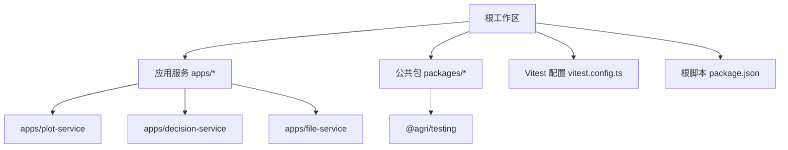
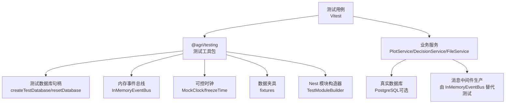
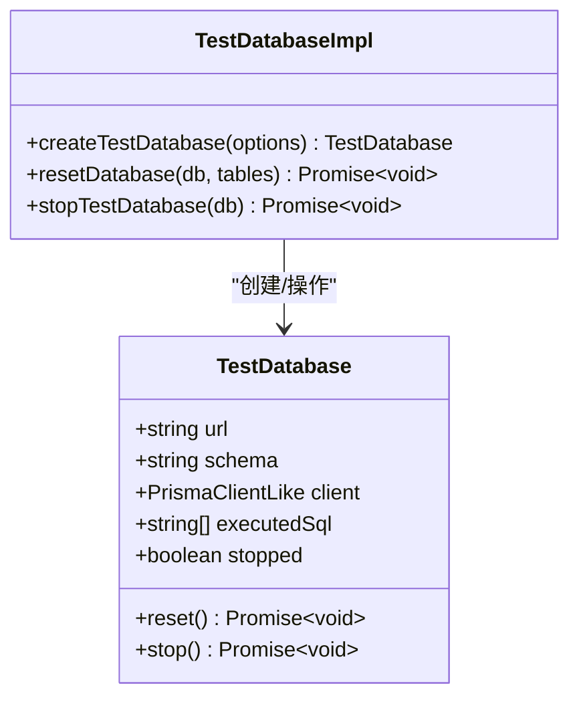
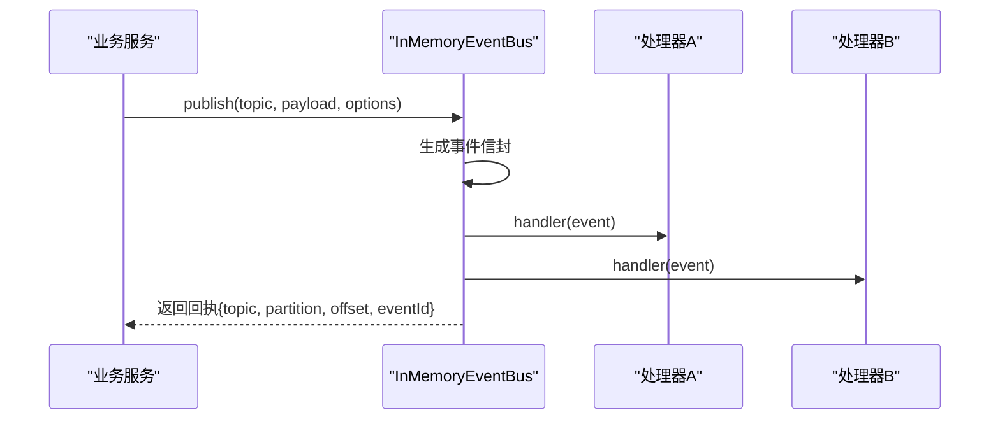
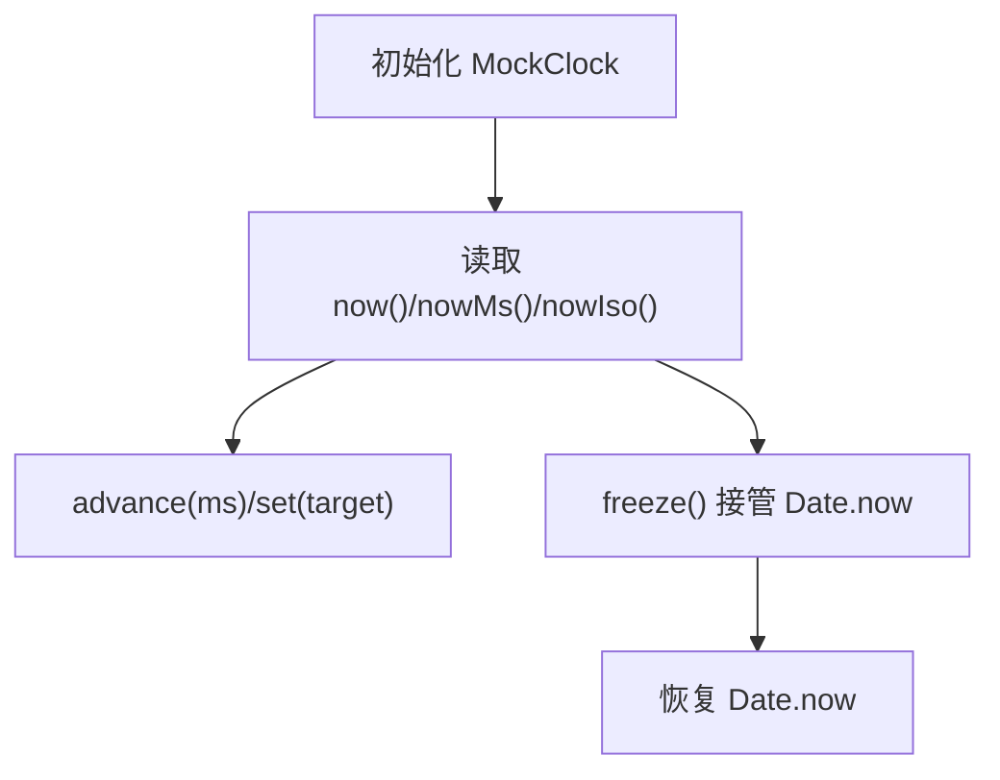
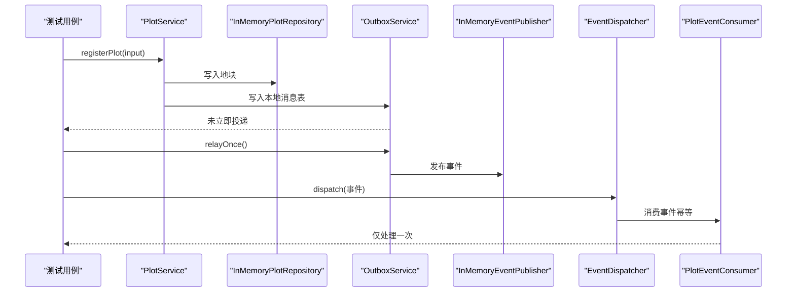
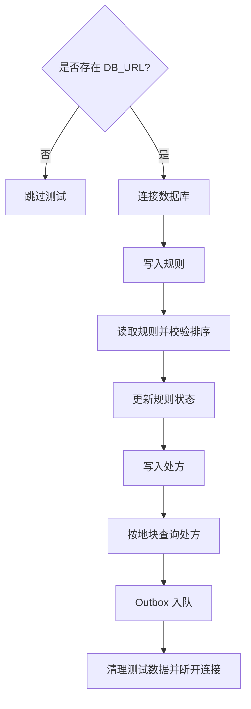
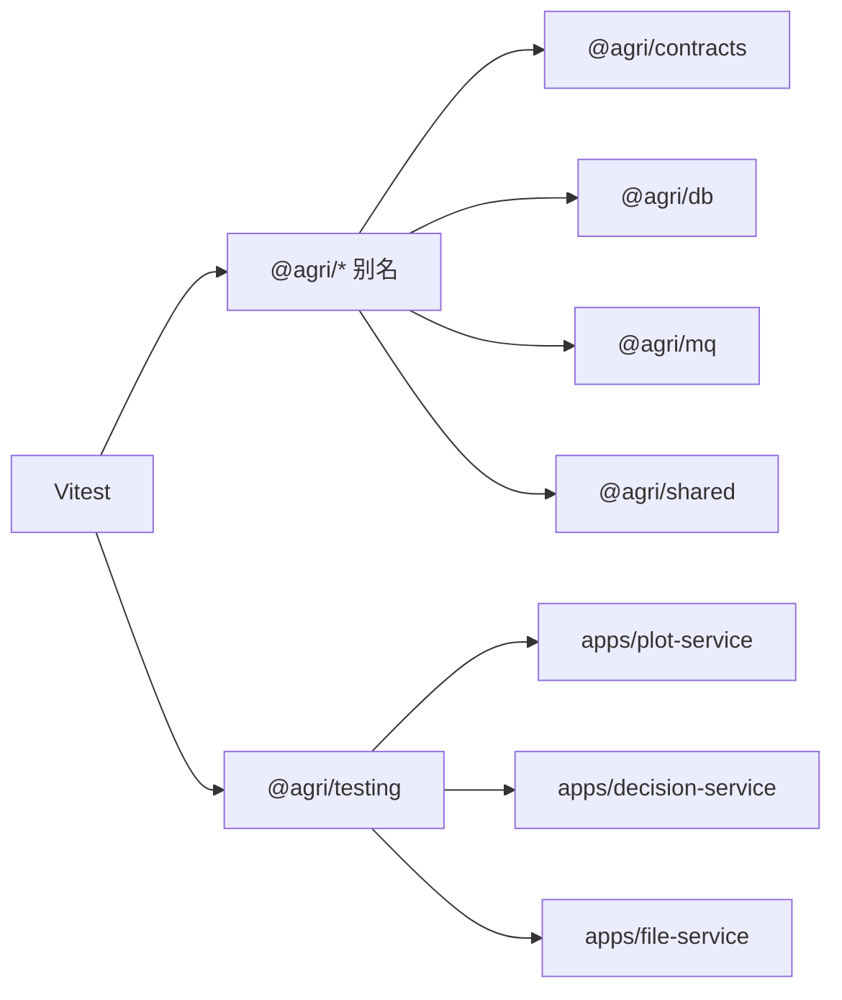

# 测试策略

<cite>
**本文引用的文件**   
- [vitest.config.ts](file://vitest.config.ts)
- [package.json](file://package.json)
- [packages/testing/src/index.ts](file://packages/testing/src/index.ts)
- [packages/testing/src/test-database.ts](file://packages/testing/src/test-database.ts)
- [packages/testing/src/event-bus.ts](file://packages/testing/src/event-bus.ts)
- [packages/testing/src/clock.ts](file://packages/testing/src/clock.ts)
- [packages/testing/src/fixtures.ts](file://packages/testing/src/fixtures.ts)
- [packages/testing/src/module-builder.ts](file://packages/testing/src/module-builder.ts)
- [apps/plot-service/test/plot-service.spec.ts](file://apps/plot-service/test/plot-service.spec.ts)
- [apps/decision-service/test/sql-decision-repository.spec.ts](file://apps/decision-service/test/sql-decision-repository.spec.ts)
- [apps/file-service/test/s3-storage.spec.ts](file://apps/file-service/test/s3-storage.spec.ts)
</cite>

## 目录
1. [引言](#引言)
2. [项目结构](#项目结构)
3. [核心组件](#核心组件)
4. [架构总览](#架构总览)
5. [详细组件分析](#详细组件分析)
6. [依赖关系分析](#依赖关系分析)
7. [性能与并发考虑](#性能与并发考虑)
8. [故障排查指南](#故障排查指南)
9. [结论](#结论)
10. [附录](#附录)

## 引言
本测试策略面向智慧农业平台，目标是建立覆盖单元测试、集成测试与端到端测试的完整质量保障体系。重点包括：
- 使用 Vitest 作为统一测试框架，配置别名直连源码，避免构建顺序问题。
- 通过 @agri/testing 工具包提供测试数据库、内存事件总线、可控时钟和夹具生成能力。
- 明确 Mock 策略、异步与并发测试规范，以及覆盖率与持续集成要求。
- 给出 API 接口测试、数据库测试与端到端测试的实施路径。

## 项目结构
仓库采用 monorepo 组织方式，业务服务位于 apps/*，公共包位于 packages/*，根级 vitest.config.ts 集中管理测试行为，并通过别名将 @agri/* 指向源码，便于在测试中直接引用最新实现。

图示来源
- [vitest.config.ts:10-40](file://vitest.config.ts#L10-L40)
- [package.json:10-28](file://package.json#L10-L28)

章节来源
- [vitest.config.ts:1-42](file://vitest.config.ts#L1-L42)
- [package.json:1-45](file://package.json#L1-L45)

## 核心组件
本节聚焦测试基础设施与关键用例，说明如何基于 Vitest 与 @agri/testing 开展高质量测试。

- 测试框架与运行入口
  - 根脚本提供 test 与 test:watch 命令，统一调用 Vitest。
  - Vitest 配置启用装饰器语义，并设置 include 规则以扫描 packages 与 apps 下的 .spec.ts。
  - 通过 alias 将 @agri/* 映射到源码，保证测试期无需先构建即可运行。

- 测试工具包 @agri/testing
  - 测试数据库：提供 createTestDatabase/resetDatabase/stopTestDatabase 等能力，封装假客户端以观察事务与 SQL。
  - 内存事件总线：InMemoryEventBus 提供发布订阅、批量发布、重复投递模拟、等待事件等能力。
  - 可控时钟：MockClock/freezeTime 支持推进时间、冻结全局 Date.now，稳定时间相关逻辑。
  - 数据夹具：plotFixture/gridFixture/deviceFixture/seasonFixture/telemetryFixture 等贴近真实量纲。
  - NestJS 模块构造器：TestModuleBuilder/buildTestModule 收敛装配与替换依赖的方式。

- 典型测试样例
  - 服务装配与领域链路验证：地块服务注册、编码生成、本地消息表入队、中继投递与消费者幂等处理。
  - 真实数据库冒烟：条件执行 SQL 仓储读写与 Outbox 入队。
  - 外部存储 Mock：S3 兼容签名请求与错误码转换。

章节来源
- [package.json:14-28](file://package.json#L14-L28)
- [vitest.config.ts:10-40](file://vitest.config.ts#L10-L40)
- [packages/testing/src/index.ts:1-25](file://packages/testing/src/index.ts#L1-L25)
- [packages/testing/src/test-database.ts:1-138](file://packages/testing/src/test-database.ts#L1-L138)
- [packages/testing/src/event-bus.ts:1-157](file://packages/testing/src/event-bus.ts#L1-L157)
- [packages/testing/src/clock.ts:1-88](file://packages/testing/src/clock.ts#L1-L88)
- [packages/testing/src/fixtures.ts:1-101](file://packages/testing/src/fixtures.ts#L1-L101)
- [packages/testing/src/module-builder.ts:1-69](file://packages/testing/src/module-builder.ts#L1-L69)
- [apps/plot-service/test/plot-service.spec.ts:1-158](file://apps/plot-service/test/plot-service.spec.ts#L1-L158)
- [apps/decision-service/test/sql-decision-repository.spec.ts:1-97](file://apps/decision-service/test/sql-decision-repository.spec.ts#L1-L97)
- [apps/file-service/test/s3-storage.spec.ts:1-20](file://apps/file-service/test/s3-storage.spec.ts#L1-L20)

## 架构总览
下图展示测试层与业务层的交互关系：测试用例通过 Vitest 驱动，借助 @agri/testing 提供的工具（测试数据库、内存事件总线、可控时钟、夹具）对服务进行隔离或半隔离验证；必要时接入真实数据库进行冒烟。

图示来源
- [vitest.config.ts:21-34](file://vitest.config.ts#L21-L34)
- [packages/testing/src/test-database.ts:94-138](file://packages/testing/src/test-database.ts#L94-L138)
- [packages/testing/src/event-bus.ts:37-157](file://packages/testing/src/event-bus.ts#L37-L157)
- [packages/testing/src/clock.ts:10-88](file://packages/testing/src/clock.ts#L10-L88)
- [packages/testing/src/fixtures.ts:13-101](file://packages/testing/src/fixtures.ts#L13-L101)
- [packages/testing/src/module-builder.ts:11-69](file://packages/testing/src/module-builder.ts#L11-L69)

## 详细组件分析

### 测试框架与运行配置（Vitest）
- 装饰器支持：通过 esbuild tsconfigRaw 开启 experimentalDecorators，确保装饰器在测试期正常登记处理器。
- 别名解析：@agri/* 全部映射到源码，避免测试依赖构建产物顺序问题。
- 测试发现：include 匹配 packages/**/test/**/*.spec.ts 与 apps/**/test/**/*.spec.ts。
- 环境：node 环境，reporter 默认输出。

图示来源
- [vitest.config.ts:14-20](file://vitest.config.ts#L14-L20)
- [vitest.config.ts:21-34](file://vitest.config.ts#L21-L34)
- [vitest.config.ts:36-40](file://vitest.config.ts#L36-L40)

章节来源
- [vitest.config.ts:1-42](file://vitest.config.ts#L1-L42)

### 测试工具包 @agri/testing

#### 测试数据库
- 目标：在不连接真实库的前提下，提供可观察的事务边界与 SQL 执行记录；在集成测试中可切换至容器化数据库。
- 能力：
  - createTestDatabase：创建句柄，暴露 client、executedSql、reset、stop。
  - resetDatabase：按默认表清单清空并重启自增序列。
  - stopTestDatabase：释放连接。
- 设计要点：内部使用“假客户端”，$transaction 包装 BEGIN/COMMIT/ROLLBACK，原始 SQL 写入 executedSql 供断言。

图示来源
- [packages/testing/src/test-database.ts:11-37](file://packages/testing/src/test-database.ts#L11-L37)
- [packages/testing/src/test-database.ts:94-138](file://packages/testing/src/test-database.ts#L94-L138)

章节来源
- [packages/testing/src/test-database.ts:1-138](file://packages/testing/src/test-database.ts#L1-L138)

#### 内存事件总线
- 目标：以与真实消息中间件一致的发布订阅契约替代 MQ，使服务代码无需为测试改写。
- 能力：
  - publish/publishBatch：自动补齐事件信封，分区与偏移递增。
  - deliver：直接投递已构造事件，用于模拟重复投递。
  - waitFor：等待满足条件的事件，超时抛错。
  - failNext：标记下一次投递失败后自动复位。
  - on/off/reset/close：订阅管理与清理。

图示来源
- [packages/testing/src/event-bus.ts:37-157](file://packages/testing/src/event-bus.ts#L37-L157)

章节来源
- [packages/testing/src/event-bus.ts:1-157](file://packages/testing/src/event-bus.ts#L1-L157)

#### 可控时钟
- 目标：稳定时间相关逻辑，避免系统时间波动导致的不稳定测试。
- 能力：
  - now/nowMs/nowIso：获取当前时间。
  - advance/set：推进或设定时间。
  - freeze：接管全局 Date.now，返回恢复函数。

图示来源
- [packages/testing/src/clock.ts:10-88](file://packages/testing/src/clock.ts#L10-L88)

章节来源
- [packages/testing/src/clock.ts:1-88](file://packages/testing/src/clock.ts#L1-L88)

#### 数据夹具
- 目标：提供贴近真实场景的数据结构，避免极端值掩盖单位/量纲问题。
- 能力：
  - buildPlotCodeFixture：生成地块编码。
  - plotFixture/gridFixture/deviceFixture/seasonFixture/telemetryFixture：常用实体夹具。

章节来源
- [packages/testing/src/fixtures.ts:1-101](file://packages/testing/src/fixtures.ts#L1-L101)

#### NestJS 模块构造器
- 目标：收敛测试模块装配与依赖替换，提升可读性与可维护性。
- 能力：
  - withImports/withProviders：追加导入与提供者。
  - withOverride/withMock：按令牌或类型替换依赖。
  - build：编译并返回 TestingModule。
  - buildTestModule：便捷方法。

章节来源
- [packages/testing/src/module-builder.ts:1-69](file://packages/testing/src/module-builder.ts#L1-L69)

### 服务单元测试示例：地块服务
该用例展示了从建档到消息落库、中继投递与消费者幂等的完整链路验证，同时注入内存仓储与消息实现，保持测试快速且具备较高可信度。

图示来源
- [apps/plot-service/test/plot-service.spec.ts:44-69](file://apps/plot-service/test/plot-service.spec.ts#L44-L69)
- [apps/plot-service/test/plot-service.spec.ts:88-157](file://apps/plot-service/test/plot-service.spec.ts#L88-L157)

章节来源
- [apps/plot-service/test/plot-service.spec.ts:1-158](file://apps/plot-service/test/plot-service.spec.ts#L1-L158)

### 数据库集成测试示例：决策服务
当存在 DB_URL 时执行真实数据库冒烟，覆盖迁移产出的表结构与 SQL 仓储读写链路，并验证 Outbox 入队。

图示来源
- [apps/decision-service/test/sql-decision-repository.spec.ts:11-46](file://apps/decision-service/test/sql-decision-repository.spec.ts#L11-L46)
- [apps/decision-service/test/sql-decision-repository.spec.ts:48-96](file://apps/decision-service/test/sql-decision-repository.spec.ts#L48-L96)

章节来源
- [apps/decision-service/test/sql-decision-repository.spec.ts:1-97](file://apps/decision-service/test/sql-decision-repository.spec.ts#L1-L97)

### 外部依赖 Mock 示例：对象存储
通过 vi.fn 拦截 fetch 实现，验证 MinIO 兼容签名请求与 404 转空的处理。

章节来源
- [apps/file-service/test/s3-storage.spec.ts:1-20](file://apps/file-service/test/s3-storage.spec.ts#L1-L20)

## 依赖关系分析
- 测试框架与别名
  - Vitest 通过 alias 将 @agri/* 指向源码，避免构建产物依赖顺序问题。
- 工具包与业务
  - @agri/testing 被各服务测试引入，提供测试数据库、事件总线、时钟与夹具。
- 服务与基础设施
  - 服务在测试中用 InMemory* 实现替换持久化与消息依赖，降低耦合。

图示来源
- [vitest.config.ts:21-34](file://vitest.config.ts#L21-L34)
- [packages/testing/src/index.ts:1-25](file://packages/testing/src/index.ts#L1-L25)

章节来源
- [vitest.config.ts:21-34](file://vitest.config.ts#L21-L34)
- [packages/testing/src/index.ts:1-25](file://packages/testing/src/index.ts#L1-L25)

## 性能与并发考虑
- 测试隔离
  - 每个测试文件或套件应独立构建上下文，避免共享状态污染。
  - 使用 InMemoryEventBus.reset 与 TestDatabase.reset 清理历史与数据。
- 异步与并发
  - 使用 Vitest 的 describe/it 异步回调；对于需要等待事件的场景，优先使用 InMemoryEventBus.waitFor。
  - 避免在测试中使用真实网络 I/O；如必须，使用 vi.fn 或代理。
- 时间敏感逻辑
  - 使用 MockClock.freeze 接管全局时间，结合 advance/set 推进时间窗口，确保确定性。
- 资源释放
  - 测试结束后调用 stopTestDatabase 与 EventBus.close，防止连接泄漏。

[本节为通用指导，不直接分析具体文件]

## 故障排查指南
- 装饰器未生效
  - 检查 Vitest 是否启用 experimentalDecorators。
  - 确认测试入口是否需要 import "reflect-metadata"。
- 别名解析失败
  - 检查 vitest.config.ts 中的 alias 配置是否正确指向源码路径。
- 事件未触发或顺序异常
  - 使用 InMemoryEventBus.deliver 模拟重复投递，配合 IdempotencyGuard 验证幂等。
  - 使用 waitFor 等待事件，避免竞态。
- 数据库连接或事务异常
  - 使用 createTestDatabase 获取假客户端，断言 executedSql 中的 BEGIN/COMMIT/ROLLBACK。
  - 集成测试需确保 DB_URL 正确且数据库可用。
- 时间相关用例不稳定
  - 使用 freezeTime 接管全局时间，并在测试结束时恢复。

章节来源
- [vitest.config.ts:14-20](file://vitest.config.ts#L14-L20)
- [vitest.config.ts:21-34](file://vitest.config.ts#L21-L34)
- [packages/testing/src/test-database.ts:50-87](file://packages/testing/src/test-database.ts#L50-L87)
- [packages/testing/src/event-bus.ts:131-151](file://packages/testing/src/event-bus.ts#L131-L151)
- [packages/testing/src/clock.ts:51-63](file://packages/testing/src/clock.ts#L51-L63)

## 结论
通过 Vitest 与 @agri/testing 的组合，平台实现了高内聚、低耦合的测试体系：
- 单元测试聚焦业务逻辑与装配，使用内存实现替代外部依赖。
- 集成测试在必要时接入真实数据库，验证 SQL 与事务边界。
- 可控时钟与内存事件总线提升了时间敏感与异步流程的可测性。
建议后续补充前端组件测试与端到端测试，完善覆盖率门禁与 CI 流水线。

[本节为总结性内容，不直接分析具体文件]

## 附录

### 测试分层与范围
- 单元测试
  - 服务类、工具函数、领域逻辑。
  - 使用 InMemoryEventBus、MockClock、fixtures 与 TestDatabase。
- 集成测试
  - API 接口测试：通过 Nest Testing 或 HTTP 客户端发起请求，断言响应。
  - 数据库测试：条件执行真实库冒烟，覆盖迁移与仓储。
  - 端到端测试：浏览器自动化或 API 全链路验证（建议后续补充）。

### Mock 策略
- 外部依赖一律 Mock：网络请求、文件系统、第三方 SDK。
- 消息中间件：使用 InMemoryEventBus 替代，必要时用 deliver 模拟重复投递。
- 时间：使用 MockClock.freeze 接管全局时间。
- 数据库：单元测试使用 TestDatabase 假客户端；集成测试使用真实库。

### 异步与并发测试
- 使用 Vitest 的异步 it/describe。
- 事件等待：InMemoryEventBus.waitFor。
- 避免共享可变状态：每个用例独立构建 SUT。

### 覆盖率要求
- 建议目标：行覆盖率 ≥ 80%，分支覆盖率 ≥ 75%。
- 报告：在 CI 中生成 HTML 与 JSON 报告，归档并比较增量变化。

### 持续集成配置
- 触发：Push/Pull Request。
- 步骤：
  - 安装依赖。
  - 类型检查 tsc -b --dry。
  - 运行测试 vitest run。
  - 生成覆盖率报告。
  - 条件执行数据库冒烟（存在 DB_URL）。
- 缓存：pnpm 依赖缓存与 Turbo 缓存。

[本节为通用指导，不直接分析具体文件]