# 测试策略

<cite>
**本文引用的文件**   
- [vitest.config.ts](file://vitest.config.ts)
- [package.json](file://package.json)
- [packages/testing/src/test-database.ts](file://packages/testing/src/test-database.ts)
- [packages/testing/src/fixtures.ts](file://packages/testing/src/fixtures.ts)
- [packages/testing/src/index.ts](file://packages/testing/src/index.ts)
- [apps/control-service/test/command-spec.spec.ts](file://apps/control-service/test/command-spec.spec.ts)
- [apps/plot-service/test/zone.spec.ts](file://apps/plot-service/test/zone.spec.ts)
- [apps/telemetry-service/test/agro-monitoring.spec.ts](file://apps/telemetry-service/test/agro-monitoring.spec.ts)
- [apps/operation-service/test/navigation.spec.ts](file://apps/operation-service/test/navigation.spec.ts)
- [apps/web/test/control-commands-view.spec.ts](file://apps/web/test/control-commands-view.spec.ts)
- [apps/web/test/view-harness.ts](file://apps/web/test/view-harness.ts)
- [apps/decision-service/test/sql-decision-repository.spec.ts](file://apps/decision-service/test/sql-decision-repository.spec.ts)
</cite>

## 更新摘要
**变更内容**   
- **新增真实数据库集成能力**：测试工具包支持真实的PostgreSQL连接，提供事务边界与SQL执行观察
- **增强时间派生测试夹具**：fixtures.ts中的时间相关数据使用动态生成，避免固定时间戳导致的测试不稳定
- **扩展业务验证逻辑**：灌溉命令参数验证、空间数据操作、农业监控工作流和田间导航规划的全面测试覆盖
- **完善前端组件测试框架**：Vue SFC编译器支持真实组件编译和渲染测试
- **新增端到端命令回执冒烟测试**：跨服务的完整流程验证能力

## 目录
1. [引言](#引言)
2. [项目结构](#项目结构)
3. [核心组件](#核心组件)
4. [架构总览](#架构总览)
5. [详细组件分析](#详细组件分析)
6. [依赖关系分析](#依赖关系分析)
7. [性能与并发考虑](#性能与并发考虑)
8. [故障排查指南](#故障排查指南)
9. [结论](#结论)
10. [附录](#附录)

## 引言
本测试策略面向智慧农业平台，目标是建立覆盖单元测试、集成测试与端到端测试的完整质量保障体系。重点包括：
- 使用 Vitest 作为统一测试框架，配置别名直连源码，避免构建顺序问题。
- 通过 @agri/testing 工具包提供测试数据库、内存事件总线、可控时钟和夹具生成能力。
- 明确 Mock 策略、异步与并发测试规范，以及覆盖率与持续集成要求。
- 给出 API 接口测试、数据库测试与端到端测试的实施路径。
- **新增** 前端组件测试支持，包括Vue单文件组件的真实编译和渲染测试。
- **新增** 端到端命令回执冒烟测试，提供跨服务的完整流程验证能力。

**更新** 本次更新显著增强了测试基础设施，新增了真实数据库集成能力、时间派生测试夹具、增强的业务验证逻辑，以及完整的前端组件测试框架。

## 项目结构
仓库采用 monorepo 组织方式，业务服务位于 apps/*，公共包位于 packages/*，根级 vitest.config.ts 集中管理测试行为，并通过别名将 @agri/* 指向源码，便于在测试中直接引用最新实现。

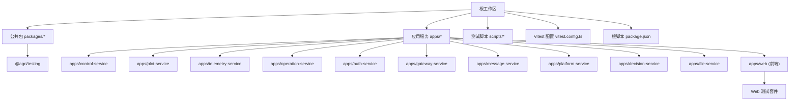

图示来源
- [vitest.config.ts:10-40](file://vitest.config.ts#L10-L40)
- [package.json:10-28](file://package.json#L10-L28)

章节来源
- [vitest.config.ts:1-42](file://vitest.config.ts#L1-L42)
- [package.json:1-45](file://package.json#L1-L45)

## 核心组件
本节聚焦测试基础设施与关键用例，说明如何基于 Vitest 与 @agri/testing 开展高质量测试。

- 测试框架与运行入口
  - 根脚本提供 test 与 test:watch 命令，统一调用 Vitest。
  - Vitest 配置启用装饰器语义，并设置 include 规则以扫描 packages 与 apps 下的 .spec.ts。
  - 通过 alias 将 @agri/* 映射到源码，保证测试期无需先构建即可运行。

- 测试工具包 @agri/testing
  - **新增** 真实数据库集成：createTestDatabase/resetDatabase/stopTestDatabase 等能力，封装假客户端以观察事务与 SQL，同时支持真实PostgreSQL连接。
  - 内存事件总线：InMemoryEventBus 提供发布订阅、批量发布、重复投递模拟、等待事件等能力。
  - 可控时钟：MockClock/freezeTime 支持推进时间、冻结全局 Date.now，稳定时间相关逻辑。
  - **增强** 数据夹具：plotFixture/gridFixture/deviceFixture/seasonFixture/telemetryFixture 等贴近真实量纲，使用时间派生机制避免固定时间戳。
  - NestJS 模块构造器：TestModuleBuilder/buildTestModule 收敛装配与替换依赖的方式。

- **新增** 前端组件测试框架
  - Vue SFC 编译器：支持真实编译Vue单文件组件，不模拟浏览器布局。
  - 虚拟DOM渲染：使用Vue.createRenderer创建轻量级渲染器，支持组件树遍历。
  - 依赖注入：支持模块化依赖注入，可Mock外部API和服务。
  - 测试辅助函数：mountView/evaluateTs/flushView等工具函数简化测试编写。

- 典型测试样例
  - 服务装配与领域链路验证：地块服务注册、编码生成、本地消息表入队、中继投递与消费者幂等处理。
  - **新增** 真实数据库冒烟：条件执行 SQL 仓储读写与 Outbox 入队，支持真实PostgreSQL连接。
  - 外部存储 Mock：S3 兼容签名请求与错误码转换。
  - **新增** Web组件测试：控制指令台账页的查询、派发、回执等完整业务流程。
  - **新增** 业务验证测试：灌溉命令参数验证、空间数据操作、农业监控工作流、田间导航规划。

**更新** 新增以下测试场景：
- 灌溉命令参数验证：水肥参数校验、分区时序计算、累计供水曲线生成
- 空间数据操作：片区凸包算法、地块归属管理、管线几何长度估算
- 农业监控工作流：四情阈值规则、虫情上报处理、告警生成与事件发布
- 田间导航规划：站点顺序优化、机耕道路径规划、直线与沿路距离计算
- **新增** 真实数据库集成：PostgreSQL连接、事务边界验证、SQL执行观察
- **新增** 时间派生夹具：动态生成时间相关数据，避免测试不稳定

章节来源
- [package.json:14-28](file://package.json#L14-L28)
- [vitest.config.ts:10-40](file://vitest.config.ts#L10-L40)
- [packages/testing/src/index.ts:1-24](file://packages/testing/src/index.ts#L1-L24)
- [packages/testing/src/test-database.ts:1-138](file://packages/testing/src/test-database.ts#L1-L138)
- [packages/testing/src/fixtures.ts:1-101](file://packages/testing/src/fixtures.ts#L1-L101)
- [apps/web/test/view-harness.ts:1-105](file://apps/web/test/view-harness.ts#L1-L105)
- [apps/control-service/test/command-spec.spec.ts:1-104](file://apps/control-service/test/command-spec.spec.ts#L1-L104)
- [apps/plot-service/test/zone.spec.ts:1-163](file://apps/plot-service/test/zone.spec.ts#L1-L163)
- [apps/telemetry-service/test/agro-monitoring.spec.ts:1-111](file://apps/telemetry-service/test/agro-monitoring.spec.ts#L1-L111)
- [apps/operation-service/test/navigation.spec.ts:1-136](file://apps/operation-service/test/navigation.spec.ts#L1-L136)

## 架构总览
下图展示测试层与业务层的交互关系：测试用例通过 Vitest 驱动，借助 @agri/testing 提供的工具（测试数据库、内存事件总线、可控时钟、夹具）对服务进行隔离或半隔离验证；必要时接入真实数据库进行冒烟；端到端测试则启动多个真实服务进程进行完整流程验证。

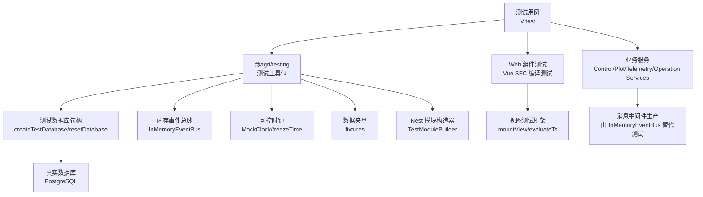

图示来源
- [vitest.config.ts:21-34](file://vitest.config.ts#L21-L34)
- [packages/testing/src/test-database.ts:94-138](file://packages/testing/src/test-database.ts#L94-L138)
- [packages/testing/src/fixtures.ts:13-101](file://packages/testing/src/fixtures.ts#L13-L101)
- [packages/testing/src/module-builder.ts:11-69](file://packages/testing/src/module-builder.ts#L11-L69)
- [apps/web/test/view-harness.ts:64-92](file://apps/web/test/view-harness.ts#L64-L92)

## 详细组件分析

### 测试框架与运行配置（Vitest）
- 装饰器支持：通过 esbuild tsconfigRaw 开启 experimentalDecorators，确保装饰器在测试期正常登记处理器。
- 别名解析：@agri/* 全部映射到源码，避免测试依赖构建产物顺序问题。
- 测试发现：include 匹配 packages/**/test/**/*.spec.ts 与 apps/**/test/**/*.spec.ts。
- 环境：node 环境，reporter 默认输出。

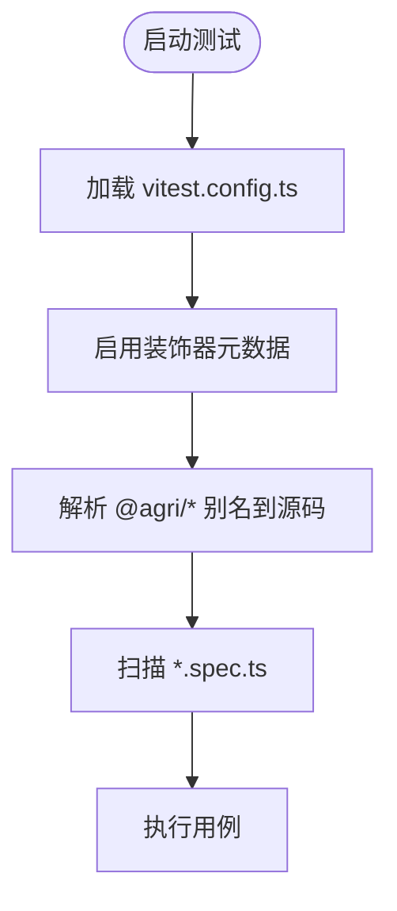

图示来源
- [vitest.config.ts:14-20](file://vitest.config.ts#L14-L20)
- [vitest.config.ts:21-34](file://vitest.config.ts#L21-L34)
- [vitest.config.ts:36-40](file://vitest.config.ts#L36-L40)

章节来源
- [vitest.config.ts:1-42](file://vitest.config.ts#L1-L42)

### 测试工具包 @agri/testing

#### 测试数据库
- **新增** 真实数据库集成：支持真实的PostgreSQL连接，提供事务边界与SQL执行观察能力。
- 目标：在不连接真实库的前提下，提供可观察的事务边界与 SQL 执行记录；在集成测试中可切换至容器化数据库。
- 能力：
  - createTestDatabase：创建句柄，暴露 client、executedSql、reset、stop。
  - resetDatabase：按默认表清单清空并重启自增序列。
  - stopTestDatabase：释放连接。
- 设计要点：内部使用"假客户端"，$transaction 包装 BEGIN/COMMIT/ROLLBACK，原始 SQL 写入 executedSql 供断言。

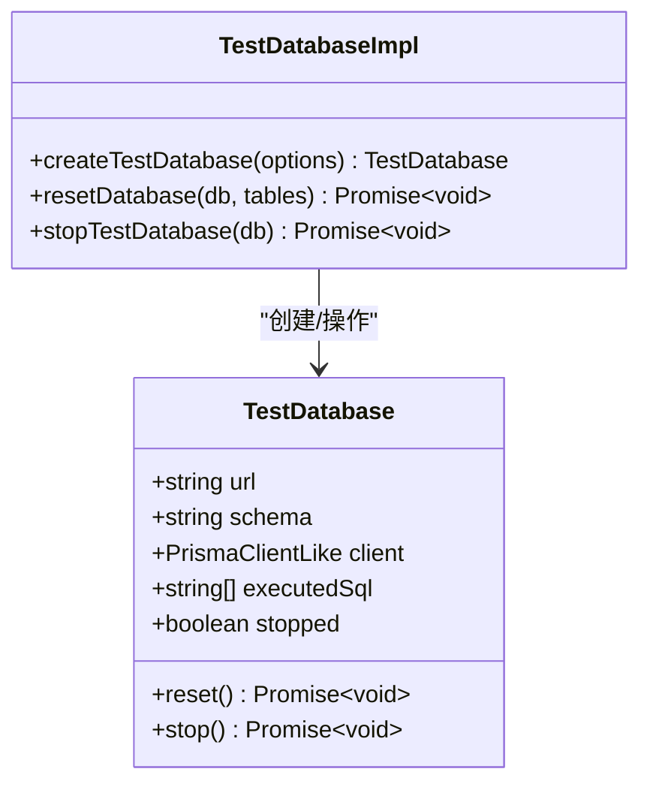

图示来源
- [packages/testing/src/test-database.ts:11-37](file://packages/testing/src/test-database.ts#L11-L37)
- [packages/testing/src/test-database.ts:94-138](file://packages/testing/src/test-database.ts#L94-L138)

章节来源
- [packages/testing/src/test-database.ts:1-138](file://packages/testing/src/test-database.ts#L1-L138)

#### 内存事件总线
- 目标：以与真实消息中间件一致的发布订阅契约替代 MQ，使服务代码无需为测试改写。
- 能力：
  - publish/publishBatch：自动补齐事件信封，分区与偏移递增。
  - deliver：直接投递已构造事件，用于模拟重复投递。
  - waitFor：等待满足条件的事件，超时抛错。
  - failNext：标记下一次投递失败后自动复位。
  - on/off/reset/close：订阅管理与清理。

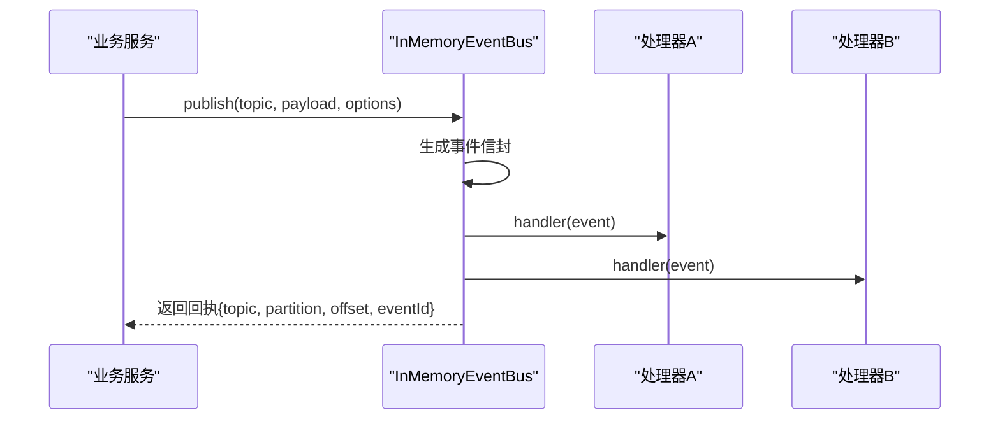

图示来源
- [packages/testing/src/event-bus.ts:37-157](file://packages/testing/src/event-bus.ts#L37-L157)

章节来源
- [packages/testing/src/event-bus.ts:1-157](file://packages/testing/src/event-bus.ts#L1-L157)

#### 可控时钟
- 目标：稳定时间相关逻辑，避免系统时间波动导致的不稳定测试。
- 能力：
  - now/nowMs/nowIso：获取当前时间。
  - advance/set：推进或设定时间。
  - freeze：接管全局 Date.now，返回恢复函数。

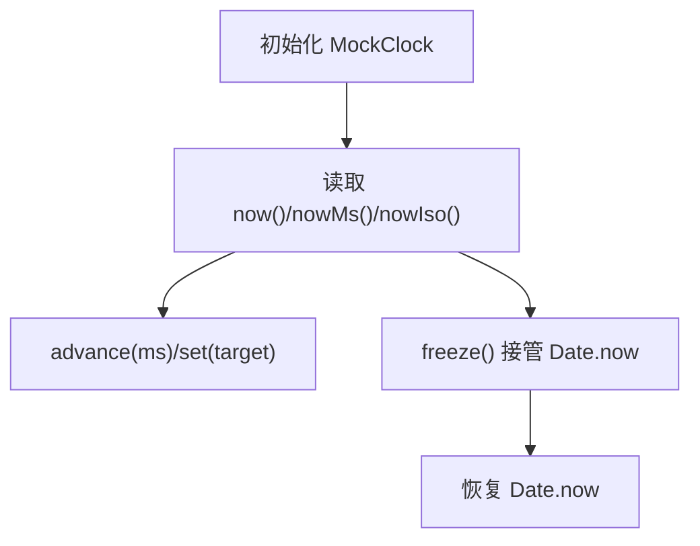

图示来源
- [packages/testing/src/clock.ts:10-88](file://packages/testing/src/clock.ts#L10-L88)

章节来源
- [packages/testing/src/clock.ts:1-88](file://packages/testing/src/clock.ts#L1-L88)

#### 数据夹具
- **增强** 时间派生机制：fixtures.ts中的时间相关数据使用动态生成，避免固定时间戳导致的测试不稳定。
- 目标：提供贴近真实场景的数据结构，避免极端值掩盖单位/量纲问题。
- 能力：
  - buildPlotCodeFixture：生成地块编码。
  - plotFixture/gridFixture/deviceFixture/seasonFixture/telemetryFixture：常用实体夹具。

章节来源
- [packages/testing/src/fixtures.ts:1-101](file://packages/testing/src/fixtures.ts#L1-L101)

#### NestJS 模块构造器
- 目标：收敛测试模块装配与依赖替换，提升可读性与可维护性。
- 能力：
  - withImports/withProviders：追加导入与提供者。
  - withOverride/withMock：按令牌或类型替换依赖。
  - build：编译并返回 TestingModule。
  - buildTestModule：便捷方法。

章节来源
- [packages/testing/src/module-builder.ts:1-69](file://packages/testing/src/module-builder.ts#L1-L69)

### 前端组件测试框架

#### Vue SFC 编译与渲染
- **新增** 真实组件测试能力：支持真实Vue单文件组件的编译和渲染测试，不模拟浏览器布局。
- 能力：
  - evaluateTs：动态编译TypeScript模块，支持模块化依赖注入。
  - mountView：挂载Vue组件，返回组件状态和卸载函数。
  - flushView：异步刷新视图，等待Vue响应式更新完成。
  - TestNode：轻量级虚拟DOM节点，支持树形结构遍历。

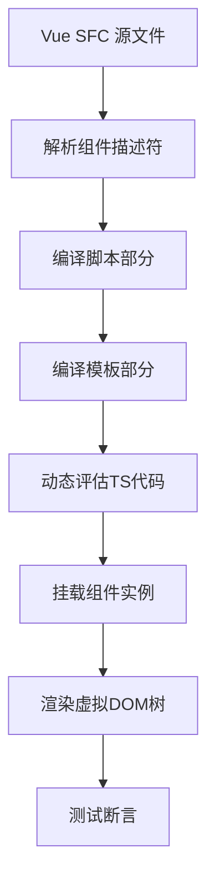

图示来源
- [apps/web/test/view-harness.ts:64-92](file://apps/web/test/view-harness.ts#L64-L92)
- [apps/web/test/view-harness.ts:8-20](file://apps/web/test/view-harness.ts#L8-L20)

章节来源
- [apps/web/test/view-harness.ts:1-105](file://apps/web/test/view-harness.ts#L1-L105)

### 灌溉命令参数验证测试

#### 水肥参数校验
**新增** 灌溉命令测试覆盖了水肥参数的完整校验逻辑，包括分区面积、目标定额、流量范围和配比参数的严格验证。

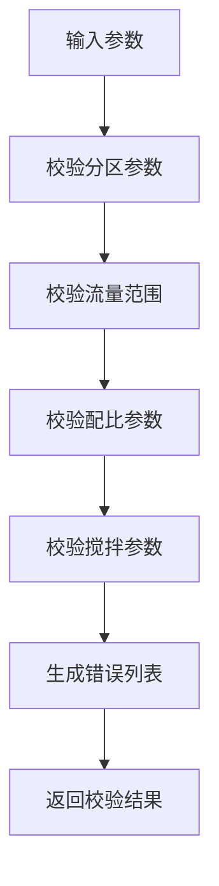

图示来源
- [apps/control-service/test/command-spec.spec.ts:28-41](file://apps/control-service/test/command-spec.spec.ts#L28-L41)
- [apps/control-service/src/command-spec.ts:84-132](file://apps/control-service/src/command-spec.ts#L84-L132)

章节来源
- [apps/control-service/test/command-spec.spec.ts:21-41](file://apps/control-service/test/command-spec.spec.ts#L21-L41)
- [apps/control-service/src/command-spec.ts:84-132](file://apps/control-service/src/command-spec.ts#L84-L132)

#### 分区时序与累计供水曲线
**新增** 测试验证了变量灌溉方案的生成逻辑，包括分区调度、用水量计算、时长分配和累计供水曲线的精确生成。

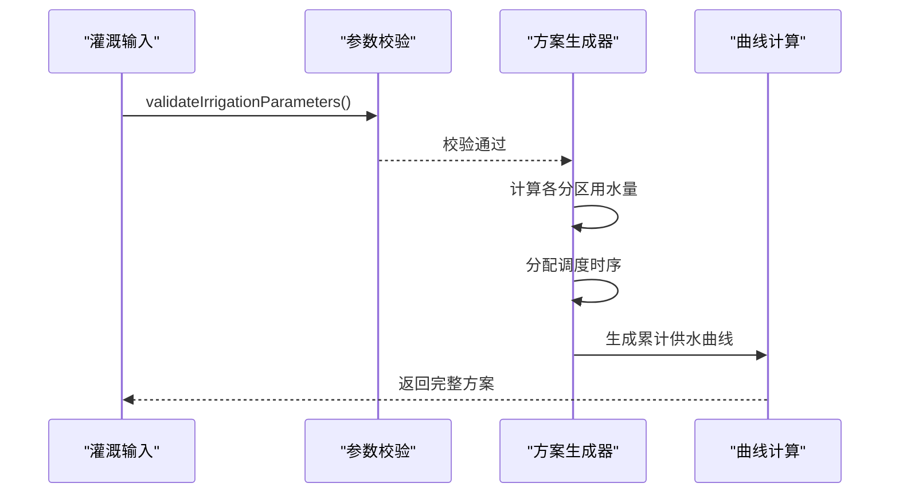

图示来源
- [apps/control-service/test/command-spec.spec.ts:43-67](file://apps/control-service/test/command-spec.spec.ts#L43-L67)
- [apps/control-service/src/command-spec.ts:140-186](file://apps/control-service/src/command-spec.ts#L140-L186)

章节来源
- [apps/control-service/test/command-spec.spec.ts:43-67](file://apps/control-service/test/command-spec.spec.ts#L43-L67)
- [apps/control-service/src/command-spec.ts:140-186](file://apps/control-service/src/command-spec.ts#L140-L186)

#### 控制指令HTTP接口
**新增** 测试确保了控制指令接口的参数验证、预演功能和权限控制机制的正确性。

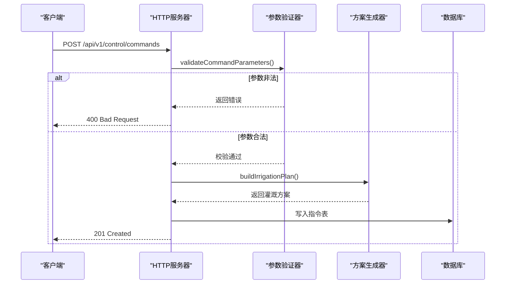

图示来源
- [apps/control-service/test/command-spec.spec.ts:71-102](file://apps/control-service/test/command-spec.spec.ts#L71-L102)

章节来源
- [apps/control-service/test/command-spec.spec.ts:70-103](file://apps/control-service/test/command-spec.spec.ts#L70-L103)

### 空间数据操作测试

#### 片区凸包算法
**新增** 片区测试验证了凸包轮廓计算、首尾闭合处理和点不足时的边界情况处理。

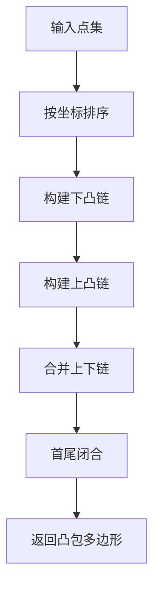

图示来源
- [apps/plot-service/test/zone.spec.ts:82-95](file://apps/plot-service/test/zone.spec.ts#L82-L95)
- [apps/plot-service/src/zone.geometry.ts:34-67](file://apps/plot-service/src/zone.geometry.ts#L34-L67)

章节来源
- [apps/plot-service/test/zone.spec.ts:81-96](file://apps/plot-service/test/zone.spec.ts#L81-L96)
- [apps/plot-service/src/zone.geometry.ts:34-67](file://apps/plot-service/src/zone.geometry.ts#L34-L67)

#### 片区台账与地块归属
**新增** 测试覆盖了片区的完整生命周期管理，包括创建、重码拒绝、地块划入移出和按片区过滤等功能。

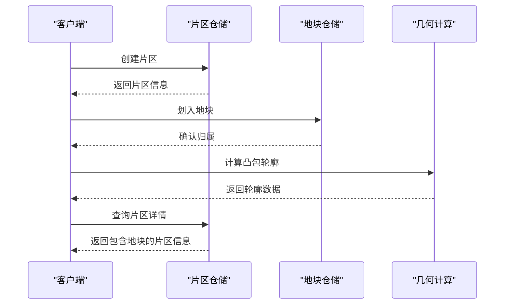

图示来源
- [apps/plot-service/test/zone.spec.ts:99-149](file://apps/plot-service/test/zone.spec.ts#L99-L149)

章节来源
- [apps/plot-service/test/zone.spec.ts:98-158](file://apps/plot-service/test/zone.spec.ts#L98-L158)

#### 管线几何长度估算
**新增** 管线测试验证了几何长度估算算法的准确性，包括经纬度换算和折线长度计算。

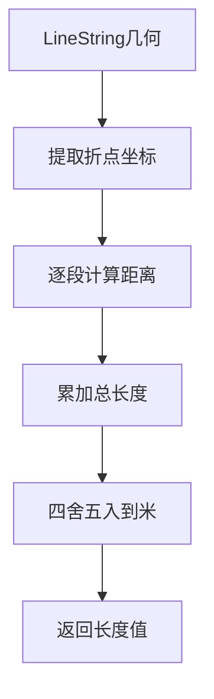

图示来源
- [apps/plot-service/test/infra-line.spec.ts:43-49](file://apps/plot-service/test/infra-line.spec.ts#L43-L49)
- [apps/plot-service/src/infra-line.repository.ts:55-73](file://apps/plot-service/src/infra-line.repository.ts#L55-L73)

章节来源
- [apps/plot-service/test/infra-line.spec.ts:42-49](file://apps/plot-service/test/infra-line.spec.ts#L42-L49)
- [apps/plot-service/src/infra-line.repository.ts:55-73](file://apps/plot-service/src/infra-line.repository.ts#L55-L73)

#### 管线CRUD操作
**新增** 测试确保了管线的增删改查功能，包括类型过滤、软删除机制和路由优先级处理。

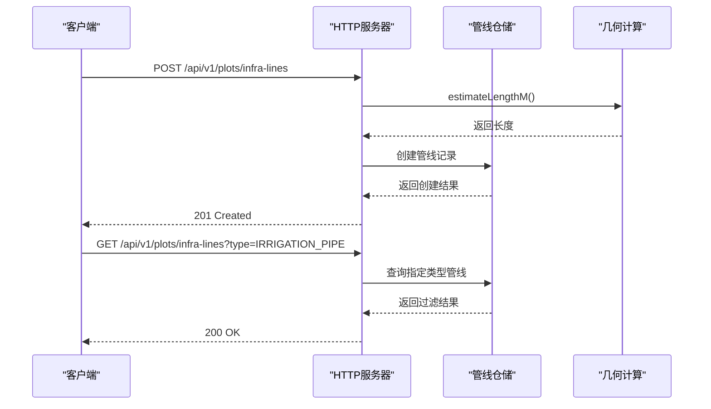

图示来源
- [apps/plot-service/test/infra-line.spec.ts:51-87](file://apps/plot-service/test/infra-line.spec.ts#L51-L87)

章节来源
- [apps/plot-service/test/infra-line.spec.ts:51-87](file://apps/plot-service/test/infra-line.spec.ts#L51-L87)

### 农业监控工作流测试

#### 四情阈值规则管理
**新增** 农业监控测试验证了阈值规则的完整管理流程，包括默认规则加载、自定义规则创建和规则校验。

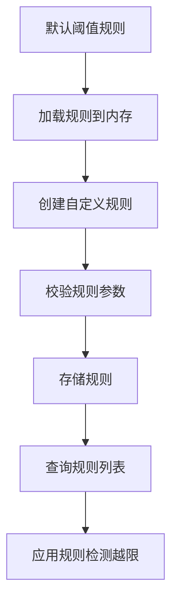

图示来源
- [apps/telemetry-service/test/agro-monitoring.spec.ts:38-68](file://apps/telemetry-service/test/agro-monitoring.spec.ts#L38-L68)
- [apps/telemetry-service/src/http.ts:76-98](file://apps/telemetry-service/src/http.ts#L76-L98)

章节来源
- [apps/telemetry-service/test/agro-monitoring.spec.ts:37-69](file://apps/telemetry-service/test/agro-monitoring.spec.ts#L37-L69)
- [apps/telemetry-service/src/http.ts:76-98](file://apps/telemetry-service/src/http.ts#L76-L98)

#### 虫情上报与告警处理
**新增** 测试确保了虫情事件的完整处理链路，从上报到告警生成、状态管理和查询处理的各个环节。

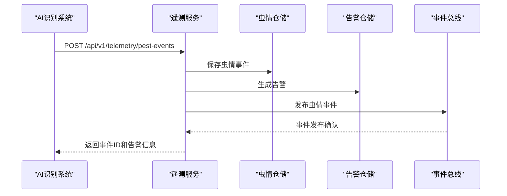

图示来源
- [apps/telemetry-service/test/agro-monitoring.spec.ts:71-99](file://apps/telemetry-service/test/agro-monitoring.spec.ts#L71-L99)
- [apps/telemetry-service/src/http.ts:100-120](file://apps/telemetry-service/src/http.ts#L100-L120)

章节来源
- [apps/telemetry-service/test/agro-monitoring.spec.ts:71-100](file://apps/telemetry-service/test/agro-monitoring.spec.ts#L71-L100)
- [apps/telemetry-service/src/http.ts:100-120](file://apps/telemetry-service/src/http.ts#L100-L120)

#### 监控数据概览
**新增** 测试验证了监控数据的聚合查询功能，包括待处理告警统计、虫情事件汇总和规则状态概览。

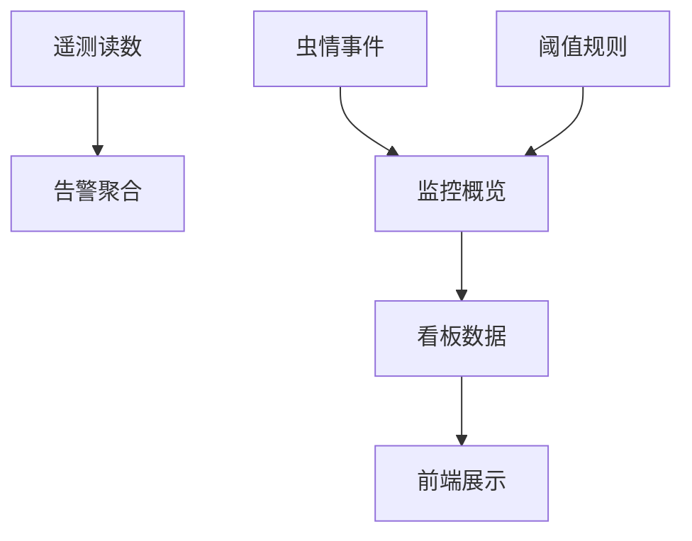

图示来源
- [apps/telemetry-service/test/agro-monitoring.spec.ts:90-94](file://apps/telemetry-service/test/agro-monitoring.spec.ts#L90-L94)

章节来源
- [apps/telemetry-service/test/agro-monitoring.spec.ts:90-94](file://apps/telemetry-service/test/agro-monitoring.spec.ts#L90-L94)

### 田间导航规划测试

#### 站点顺序优化
**新增** 导航测试验证了最近邻算法和2-opt优化策略，确保站点访问顺序的最优性。

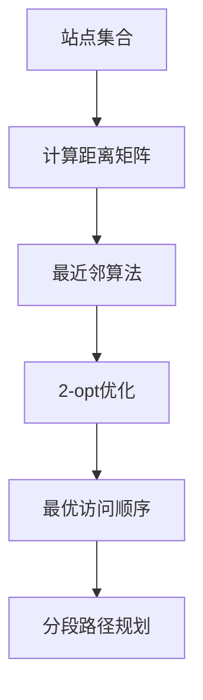

图示来源
- [apps/operation-service/test/navigation.spec.ts:30-52](file://apps/operation-service/test/navigation.spec.ts#L30-L52)
- [apps/operation-service/src/navigation.ts:257-310](file://apps/operation-service/src/navigation.ts#L257-L310)

章节来源
- [apps/operation-service/test/navigation.spec.ts:29-52](file://apps/operation-service/test/navigation.spec.ts#L29-L52)
- [apps/operation-service/src/navigation.ts:257-310](file://apps/operation-service/src/navigation.ts#L257-L310)

#### 机耕道路径规划
**新增** 测试确保了机耕道路网的路径规划功能，包括站点吸附、Dijkstra最短路径和距离计算。

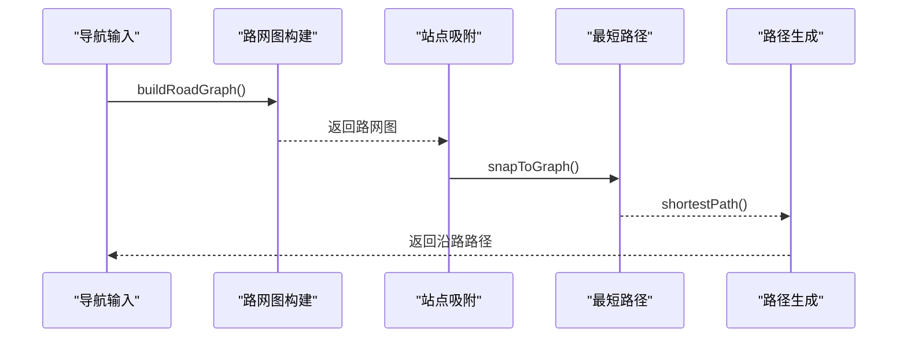

图示来源
- [apps/operation-service/test/navigation.spec.ts:54-78](file://apps/operation-service/test/navigation.spec.ts#L54-L78)
- [apps/operation-service/src/navigation.ts:93-254](file://apps/operation-service/src/navigation.ts#L93-L254)

章节来源
- [apps/operation-service/test/navigation.spec.ts:54-78](file://apps/operation-service/test/navigation.spec.ts#L54-L78)
- [apps/operation-service/src/navigation.ts:93-254](file://apps/operation-service/src/navigation.ts#L93-L254)

#### 导航参数校验
**新增** 测试验证了导航请求参数的完整性校验，包括坐标合法性、站点数量限制和速度范围检查。

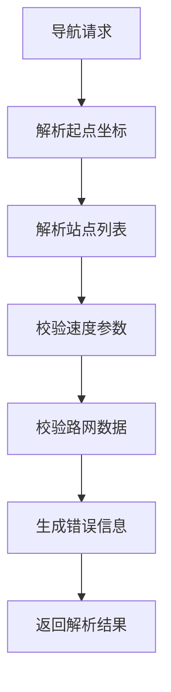

图示来源
- [apps/operation-service/test/navigation.spec.ts:89-97](file://apps/operation-service/test/navigation.spec.ts#L89-L97)
- [apps/operation-service/src/navigation.ts:401-447](file://apps/operation-service/src/navigation.ts#L401-L447)

章节来源
- [apps/operation-service/test/navigation.spec.ts:89-97](file://apps/operation-service/test/navigation.spec.ts#L89-L97)
- [apps/operation-service/src/navigation.ts:401-447](file://apps/operation-service/src/navigation.ts#L401-L447)

#### 导航HTTP接口
**新增** 测试确保了导航接口的完整功能，包括方案生成、历史记录保存和错误处理。

```mermaid
sequenceDiagram
participant Client as "客户端"
participant HTTP as "操作服务"
participant Parser as "参数解析器"
participant Planner as "路径规划器"
participant History as "历史记录"
Client->>HTTP : POST /api/v1/operations/path-plan
HTTP->>Parser : parseNavigationRequest()
Parser-->>HTTP : 返回解析结果
HTTP->>Planner : planNavigation()
Planner-->>HTTP : 返回导航方案
HTTP->>History : 保存历史记录
HTTP-->>Client : 返回导航方案
```

图示来源
- [apps/operation-service/test/navigation.spec.ts:101-135](file://apps/operation-service/test/navigation.spec.ts#L101-L135)

章节来源
- [apps/operation-service/test/navigation.spec.ts:100-136](file://apps/operation-service/test/navigation.spec.ts#L100-L136)

### 控制命令视图Web测试

#### 查询参数处理测试
**新增** 控制命令视图测试覆盖了查询参数的完整处理逻辑，包括条件过滤、分页处理和超时筛选等功能。

```mermaid
flowchart TD
Input["用户输入"] --> ValidateParams["参数验证"]
ValidateParams --> BuildQuery["构建查询对象"]
BuildQuery --> FilterEmpty["过滤空值"]
FilterEmpty --> SendRequest["发送API请求"]
SendRequest --> UpdateState["更新组件状态"]
UpdateState --> RenderTable["渲染表格数据"]
```

图示来源
- [apps/web/test/control-commands-view.spec.ts:84-131](file://apps/web/test/control-commands-view.spec.ts#L84-L131)
- [apps/web/src/views/device/Commands.vue:218-254](file://apps/web/src/views/device/Commands.vue#L218-L254)

章节来源
- [apps/web/test/control-commands-view.spec.ts:84-131](file://apps/web/test/control-commands-view.spec.ts#L84-L131)
- [apps/web/src/views/device/Commands.vue:218-254](file://apps/web/src/views/device/Commands.vue#L218-L254)

#### 生命周期显示测试
**新增** 测试验证了指令生命周期的正确显示，包括已发生节点的展开、失败状态的标识和时间格式化。

```mermaid
sequenceDiagram
participant Data as "指令数据"
participant Lifecycle as "生命周期计算"
participant Format as "时间格式化"
participant Display as "界面显示"
Data->>Lifecycle : lifecycleText(row)
Lifecycle->>Format : formatDateTime(timestamp)
Format-->>Lifecycle : 格式化时间字符串
Lifecycle-->>Display : 组装生命周期文本
Display-->>Data : 显示完整的生命周期信息
```

图示来源
- [apps/web/test/control-commands-view.spec.ts:133-149](file://apps/web/test/control-commands-view.spec.ts#L133-L149)
- [apps/web/src/views/device/Commands.vue:204-216](file://apps/web/src/views/device/Commands.vue#L204-L216)

章节来源
- [apps/web/test/control-commands-view.spec.ts:133-149](file://apps/web/test/control-commands-view.spec.ts#L133-L149)
- [apps/web/src/views/device/Commands.vue:204-216](file://apps/web/src/views/device/Commands.vue#L204-L216)

#### 派发确认对话框测试
**新增** 测试确保了派发操作的二次确认机制，包括确认对话框的触发、取消处理和成功后的状态更新。

```mermaid
sequenceDiagram
participant User as "用户"
participant UI as "界面"
participant Confirm as "确认对话框"
participant API as "API接口"
User->>UI : 点击"标记下发"按钮
UI->>Confirm : 弹出二次确认对话框
alt 用户确认
Confirm-->>UI : 确认操作
UI->>API : dispatchCommand(commandId)
API-->>UI : 返回成功响应
UI->>UI : 更新指令状态
else 用户取消
Confirm-->>UI : 取消操作
UI->>UI : 保持原状态
end
```

图示来源
- [apps/web/test/control-commands-view.spec.ts:151-177](file://apps/web/test/control-commands-view.spec.ts#L151-L177)
- [apps/web/src/views/device/Commands.vue:256-276](file://apps/web/src/views/device/Commands.vue#L256-L276)

章节来源
- [apps/web/test/control-commands-view.spec.ts:151-177](file://apps/web/test/control-commands-view.spec.ts#L151-L177)
- [apps/web/src/views/device/Commands.vue:256-276](file://apps/web/src/views/device/Commands.vue#L256-L276)

#### 回执提交验证测试
**新增** 测试涵盖了回执提交的完整验证逻辑，包括状态默认值、急停指令确认、失败原因必填等规则。

```mermaid
flowchart TD
OpenDialog["打开回执对话框"] --> SetDefault["设置默认状态"]
SetDefault --> ValidateForm["表单验证"]
ValidateForm --> CheckEStop{"是否急停指令?"}
CheckEStop --> |是| RequireConfirm["需要到位确认"]
CheckEStop --> |否| CheckFailed{"是否为失败状态?"}
RequireConfirm --> CheckFailed
CheckFailed --> |是| RequireMessage["必须填写失败原因"]
CheckFailed --> |否| SubmitValid["提交有效"]
RequireConfirm --> SubmitValid
RequireMessage --> SubmitValid
SubmitValid --> SubmitAPI["提交API请求"]
```

图示来源
- [apps/web/test/control-commands-view.spec.ts:179-220](file://apps/web/test/control-commands-view.spec.ts#L179-L220)
- [apps/web/src/views/device/Commands.vue:289-323](file://apps/web/src/views/device/Commands.vue#L289-L323)

章节来源
- [apps/web/test/control-commands-view.spec.ts:179-220](file://apps/web/test/control-commands-view.spec.ts#L179-L220)
- [apps/web/src/views/device/Commands.vue:289-323](file://apps/web/src/views/device/Commands.vue#L289-L323)

#### 权限控制测试
**新增** 测试验证了设备控制权限的正确性，无权限时不显示操作列，防止未授权操作。

```mermaid
flowchart TD
UserLogin["用户登录"] --> CheckPermission["检查device:control权限"]
CheckPermission --> |有权限| ShowActions["显示操作按钮"]
CheckPermission --> |无权限| HideActions["隐藏操作列"]
ShowActions --> CanDispatch["可执行派发操作"]
HideActions --> ReadOnly["只读模式"]
```

图示来源
- [apps/web/test/control-commands-view.spec.ts:222-228](file://apps/web/test/control-commands-view.spec.ts#L222-L228)
- [apps/web/src/views/device/Commands.vue:200-202](file://apps/web/src/views/device/Commands.vue#L200-L202)

章节来源
- [apps/web/test/control-commands-view.spec.ts:222-228](file://apps/web/test/control-commands-view.spec.ts#L222-L228)
- [apps/web/src/views/device/Commands.vue:200-202](file://apps/web/src/views/device/Commands.vue#L200-L202)

### 真实数据库集成测试示例：决策服务
**新增** 当存在 DB_URL 时执行真实数据库冒烟，覆盖迁移产出的表结构与 SQL 仓储读写链路，并验证 Outbox 入队。

```mermaid
flowchart TD
EnvCheck{"是否存在 DB_URL?"}
EnvCheck --> |否| Skip["跳过测试"]
EnvCheck --> |是| Connect["连接数据库"]
Connect --> WriteRule["写入规则"]
WriteRule --> ReadRule["读取规则并校验排序"]
ReadRule --> UpdateRule["更新规则状态"]
UpdateRule --> WriteRx["写入处方"]
WriteRx --> QueryRx["按地块查询处方"]
QueryRx --> Enqueue["Outbox 入队"]
Enqueue --> Cleanup["清理测试数据并断开连接"]
```

图示来源
- [apps/decision-service/test/sql-decision-repository.spec.ts:11-46](file://apps/decision-service/test/sql-decision-repository.spec.ts#L11-L46)
- [apps/decision-service/test/sql-decision-repository.spec.ts:48-96](file://apps/decision-service/test/sql-decision-repository.spec.ts#L48-L96)

章节来源
- [apps/decision-service/test/sql-decision-repository.spec.ts:1-97](file://apps/decision-service/test/sql-decision-repository.spec.ts#L1-L97)

## 依赖关系分析
- 测试框架与别名
  - Vitest 通过 alias 将 @agri/* 指向源码，避免构建产物依赖顺序问题。
- 工具包与业务
  - @agri/testing 被各服务测试引入，提供测试数据库、事件总线、时钟与夹具。
- 服务与基础设施
  - 服务在测试中用 InMemory* 实现替换持久化与消息依赖，降低耦合。
- **新增** Web测试依赖
  - Vue SFC编译器用于真实组件编译，Element Plus组件桩用于UI测试。

```mermaid
graph LR
Vitest["Vitest"] --> Alias["@agri/* 别名"]
Alias --> Contracts["@agri/contracts"]
Alias --> Db["@agri/db"]
Alias --> Mq["@agri/mq"]
Alias --> Shared["@agri/shared"]
Vitest --> Testing["@agri/testing"]
Testing --> ControlService["apps/control-service"]
Testing --> PlotService["apps/plot-service"]
Testing --> TelemetryService["apps/telemetry-service"]
Testing --> OperationService["apps/operation-service"]
Testing --> AuthService["apps/auth-service"]
Testing --> GatewayService["apps/gateway-service"]
Testing --> MessageService["apps/message-service"]
Testing --> PlatformService["apps/platform-service"]
Testing --> DecisionService["apps/decision-service"]
Testing --> FileService["apps/file-service"]
Vitest --> WebTests["apps/web 测试"]
WebTests --> VueCompiler["Vue SFC 编译器"]
WebTests --> ElementPlus["Element Plus 组件桩"]
```

图示来源
- [vitest.config.ts:21-34](file://vitest.config.ts#L21-L34)
- [packages/testing/src/index.ts:1-24](file://packages/testing/src/index.ts#L1-L24)
- [apps/web/test/view-harness.ts:1-105](file://apps/web/test/view-harness.ts#L1-L105)

章节来源
- [vitest.config.ts:21-34](file://vitest.config.ts#L21-L34)
- [packages/testing/src/index.ts:1-24](file://packages/testing/src/index.ts#L1-L24)

## 性能与并发考虑
- 测试隔离
  - 每个测试文件或套件应独立构建上下文，避免共享状态污染。
  - 使用 InMemoryEventBus.reset 与 TestDatabase.reset 清理历史与数据。
- 异步与并发
  - 使用 Vitest 的 describe/it 异步回调；对于需要等待事件的场景，优先使用 InMemoryEventBus.waitFor。
  - 避免在测试中使用真实网络 I/O；如必须，使用 vi.fn 或代理。
- 时间敏感逻辑
  - 使用 MockClock.freeze 接管全局时间，结合 advance/set 推进时间窗口，确保确定性。
- 资源释放
  - 测试结束后调用 stopTestDatabase 与 EventBus.close，防止连接泄漏。
- **新增** Web测试性能
  - 使用虚拟DOM渲染而非真实DOM，避免浏览器布局开销。
  - 组件卸载时使用unmount函数释放资源。
- **新增** 真实数据库性能
  - 条件执行真实数据库测试，避免不必要的数据库连接开销。
  - 使用事务边界确保测试数据一致性。

[本节为通用指导，不直接分析具体文件]

## 故障排查指南
- 装饰器未生效
  - 检查 Vitest 是否启用 experimentalDecorators。
  - 确认测试入口是否需要 import "reflect-metadata"。
- 别名解析失败
  - 检查 vitest.config.ts 中的 alias 配置是否正确指向源码路径。
- 事件未触发或顺序异常
  - 使用 InMemoryEventBus.deliver 模拟重复投递，配合 IdempotencyGuard 验证幂等。
  - 使用 waitFor 等待事件，避免竞态。
- 数据库连接或事务异常
  - 使用 createTestDatabase 获取假客户端，断言 executedSql 中的 BEGIN/COMMIT/ROLLBACK。
  - 集成测试需确保 DB_URL 正确且数据库可用。
- 时间相关用例不稳定
  - 使用 freezeTime 接管全局时间，并在测试结束时恢复。
- 权限校验失败
  - 检查 AUTH_GUARD_MODE 环境变量配置。
  - 验证权限头格式与权限目录定义。
- 用户与会话问题
  - 确认密码哈希算法与盐值生成。
  - 验证会话过期时间与续期逻辑。
- 密码哈希相关问题
  - 检查scrypt参数配置和内存限制设置。
  - 验证向后兼容性逻辑和needsRehash判断。
- HTTP网关问题
  - 确认路由前缀匹配规则和鉴权流程。
  - 检查身份头处理逻辑和伪造防护机制。
- 灌溉命令验证问题
  - 检查水肥参数校验逻辑和单位换算精度。
  - 验证分区时序计算和累计供水曲线生成。
- 空间数据处理问题
  - 确认凸包算法实现和几何坐标处理。
  - 检查管线长度估算算法和坐标系统转换。
- 农业监控问题
  - 验证阈值规则配置和告警生成逻辑。
  - 检查虫情事件处理流程和状态管理。
- 导航规划问题
  - 确认站点顺序优化算法和路径规划逻辑。
  - 检查机耕道路网数据和距离计算方法。
- **新增** Web测试问题
  - 检查Vue SFC编译错误和模板语法。
  - 确认组件依赖注入和Mock配置。
  - 验证Element Plus组件桩的正确性。
- **新增** 真实数据库问题
  - 检查PostgreSQL连接配置和权限设置。
  - 验证数据库迁移脚本的执行状态。
  - 确认事务边界和数据一致性。
- 控制命令视图问题
  - 检查查询参数处理和API调用逻辑。
  - 验证生命周期显示和状态转换。
  - 确认派发确认和回执提交的验证规则。

章节来源
- [vitest.config.ts:14-20](file://vitest.config.ts#L14-L20)
- [vitest.config.ts:21-34](file://vitest.config.ts#L21-L34)
- [packages/testing/src/test-database.ts:50-87](file://packages/testing/src/test-database.ts#L50-L87)
- [packages/testing/src/clock.ts:51-63](file://packages/testing/src/clock.ts#L51-L63)
- [apps/control-service/test/command-spec.spec.ts:21-103](file://apps/control-service/test/command-spec.spec.ts#L21-L103)
- [apps/plot-service/test/zone.spec.ts:81-158](file://apps/plot-service/test/zone.spec.ts#L81-L158)
- [apps/telemetry-service/test/agro-monitoring.spec.ts:37-110](file://apps/telemetry-service/test/agro-monitoring.spec.ts#L37-L110)
- [apps/operation-service/test/navigation.spec.ts:29-135](file://apps/operation-service/test/navigation.spec.ts#L29-L135)
- [apps/web/test/control-commands-view.spec.ts:84-228](file://apps/web/test/control-commands-view.spec.ts#L84-L228)
- [apps/web/test/view-harness.ts:64-92](file://apps/web/test/view-harness.ts#L64-L92)
- [apps/decision-service/test/sql-decision-repository.spec.ts:11-46](file://apps/decision-service/test/sql-decision-repository.spec.ts#L11-L46)

## 结论
通过 Vitest 与 @agri/testing 的组合，平台实现了高内聚、低耦合的测试体系：
- 单元测试聚焦业务逻辑与装配，使用内存实现替代外部依赖。
- **新增** 集成测试在必要时接入真实数据库，验证 SQL 与事务边界。
- 可控时钟与内存事件总线提升了时间敏感与异步流程的可测性。
- **新增** 前端组件测试支持，通过Vue SFC编译器实现真实组件渲染测试。
- **新增** 真实数据库集成能力，提供事务边界与SQL执行观察。
- **新增** 增强的业务验证测试，涵盖灌溉命令、空间数据、农业监控和导航规划。
- 新增的灌溉命令验证、空间数据操作、农业监控工作流和田间导航规划测试显著提升了系统的整体质量保障。
- **新增** 控制命令视图Web测试覆盖了查询、派发、回执等完整业务流程，提升了前端代码质量。

建议后续补充更多前端组件测试与端到端测试，完善覆盖率门禁与 CI 流水线。

[本节为总结性内容，不直接分析具体文件]

## 附录

### 测试分层与范围
- 单元测试
  - 服务类、工具函数、领域逻辑。
  - 使用 InMemoryEventBus、MockClock、fixtures 与 TestDatabase。
- 集成测试
  - API 接口测试：通过 Nest Testing 或 HTTP 客户端发起请求，断言响应。
  - **新增** 数据库测试：条件执行真实库冒烟，覆盖迁移与仓储。
  - 端到端测试：浏览器自动化或 API 全链路验证（建议后续补充）。
- **新增** 前端组件测试
  - Vue单文件组件测试：使用mountView挂载组件，验证渲染和用户交互。
  - 组件状态测试：验证响应式数据变化和计算属性逻辑。
  - API集成测试：Mock外部API调用，验证组件与后端交互。

### Mock 策略
- 外部依赖一律 Mock：网络请求、文件系统、第三方 SDK。
- 消息中间件：使用 InMemoryEventBus 替代，必要时用 deliver 模拟重复投递。
- 时间：使用 MockClock.freeze 接管全局时间。
- 数据库：单元测试使用 TestDatabase 假客户端；集成测试使用真实库。
- **新增** Web依赖Mock：Element Plus组件、路由、状态管理等前端依赖。

### 异步与并发测试
- 使用 Vitest 的异步 it/describe。
- 事件等待：InMemoryEventBus.waitFor。
- 避免共享可变状态：每个用例独立构建 SUT。
- **新增** 组件异步测试：使用flushView等待Vue响应式更新完成。

### 覆盖率要求
- 建议目标：行覆盖率 ≥ 80%，分支覆盖率 ≥ 75%。
- 报告：在 CI 中生成 HTML 与 JSON 报告，归档并比较增量变化。

### 持续集成配置
- 触发：Push/Pull Request。
- 步骤：
  - 安装依赖。
  - 类型检查 tsc -b --dry。
  - 运行测试 vitest run。
  - 生成覆盖率报告。
  - 条件执行数据库冒烟（存在 DB_URL）。
- 缓存：pnpm 依赖缓存与 Turbo 缓存。

### Web测试最佳实践
- 使用mountView挂载真实Vue组件，避免过度抽象。
- Mock所有外部依赖，包括API调用、第三方库和用户交互。
- 验证组件状态变化而非DOM细节，提高测试稳定性。
- 使用flushView等待异步操作完成，确保测试时序正确。
- 组件卸载时调用unmount函数，避免内存泄漏。

[本节为通用指导，不直接分析具体文件]