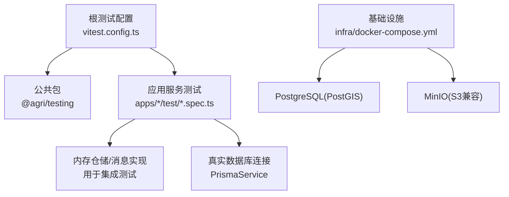
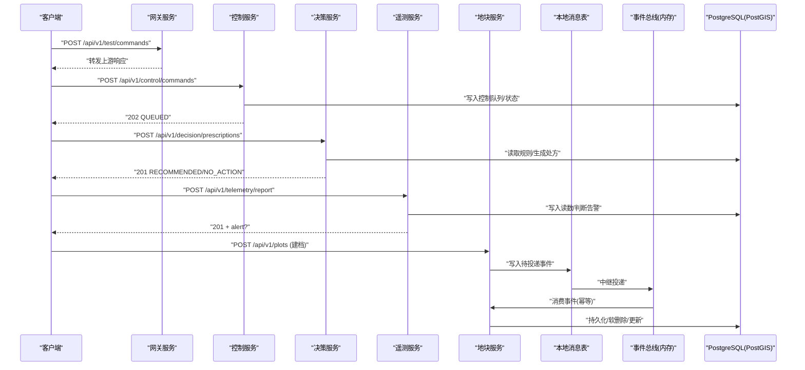
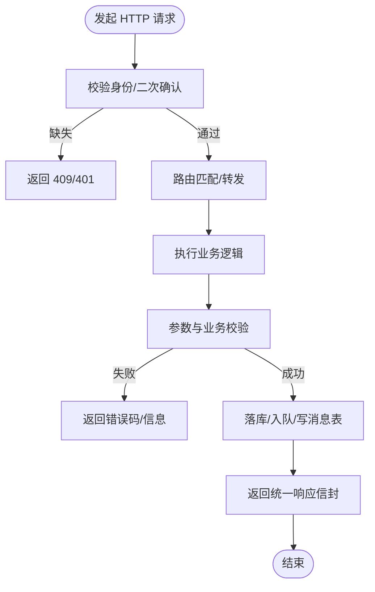
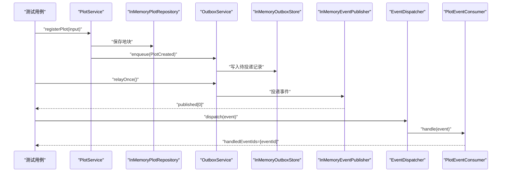
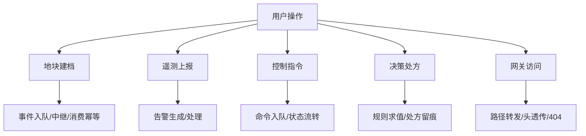
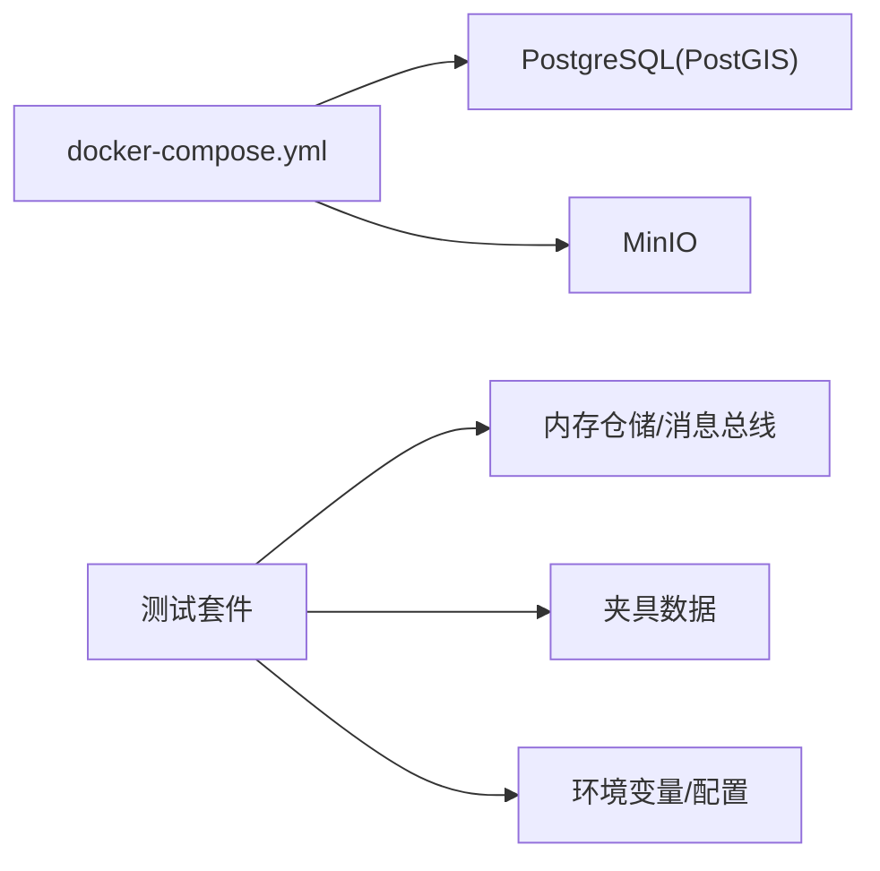
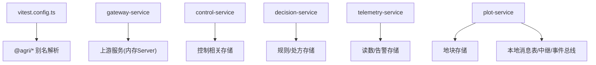

# 集成测试

<cite>
**本文引用的文件**   
- [README.md](file://README.md)
- [vitest.config.ts](file://vitest.config.ts)
- [docker-compose.yml](file://infra/docker-compose.yml)
- [apps/control-service/test/http.spec.ts](file://apps/control-service/test/http.spec.ts)
- [apps/gateway-service/test/http.spec.ts](file://apps/gateway-service/test/http.spec.ts)
- [apps/file-service/test/http.spec.ts](file://apps/file-service/test/http.spec.ts)
- [apps/operation-service/test/http.spec.ts](file://apps/operation-service/test/http.spec.ts)
- [apps/decision-service/test/decision.spec.ts](file://apps/decision-service/test/decision.spec.ts)
- [apps/telemetry-service/test/telemetry.spec.ts](file://apps/telemetry-service/test/telemetry.spec.ts)
- [apps/plot-service/test/plot-service.spec.ts](file://apps/plot-service/test/plot-service.spec.ts)
- [packages/testing/src/index.ts](file://packages/testing/src/index.ts)
</cite>

## 目录
1. [引言](#引言)
2. [项目结构](#项目结构)
3. [核心组件](#核心组件)
4. [架构总览](#架构总览)
5. [详细组件分析](#详细组件分析)
6. [依赖关系分析](#依赖关系分析)
7. [性能与压力测试指南](#性能与压力测试指南)
8. [故障排查指南](#故障排查指南)
9. [结论](#结论)
10. [附录](#附录)

## 引言
本文件面向智慧农业平台的集成测试，覆盖以下目标：
- API 接口测试：HTTP 请求模拟、响应验证与错误处理。
- 数据库集成测试：PostgreSQL 连接、事务边界与数据清理策略。
- 端到端测试：用户操作流程与业务场景验证。
- 测试环境隔离：测试数据库配置、测试数据准备与环境隔离方案。
- 性能与压力测试：指导原则与落地建议。
- 多服务协作、事件驱动流程与外部系统交互的集成用例展示。

平台采用 NestJS + TypeScript，使用 Vitest 作为测试框架，通过 pnpm workspace 管理多个微服务与应用，并通过 Docker Compose 提供 PostgreSQL（PostGIS）与 MinIO 等基础设施。

**章节来源**
- [README.md:1-167](file://README.md#L1-L167)

## 项目结构
仓库以“公共包 + 微服务 + 前端”组织，测试代码分布在各服务的 test 目录以及 packages/testing 提供的测试工具中。根级 vitest.config.ts 将 @agri/* 别名直连源码，避免测试依赖构建顺序问题，并开启装饰器语义以便正确注册处理器。

**图表来源**
- [vitest.config.ts:1-42](file://vitest.config.ts#L1-L42)
- [packages/testing/src/index.ts:1-25](file://packages/testing/src/index.ts#L1-L25)
- [docker-compose.yml:1-39](file://infra/docker-compose.yml#L1-L39)

**章节来源**
- [vitest.config.ts:1-42](file://vitest.config.ts#L1-L42)
- [packages/testing/src/index.ts:1-25](file://packages/testing/src/index.ts#L1-L25)
- [docker-compose.yml:1-39](file://infra/docker-compose.yml#L1-L39)

## 核心组件
本节聚焦集成测试的关键能力与模式：
- HTTP 服务器启动与端口分配：在测试中动态监听随机端口，并在 afterEach 统一关闭。
- 内存仓储与消息总线：替代真实存储与中间件，保证测试可重复且快速。
- 本地消息表与中继投递：验证“建档 → 写消息表 → 中继投递 → 消费幂等”链路。
- 规则引擎热更新：验证规则增改查对处方生成的即时影响。
- 遥测上报与告警：验证阈值触发、历史查询与告警处理。
- 网关转发与路由优先级：验证路径转发、请求头透传与未知路径 404。

**章节来源**
- [apps/control-service/test/http.spec.ts:1-44](file://apps/control-service/test/http.spec.ts#L1-L44)
- [apps/gateway-service/test/http.spec.ts:1-63](file://apps/gateway-service/test/http.spec.ts#L1-L63)
- [apps/file-service/test/http.spec.ts:1-24](file://apps/file-service/test/http.spec.ts#L1-L24)
- [apps/operation-service/test/http.spec.ts:1-45](file://apps/operation-service/test/http.spec.ts#L1-L45)
- [apps/decision-service/test/decision.spec.ts:1-146](file://apps/decision-service/test/decision.spec.ts#L1-L146)
- [apps/telemetry-service/test/telemetry.spec.ts:1-70](file://apps/telemetry-service/test/telemetry.spec.ts#L1-L70)
- [apps/plot-service/test/plot-service.spec.ts:1-158](file://apps/plot-service/test/plot-service.spec.ts#L1-L158)

## 架构总览
下图展示了典型的多服务协作与事件驱动流程，包括网关转发、控制指令、决策处方、遥测告警与地块建档的事件出队与消费幂等。

**图表来源**
- [apps/gateway-service/test/http.spec.ts:20-60](file://apps/gateway-service/test/http.spec.ts#L20-L60)
- [apps/control-service/test/http.spec.ts:19-43](file://apps/control-service/test/http.spec.ts#L19-L43)
- [apps/decision-service/test/decision.spec.ts:106-145](file://apps/decision-service/test/decision.spec.ts#L106-L145)
- [apps/telemetry-service/test/telemetry.spec.ts:26-67](file://apps/telemetry-service/test/telemetry.spec.ts#L26-L67)
- [apps/plot-service/test/plot-service.spec.ts:124-156](file://apps/plot-service/test/plot-service.spec.ts#L124-L156)

## 详细组件分析

### API 接口测试：HTTP 请求模拟、响应验证与错误处理
- 健康检查与统一响应信封：验证返回码与数据结构。
- 身份与二次确认校验：无身份或无确认时拒绝，确认后进入队列。
- 网关转发：路径、方法与关键请求头透传；最长前缀优先；未知路径返回 404。
- 文件上传/下载/删除：内容一致性、删除后 404。
- 任务创建与状态流转：筛选条件与分页参数生效。

**图表来源**
- [apps/control-service/test/http.spec.ts:19-43](file://apps/control-service/test/http.spec.ts#L19-L43)
- [apps/gateway-service/test/http.spec.ts:20-60](file://apps/gateway-service/test/http.spec.ts#L20-L60)
- [apps/file-service/test/http.spec.ts:9-23](file://apps/file-service/test/http.spec.ts#L9-L23)
- [apps/operation-service/test/http.spec.ts:21-44](file://apps/operation-service/test/http.spec.ts#L21-L44)

**章节来源**
- [apps/control-service/test/http.spec.ts:1-44](file://apps/control-service/test/http.spec.ts#L1-L44)
- [apps/gateway-service/test/http.spec.ts:1-63](file://apps/gateway-service/test/http.spec.ts#L1-L63)
- [apps/file-service/test/http.spec.ts:1-24](file://apps/file-service/test/http.spec.ts#L1-L24)
- [apps/operation-service/test/http.spec.ts:1-45](file://apps/operation-service/test/http.spec.ts#L1-L45)

### 数据库集成测试：PostgreSQL 连接、事务管理与数据清理
- 连接与初始化：示例服务装配 PrismaService，传入连接参数与工厂函数，并在模块初始化阶段建立连接。
- 事务与本地消息表：建档时先写业务数据，再写本地消息表；中继定时投递，消费者侧基于 eventId 幂等去重。
- 数据清理策略：测试中使用内存仓储替代持久化；对于需要真实数据库的场景，应结合测试数据库工具进行重置与清理。

**图表来源**
- [apps/plot-service/test/plot-service.spec.ts:88-156](file://apps/plot-service/test/plot-service.spec.ts#L88-L156)

**章节来源**
- [apps/plot-service/test/plot-service.spec.ts:1-158](file://apps/plot-service/test/plot-service.spec.ts#L1-L158)

### 端到端测试：用户操作流程与业务场景验证
- 地块建档：编码生成、唯一性约束、更新与软删除。
- 决策处方：规则增改查、热更新、处方生成与留痕。
- 遥测上报：阈值告警、历史查询、系列聚合与告警处理。
- 控制指令：身份校验、二次确认、队列状态。
- 网关转发：路径透传、请求头透传、路由优先级与 404。

**图表来源**
- [apps/plot-service/test/plot-service.spec.ts:88-156](file://apps/plot-service/test/plot-service.spec.ts#L88-L156)
- [apps/telemetry-service/test/telemetry.spec.ts:26-67](file://apps/telemetry-service/test/telemetry.spec.ts#L26-L67)
- [apps/control-service/test/http.spec.ts:19-43](file://apps/control-service/test/http.spec.ts#L19-L43)
- [apps/decision-service/test/decision.spec.ts:106-145](file://apps/decision-service/test/decision.spec.ts#L106-L145)
- [apps/gateway-service/test/http.spec.ts:20-60](file://apps/gateway-service/test/http.spec.ts#L20-L60)

**章节来源**
- [apps/plot-service/test/plot-service.spec.ts:1-158](file://apps/plot-service/test/plot-service.spec.ts#L1-L158)
- [apps/telemetry-service/test/telemetry.spec.ts:1-70](file://apps/telemetry-service/test/telemetry.spec.ts#L1-L70)
- [apps/control-service/test/http.spec.ts:1-44](file://apps/control-service/test/http.spec.ts#L1-L44)
- [apps/decision-service/test/decision.spec.ts:1-146](file://apps/decision-service/test/decision.spec.ts#L1-L146)
- [apps/gateway-service/test/http.spec.ts:1-63](file://apps/gateway-service/test/http.spec.ts#L1-L63)

### 测试数据库配置、测试数据准备与环境隔离
- 测试数据库：通过 docker-compose 启动 PostgreSQL(PostGIS) 与 MinIO，便于集成测试与冒烟测试。
- 测试数据准备：使用内存仓储与夹具（fixtures）构造最小可用数据集，避免跨用例污染。
- 环境隔离：每个测试用例独立启动 HTTP 服务器并监听随机端口，afterEach 统一关闭；对需要真实数据库的场景，建议使用 testing 包提供的测试数据库工具进行重置与清理。

**图表来源**
- [docker-compose.yml:1-39](file://infra/docker-compose.yml#L1-L39)
- [packages/testing/src/index.ts:1-25](file://packages/testing/src/index.ts#L1-L25)

**章节来源**
- [docker-compose.yml:1-39](file://infra/docker-compose.yml#L1-L39)
- [packages/testing/src/index.ts:1-25](file://packages/testing/src/index.ts#L1-L25)

## 依赖关系分析
- 测试框架与别名：vitest.config.ts 将 @agri/* 别名直连源码，确保装饰器与依赖注入在测试期正常工作。
- 服务间耦合：网关仅负责转发，不持有业务状态；控制、决策、遥测、地块等服务各自维护仓储与领域逻辑。
- 事件驱动解耦：本地消息表与中继将生产与消费解耦，消费者侧通过 eventId 幂等去重。

**图表来源**
- [vitest.config.ts:10-35](file://vitest.config.ts#L10-L35)
- [apps/gateway-service/test/http.spec.ts:20-60](file://apps/gateway-service/test/http.spec.ts#L20-L60)
- [apps/plot-service/test/plot-service.spec.ts:124-156](file://apps/plot-service/test/plot-service.spec.ts#L124-L156)

**章节来源**
- [vitest.config.ts:1-42](file://vitest.config.ts#L1-L42)
- [apps/gateway-service/test/http.spec.ts:1-63](file://apps/gateway-service/test/http.spec.ts#L1-L63)
- [apps/plot-service/test/plot-service.spec.ts:1-158](file://apps/plot-service/test/plot-service.spec.ts#L1-L158)

## 性能与压力测试指南
- 基准测试：针对热点接口（如遥测上报、处方生成）设计单接口吞吐与延迟指标，逐步增加并发观察拐点。
- 压测模型：模拟多租户、多设备上报与批量处方生成，关注数据库连接池、慢查询与消息堆积。
- 资源隔离：为压测环境与开发环境分离，避免共享数据库与缓存导致结果污染。
- 观测与回归：采集 CPU、内存、GC、I/O 与数据库指标，建立回归基线，防止性能退化。
- 渐进式扩容：根据压测结果调整连接池大小、线程数与中间件批处理策略。

[本节为通用指导，不直接分析具体文件]

## 故障排查指南
- 端口冲突或服务未释放：确保 afterEach 中统一关闭所有 Server 实例，避免端口占用。
- 装饰器未生效：检查 vitest.config.ts 是否开启 experimentalDecorators，并确保测试提供者显式声明 inject。
- 事件重复消费：确认 eventId 幂等机制生效，消费者只处理一次。
- 网关 404：检查路由前缀与最长前缀匹配是否正确，未知路径应返回网关 404。
- 遥测告警异常：核对阈值与时间范围，确认历史查询与系列聚合结果符合预期。

**章节来源**
- [apps/control-service/test/http.spec.ts:15-17](file://apps/control-service/test/http.spec.ts#L15-L17)
- [apps/gateway-service/test/http.spec.ts:16-18](file://apps/gateway-service/test/http.spec.ts#L16-L18)
- [apps/plot-service/test/plot-service.spec.ts:135-156](file://apps/plot-service/test/plot-service.spec.ts#L135-L156)
- [apps/telemetry-service/test/telemetry.spec.ts:26-67](file://apps/telemetry-service/test/telemetry.spec.ts#L26-L67)

## 结论
本集成测试体系通过内存仓储与消息总线实现快速、稳定的端到端验证，同时保留对真实数据库与外部系统的接入能力。API 层覆盖身份校验、二次确认、路由转发与错误处理；事件驱动链路验证了本地消息表与消费幂等；遥测与控制场景覆盖了常见业务闭环。配合 docker-compose 的基础设施与 testing 包的测试工具，可在不同环境中保持一致的测试质量与可重复性。

[本节为总结性内容，不直接分析具体文件]

## 附录
- 运行与验证命令参考：见 README 中的脚本说明，包括全量编译、测试、服务启动与健康检查。
- 扩展指引：新增服务时复制示例服务结构，按需装配 ConfigModule、PrismaModule、MqModule，并在契约包中定义事件主题与载荷。

**章节来源**
- [README.md:12-52](file://README.md#L12-L52)
- [README.md:147-167](file://README.md#L147-L167)