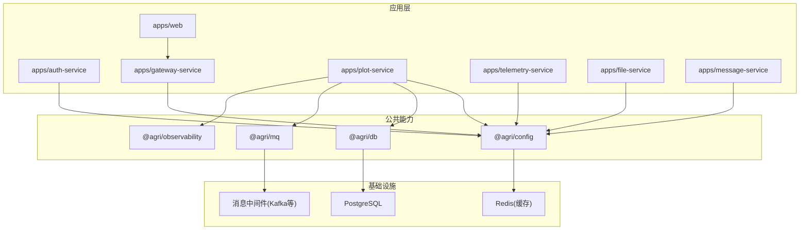
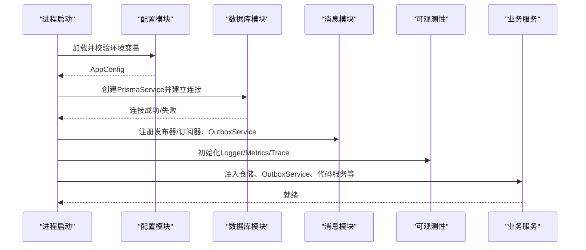
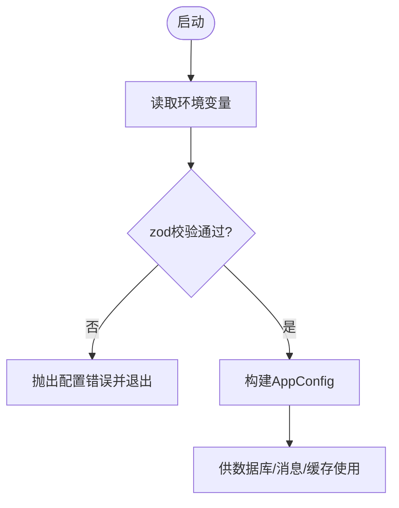
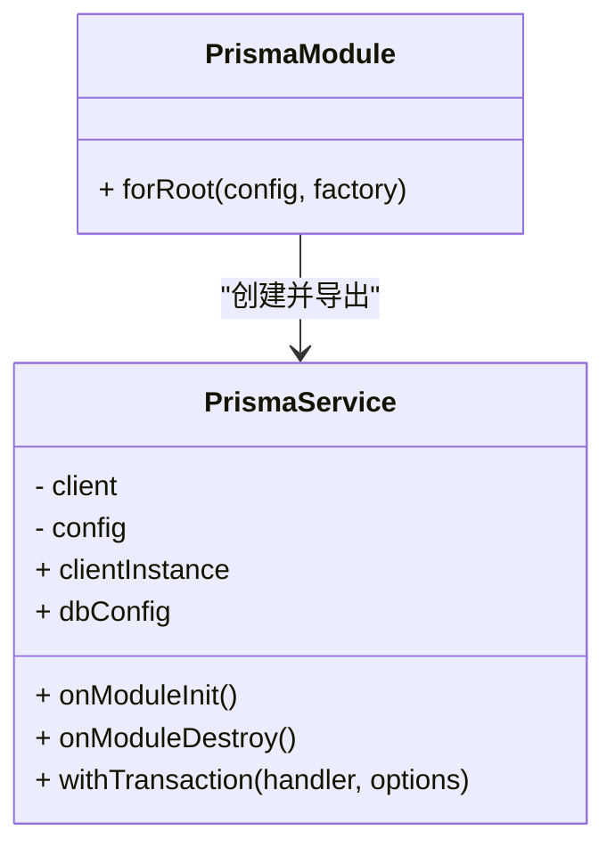
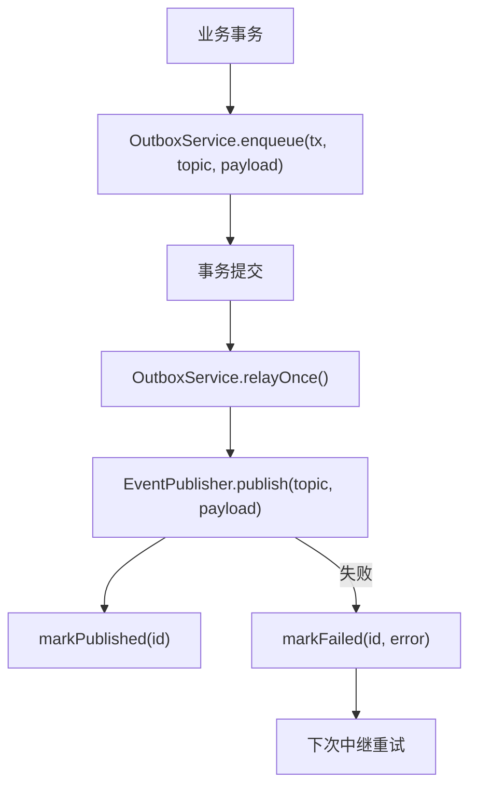
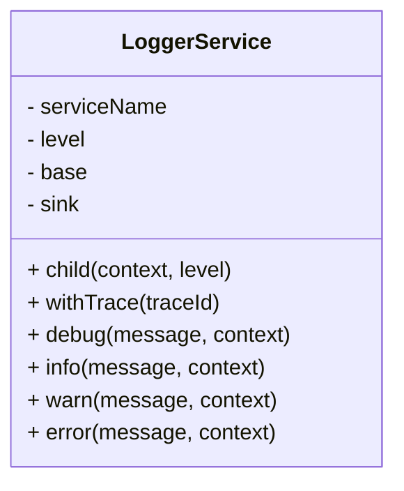
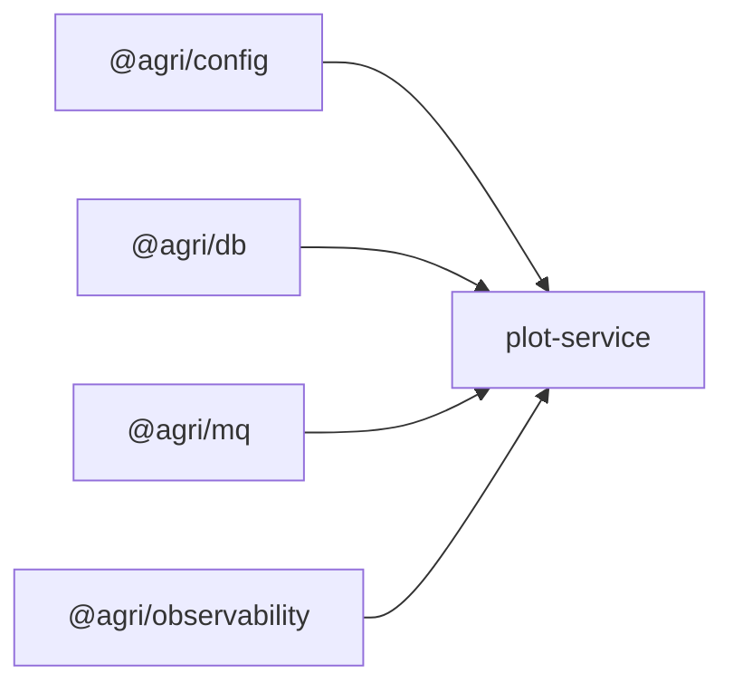

# 故障排查

<cite>
**本文引用的文件**   
- [README.md](file://README.md)
- [package.json](file://package.json)
- [apps/plot-service/src/app.module.ts](file://apps/plot-service/src/app.module.ts)
- [packages/config/src/env-schema.ts](file://packages/config/src/env-schema.ts)
- [packages/db/src/client.ts](file://packages/db/src/client.ts)
- [packages/mq/src/outbox.ts](file://packages/mq/src/outbox.ts)
- [packages/observability/src/logger.ts](file://packages/observability/src/logger.ts)
</cite>

## 目录
1. [引言](#引言)
2. [项目结构](#项目结构)
3. [核心组件](#核心组件)
4. [架构总览](#架构总览)
5. [详细组件分析](#详细组件分析)
6. [依赖关系分析](#依赖关系分析)
7. [性能考虑](#性能考虑)
8. [故障排查指南](#故障排查指南)
9. [结论](#结论)
10. [附录](#附录)

## 引言
本指南面向智慧农业平台运维与研发人员，聚焦服务启动失败、数据库连接异常、消息队列问题、日志分析方法、性能调优技巧、网络问题诊断、容量规划与安全事件排查。文档基于仓库中的配置、数据库客户端、消息本地消息表与可观测性实现进行说明，帮助快速定位根因并给出可执行的处理建议。

## 项目结构
平台采用 pnpm workspace + Turborepo + TypeScript Project References 的多包架构：公共能力集中在 packages，业务微服务集中在 apps，前端在 apps/web。脚本位于 scripts，基础设施定义在 infra。

图表来源
- [README.md:58-82](file://README.md#L58-L82)
- [package.json:10-29](file://package.json#L10-L29)

章节来源
- [README.md:58-82](file://README.md#L58-L82)
- [package.json:10-29](file://package.json#L10-L29)

## 核心组件
- 配置加载与校验：通过 zod 对环境变量进行强类型校验，缺失或类型不符时拒绝启动，避免运行期偶发错误。
- 数据库客户端：封装 Prisma 客户端生命周期、事务、分片与慢查询阈值；模块初始化建立连接、销毁释放连接，防止连接泄漏。
- 消息与本地消息表：业务数据与待投递事件写入同一事务，中继周期性投递，消费侧幂等去重，重试转死信。
- 可观测性：结构化日志、链路追踪与指标采集共享 traceId，便于跨服务串联一次请求。

章节来源
- [packages/config/src/env-schema.ts:1-40](file://packages/config/src/env-schema.ts#L1-L40)
- [packages/db/src/client.ts:31-64](file://packages/db/src/client.ts#L31-L64)
- [packages/mq/src/outbox.ts:6-12](file://packages/mq/src/outbox.ts#L6-L12)
- [packages/observability/src/logger.ts:1-6](file://packages/observability/src/logger.ts#L1-L6)

## 架构总览
下图展示示例服务装配与关键依赖：配置与数据库为基础设施，消息与可观测性为横切能力，业务服务仅依赖对外契约。

图表来源
- [apps/plot-service/src/app.module.ts:83-163](file://apps/plot-service/src/app.module.ts#L83-L163)
- [packages/db/src/client.ts:31-64](file://packages/db/src/client.ts#L31-L64)
- [packages/mq/src/outbox.ts:50-137](file://packages/mq/src/outbox.ts#L50-L137)
- [packages/observability/src/logger.ts:40-100](file://packages/observability/src/logger.ts#L40-L100)

## 详细组件分析

### 配置与环境变量
- 关键字段：服务名、端口、日志级别、数据库连接串与分片模式、连接池大小、慢查询阈值、消息中间件 brokers、消费者组、自动提交间隔、Redis 主机/端口/库号。
- 行为：启动期校验，缺失或类型不匹配直接报错退出，便于快速发现配置错误。

图表来源
- [packages/config/src/env-schema.ts:10-40](file://packages/config/src/env-schema.ts#L10-L40)

章节来源
- [packages/config/src/env-schema.ts:10-40](file://packages/config/src/env-schema.ts#L10-L40)

### 数据库客户端与连接管理
- 生命周期：模块初始化时建立连接，销毁时断开连接，避免连接泄漏。
- 事务：提供 withTransaction 便捷方法，自动重试可重试错误。
- 工厂模式：通过 PrismaClientFactory 解耦 ORM 实现，便于替换与测试。

图表来源
- [packages/db/src/client.ts:31-87](file://packages/db/src/client.ts#L31-L87)

章节来源
- [packages/db/src/client.ts:31-87](file://packages/db/src/client.ts#L31-L87)

### 消息与本地消息表
- 本地消息表：业务数据与事件记录在同一事务中写入，中继任务周期性投递，失败累计次数并记录原因。
- 幂等：消费端通过 eventId 去重，避免重复处理。
- 重试策略：指数退避，超过阈值进入死信。

图表来源
- [packages/mq/src/outbox.ts:50-137](file://packages/mq/src/outbox.ts#L50-L137)

章节来源
- [packages/mq/src/outbox.ts:50-137](file://packages/mq/src/outbox.ts#L50-L137)

### 可观测性与日志
- 结构化日志：单行 JSON，固定字段包含时间戳、级别、服务名、消息体与 traceId。
- 子日志器：支持 child 与 withTrace，便于按上下文与链路串联日志。
- 指标与链路：MetricsService 与 TraceService 与 LoggerService 共享上下文标识。

图表来源
- [packages/observability/src/logger.ts:40-100](file://packages/observability/src/logger.ts#L40-L100)

章节来源
- [packages/observability/src/logger.ts:40-100](file://packages/observability/src/logger.ts#L40-L100)

## 依赖关系分析
- 服务装配顺序体现依赖方向：配置与数据库为基础设施，消息与可观测性为横切能力，业务服务只依赖这些能力的对外契约，不反向被它们引用。
- 示例服务装配了 OutboxService、EventDispatcher、PlotService 等，并通过 MqModule.forRoot 接入消息能力。

图表来源
- [apps/plot-service/src/app.module.ts:83-163](file://apps/plot-service/src/app.module.ts#L83-L163)

章节来源
- [apps/plot-service/src/app.module.ts:83-163](file://apps/plot-service/src/app.module.ts#L83-L163)

## 性能考虑
- 数据库连接池：根据容器副本数反推 DB_POOL_SIZE，避免总连接数超过数据库上限；结合慢查询阈值 DB_SLOW_QUERY_MS 识别慢查询。
- 消息吞吐：调整 MQ_AUTO_COMMIT_INTERVAL_MS，增大可提高吞吐但重复窗口变宽；合理设置中继轮询间隔与批量 limit。
- 事件幂等：消费端必须实现幂等，避免重复投递导致重复计算。
- 指标与链路：利用 MetricsService 与 TraceService 监控事件循环延迟、句柄占用与请求链路耗时。

章节来源
- [packages/config/src/env-schema.ts:20-39](file://packages/config/src/env-schema.ts#L20-L39)
- [packages/mq/src/outbox.ts:94-123](file://packages/mq/src/outbox.ts#L94-L123)
- [apps/plot-service/src/app.module.ts:91-110](file://apps/plot-service/src/app.module.ts#L91-L110)

## 故障排查指南

### 一、服务启动失败
常见原因
- 环境变量缺失或类型错误：如 SERVICE_NAME、PORT、LOG_LEVEL、DB_URL、MQ_BROKERS、REDIS_HOST 等未配置或格式不正确。
- 数据库连接失败：DB_URL 不可达、认证失败、连接池耗尽。
- 消息中间件不可用：MQ_BROKERS 列表错误或网络不通。
- Redis 不可用：缓存相关逻辑依赖 Redis 配置。

定位步骤
- 检查环境变量是否满足 zod 校验规则，确认所有必填项存在且类型正确。
- 查看启动期日志（error/warn），优先关注配置校验失败与连接失败信息。
- 使用健康检查脚本验证各服务与基础设施状态。

处理建议
- 补齐或修正环境变量后重启服务。
- 若数据库连接失败，检查网络连通性、账号权限、连接池上限与数据库负载。
- 若消息中间件不可用，检查 brokers 地址、端口、ACL 与集群状态。
- 若 Redis 不可用，检查主机、端口、密码与防火墙策略。

章节来源
- [packages/config/src/env-schema.ts:10-40](file://packages/config/src/env-schema.ts#L10-L40)
- [README.md:27-52](file://README.md#L27-L52)

### 二、数据库连接异常
现象
- 启动时报连接失败或连接池耗尽。
- 运行时出现“连接超时”“连接被拒绝”“事务失败”。

定位步骤
- 检查 DB_URL、DB_SHARD_MODE、DB_POOL_SIZE、DB_SLOW_QUERY_MS 配置是否正确。
- 观察 PrismaService 的 onModuleInit 阶段是否抛错。
- 使用 health-infra 脚本检查 PostgreSQL 连通性。
- 在慢查询阈值内定位慢 SQL，结合索引与分页白名单优化。

处理建议
- 调整 DB_POOL_SIZE 与副本数匹配，避免连接数超限。
- 针对慢查询优化 SQL 与索引，必要时拆分查询或引入缓存。
- 若分片模式变更，确保路由与租户隔离策略一致。

章节来源
- [packages/config/src/env-schema.ts:20-27](file://packages/config/src/env-schema.ts#L20-L27)
- [packages/db/src/client.ts:31-64](file://packages/db/src/client.ts#L31-L64)
- [README.md:50-52](file://README.md#L50-L52)

### 三、消息队列问题
现象
- 事件未投递或投递失败。
- 消费端重复处理或长时间堆积。
- Outbox 记录长期 pending 或 retryCount 持续增长。

定位步骤
- 检查 MQ_BROKERS、MQ_GROUP_ID、MQ_AUTO_COMMIT_INTERVAL_MS 配置。
- 查看 OutboxService.relayOnce 是否周期性执行，是否存在持久化失败。
- 检查消费端幂等逻辑是否生效，eventId 是否唯一。
- 观察死信队列与重试次数，定位最终失败原因。

处理建议
- 修复 brokers 连通性或 ACL 权限。
- 调整 autoCommitIntervalMs 平衡吞吐与重复窗口。
- 完善消费端幂等存储，确保 eventId 去重。
- 对持续失败的事件进行人工干预或重新入队。

章节来源
- [packages/config/src/env-schema.ts:29-34](file://packages/config/src/env-schema.ts#L29-L34)
- [packages/mq/src/outbox.ts:94-137](file://packages/mq/src/outbox.ts#L94-L137)

### 四、日志分析方法
错误日志定位
- 过滤 level=error 的记录，结合 service 与 traceId 定位具体服务与请求。
- 关注配置校验失败、数据库连接失败、消息投递失败的错误消息。

性能日志分析
- 结合 TraceService 与 MetricsService 的指标，观察事件循环延迟、句柄占用与接口耗时。
- 通过慢查询阈值筛选慢 SQL，结合索引与分页优化。

审计日志追踪
- 所有日志携带 service 与 traceId，可在多服务间串联一次请求的完整链路。
- 使用 child/withTrace 生成带上下文的子日志器，便于细分模块与链路追踪。

章节来源
- [packages/observability/src/logger.ts:20-100](file://packages/observability/src/logger.ts#L20-L100)
- [apps/plot-service/src/app.module.ts:91-110](file://apps/plot-service/src/app.module.ts#L91-L110)

### 五、性能调优技巧
数据库查询优化
- 启用慢查询阈值，定期分析慢查询日志，补充索引或改写 SQL。
- 分页每页上限 200，排序字段走服务端白名单，避免全表扫描。

缓存策略调整
- 合理配置 Redis 主机、端口与库号，避免热点键倾斜。
- 对读多写少的数据增加缓存层，降低数据库压力。

内存泄漏排查
- 使用 HandleCollector 与 EventLoopLagCollector 监控句柄与事件循环延迟。
- 检查定时器、监听器与全局对象是否及时释放。

章节来源
- [packages/config/src/env-schema.ts:24-39](file://packages/config/src/env-schema.ts#L24-L39)
- [apps/plot-service/src/app.module.ts:91-110](file://apps/plot-service/src/app.module.ts#L91-L110)

### 六、网络问题诊断
连接超时
- 检查 DNS 解析与防火墙策略，确认目标主机可达。
- 缩短或延长超时时间，结合重试与退避策略提升稳定性。

DNS 解析问题
- 使用系统工具检测域名解析结果，确认 CNAME/A 记录正确。
- 在容器环境中检查 CoreDNS 与网络策略。

SSL 证书问题
- 检查证书有效期、链完整性与信任根。
- 确认 TLS 版本与加密套件兼容，必要时更新 CA 证书。

章节来源
- [packages/config/src/env-schema.ts:29-39](file://packages/config/src/env-schema.ts#L29-L39)

### 七、容量规划指导
资源使用率监控
- 监控 CPU、内存、磁盘 I/O、网络带宽与数据库连接数。
- 通过 MetricsService 暴露关键指标，结合告警阈值触发扩容。

扩容触发条件
- 连接池使用率接近上限、慢查询比例升高、消息堆积严重、事件循环延迟持续偏高。

扩容操作指南
- 水平扩展服务副本，按比例调整 DB_POOL_SIZE，避免连接数超限。
- 扩容消息消费者实例，合理划分分区与消费者组。
- 扩容 Redis 与数据库节点，确保缓存命中率与读写分离策略有效。

章节来源
- [packages/config/src/env-schema.ts:24-39](file://packages/config/src/env-schema.ts#L24-L39)
- [apps/plot-service/src/app.module.ts:91-110](file://apps/plot-service/src/app.module.ts#L91-L110)

### 八、安全事件排查
访问异常
- 检查网关鉴权与路由策略，确认访问来源与权限。
- 审计日志中查找异常 IP、频繁失败登录与越权访问。

数据泄露检测
- 核对敏感字段是否脱敏输出，检查日志与响应体是否包含敏感信息。
- 审查外部存储（MinIO/S3）访问策略与桶权限。

攻击防护
- 开启速率限制与黑名单，防范暴力破解与爬虫。
- 对输入进行严格校验，防止注入与越权。

章节来源
- [packages/observability/src/logger.ts:20-100](file://packages/observability/src/logger.ts#L20-L100)

## 结论
通过严格的配置校验、健壮的数据库连接管理、可靠的本地消息表与统一的可观测性体系，平台能够在启动期快速暴露配置错误，在运行期精准定位数据库、消息与性能问题。配合日志分析与指标监控，可高效完成故障排查、性能调优与容量规划，保障智慧农业平台的稳定与可扩展。

## 附录
- 常用命令
  - 启动全部 HTTP 服务：pnpm start:services
  - 检查 HTTP 服务健康状态：pnpm health:services
  - 检查基础设施健康：pnpm health:infra
  - 执行数据库迁移：pnpm db:migrate

章节来源
- [README.md:27-52](file://README.md#L27-L52)
- [package.json:21-29](file://package.json#L21-L29)