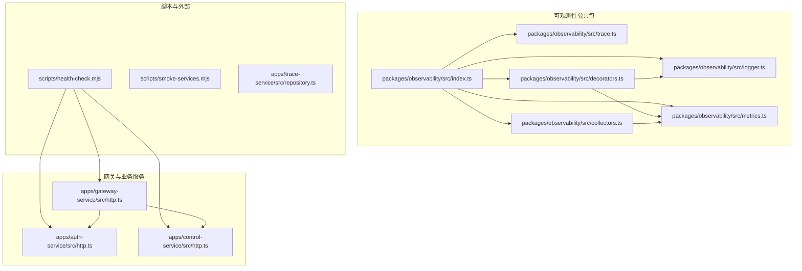
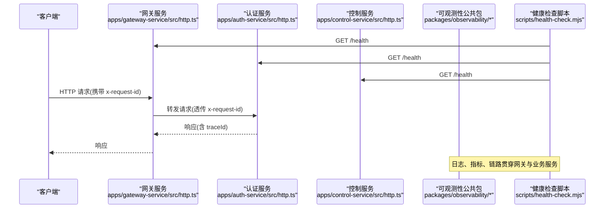
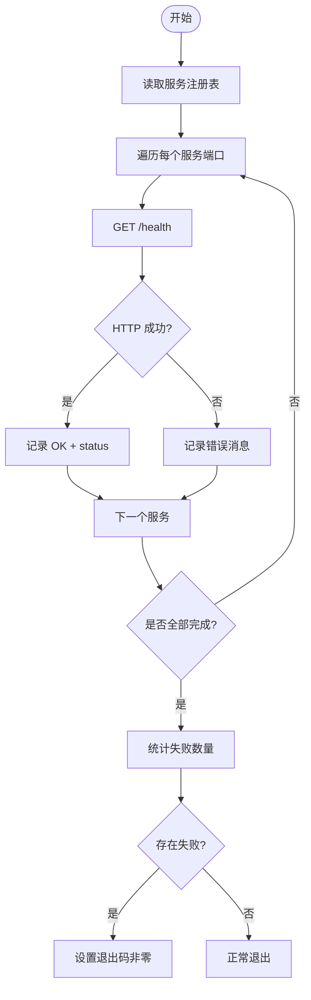
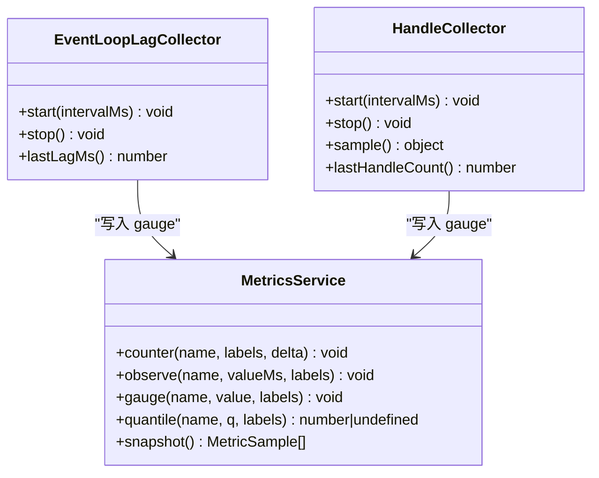
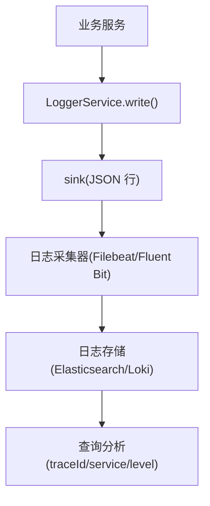
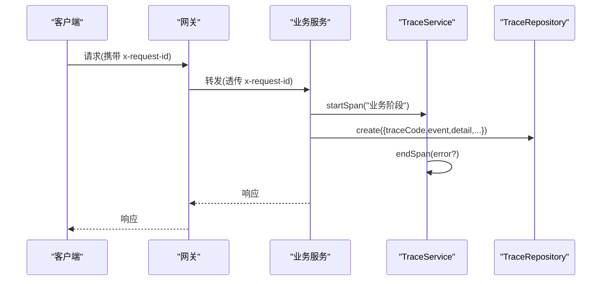
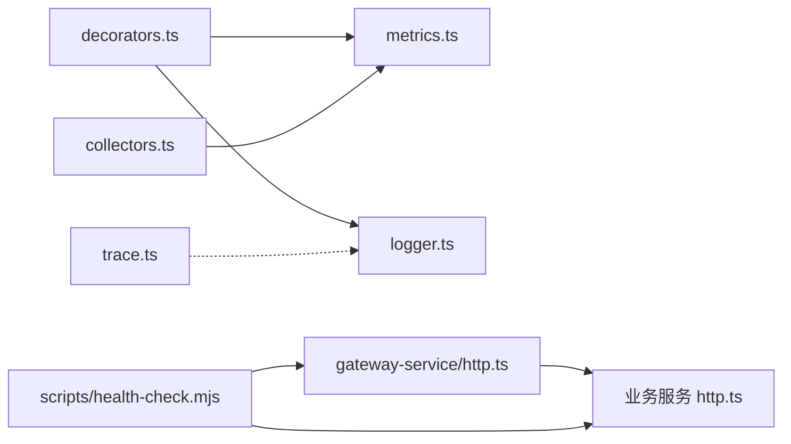

# 监控告警

<cite>
**本文引用的文件**   
- [README.md](file://README.md)
- [packages/observability/src/index.ts](file://packages/observability/src/index.ts)
- [packages/observability/src/logger.ts](file://packages/observability/src/logger.ts)
- [packages/observability/src/metrics.ts](file://packages/observability/src/metrics.ts)
- [packages/observability/src/trace.ts](file://packages/observability/src/trace.ts)
- [packages/observability/src/decorators.ts](file://packages/observability/src/decorators.ts)
- [packages/observability/src/collectors.ts](file://packages/observability/src/collectors.ts)
- [apps/gateway-service/src/http.ts](file://apps/gateway-service/src/http.ts)
- [apps/auth-service/src/http.ts](file://apps/auth-service/src/http.ts)
- [apps/control-service/src/http.ts](file://apps/control-service/src/http.ts)
- [scripts/health-check.mjs](file://scripts/health-check.mjs)
- [scripts/smoke-services.mjs](file://scripts/smoke-services.mjs)
- [apps/trace-service/src/repository.ts](file://apps/trace-service/src/repository.ts)
</cite>

## 目录
1. [引言](#引言)
2. [项目结构](#项目结构)
3. [核心组件](#核心组件)
4. [架构总览](#架构总览)
5. [详细组件分析](#详细组件分析)
6. [依赖关系分析](#依赖关系分析)
7. [性能与容量规划](#性能与容量规划)
8. [故障排查指南](#故障排查指南)
9. [结论](#结论)
10. [附录：指标与日志规范](#附录指标与日志规范)

## 引言
本文件为智慧农业平台的监控告警系统文档，覆盖服务健康检查、性能指标采集、结构化日志、分布式链路追踪、告警规则与仪表板可视化方案。平台采用多微服务架构，网关统一入口，各业务服务暴露健康端点；可观测性能力由公共包 @agri/observability 提供，包含结构化日志、指标采集、链路跨度与运行期采集器。脚本层提供主动健康检查与服务冒烟测试，便于持续集成与部署验证。

## 项目结构
监控相关代码主要分布在以下位置：
- 可观测性公共包：@agri/observability（日志、指标、链路、装饰器、运行期采集器）
- 网关服务：gateway-service（请求路由、透传链路标识、健康端点）
- 业务服务示例：auth-service、control-service 等（均暴露 /health）
- 脚本工具：health-check.mjs、smoke-services.mjs（主动探测与冒烟）
- 链路记录服务：trace-service（业务级操作轨迹存储）

图示来源
- [packages/observability/src/index.ts:1-10](file://packages/observability/src/index.ts#L1-L10)
- [packages/observability/src/logger.ts:1-102](file://packages/observability/src/logger.ts#L1-L102)
- [packages/observability/src/metrics.ts:1-106](file://packages/observability/src/metrics.ts#L1-L106)
- [packages/observability/src/trace.ts:1-83](file://packages/observability/src/trace.ts#L1-L83)
- [packages/observability/src/decorators.ts:1-90](file://packages/observability/src/decorators.ts#L1-L90)
- [packages/observability/src/collectors.ts:1-124](file://packages/observability/src/collectors.ts#L1-L124)
- [apps/gateway-service/src/http.ts:1-41](file://apps/gateway-service/src/http.ts#L1-L41)
- [apps/auth-service/src/http.ts:1-20](file://apps/auth-service/src/http.ts#L1-L20)
- [apps/control-service/src/http.ts:1-16](file://apps/control-service/src/http.ts#L1-L16)
- [scripts/health-check.mjs:1-12](file://scripts/health-check.mjs#L1-L12)
- [scripts/smoke-services.mjs:1-23](file://scripts/smoke-services.mjs#L1-L23)
- [apps/trace-service/src/repository.ts:1-20](file://apps/trace-service/src/repository.ts#L1-L20)

章节来源
- [README.md:1-167](file://README.md#L1-L167)

## 核心组件
- 结构化日志 LoggerService：单行 JSON 输出，固定字段 timestamp、level、service、message、traceId，支持级别过滤、上下文派生、sink 替换。
- 指标 MetricsService：计数器、直方图观测、当前值型指标，内置平台标准指标名，支持分位数查询与快照导出。
- 链路 TraceService：生成 traceId，管理 span 栈，支持 withSpan 包裹调用并自动标记异常。
- 装饰器 Traced/Metered：方法级耗时日志与指标打点，错误计数独立指标。
- 运行期采集器 EventLoopLagCollector/HandleCollector：事件循环延迟、活动句柄数、数据库连接池使用率采样与阈值告警。
- 网关 HTTP 服务：统一路由转发，透传 x-request-id 等头，暴露 /health。
- 业务服务健康端点：各服务 /health 返回服务状态与名称。
- 脚本健康检查：批量拉取各服务 /health，汇总结果并退出码控制。
- 链路记录仓库：trace-service 提供内存与 SQL 两种实现，用于业务级追踪记录持久化。

章节来源
- [packages/observability/src/logger.ts:1-102](file://packages/observability/src/logger.ts#L1-L102)
- [packages/observability/src/metrics.ts:1-106](file://packages/observability/src/metrics.ts#L1-L106)
- [packages/observability/src/trace.ts:1-83](file://packages/observability/src/trace.ts#L1-L83)
- [packages/observability/src/decorators.ts:1-90](file://packages/observability/src/decorators.ts#L1-L90)
- [packages/observability/src/collectors.ts:1-124](file://packages/observability/src/collectors.ts#L1-L124)
- [apps/gateway-service/src/http.ts:1-41](file://apps/gateway-service/src/http.ts#L1-L41)
- [apps/auth-service/src/http.ts:1-20](file://apps/auth-service/src/http.ts#L1-L20)
- [apps/control-service/src/http.ts:1-16](file://apps/control-service/src/http.ts#L1-L16)
- [scripts/health-check.mjs:1-12](file://scripts/health-check.mjs#L1-L12)
- [scripts/smoke-services.mjs:1-23](file://scripts/smoke-services.mjs#L1-L23)
- [apps/trace-service/src/repository.ts:1-20](file://apps/trace-service/src/repository.ts#L1-L20)

## 架构总览
监控告警体系围绕“网关入口—业务服务—可观测性公共包—脚本与外部系统”展开。网关负责请求分发与链路标识透传；业务服务通过 @agri/observability 输出结构化日志、指标与跨度；运行期采集器周期性上报系统级指标；脚本层对服务健康进行主动探测；trace-service 提供业务级追踪记录的持久化能力。

图示来源
- [apps/gateway-service/src/http.ts:1-41](file://apps/gateway-service/src/http.ts#L1-L41)
- [apps/auth-service/src/http.ts:1-20](file://apps/auth-service/src/http.ts#L1-L20)
- [apps/control-service/src/http.ts:1-16](file://apps/control-service/src/http.ts#L1-L16)
- [scripts/health-check.mjs:1-12](file://scripts/health-check.mjs#L1-L12)
- [packages/observability/src/index.ts:1-10](file://packages/observability/src/index.ts#L1-L10)

## 详细组件分析

### 服务健康检查机制
- 主动探测
  - 脚本 health-check.mjs 遍历服务注册表，逐个调用 http://127.0.0.1:{port}/health，汇总 ok/status，失败时设置进程退出码非零。
  - smoke-services.mjs 启动全部服务，轮询等待 /health 就绪，超时则报错，并在 finally 中清理子进程。
- 被动监控
  - 网关与各业务服务均实现 /health 端点，返回 {code/data.status/service} 或 {status/service}，供外部探针与编排系统拉取。
  - 网关在转发失败时返回 502 并附带错误信息，便于上层快速发现下游不可用。

图示来源
- [scripts/health-check.mjs:1-12](file://scripts/health-check.mjs#L1-L12)
- [scripts/smoke-services.mjs:1-23](file://scripts/smoke-services.mjs#L1-L23)
- [apps/gateway-service/src/http.ts:27-40](file://apps/gateway-service/src/http.ts#L27-L40)
- [apps/auth-service/src/http.ts:14-20](file://apps/auth-service/src/http.ts#L14-L20)
- [apps/control-service/src/http.ts:11-16](file://apps/control-service/src/http.ts#L11-L16)

章节来源
- [scripts/health-check.mjs:1-12](file://scripts/health-check.mjs#L1-L12)
- [scripts/smoke-services.mjs:1-23](file://scripts/smoke-services.mjs#L1-L23)
- [apps/gateway-service/src/http.ts:27-40](file://apps/gateway-service/src/http.ts#L27-L40)
- [apps/auth-service/src/http.ts:14-20](file://apps/auth-service/src/http.ts#L14-L20)
- [apps/control-service/src/http.ts:11-16](file://apps/control-service/src/http.ts#L11-L16)

### 性能指标采集
- 指标定义与类型
  - METRIC 定义平台标准指标名与单位，包括 HTTP 请求耗时、事件循环延迟、活动句柄数、数据库连接池使用率、消息消费耗时、死信累计、设备遥测总量等。
  - MetricsService 提供 counter（只增）、observe（直方图样本）、gauge（当前值），并提供 quantile 计算分位数、snapshot 导出全部样本。
- 关键指标说明
  - http_request_duration_ms：方法或接口耗时分布，适合 P95/P99 告警。
  - event_loop_lag_ms：事件循环延迟均值，反映主线程阻塞风险。
  - active_handles：活动资源句柄数，泄漏检测。
  - db_pool_in_use：数据库连接池使用量，容量与瓶颈定位。
  - mq_consume_duration_ms、mq_dead_letter_total：消息消费性能与失败累积。
  - device_telemetry_total：设备遥测数据写入总量。
- 运行期采集器
  - EventLoopLagCollector：基于 perf_hooks 的 monitorEventLoopDelay，周期采样 mean 并写入 gauge，超过阈值输出 warn 日志。
  - HandleCollector：周期采样 process.getActiveResourcesInfo 长度与数据库连接池使用率，写入 gauge。

图示来源
- [packages/observability/src/metrics.ts:1-106](file://packages/observability/src/metrics.ts#L1-L106)
- [packages/observability/src/collectors.ts:1-124](file://packages/observability/src/collectors.ts#L1-L124)

章节来源
- [packages/observability/src/metrics.ts:1-106](file://packages/observability/src/metrics.ts#L1-L106)
- [packages/observability/src/collectors.ts:1-124](file://packages/observability/src/collectors.ts#L1-L124)

### 日志收集与分析
- 结构化日志格式
  - LogRecord 固定字段：timestamp、level、service、message、traceId，扩展字段以任意键值对追加。
  - LoggerService 支持 child/withTrace 派生子日志器，便于按请求或服务阶段附加上下文。
  - sink 可替换为标准输出或采集函数，便于对接日志聚合系统。
- 日志级别与过滤
  - LOG_LEVELS 顺序 debug/info/warn/error，内部按权重过滤低于配置的级别。
- 建议的日志聚合与查询
  - 将 stdout 管道至日志采集器（如 Filebeat/Fluent Bit），解析 JSON 后入库（Elasticsearch/Loki）。
  - 索引字段：service、level、traceId、timestamp；可按 service 与 level 筛选，按 traceId 串联跨服务日志。
  - 结合 traceId 在链路系统中关联跨度与日志，形成端到端诊断视图。

图示来源
- [packages/observability/src/logger.ts:1-102](file://packages/observability/src/logger.ts#L1-L102)

章节来源
- [packages/observability/src/logger.ts:1-102](file://packages/observability/src/logger.ts#L1-L102)

### 分布式链路追踪
- 链路标识与跨度
  - TraceService.newTraceId 生成 traceId；setTraceId/currentTraceId 管理当前链路；startSpan/endSpan/withSpan 管理 span 栈与耗时、异常标记。
- 网关透传
  - 网关在转发请求时透传 x-request-id、x-user-id、x-tenant-id 等头，保证下游服务能复用同一链路标识。
- 业务级追踪
  - trace-service 提供 InMemoryTraceRepository 与 SqlTraceRepository，用于持久化业务追踪记录（traceCode、plotCode、event、detail、operator、createdAt）。
- 建议的链路系统对接
  - 将 TraceService 产生的 Span 与 LoggerService 的 traceId 一起上报到链路系统（如 OpenTelemetry Collector/Jaeger），实现请求链路跟踪与性能瓶颈定位。

图示来源
- [packages/observability/src/trace.ts:1-83](file://packages/observability/src/trace.ts#L1-L83)
- [apps/gateway-service/src/http.ts:27-40](file://apps/gateway-service/src/http.ts#L27-L40)
- [apps/trace-service/src/repository.ts:1-20](file://apps/trace-service/src/repository.ts#L1-L20)

章节来源
- [packages/observability/src/trace.ts:1-83](file://packages/observability/src/trace.ts#L1-L83)
- [apps/gateway-service/src/http.ts:27-40](file://apps/gateway-service/src/http.ts#L27-L40)
- [apps/trace-service/src/repository.ts:1-20](file://apps/trace-service/src/repository.ts#L1-L20)

### 告警规则配置
- 阈值告警
  - 事件循环延迟：当 EventLoopLagCollector 的 mean > thresholdMs（默认 100ms）时输出 warn 日志，可作为阈值告警触发条件。
  - 活动句柄数：HandleCollector 的 active_handles 持续增长且无回落，提示资源泄漏。
  - 数据库连接池使用率：db_pool_in_use 接近上限，需扩容或优化慢查询。
  - HTTP 请求耗时：http_request_duration_ms 的 P95/P99 超过阈值，触发性能告警。
  - 消息消费：mq_consume_duration_ms 升高或 mq_dead_letter_total 增长，提示消息处理异常。
- 异常检测
  - 错误计数：Metered 装饰器在异常路径增加 _error_total 指标，可结合错误率阈值告警。
  - 网关 502：下游不可用时的 502 比例上升，触发可用性告警。
- 智能告警
  - 基线对比：对 http_request_duration_ms、event_loop_lag_ms 建立历史基线，偏离基线一定倍数触发告警。
  - 多指标联动：db_pool_in_use 升高 + slow query 增多 + error_total 升高，联合判定为数据库瓶颈。

章节来源
- [packages/observability/src/collectors.ts:1-124](file://packages/observability/src/collectors.ts#L1-L124)
- [packages/observability/src/metrics.ts:1-106](file://packages/observability/src/metrics.ts#L1-L106)
- [packages/observability/src/decorators.ts:1-90](file://packages/observability/src/decorators.ts#L1-L90)
- [apps/gateway-service/src/http.ts:27-40](file://apps/gateway-service/src/http.ts#L27-L40)

### 监控仪表板配置与可视化
- 指标展示
  - 使用 Prometheus/Grafana 或 Loki+Grafana 组合，导入标准面板：
    - 事件循环延迟趋势（event_loop_lag_ms）
    - 活动句柄数与数据库连接池使用率（active_handles、db_pool_in_use）
    - HTTP 请求耗时分位数（http_request_duration_ms P95/P99）
    - 消息消费耗时与死信累计（mq_consume_duration_ms、mq_dead_letter_total）
    - 设备遥测总量（device_telemetry_total）
- 日志展示
  - 以 service、level、traceId 为维度构建日志面板，支持按 traceId 过滤串联日志。
- 链路展示
  - 将 TraceService 的 Span 与日志 traceId 关联，在链路系统中展示请求链路拓扑与耗时分布。

[本节为概念性内容，不直接分析具体文件]

## 依赖关系分析
- 模块内聚与耦合
  - observability 包内部高内聚：logger/metrics/trace/decorators/collectors 职责清晰，通过 index.ts 统一导出。
  - decorators 依赖 metrics 与 logger，collectors 依赖 metrics，trace 独立。
- 服务间依赖
  - gateway-service 依赖环境变量中的下游服务 URL，转发请求并透传链路头。
  - 业务服务通过 /health 暴露健康状态，被脚本与健康探针拉取。
- 外部依赖
  - Node.js perf_hooks 用于事件循环延迟采集。
  - trace-service 可选 SQL 实现依赖 PrismaClientLike。

图示来源
- [packages/observability/src/decorators.ts:1-90](file://packages/observability/src/decorators.ts#L1-L90)
- [packages/observability/src/metrics.ts:1-106](file://packages/observability/src/metrics.ts#L1-L106)
- [packages/observability/src/logger.ts:1-102](file://packages/observability/src/logger.ts#L1-L102)
- [packages/observability/src/collectors.ts:1-124](file://packages/observability/src/collectors.ts#L1-L124)
- [packages/observability/src/trace.ts:1-83](file://packages/observability/src/trace.ts#L1-L83)
- [apps/gateway-service/src/http.ts:1-41](file://apps/gateway-service/src/http.ts#L1-L41)
- [scripts/health-check.mjs:1-12](file://scripts/health-check.mjs#L1-L12)

章节来源
- [packages/observability/src/index.ts:1-10](file://packages/observability/src/index.ts#L1-L10)
- [apps/gateway-service/src/http.ts:1-41](file://apps/gateway-service/src/http.ts#L1-L41)
- [scripts/health-check.mjs:1-12](file://scripts/health-check.mjs#L1-L12)

## 性能与容量规划
- 指标采样频率
  - EventLoopLagCollector 默认每秒采样一次，HandleCollector 默认每 5 秒采样一次，避免过度采样影响性能。
- 内存与存储
  - MetricsService.observe 保留最近 1000 个样本，防止长期运行内存增长。
  - trace-service 的 SQL 实现需为 trace_records 表建立合适索引（trace_code、plot_code、created_at）。
- 容量评估
  - 根据 db_pool_in_use 峰值与平均负载评估数据库连接池大小。
  - 根据 mq_dead_letter_total 增长速率评估重试策略与死信处理流程。
  - 根据 http_request_duration_ms P95/P99 评估服务吞吐与扩容策略。

[本节为通用指导，不直接分析具体文件]

## 故障排查指南
- 健康检查失败
  - 使用 health-check.mjs 定位失败服务与端口，查看对应服务的 /health 响应与日志。
  - 若网关返回 502，检查下游服务 URL 配置与网络连通性。
- 事件循环延迟告警
  - 关注 EventLoopLagCollector 的 warn 日志，定位同步阻塞任务（如影像处理、批量核算）。
- 活动句柄泄漏
  - 观察 active_handles 是否持续增长，检查未释放的连接、定时器或未关闭的资源。
- 数据库连接池耗尽
  - 结合 db_pool_in_use 与慢查询日志，定位长事务或慢查询，优化 SQL 与连接池配置。
- 消息消费异常
  - 关注 mq_consume_duration_ms 与 mq_dead_letter_total，检查消费者逻辑与重试策略。

章节来源
- [scripts/health-check.mjs:1-12](file://scripts/health-check.mjs#L1-L12)
- [apps/gateway-service/src/http.ts:27-40](file://apps/gateway-service/src/http.ts#L27-L40)
- [packages/observability/src/collectors.ts:1-124](file://packages/observability/src/collectors.ts#L1-L124)

## 结论
本平台通过统一的 @agri/observability 公共包实现了结构化日志、指标采集、链路跨度与运行期采集器，配合网关的请求透传与业务服务的健康端点，构建了完整的监控告警基础。脚本层的主动健康检查与服务冒烟测试保障了部署质量。建议在生产环境接入日志与链路系统，完善告警规则与仪表板，持续提升系统的可观测性与稳定性。

[本节为总结性内容，不直接分析具体文件]

## 附录：指标与日志规范
- 指标命名与单位
  - http_request_duration_ms（毫秒）
  - event_loop_lag_ms（毫秒）
  - active_handles（计数）
  - db_pool_in_use（计数）
  - mq_consume_duration_ms（毫秒）
  - mq_dead_letter_total（计数）
  - device_telemetry_total（计数）
- 日志字段
  - timestamp（ISO 时间戳）
  - level（debug/info/warn/error）
  - service（服务名）
  - message（消息文本）
  - traceId（链路标识）
  - 其他业务上下文字段

章节来源
- [packages/observability/src/metrics.ts:1-106](file://packages/observability/src/metrics.ts#L1-L106)
- [packages/observability/src/logger.ts:1-102](file://packages/observability/src/logger.ts#L1-L102)