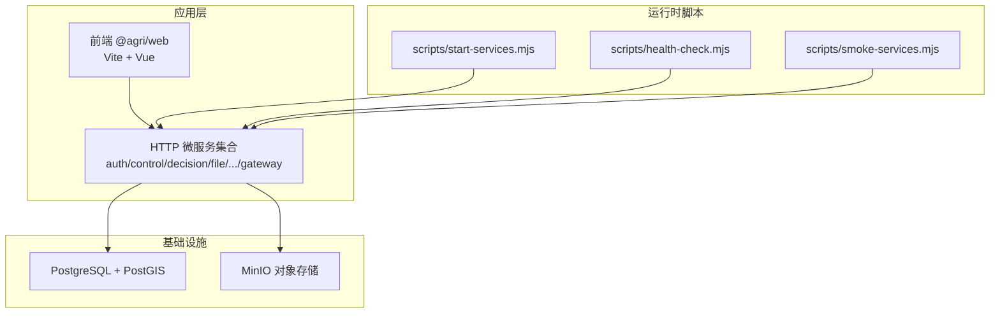
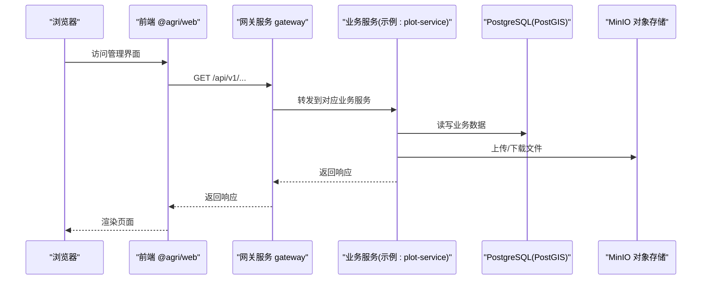
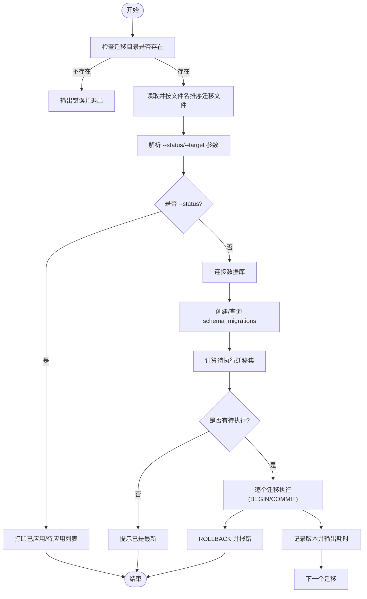
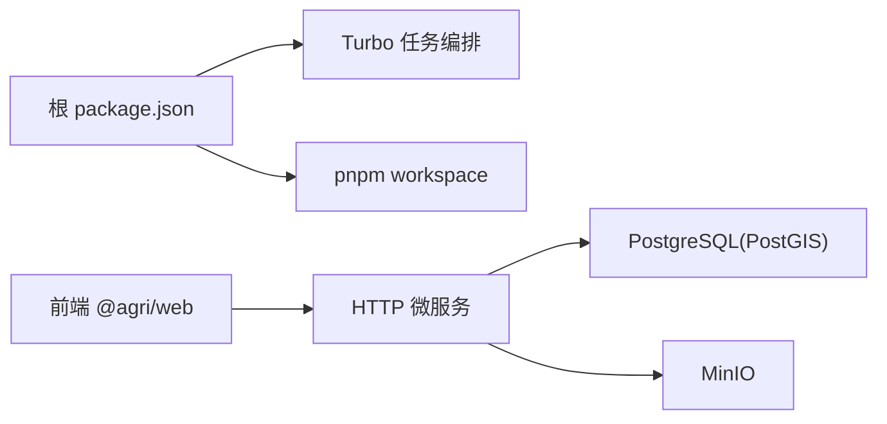

# 部署策略

<cite>
**本文引用的文件**   
- [README.md](file://README.md)
- [package.json](file://package.json)
- [pnpm-workspace.yaml](file://pnpm-workspace.yaml)
- [turbo.json](file://turbo.json)
- [infra/docker-compose.yml](file://infra/docker-compose.yml)
- [scripts/migrate-postgres.mjs](file://scripts/migrate-postgres.mjs)
- [infra/postgres/migrations/001_initial_schema.sql](file://infra/postgres/migrations/001_initial_schema.sql)
- [infra/postgres/migrations/002_decision_telemetry.sql](file://infra/postgres/migrations/002_decision_telemetry.sql)
- [apps/web/vite.config.ts](file://apps/web/vite.config.ts)
- [apps/web/package.json](file://apps/web/package.json)
- [apps/web/src/main.ts](file://apps/web/src/main.ts)
- [Dockerfile](file://Dockerfile)
- [infra/edge/nginx.conf](file://infra/edge/nginx.conf)
- [apps/plot-service/package.json](file://apps/plot-service/package.json)
- [scripts/start-services.mjs](file://scripts/start-services.mjs)
- [scripts/health-check.mjs](file://scripts/health-check.mjs)
- [scripts/smoke-services.mjs](file://scripts/smoke-services.mjs)
</cite>

## 更新摘要
**变更内容**   
- 新增前端增量部署策略，支持仅重建前端镜像而不影响后端服务
- 添加前端白屏问题修复机制，处理懒加载chunk的404错误
- 优化Nginx配置以支持SPA路由和更好的缓存策略
- 完善多阶段构建和镜像仓库管理说明

## 目录
1. [引言](#引言)
2. [项目结构](#项目结构)
3. [核心组件](#核心组件)
4. [架构总览](#架构总览)
5. [详细组件分析](#详细组件分析)
6. [依赖关系分析](#依赖关系分析)
7. [性能与容量规划](#性能与容量规划)
8. [故障排查指南](#故障排查指南)
9. [结论](#结论)
10. [附录：环境差异与发布策略](#附录环境差异与发布策略)

## 引言
本部署策略面向智慧农业平台，目标是在容器化与编排环境下，提供可重复、可观测、可扩展且安全的交付流程。平台基于 Node.js 24 LTS 与 NestJS 微服务架构，包含多个 HTTP 服务与 Vue 前端管理后台；基础设施以 PostgreSQL（PostGIS）与对象存储为主。本文从镜像构建、Kubernetes 编排、服务发现与负载均衡、网络策略、多环境差异化配置、滚动更新与灰度发布、数据库迁移与备份恢复等维度给出完整方案。

**更新** 新增了前端增量部署策略和白屏问题修复机制，支持更灵活的发布流程和更好的用户体验。

## 项目结构
仓库采用 pnpm workspace + Turborepo 的多包工程形态，后端为多个 NestJS 应用，前端为 Vue 应用。根脚本统一编排编译、测试、启动与健康检查；基础设施通过 docker-compose 拉起 PostgreSQL 与 MinIO。



图表来源
- [README.md:12-53](file://README.md#L12-L53)
- [package.json:14-28](file://package.json#L14-L28)
- [infra/docker-compose.yml:1-39](file://infra/docker-compose.yml#L1-L39)

章节来源
- [README.md:12-53](file://README.md#L12-L53)
- [package.json:14-28](file://package.json#L14-L28)

## 核心组件
- 后端微服务：每个服务遵循统一的 NestJS 装配模式，对外暴露 /health 健康端点，网关聚合路由到各业务服务。
- 前端管理后台：Vue3 + Vite，开发期通过代理转发至后端 API，具备增量部署能力和白屏问题自动修复机制。
- 基础设施：PostgreSQL（含 PostGIS）、MinIO 对象存储。
- 运维脚本：服务批量启动、健康检查、冒烟测试、数据库迁移。

**更新** 前端现已支持增量部署和智能错误恢复，提升了部署灵活性和用户体验。

章节来源
- [apps/web/vite.config.ts:16-30](file://apps/web/vite.config.ts#L16-L30)
- [apps/web/src/main.ts:14-24](file://apps/web/src/main.ts#L14-L24)
- [scripts/start-services.mjs:1-28](file://scripts/start-services.mjs#L1-L28)
- [scripts/health-check.mjs:1-12](file://scripts/health-check.mjs#L1-L12)
- [scripts/smoke-services.mjs:1-23](file://scripts/smoke-services.mjs#L1-L23)
- [infra/docker-compose.yml:1-39](file://infra/docker-compose.yml#L1-L39)

## 架构总览
下图展示端到端请求路径：浏览器访问前端静态资源，API 请求经网关分发到具体业务服务，数据落库并持久化到对象存储。



图表来源
- [apps/web/vite.config.ts:16-30](file://apps/web/vite.config.ts#L16-L30)
- [scripts/smoke-services.mjs:8-15](file://scripts/smoke-services.mjs#L8-L15)
- [infra/docker-compose.yml:1-39](file://infra/docker-compose.yml#L1-L39)

## 详细组件分析

### 容器化与镜像构建
- 后端镜像
  - 基础镜像：Node.js 24 LTS。
  - 构建阶段：使用 pnpm 安装依赖并执行 tsc -b 全量编译；生产镜像仅拷贝 dist 与必要运行依赖。
  - 多阶段优化：第一阶段安装依赖并编译，第二阶段仅保留产物，减小镜像体积。
  - 入口命令：node dist/main.js，端口由环境变量 PORT 控制。
- 前端镜像
  - 构建阶段：vue-tsc 类型检查 + vite build 生成静态资源。
  - 运行阶段：Nginx/Apache 或 Node 静态托管均可；开发期使用 Vite dev server。
  - **增量构建支持**：支持仅重建前端镜像而不影响后端服务。
- 镜像仓库管理
  - 命名规范：registry.example.com/agri/{service}:{version}。
  - 标签策略：语义化版本、git commit short hash、latest（仅用于 CI 临时）。
  - 扫描与签名：CI 集成 Trivy 扫描漏洞，Cosign 签名镜像。

**更新** 新增了对前端增量构建的支持，允许单独重建前端镜像而无需重新构建整个应用。

章节来源
- [README.md:7-10](file://README.md#L7-L10)
- [package.json:14-28](file://package.json#L14-L28)
- [apps/web/package.json:6-10](file://apps/web/package.json#L6-L10)
- [Dockerfile:1-63](file://Dockerfile#L1-L63)

### Kubernetes 编排配置
- Deployment
  - 副本数：按 QPS 与 CPU/内存阈值设置 HPA。
  - 资源限制：requests/limits 明确 CPU、内存，避免节点争用。
  - 探针：liveness/readiness 探测 /health，失败自动重启与摘除流量。
  - 滚动参数：maxUnavailable=1, maxSurge=1，保证零停机。
- Service
  - ClusterIP 暴露内部服务；Ingress 暴露外部入口。
  - SessionAffinity 默认关闭，除非会话粘性需求。
- ConfigMap
  - 注入非敏感配置：服务端口、日志级别、功能开关、第三方域名等。
- Secret
  - 注入敏感信息：数据库连接串、密钥、令牌等，通过 kubectl create secret 或外部 Secrets 管理器。

章节来源
- [scripts/health-check.mjs:5-8](file://scripts/health-check.mjs#L5-L8)
- [scripts/smoke-services.mjs:13-20](file://scripts/smoke-services.mjs#L13-L20)

### 服务发现与负载均衡
- 服务发现
  - K8s Service DNS：{service}.svc.cluster.local。
  - 网关通过环境变量注入下游服务地址，如 {SERVICE}_SERVICE_URL。
- 负载均衡
  - Ingress Controller 实现 L7 负载均衡。
  - Service 层面 kube-proxy 或 eBPF 模式进行 L4 负载。
  - 网关侧可按权重分流，配合蓝绿/金丝雀。

章节来源
- [scripts/start-services.mjs:9-16](file://scripts/start-services.mjs#L9-L16)
- [scripts/smoke-services.mjs:13-15](file://scripts/smoke-services.mjs#L13-L15)

### 网络策略
- 入站
  - 仅允许 Ingress Controller 访问网关 Service。
  - 业务服务之间通过 Service 名称访问，禁止直接 Pod IP。
- 出站
  - 限制对公网的访问，仅放行必要的第三方接口与镜像仓库。
- 隔离
  - 不同命名空间隔离开发/测试/预生产/生产。
  - 关键服务启用 NetworkPolicy 白名单。

### 多环境差异化配置
- 开发环境
  - 本地 docker-compose 拉起 PostgreSQL 与 MinIO。
  - 前端代理到 localhost:8080。
- 测试环境
  - 独立命名空间，最小副本，开启详细日志。
- 预生产环境
  - 与生产同构，数据脱敏同步，压测验证。
- 生产环境
  - 高可用集群，多副本，HPA，监控告警完善。

章节来源
- [infra/docker-compose.yml:1-39](file://infra/docker-compose.yml#L1-L39)
- [apps/web/vite.config.ts:16-30](file://apps/web/vite.config.ts#L16-L30)

### 滚动更新、蓝绿部署与金丝雀发布
- 滚动更新
  - 使用 Deployment 滚动策略，逐步替换旧 Pod，确保 /health 就绪后再切流。
- 蓝绿部署
  - 两套完全相同的 Deployment，通过 Ingress/Service 切换流量。
- 金丝雀发布
  - 先放量小比例流量到新版本，观察错误率与延迟，再逐步放大。

章节来源
- [scripts/health-check.mjs:5-8](file://scripts/health-check.mjs#L5-L8)
- [scripts/smoke-services.mjs:13-20](file://scripts/smoke-services.mjs#L13-L20)

### 数据库迁移策略
- 迁移工具
  - 使用 scripts/migrate-postgres.mjs 执行版本化 SQL 迁移。
  - 迁移文件位于 infra/postgres/migrations，按文件名排序执行。
  - 已执行记录在 schema_migrations 表，支持 --status 与 --target。
- 事务性
  - 每个迁移在单个事务中执行，失败回滚，不留下半套结构。
- 典型迁移
  - 001_initial_schema.sql：地块、财务、溯源等基础表。
  - 002_decision_telemetry.sql：决策规则、处方、遥测读数与告警、Outbox 表。



图表来源
- [scripts/migrate-postgres.mjs:1-85](file://scripts/migrate-postgres.mjs#L1-L85)
- [infra/postgres/migrations/001_initial_schema.sql:1-41](file://infra/postgres/migrations/001_initial_schema.sql#L1-L41)
- [infra/postgres/migrations/002_decision_telemetry.sql:1-88](file://infra/postgres/migrations/002_decision_telemetry.sql#L1-L88)

章节来源
- [scripts/migrate-postgres.mjs:1-85](file://scripts/migrate-postgres.mjs#L1-L85)
- [infra/postgres/migrations/001_initial_schema.sql:1-41](file://infra/postgres/migrations/001_initial_schema.sql#L1-L41)
- [infra/postgres/migrations/002_decision_telemetry.sql:1-88](file://infra/postgres/migrations/002_decision_telemetry.sql#L1-L88)

### 数据备份与灾难恢复
- 备份策略
  - 定时逻辑快照 + 增量 WAL 归档。
  - 对象存储冷备：定期导出关键表结构与数据。
- 恢复演练
  - 定期在隔离环境恢复，校验数据一致性与业务可用性。
- RTO/RPO
  - 设定明确的恢复时间目标与恢复点目标，并在演练中验证。

### 前端开发与构建
- 开发服务器
  - Vite 默认端口 3000，代理 /api 与 /api/v1 到后端。
- 构建产物
  - vue-tsc 类型检查 + vite build 输出静态资源。
- 部署建议
  - 静态资源 CDN 加速，后端 API 走 Ingress。
- **增量部署支持**
  - 支持仅重建前端镜像而不影响后端服务。
  - 使用 `docker compose build edge` 单独构建前端。
  - 使用 `docker compose up -d --force-recreate --no-deps edge` 仅重启前端服务。

**更新** 新增了前端增量部署能力，显著提升了开发效率和部署灵活性。

章节来源
- [apps/web/vite.config.ts:16-30](file://apps/web/vite.config.ts#L16-L30)
- [apps/web/package.json:6-10](file://apps/web/package.json#L6-L10)
- [README.md:103-115](file://README.md#L103-L115)

### 前端白屏问题修复机制
- **问题背景**
  - 重建前端镜像后，带哈希的懒加载 chunk 全部改名，改版前打开的页签点进未预载的路由会因 404 停在白屏。
- **解决方案**
  - 监听 `vite:preloadError` 事件，检测到资源加载失败时自动整页重载。
  - 使用 sessionStorage 记录重载时间戳，10秒内不重复重载，避免资源真缺失时陷入刷新循环。
- **技术实现**
  - 在 main.ts 中添加全局错误监听器。
  - 通过 session storage 管理重载状态。
  - 自动触发 window.location.reload() 获取新的 index.html。

**更新** 新增了前端白屏问题的自动修复机制，显著提升了用户体验和部署可靠性。

章节来源
- [apps/web/src/main.ts:14-24](file://apps/web/src/main.ts#L14-L24)

### Nginx边缘代理配置
- **HTTPS终止**
  - 80端口自动跳转到443，强制使用HTTPS。
  - 支持TLS 1.2/1.3，配置安全响应头。
- **静态资源缓存**
  - 构建产物带内容哈希，可长缓存7天。
  - index.html每次回源校验，避免缓存旧版本。
- **SPA路由支持**
  - history路由模式下，未命中文件时回落到index.html。
  - 正确处理前端路由跳转。
- **API反向代理**
  - /api路径转发到后端app服务。
  - 传递X-Request-Id等追踪信息。

**更新** 优化了Nginx配置以更好地支持SPA路由和缓存策略，解决了前端资源缓存导致的版本不一致问题。

章节来源
- [infra/edge/nginx.conf:1-80](file://infra/edge/nginx.conf#L1-L80)

### 服务启动与健康检查
- 批量启动
  - start-services.mjs 根据服务注册表启动所有服务，并为网关注入下游服务 URL。
- 健康检查
  - health-check.mjs 轮询各服务的 /health 端点，汇总结果。
- 冒烟测试
  - smoke-services.mjs 在隔离端口启动全部服务并等待就绪。

章节来源
- [scripts/start-services.mjs:1-28](file://scripts/start-services.mjs#L1-L28)
- [scripts/health-check.mjs:1-12](file://scripts/health-check.mjs#L1-L12)
- [scripts/smoke-services.mjs:1-23](file://scripts/smoke-services.mjs#L1-L23)

## 依赖关系分析
- 工作区与任务编排
  - pnpm workspace 管理包依赖，Turborepo 编排 build/typecheck。
- 服务间依赖
  - 网关聚合路由，其他服务通过环境变量注入下游服务地址。
- 基础设施依赖
  - 业务服务依赖 PostgreSQL(PostGIS) 与 MinIO。



图表来源
- [package.json:1-45](file://package.json#L1-L45)
- [infra/docker-compose.yml:1-39](file://infra/docker-compose.yml#L1-L39)

章节来源
- [package.json:1-45](file://package.json#L1-L45)
- [README.md:8-10](file://README.md#L8-L10)

## 性能与容量规划
- 水平扩展
  - 无状态服务通过 HPA 自动扩缩容。
- 缓存策略
  - 热点数据使用 Redis/Memcached（按需引入），注意缓存一致性。
  - 前端静态资源使用CDN加速，后端API走Ingress。
- I/O 优化
  - 大文件走对象存储，数据库只存元数据与索引。
- 资源配额
  - 合理设置 requests/limits，避免节点过载。

## 故障排查指南
- 服务不可用
  - 检查 /health 端点与 Pod 状态，查看事件与日志。
- 数据库连接失败
  - 核对 Secret 中的连接串，确认网络策略与端口可达。
- 迁移失败
  - 使用 --status 查看迁移状态，定位失败迁移文件并修复后重试。
- 前端无法调用后端
  - 检查 Ingress 与 Service 配置，确认代理路径重写规则。
- **前端白屏问题**
  - 检查浏览器控制台是否有 `vite:preloadError` 事件。
  - 确认sessionStorage中是否有 `agri-chunk-reload-at` 键值。
  - 验证Nginx是否正确配置了SPA路由回退。
- **增量部署问题**
  - 确认是否使用了正确的构建命令 `docker compose build edge`。
  - 检查前端服务是否成功重启 `docker compose up -d --force-recreate --no-deps edge`。

**更新** 新增了前端白屏问题和增量部署相关的故障排查指导。

章节来源
- [scripts/health-check.mjs:5-8](file://scripts/health-check.mjs#L5-L8)
- [scripts/migrate-postgres.mjs:42-54](file://scripts/migrate-postgres.mjs#L42-L54)
- [apps/web/vite.config.ts:16-30](file://apps/web/vite.config.ts#L16-L30)
- [apps/web/src/main.ts:14-24](file://apps/web/src/main.ts#L14-L24)

## 结论
通过容器化与 Kubernetes 编排，结合版本化迁移与健康检查，平台可实现稳定、可观测、可演进的持续交付。建议在 CI/CD 中固化镜像构建、安全扫描、自动化测试与灰度发布流程，并通过演练保障备份恢复能力。

**更新** 新增的前端增量部署策略和白屏问题修复机制进一步提升了平台的部署灵活性和用户体验，使得开发和运维流程更加高效可靠。

## 附录：环境差异与发布策略

### 环境差异对照
- 开发
  - 本地 docker-compose 启动 PostgreSQL 与 MinIO。
  - 前端代理到本地后端。
- 测试
  - 独立命名空间，最小副本，详细日志。
- 预生产
  - 与生产同构，数据脱敏，压测验证。
- 生产
  - 高可用集群，HPA，严格网络策略与审计。

### 发布策略矩阵
- 滚动更新：适用于常规迭代，风险低。
- 蓝绿部署：适用于重大变更，快速回滚。
- 金丝雀发布：适用于高风险特性，逐步放量。
- **增量发布**：适用于前端-only变更，仅重建前端镜像。

**更新** 新增了增量发布策略，专门用于前端-only变更场景。

### 数据库迁移与回滚
- 正向迁移：按版本号顺序执行。
- 反向迁移：谨慎设计，必要时通过新字段兼容旧结构，再清理历史数据。

### 增量部署操作指南
- **前后端都改了**：两个都要重建
  ```bash
  docker compose -f infra/docker-compose.yml --profile app build app edge
  docker compose -f infra/docker-compose.yml --profile app up -d
  ```
- **只改前端**：只重建 edge，不动 app、不动数据库
  ```bash
  docker compose -f infra/docker-compose.yml --profile app build edge
  docker compose -f infra/docker-compose.yml --profile app up -d --force-recreate --no-deps edge
  ```

**更新** 新增了详细的增量部署操作指南，帮助开发者更高效地进行前端-only变更的发布。

章节来源
- [README.md:103-115](file://README.md#L103-L115)