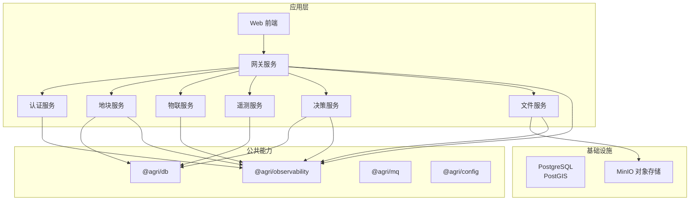
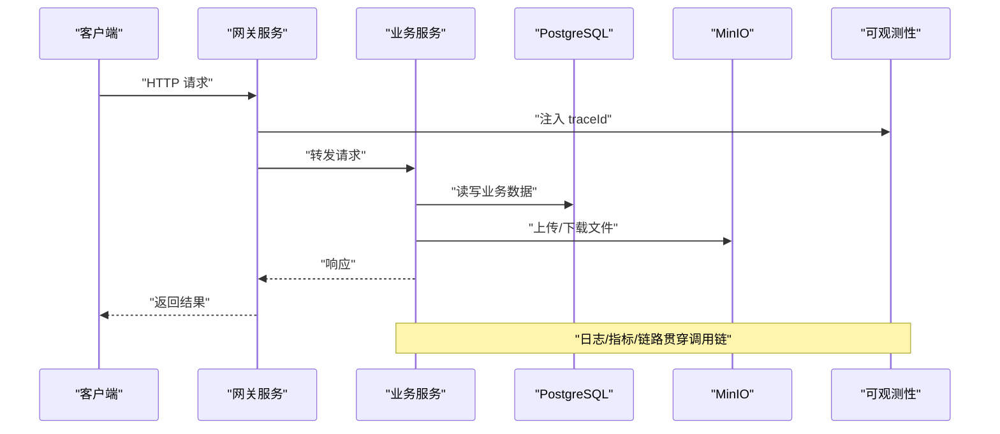
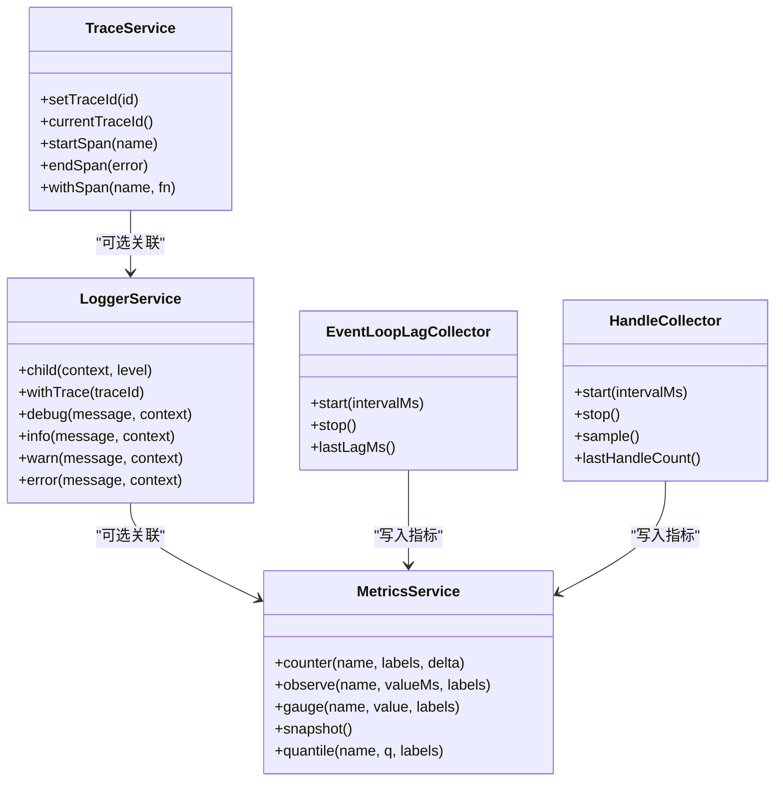
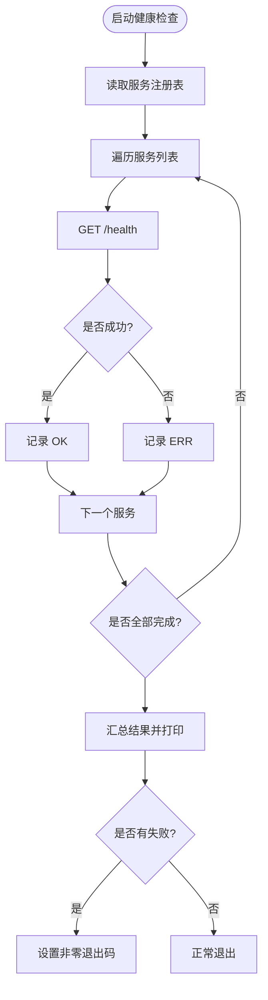
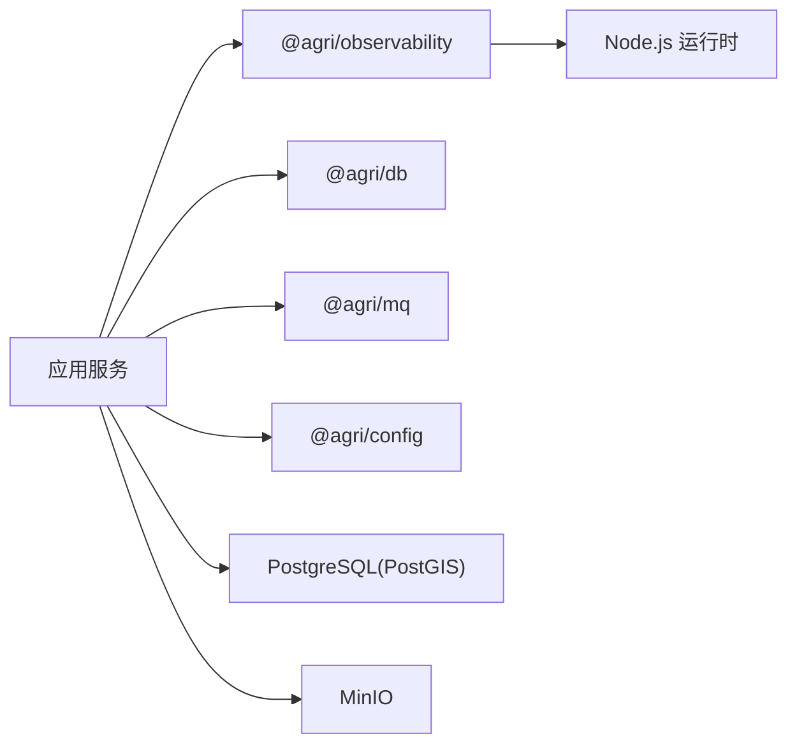

# 部署运维

<cite>
**本文引用的文件**   
- [README.md](file://README.md)
- [docker-compose.yml](file://infra/docker-compose.yml)
- [health-check.mjs](file://scripts/health-check.mjs)
- [index.ts（可观测性入口）](file://packages/observability/src/index.ts)
- [logger.ts（结构化日志）](file://packages/observability/src/logger.ts)
- [metrics.ts（指标采集）](file://packages/observability/src/metrics.ts)
- [trace.ts（链路追踪）](file://packages/observability/src/trace.ts)
- [decorators.ts（方法装饰器）](file://packages/observability/src/decorators.ts)
- [collectors.ts（运行期采集器）](file://packages/observability/src/collectors.ts)
</cite>

## 目录
1. [简介](#简介)
2. [项目结构](#项目结构)
3. [核心组件](#核心组件)
4. [架构总览](#架构总览)
5. [详细组件分析](#详细组件分析)
6. [依赖关系分析](#依赖关系分析)
7. [性能与容量规划](#性能与容量规划)
8. [故障排查指南](#故障排查指南)
9. [结论](#结论)
10. [附录：部署清单与检查项](#附录部署清单与检查项)

## 简介
本运维文档面向智慧农业平台的容器化部署、Kubernetes 编排与服务发现、负载均衡与高可用、监控告警、故障排查、备份恢复、容量规划与扩容指导。平台基于 Node.js 24 LTS + NestJS 11 + TypeScript 5.9，采用 pnpm workspace + Turborepo 多包工程，包含多个 HTTP 微服务与前端管理后台；基础设施通过 Docker Compose 提供 PostgreSQL(PostGIS) 与 MinIO 对象存储。可观测性能力由 @agri/observability 统一提供结构化日志、链路追踪与指标采集。

## 项目结构
仓库以“公共包 + 应用服务”分层组织：
- apps：各业务微服务与前端 Web 应用
- packages：公共能力包（配置、契约、数据库、消息、可观测性等）
- infra：本地开发基础设施（PostgreSQL、MinIO）
- scripts：健康检查、初始化、迁移等运维脚本

图表来源
- [README.md:1-167](file://README.md#L1-L167)
- [docker-compose.yml:1-39](file://infra/docker-compose.yml#L1-L39)

章节来源
- [README.md:1-167](file://README.md#L1-L167)

## 核心组件
- 可观测性能力
  - 结构化日志：统一 service、traceId、level、message 字段，便于跨服务串联
  - 指标采集：计数器、直方图、当前值型指标，覆盖请求耗时、事件循环延迟、句柄数、连接池使用率等
  - 链路追踪：traceId/spanId 生成与跨度包裹，支持异常标记
  - 运行期采集器：事件循环延迟、活动句柄与连接池使用率周期性采样
- 基础设施
  - PostgreSQL(PostGIS)：空间数据与业务主库
  - MinIO：对象存储，承载影像、报表等文件
- 健康检查
  - 每个服务暴露 /health 端点
  - 脚本批量探测所有服务端口并汇总结果

章节来源
- [index.ts（可观测性入口）:1-10](file://packages/observability/src/index.ts#L1-L10)
- [logger.ts（结构化日志）:1-102](file://packages/observability/src/logger.ts#L1-L102)
- [metrics.ts（指标采集）:1-106](file://packages/observability/src/metrics.ts#L1-L106)
- [trace.ts（链路追踪）:1-83](file://packages/observability/src/trace.ts#L1-L83)
- [collectors.ts（运行期采集器）:1-124](file://packages/observability/src/collectors.ts#L1-L124)
- [docker-compose.yml:1-39](file://infra/docker-compose.yml#L1-L39)
- [health-check.mjs:1-12](file://scripts/health-check.mjs#L1-L12)

## 架构总览
从部署视角，系统分为四层：
- 接入层：网关服务统一入口，负责路由、鉴权、限流与链路标识透传
- 业务层：各微服务按领域拆分，无状态或轻状态，水平扩展
- 数据层：PostgreSQL(PostGIS) 作为主库，MinIO 作为对象存储
- 可观测层：结构化日志、指标、链路贯穿全栈，支撑监控与排障

图表来源
- [README.md:1-167](file://README.md#L1-L167)
- [docker-compose.yml:1-39](file://infra/docker-compose.yml#L1-L39)
- [logger.ts（结构化日志）:1-102](file://packages/observability/src/logger.ts#L1-L102)
- [metrics.ts（指标采集）:1-106](file://packages/observability/src/metrics.ts#L1-L106)
- [trace.ts（链路追踪）:1-83](file://packages/observability/src/trace.ts#L1-L83)

## 详细组件分析

### 可观测性子系统
- 结构化日志
  - 固定字段：timestamp、level、service、message、traceId
  - 支持 child/withTrace 派生子日志器，便于上下文传递
- 指标采集
  - 标准指标：HTTP 请求耗时、事件循环延迟、活动句柄、数据库连接池使用率、MQ 消费耗时、死信计数、设备遥测总量
  - 提供 counter/observe/gauge/snapshot/quantile 等方法
- 链路追踪
  - 生成 traceId/spanId，支持 withSpan 包裹异步调用，自动记录耗时与错误标记
- 运行期采集器
  - EventLoopLagCollector：周期采样事件循环延迟，超过阈值输出告警日志
  - HandleCollector：周期采样活动句柄数与连接池使用率

图表来源
- [logger.ts（结构化日志）:1-102](file://packages/observability/src/logger.ts#L1-L102)
- [metrics.ts（指标采集）:1-106](file://packages/observability/src/metrics.ts#L1-L106)
- [trace.ts（链路追踪）:1-83](file://packages/observability/src/trace.ts#L1-L83)
- [collectors.ts（运行期采集器）:1-124](file://packages/observability/src/collectors.ts#L1-L124)

章节来源
- [index.ts（可观测性入口）:1-10](file://packages/observability/src/index.ts#L1-L10)
- [logger.ts（结构化日志）:1-102](file://packages/observability/src/logger.ts#L1-L102)
- [metrics.ts（指标采集）:1-106](file://packages/observability/src/metrics.ts#L1-L106)
- [trace.ts（链路追踪）:1-83](file://packages/observability/src/trace.ts#L1-L83)
- [collectors.ts（运行期采集器）:1-124](file://packages/observability/src/collectors.ts#L1-L124)

### 基础设施与健康检查
- PostgreSQL(PostGIS)
  - 镜像：postgis/postgis:16-3.5
  - 环境变量：数据库名、用户名、密码
  - 健康检查：pg_isready
- MinIO
  - 镜像：pgsty/minio
  - 控制台端口：9001
  - 健康检查：mc ready local
- 服务健康检查脚本
  - 读取服务注册表，遍历端口发起 GET /health
  - 汇总 OK/ERR 并输出统计，失败时非零退出码

图表来源
- [health-check.mjs:1-12](file://scripts/health-check.mjs#L1-L12)
- [docker-compose.yml:1-39](file://infra/docker-compose.yml#L1-L39)

章节来源
- [docker-compose.yml:1-39](file://infra/docker-compose.yml#L1-L39)
- [health-check.mjs:1-12](file://scripts/health-check.mjs#L1-L12)

## 依赖关系分析
- 运行时依赖
  - Node.js 24 LTS
  - NestJS 11 + TypeScript 5.9
  - Vitest 3（测试）
- 构建与任务编排
  - pnpm workspace + Turborepo + tsc -b
- 外部依赖
  - PostgreSQL(PostGIS)
  - MinIO 对象存储
- 可观测性依赖
  - Node.js perf_hooks（事件循环延迟）
  - process API（活动资源信息）

图表来源
- [README.md:1-167](file://README.md#L1-L167)
- [docker-compose.yml:1-39](file://infra/docker-compose.yml#L1-L39)
- [collectors.ts（运行期采集器）:1-124](file://packages/observability/src/collectors.ts#L1-L124)

章节来源
- [README.md:1-167](file://README.md#L1-L167)

## 性能与容量规划
- 关键性能信号
  - 事件循环延迟持续偏高：存在阻塞主线程的同步计算
  - 活动句柄只增不减：可能存在未释放的连接或定时器
  - 数据库连接池使用率高：连接泄漏或并发过大
  - 死信累计非零：事件反复处理失败需人工介入
- 建议阈值与观察窗口
  - 事件循环延迟：>100ms 持续一段时间即告警
  - 活动句柄：对比基线趋势，出现单调增长即预警
  - 连接池使用率：>80% 持续一段时间触发扩容或优化
- 容量规划要点
  - 根据 QPS 与 P95 耗时估算 CPU/内存需求
  - 数据库连接池大小与实例规格匹配
  - 对象存储带宽与吞吐评估（影像/视频场景）
- 扩容策略
  - 水平扩容：增加服务副本，配合 K8s HPA 基于 CPU/自定义指标
  - 垂直扩容：提升单 Pod 资源配额
  - 分库分表：热点表拆分与读写分离（长期演进）

[本节为通用指导，不直接分析具体文件]

## 故障排查指南
- 日志分析
  - 使用 service 与 traceId 定位跨服务调用链
  - 关注 error/warn 级别日志中的 reason、span、durationMs 等字段
- 指标诊断
  - 查看 http_request_duration_ms 的分位数，识别慢接口
  - 观察 event_loop_lag_ms、active_handles、db_pool_in_use 趋势
  - 关注 mq_dead_letter_total 是否持续增长
- 健康检查
  - 使用 health-check 脚本快速判断哪些服务不可用
  - 结合 /health 返回体确认服务名称与状态
- 常见问题定位
  - 事件循环延迟高：排查同步计算、大对象序列化、图片处理
  - 连接泄漏：检查数据库连接、外部 HTTP 客户端、定时任务清理
  - 死信堆积：检查下游依赖可用性、重试策略与幂等实现

章节来源
- [logger.ts（结构化日志）:1-102](file://packages/observability/src/logger.ts#L1-L102)
- [metrics.ts（指标采集）:1-106](file://packages/observability/src/metrics.ts#L1-L106)
- [collectors.ts（运行期采集器）:1-124](file://packages/observability/src/collectors.ts#L1-L124)
- [health-check.mjs:1-12](file://scripts/health-check.mjs#L1-L12)

## 结论
本平台具备清晰的微服务边界与完善的可观测性能力，适合在 Kubernetes 上实现高可用与弹性伸缩。通过统一的日志、指标与链路规范，运维侧可以快速定位问题并进行容量规划与扩容。基础设施以 PostgreSQL(PostGIS) 与 MinIO 为主，配合健康检查脚本形成基础运维闭环。

[本节为总结性内容，不直接分析具体文件]

## 附录：部署清单与检查项
- 容器化与镜像构建
  - 为每个微服务构建独立镜像，最小化基础镜像
  - 将环境变量（数据库、对象存储、可观测性相关）纳入镜像外配置
- Kubernetes 编排
  - Deployment：副本数、资源限制、探针（liveness/readiness）
  - Service：ClusterIP/LoadBalancer 暴露
  - Ingress/Gateway：统一入口、TLS 终止、路径路由
  - ConfigMap/Secret：集中管理配置与密钥
  - HorizontalPodAutoscaler：基于 CPU/自定义指标自动扩缩容
- 服务发现与负载均衡
  - 使用 K8s Service 进行服务发现
  - Ingress/Gateway 做七层负载均衡与熔断限流
- 高可用与故障转移
  - 多副本部署，避免单点
  - 就绪探针确保流量仅进入健康 Pod
  - 数据库与对象存储选择高可用方案（集群/多副本）
- 监控告警
  - 指标：http_request_duration_ms、event_loop_lag_ms、active_handles、db_pool_in_use、mq_dead_letter_total
  - 告警规则：P95 耗时、事件循环延迟、句柄增长、死信累计
  - 日志聚合：ELK/Loki 等，按 service/traceId 检索
- 备份恢复
  - PostgreSQL：定期逻辑/物理备份，保留策略与恢复演练
  - MinIO：跨区域复制与版本控制，定期快照
- 容量规划与扩容
  - 压测获取基线，设定 HPA 目标
  - 数据库连接池与实例规格联动调整
  - 对象存储带宽与吞吐评估

[本节为通用指导，不直接分析具体文件]