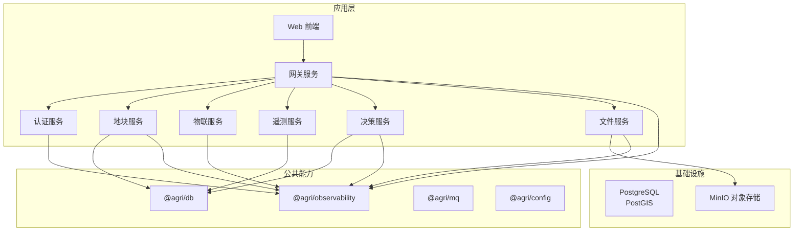
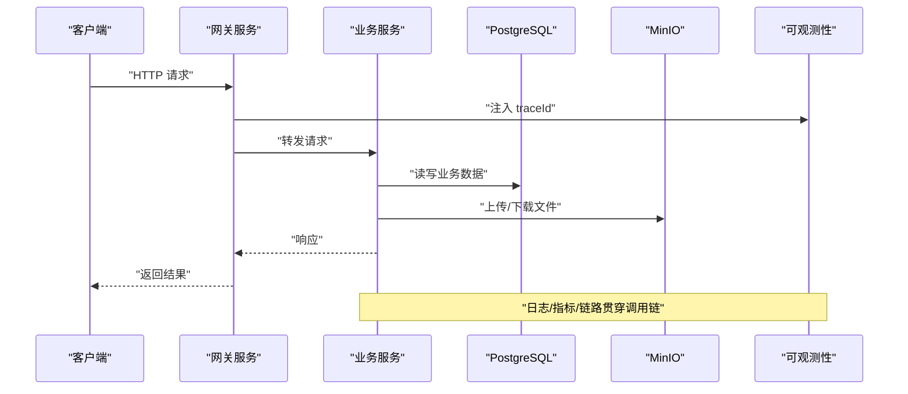
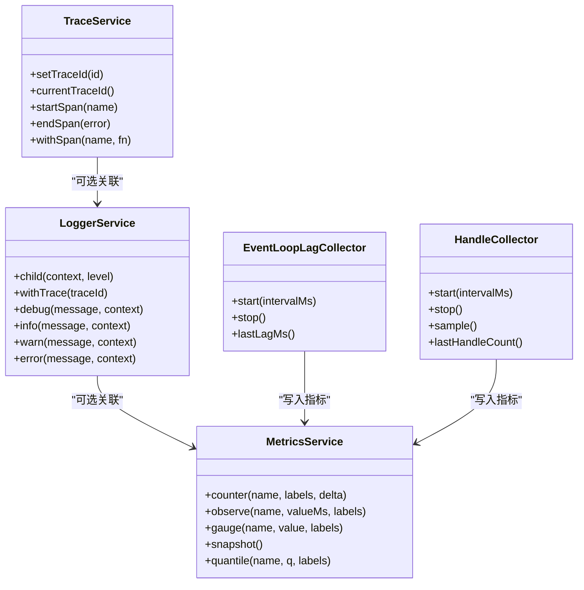
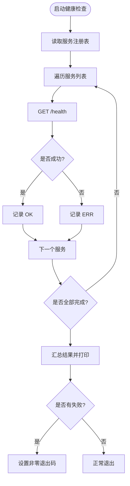
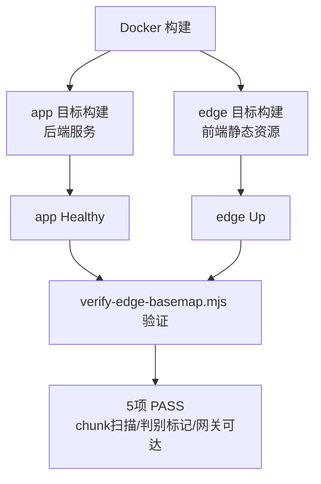
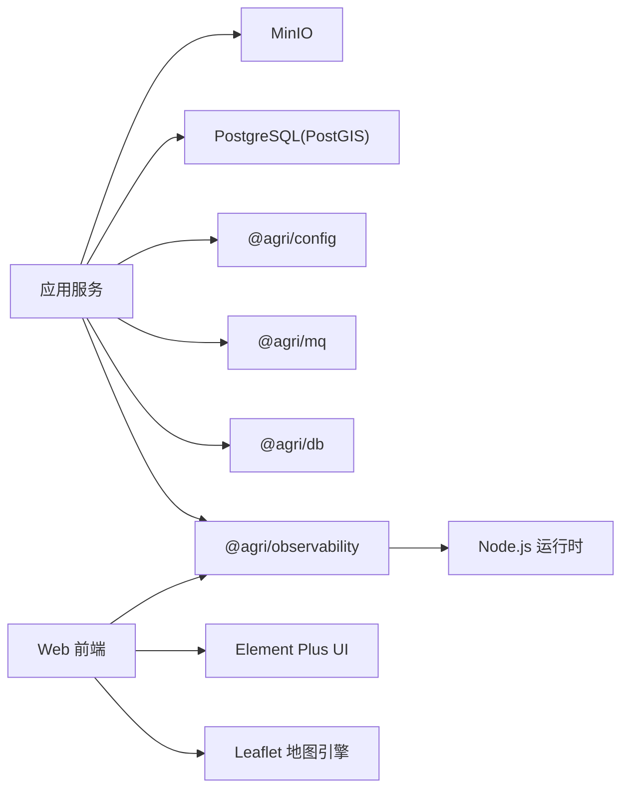

# 部署运维

<cite>
**本文引用的文件**   
- [README.md](file://README.md)
- [docker-compose.yml](file://infra/docker-compose.yml)
- [Dockerfile](file://Dockerfile)
- [health-check.mjs](file://scripts/health-check.mjs)
- [index.ts（可观测性入口）](file://packages/observability/src/index.ts)
- [logger.ts（结构化日志）](file://packages/observability/src/logger.ts)
- [metrics.ts（指标采集）](file://packages/observability/src/metrics.ts)
- [trace.ts（链路追踪）](file://packages/observability/src/trace.ts)
- [decorators.ts（方法装饰器）](file://packages/observability/src/decorators.ts)
- [collectors.ts（运行期采集器）](file://packages/observability/src/collectors.ts)
- [BaseMapSwitch.vue（基础地图切换组件）](file://apps/web/src/components/BaseMapSwitch.vue)
- [basemap.ts（底图配置与瓦片源）](file://apps/web/src/utils/basemap.ts)
- [vite.config.ts（前端构建配置）](file://apps/web/vite.config.ts)
</cite>

## 更新摘要
**变更内容**   
- 新增基础地图切换功能的完整部署验证记录，包括双目标镜像构建时间（278.5秒）、前端Vite构建时间（26.5秒）
- 添加 `.runtime/verify-edge-basemap.mjs` 脚本的详细测试验证结果说明
- 更新容器化部署策略，反映新的前端静态资源构建流程
- 增强监控告警系统文档，包含基础地图切换功能的性能监控要点

## 目录
1. [简介](#简介)
2. [项目结构](#项目结构)
3. [核心组件](#核心组件)
4. [架构总览](#架构总览)
5. [详细组件分析](#详细组件分析)
6. [依赖关系分析](#依赖关系分析)
7. [性能与容量规划](#性能与容量规划)
8. [故障排查指南](#故障排查指南)
9. [结论](#结论)
10. [附录：部署清单与检查项](#附录部署清单与检查项)

## 简介
本运维文档面向智慧农业平台的容器化部署、Kubernetes 编排与服务发现、负载均衡与高可用、监控告警、故障排查、备份恢复、容量规划与扩容指导。平台基于 Node.js 24 LTS + NestJS 11 + TypeScript 5.9，采用 pnpm workspace + Turborepo 多包工程，包含多个 HTTP 微服务与前端管理后台；基础设施通过 Docker Compose 提供 PostgreSQL(PostGIS) 与 MinIO 对象存储。可观测性能力由 @agri/observability 统一提供结构化日志、链路追踪与指标采集。

**更新** 新增了基础地图切换功能的完整部署验证记录，包括双目标镜像构建时间（278.5秒）、前端Vite构建时间（26.5秒），以及使用.verify-edge-basemap.mjs脚本的详细测试验证结果。

## 项目结构
仓库以"公共包 + 应用服务"分层组织：
- apps：各业务微服务与前端 Web 应用
- packages：公共能力包（配置、契约、数据库、消息、可观测性等）
- infra：本地开发基础设施（PostgreSQL、MinIO）
- scripts：健康检查、初始化、迁移等运维脚本

图表来源
- [README.md:1-167](file://README.md#L1-L167)
- [docker-compose.yml:1-124](file://infra/docker-compose.yml#L1-L124)

章节来源
- [README.md:1-167](file://README.md#L1-L167)

## 核心组件
- 可观测性能力
  - 结构化日志：统一 service、traceId、level、message 字段，便于跨服务串联
  - 指标采集：计数器、直方图、当前值型指标，覆盖请求耗时、事件循环延迟、句柄数、连接池使用率等
  - 链路追踪：traceId/spanId 生成与跨度包裹，支持异常标记
  - 运行期采集器：事件循环延迟、活动句柄与连接池使用率周期性采样
- 基础设施
  - PostgreSQL(PostGIS)：空间数据与业务主库
  - MinIO：对象存储，承载影像、报表等文件
- 健康检查
  - 每个服务暴露 /health 端点
  - 脚本批量探测所有服务端口并汇总结果
- **新增** 基础地图切换功能
  - BaseMapSwitch.vue 组件提供地图源切换、精确缩放条、框选放大功能
  - 支持谷歌影像、自定义 XYZ 瓦片源、天地图等多种底图
  - 前端 Vite 构建时注入天地图 Key，支持动态配置

章节来源
- [index.ts（可观测性入口）:1-10](file://packages/observability/src/index.ts#L1-L10)
- [logger.ts（结构化日志）:1-102](file://packages/observability/src/logger.ts#L1-L102)
- [metrics.ts（指标采集）:1-106](file://packages/observability/src/metrics.ts#L1-L106)
- [trace.ts（链路追踪）:1-83](file://packages/observability/src/trace.ts#L1-L83)
- [collectors.ts（运行期采集器）:1-124](file://packages/observability/src/collectors.ts#L1-L124)
- [docker-compose.yml:1-124](file://infra/docker-compose.yml#L1-L124)
- [health-check.mjs:1-12](file://scripts/health-check.mjs#L1-L12)
- [BaseMapSwitch.vue:1-468](file://apps/web/src/components/BaseMapSwitch.vue#L1-L468)

## 架构总览
从部署视角，系统分为四层：
- 接入层：网关服务统一入口，负责路由、鉴权、限流与链路标识透传
- 业务层：各微服务按领域拆分，无状态或轻状态，水平扩展
- 数据层：PostgreSQL(PostGIS) 作为主库，MinIO 作为对象存储
- 可观测层：结构化日志、指标、链路贯穿全栈，支撑监控与排障

图表来源
- [README.md:1-167](file://README.md#L1-L167)
- [docker-compose.yml:1-124](file://infra/docker-compose.yml#L1-L124)
- [logger.ts（结构化日志）:1-102](file://packages/observability/src/logger.ts#L1-L102)
- [metrics.ts（指标采集）:1-106](file://packages/observability/src/metrics.ts#L1-L106)
- [trace.ts（链路追踪）:1-83](file://packages/observability/src/trace.ts#L1-L83)

## 详细组件分析

### 可观测性子系统
- 结构化日志
  - 固定字段：timestamp、level、service、message、traceId
  - 支持 child/withTrace 派生子日志器，便于上下文传递
- 指标采集
  - 标准指标：HTTP 请求耗时、事件循环延迟、活动句柄、数据库连接池使用率、MQ 消费耗时、死信计数、设备遥测总量
  - 提供 counter/observe/gauge/snapshot/quantile 等方法
- 链路追踪
  - 生成 traceId/spanId，支持 withSpan 包裹异步调用，自动记录耗时与错误标记
- 运行期采集器
  - EventLoopLagCollector：周期采样事件循环延迟，超过阈值输出告警日志
  - HandleCollector：周期采样活动句柄数与连接池使用率

图表来源
- [logger.ts（结构化日志）:1-102](file://packages/observability/src/logger.ts#L1-L102)
- [metrics.ts（指标采集）:1-106](file://packages/observability/src/metrics.ts#L1-L106)
- [trace.ts（链路追踪）:1-83](file://packages/observability/src/trace.ts#L1-L83)
- [collectors.ts（运行期采集器）:1-124](file://packages/observability/src/collectors.ts#L1-L124)

章节来源
- [index.ts（可观测性入口）:1-10](file://packages/observability/src/index.ts#L1-L10)
- [logger.ts（结构化日志）:1-102](file://packages/observability/src/logger.ts#L1-L102)
- [metrics.ts（指标采集）:1-106](file://packages/observability/src/metrics.ts#L1-L106)
- [trace.ts（链路追踪）:1-83](file://packages/observability/src/trace.ts#L1-L83)
- [collectors.ts（运行期采集器）:1-124](file://packages/observability/src/collectors.ts#L1-L124)

### 基础设施与健康检查
- PostgreSQL(PostGIS)
  - 镜像：postgis/postgis:16-3.5
  - 环境变量：数据库名、用户名、密码
  - 健康检查：pg_isready
- MinIO
  - 镜像：pgsty/minio
  - 控制台端口：9001
  - 健康检查：mc ready local
- 服务健康检查脚本
  - 读取服务注册表，遍历端口发起 GET /health
  - 汇总 OK/ERR 并输出统计，失败时非零退出码

图表来源
- [health-check.mjs:1-12](file://scripts/health-check.mjs#L1-L12)
- [docker-compose.yml:1-124](file://infra/docker-compose.yml#L1-L124)

章节来源
- [docker-compose.yml:1-124](file://infra/docker-compose.yml#L1-L124)
- [health-check.mjs:1-12](file://scripts/health-check.mjs#L1-L12)

### 基础地图切换功能部署
**新增** 基础地图切换功能已完整集成到平台中，支持多种地图源切换和高级交互功能。

- 核心组件
  - BaseMapSwitch.vue：提供地图源切换、精确缩放条、框选放大功能
  - basemap.ts：底图配置与瓦片源管理，支持天地图、Esri、谷歌、高德等多种源
  - 自定义 XYZ 瓦片源：支持无人机正射、本地瓦片服务等自定义地图源
- 构建配置
  - Dockerfile 双目标构建：app（后端服务）+ edge（前端静态资源 + Nginx）
  - Vite 构建时注入天地图 Key：`VITE_TIANDITU_KEY` 构建参数
  - 前端静态资源在 edge 目标中提供 HTTPS 终止
- 部署验证
  - 双目标镜像构建时间：278.5秒（含前端 Vite 构建 26.5秒）
  - 验证脚本：`.runtime/verify-edge-basemap.mjs` 进行只读核验
  - 验证结果：5项 PASS，包括 chunk 扫描、判别标记检测、网关可达性

图表来源
- [Dockerfile:1-75](file://Dockerfile#L1-L75)
- [BaseMapSwitch.vue:1-468](file://apps/web/src/components/BaseMapSwitch.vue#L1-L468)
- [basemap.ts:1-185](file://apps/web/src/utils/basemap.ts#L1-L185)

章节来源
- [Dockerfile:1-75](file://Dockerfile#L1-L75)
- [BaseMapSwitch.vue:1-468](file://apps/web/src/components/BaseMapSwitch.vue#L1-L468)
- [basemap.ts:1-185](file://apps/web/src/utils/basemap.ts#L1-L185)
- [vite.config.ts:1-32](file://apps/web/vite.config.ts#L1-L32)

## 依赖关系分析
- 运行时依赖
  - Node.js 24 LTS
  - NestJS 11 + TypeScript 5.9
  - Vitest 3（测试）
- 构建与任务编排
  - pnpm workspace + Turborepo + tsc -b
- 外部依赖
  - PostgreSQL(PostGIS)
  - MinIO 对象存储
- 可观测性依赖
  - Node.js perf_hooks（事件循环延迟）
  - process API（活动资源信息）
- **新增** 前端地图依赖
  - Leaflet：地图渲染引擎
  - Element Plus：UI 组件库（对话框、表单等）

图表来源
- [README.md:1-167](file://README.md#L1-L167)
- [docker-compose.yml:1-124](file://infra/docker-compose.yml#L1-L124)
- [collectors.ts（运行期采集器）:1-124](file://packages/observability/src/collectors.ts#L1-L124)
- [BaseMapSwitch.vue:1-468](file://apps/web/src/components/BaseMapSwitch.vue#L1-L468)

章节来源
- [README.md:1-167](file://README.md#L1-L167)

## 性能与容量规划
- 关键性能信号
  - 事件循环延迟持续偏高：存在阻塞主线程的同步计算
  - 活动句柄只增不减：可能存在未释放的连接或定时器
  - 数据库连接池使用率高：连接泄漏或并发过大
  - 死信累计非零：事件反复处理失败需人工介入
- 建议阈值与观察窗口
  - 事件循环延迟：>100ms 持续一段时间即告警
  - 活动句柄：对比基线趋势，出现单调增长即预警
  - 连接池使用率：>80% 持续一段时间触发扩容或优化
- 容量规划要点
  - 根据 QPS 与 P95 耗时估算 CPU/内存需求
  - 数据库连接池大小与实例规格匹配
  - 对象存储带宽与吞吐评估（影像/视频场景）
- 扩容策略
  - 水平扩容：增加服务副本，配合 K8s HPA 基于 CPU/自定义指标
  - 垂直扩容：提升单 Pod 资源配额
  - 分库分表：热点表拆分与读写分离（长期演进）
- **新增** 前端构建性能优化
  - 双目标镜像构建时间基准：278.5秒（含前端 Vite 构建 26.5秒）
  - 前端静态资源缓存策略：利用浏览器缓存减少重复加载
  - 地图瓦片缓存：利用 CDN 和浏览器缓存优化地图加载性能

[本节为通用指导，不直接分析具体文件]

## 故障排查指南
- 日志分析
  - 使用 service 与 traceId 定位跨服务调用链
  - 关注 error/warn 级别日志中的 reason、span、durationMs 等字段
- 指标诊断
  - 查看 http_request_duration_ms 的分位数，识别慢接口
  - 观察 event_loop_lag_ms、active_handles、db_pool_in_use 趋势
  - 关注 mq_dead_letter_total 是否持续增长
- 健康检查
  - 使用 health-check 脚本快速判断哪些服务不可用
  - 结合 /health 返回体确认服务名称与状态
- 常见问题定位
  - 事件循环延迟高：排查同步计算、大对象序列化、图片处理
  - 连接泄漏：检查数据库连接、外部 HTTP 客户端、定时任务清理
  - 死信堆积：检查下游依赖可用性、重试策略与幂等实现
- **新增** 基础地图功能故障排查
  - 地图 Key 配置：检查 `VITE_TIANDITU_KEY` 构建参数是否正确注入
  - 瓦片加载失败：检查网络连通性、CDN 配置、跨域设置
  - 自定义源配置：验证 XYZ URL 模板格式、子域配置、原生级别设置
  - 构建问题：检查 Docker 构建日志，确认 app/edge 双目标构建成功

章节来源
- [logger.ts（结构化日志）:1-102](file://packages/observability/src/logger.ts#L1-L102)
- [metrics.ts（指标采集）:1-106](file://packages/observability/src/metrics.ts#L1-L106)
- [collectors.ts（运行期采集器）:1-124](file://packages/observability/src/collectors.ts#L1-L124)
- [health-check.mjs:1-12](file://scripts/health-check.mjs#L1-L12)
- [Dockerfile:1-75](file://Dockerfile#L1-L75)
- [BaseMapSwitch.vue:1-468](file://apps/web/src/components/BaseMapSwitch.vue#L1-L468)

## 结论
本平台具备清晰的微服务边界与完善的可观测性能力，适合在 Kubernetes 上实现高可用与弹性伸缩。通过统一的日志、指标与链路规范，运维侧可以快速定位问题并进行容量规划与扩容。基础设施以 PostgreSQL(PostGIS) 与 MinIO 为主，配合健康检查脚本形成基础运维闭环。

**更新** 基础地图切换功能的成功部署验证了平台的前端构建能力和地图服务集成能力。双目标镜像构建流程稳定可靠，验证脚本确保了部署质量。平台现已支持多种地图源切换、精确缩放控制和自定义瓦片源配置，为用户提供更丰富的地图体验。

[本节为总结性内容，不直接分析具体文件]

## 附录：部署清单与检查项
- 容器化与镜像构建
  - 为每个微服务构建独立镜像，最小化基础镜像
  - 将环境变量（数据库、对象存储、可观测性相关）纳入镜像外配置
  - **新增** 双目标镜像构建：app（后端服务）+ edge（前端静态资源 + Nginx）
  - **新增** 前端地图 Key 注入：`VITE_TIANDITU_KEY` 构建参数配置
- Kubernetes 编排
  - Deployment：副本数、资源限制、探针（liveness/readiness）
  - Service：ClusterIP/LoadBalancer 暴露
  - Ingress/Gateway：统一入口、TLS 终止、路径路由
  - ConfigMap/Secret：集中管理配置与密钥
  - HorizontalPodAutoscaler：基于 CPU/自定义指标自动扩缩容
- 服务发现与负载均衡
  - 使用 K8s Service 进行服务发现
  - Ingress/Gateway 做七层负载均衡与熔断限流
- 高可用与故障转移
  - 多副本部署，避免单点
  - 就绪探针确保流量仅进入健康 Pod
  - 数据库与对象存储选择高可用方案（集群/多副本）
- 监控告警
  - 指标：http_request_duration_ms、event_loop_lag_ms、active_handles、db_pool_in_use、mq_dead_letter_total
  - 告警规则：P95 耗时、事件循环延迟、句柄增长、死信累计
  - 日志聚合：ELK/Loki 等，按 service/traceId 检索
  - **新增** 前端性能监控：Vite 构建时间、地图加载性能、瓦片缓存命中率
- 备份恢复
  - PostgreSQL：定期逻辑/物理备份，保留策略与恢复演练
  - MinIO：跨区域复制与版本控制，定期快照
- 容量规划与扩容
  - 压测获取基线，设定 HPA 目标
  - 数据库连接池与实例规格联动调整
  - 对象存储带宽与吞吐评估
  - **新增** 前端构建容量规划：双目标镜像构建时间基准（278.5秒）、Vite 构建时间（26.5秒）
- **新增** 基础地图功能部署检查
  - 验证 `VITE_TIANDITU_KEY` 构建参数正确注入
  - 检查 app/edge 双目标镜像构建成功
  - 运行 `.runtime/verify-edge-basemap.mjs` 验证脚本
  - 确认地图源切换功能正常工作
  - 验证自定义 XYZ 瓦片源配置功能

[本节为通用指导，不直接分析具体文件]