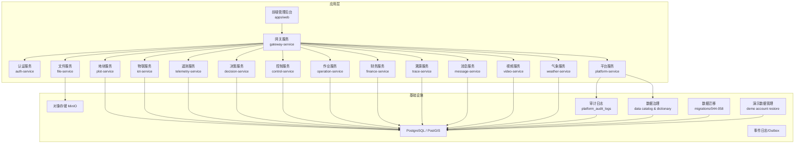
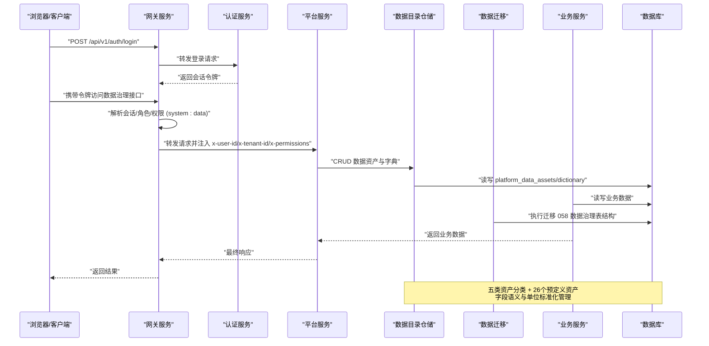
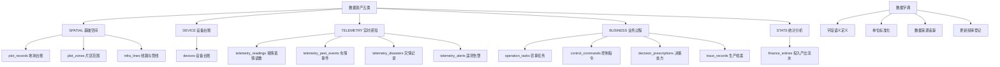
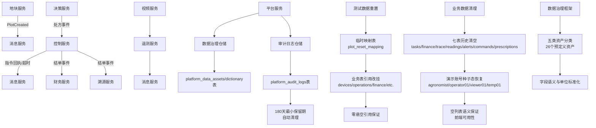

# 平台功能清单

<cite>
**本文引用的文件**   
- [README.md](file://README.md)
- [EXISTING_FEATURES.md](file://EXISTING_FEATURES.md)
- [IMPLEMENTATION_PROGRESS.md](file://IMPLEMENTATION_PROGRESS.md)
- [apps/platform-service/src/data-catalog.repository.ts](file://apps/platform-service/src/data-catalog.repository.ts)
- [apps/platform-service/src/http.ts](file://apps/platform-service/src/http.ts)
- [apps/platform-service/test/data-catalog.spec.ts](file://apps/platform-service/test/data-catalog.spec.ts)
- [infra/postgres/migrations/058_data_catalog.sql](file://infra/postgres/migrations/058_data_catalog.sql)
- [apps/web/src/views/system/DataCatalog.vue](file://apps/web/src/views/system/DataCatalog.vue)
- [apps/web/src/api/index.ts](file://apps/web/src/api/index.ts)
- [apps/web/src/types/index.ts](file://apps/web/src/types/index.ts)
- [infra/postgres/migrations/044_reset_plots_lines.sql](file://infra/postgres/migrations/044_reset_plots_lines.sql)
- [infra/postgres/migrations/045_smoke_residue_cleanup.sql](file://infra/postgres/migrations/045_smoke_residue_cleanup.sql)
- [infra/postgres/migrations/046_history_clear_demo_restore.sql](file://infra/postgres/migrations/046_history_clear_demo_restore.sql)
- [infra/postgres/migrations/010_demo_data.sql](file://infra/postgres/migrations/010_demo_data.sql)
- [scripts/seed-test-plots.mjs](file://scripts/seed-test-plots.mjs)
- [scripts/smoke-demo-data.mjs](file://scripts/smoke-demo-data.mjs)
- [apps/web/src/views/agro/Index.vue](file://apps/web/src/views/agro/Index.vue)
- [apps/web/src/views/dashboard/Index.vue](file://apps/web/src/views/dashboard/Index.vue)
- [apps/web/src/views/system/User.vue](file://apps/web/src/views/system/User.vue)
- [apps/web/src/views/system/Role.vue](file://apps/web/src/views/system/Role.vue)
- [apps/platform-service/src/role.repository.ts](file://apps/platform-service/src/role.repository.ts)
- [apps/platform-service/src/main.ts](file://apps/platform-service/src/main.ts)
- [apps/auth-service/src/user.repository.ts](file://apps/auth-service/src/user.repository.ts)
- [infra/postgres/migrations/004_identity_accounts.sql](file://infra/postgres/migrations/004_identity_accounts.sql)
</cite>

## 更新摘要
**已完成的变更**   
- 新增数据治理框架章节，详细说明五类资产分类、26个预定义数据资产与完整字典管理功能
- 补充数据目录仓储实现，包含内存与SQL双实现及完整的CRUD接口
- 新增前端数据治理页面，支持资产目录与数据字典的可视化维护
- 完善数据库迁移058，提供完整的表结构定义和种子数据
- 增强API权限控制，新增system:data权限组用于数据治理操作
- 更新架构总览图，增加数据治理相关组件和数据流

## 目录
1. [引言](#引言)
2. [项目结构](#项目结构)
3. [核心组件](#核心组件)
4. [架构总览](#架构总览)
5. [详细功能清单](#详细功能清单)
6. [依赖关系分析](#依赖关系分析)
7. [性能与可靠性要点](#性能与可靠性要点)
8. [故障排查指南](#故障排查指南)
9. [结论](#结论)

## 引言
本文件面向"无人农场 AI 平台"的使用者与实施人员，把仓库中已落地的后端微服务、前端页面与跨服务业务链路整理成一份可检索的"平台功能清单"。文档以现有仓库说明与前端页面为事实依据，按系统管理、地块与空间、四情监控、设备与指令、作业与决策、财务与溯源、消息与视频、气象等维度组织，并给出关键业务流程图与参考实现位置。

**最新更新**：平台现已具备完整的数据治理框架，包括五类资产分类（SPATIAL基础空间、DEVICE设备台账、TELEMETRY实时感知、BUSINESS业务过程、STATS统计分析）、26个预定义数据资产和丰富字典条目，支持字段语义和单位的标准化管理。同时具备完整的业务数据清理与演示账号管理能力，支持按卫星底图重建真实尺度田块，并通过业务引用改挂确保零悬空引用。

## 项目结构
平台采用 pnpm workspace + Turborepo 多包工程：
- `packages/`：公共能力包（契约、配置、数据库、消息、观测、地块核心等）。
- `apps/`：15 个 HTTP 微服务 + Vue 管理后台。
- `infra/`：PostgreSQL/PostGIS 迁移、MinIO、Docker Compose 与边缘 nginx。
- `scripts/`：冒烟测试、健康检查、数据初始化与服务启动脚本。

图表来源
- [README.md:161-192](file://README.md#L161-L192)
- [EXISTING_FEATURES.md:7-25](file://EXISTING_FEATURES.md#L7-L25)
- [infra/postgres/migrations/004_identity_accounts.sql:49-58](file://infra/postgres/migrations/004_identity_accounts.sql#L49-L58)

章节来源
- [README.md:1-10](file://README.md#L1-L10)
- [README.md:161-192](file://README.md#L161-L192)
- [EXISTING_FEATURES.md:7-25](file://EXISTING_FEATURES.md#L7-L25)

## 核心组件
- 网关：唯一对外入口，负责会话校验、权限判定、路由转发与健康汇总。
- 认证与会话：登录、登出、当前用户、会话；口令使用 scrypt 随机盐。
- 平台基础：租户、用户、角色、权限目录；是权限与租户隔离的数据源头。
- **数据治理框架**：五类资产分类、26个预定义数据资产、完整字典管理，支持字段语义和单位标准化。
- **审计日志保留策略**：180天最小保留期强制执行，支持环境变量配置延长保留期，自动清理过期日志。
- **业务数据清理引擎**：迁移 046 提供七表历史数据清空能力，支持演示账号种子态恢复。
- **演示账号管理**：支持密码重置、状态恢复、权限验证，确保演示环境一致性。
- **历史端点空列表语义**：所有历史查询接口在数据清空后返回空列表而非错误，保证前端可用性。
- 地块核心：地块建档、边界面积重算、季次、设施线、管理分区、合并/拆分。
- 物联与遥测：设备档案、点位绑定、采集标准化、读数落库、阈值告警、虫情/灾情归档。
- 控制闭环：处方/规则 → 指令计划 → 下发 → 回执 → 超时收口 → 结单事件 → 财务记账。
- 作业与决策：覆盖路径规划、道路导航、任务状态机；规则引擎、处方签发与效果回流。
- 财务与溯源：投入产出明细、报表三维度、生产档案事件归档。
- 消息中心：模板渲染、订阅偏好过滤、主题去重与重试死信。
- 视频与文件：摄像头接入、PTZ、AI 识别转发、对象存储后端可插拔。
- 气象：和风天气同步、预警、逐小时、农事建议、田时。

章节来源
- [EXISTING_FEATURES.md:43-179](file://EXISTING_FEATURES.md#L43-L179)
- [README.md:215-353](file://README.md#L215-L353)

## 架构总览
平台遵循以下横切约定：
- 外部请求只到网关；下游服务不直接对外暴露。
- 身份与租户由网关注入可信头，下游不信任客户端自报。
- 鉴权在网关按「方法+路径→权限」拦截；服务侧守卫作为第二道闸。
- 事件与 Outbox 在同一事务内写入，消费侧按 eventId 幂等。
- 删除统一为软删除（`deleted_at`），历史行保留。
- 地块代码是跨表关联锚点；面积以边界几何现算为准。
- **数据治理框架**：通过 platform_data_assets 和 platform_data_dictionary 表实现资产目录与字典管理，(tenant_id, asset_code, metric_key) 唯一约束杜绝同指标多口径。
- **审计日志保留策略**：所有平台操作自动记录审计日志，180天最小保留期强制执行，支持周期自动清理。
- **测试数据重置**：迁移 044-045 提供完整的测试数据重置能力，按卫星底图重建真实尺度田块。
- **业务数据清理**：迁移 046 提供七表历史数据清空能力，支持演示账号种子态恢复。

图表来源
- [EXISTING_FEATURES.md:26-39](file://EXISTING_FEATURES.md#L26-L39)
- [README.md:336-344](file://README.md#L336-L344)
- [apps/platform-service/src/main.ts:46-59](file://apps/platform-service/src/main.ts#L46-L59)
- [apps/platform-service/src/data-catalog.repository.ts:14-15](file://apps/platform-service/src/data-catalog.repository.ts#L14-L15)
- [infra/postgres/migrations/058_data_catalog.sql:1-11](file://infra/postgres/migrations/058_data_catalog.sql#L1-L11)

## 详细功能清单

### 一、系统管理与权限
- 用户管理：创建、编辑、停用/启用、重置密码、分页查询、关键词筛选。
- 角色管理：创建、编辑、启用/停用、分配权限组、关键字搜索。
- 权限目录：8 组 22 码，支持通配；网关与服务侧双重校验。
- 账号与角色分域存储：认证域与平台域分离；口令 scrypt 随机盐；支持内存/SQL 模式。
- **数据治理权限**：新增 system:data 权限组，控制数据资产与字典的CRUD操作。
- **审计日志管理**：
  - 自动记录所有平台操作（角色CRUD、权限变更、数据治理操作等）
  - 180天最小保留期强制执行，可通过 `AUDIT_RETENTION_DAYS` 环境变量延长
  - 启动即清理一轮过期日志，之后每24小时自动清理（可通过 `AUDIT_RETENTION_SWEEP_INTERVAL_MS` 调整）
  - 提供 `GET /api/v1/platform/audit-retention` 接口查询当前保留策略
  - 支持按租户、关键词分页查询审计日志

参考实现
- 用户页面：[apps/web/src/views/system/User.vue](file://apps/web/src/views/system/User.vue)
- 角色页面：[apps/web/src/views/system/Role.vue](file://apps/web/src/views/system/Role.vue)
- 数据治理权限：[apps/platform-service/src/http.ts:42](file://apps/platform-service/src/http.ts#L42)
- 审计日志保留策略：[apps/platform-service/src/role.repository.ts:71-82](file://apps/platform-service/src/role.repository.ts#L71-L82)
- 审计日志清理调度：[apps/platform-service/src/main.ts:46-59](file://apps/platform-service/src/main.ts#L46-L59)
- 审计日志HTTP接口：[apps/platform-service/src/http.ts:153-163](file://apps/platform-service/src/http.ts#L153-L163)

章节来源
- [apps/web/src/views/system/User.vue:1-266](file://apps/web/src/views/system/User.vue#L1-L266)
- [apps/web/src/views/system/Role.vue:1-241](file://apps/web/src/views/system/Role.vue#L1-L241)
- [apps/platform-service/src/http.ts:42](file://apps/platform-service/src/http.ts#L42)
- [apps/platform-service/src/role.repository.ts:71-82](file://apps/platform-service/src/role.repository.ts#L71-L82)
- [apps/platform-service/src/main.ts:46-59](file://apps/platform-service/src/main.ts#L46-L59)
- [apps/platform-service/src/http.ts:153-163](file://apps/platform-service/src/http.ts#L153-L163)

### 二、数据治理框架（新增）
- **五类资产分类**：
  - SPATIAL（基础空间）：地块台账、片区范围、线路与管线
  - DEVICE（设备台账）：设备类型、型号厂商、安装位置、通信方式
  - TELEMETRY（实时感知）：墒情苗情读数、虫情事件、灾情记录、遥测告警
  - BUSINESS（业务过程）：农事任务、控制指令、决策处方、生产档案
  - STATS（统计分析）：投入产出流水、监管统计报表
- **26个预定义数据资产**：涵盖平台所有核心业务表，code取真实表名，登记来源服务、存储介质、更新频率与是否归集到地块。
- **数据字典管理**：
  - 26个预定义字典条目，包含土壤温度/湿度、空气温湿度、风速降雨、苗情指标等
  - 字段语义、单位、数据类型、数据来源、更新频率完整登记
  - (tenant_id, asset_code, metric_key) 唯一约束，杜绝同指标多口径
- **CRUD接口**：
  - 数据资产：分页查询、创建、更新、删除（带引用守卫）
  - 数据字典：分页查询、创建、更新、删除（带资产存在性校验）
- **前端管理界面**：
  - 资产目录页：支持关键词搜索、分类筛选、CRUD操作
  - 数据字典页：支持资产筛选、关键词搜索、CRUD操作
  - 表单验证：编码格式、必填字段、布尔值类型校验
- **权限控制**：system:data 权限组，区分读操作（GET）和写操作（POST/PUT/DELETE）

图表来源
- [apps/platform-service/src/data-catalog.repository.ts:14-111](file://apps/platform-service/src/data-catalog.repository.ts#L14-L111)
- [infra/postgres/migrations/058_data_catalog.sql:52-79](file://infra/postgres/migrations/058_data_catalog.sql#L52-L79)

**Section sources**
- [apps/platform-service/src/data-catalog.repository.ts:14-111](file://apps/platform-service/src/data-catalog.repository.ts#L14-L111)
- [apps/platform-service/src/http.ts:176-287](file://apps/platform-service/src/http.ts#L176-L287)
- [apps/web/src/views/system/DataCatalog.vue:1-443](file://apps/web/src/views/system/DataCatalog.vue#L1-L443)
- [infra/postgres/migrations/058_data_catalog.sql:1-109](file://infra/postgres/migrations/058_data_catalog.sql#L1-L109)

### 三、地块与空间管理
- 地块台账：列表、详情、编辑边界、合并（凸包面积 delta 提示与手工改边界入口）、拆分、季次、设施线、管理分区。
- 地图一张图：天地图底图、图层可视、管线图例、绘制地块/片区/管线、弹窗操作、天气卡片。
- 面积口径：边界几何现算，前后端一致；合并/编辑后面积同步重算，地块代码不变。
- 片区：成员地块聚合、凸包范围、手绘边界、有成员地块不可删除。
- **测试数据重置**：
  - 按卫星底图（Esri World Imagery z17）目视解译重建真实尺度田块
  - 13 块小田（1.25-3.85 亩），涵盖 FIELD/GREENHOUSE/ORCHARD/AQUACULTURE 多种类型
  - 7 条基础设施管线（机耕道、灌溉管、电力线、通信线）
  - 2 个管理片区（北坡梯田片、塘边东片）
  - 业务引用改挂：设备、任务、财务、溯源、遥测、控制指令等全部映射到新地块
  - 零悬空引用保证：通过临时映射表确保所有历史数据正确关联

参考实现
- 地图主界面与菜单面板：[apps/web/src/views/dashboard/Index.vue](file://apps/web/src/views/dashboard/Index.vue)
- 地块领域约定：[EXISTING_FEATURES.md:67-82](file://EXISTING_FEATURES.md#L67-L82)
- 测试数据重置迁移：[infra/postgres/migrations/044_reset_plots_lines.sql:1-90](file://infra/postgres/migrations/044_reset_plots_lines.sql#L1-L90)
- 测试数据维护脚本：[scripts/seed-test-plots.mjs:1-197](file://scripts/seed-test-plots.mjs#L1-L197)

章节来源
- [apps/web/src/views/dashboard/Index.vue:1-800](file://apps/web/src/views/dashboard/Index.vue#L1-L800)
- [EXISTING_FEATURES.md:67-82](file://EXISTING_FEATURES.md#L67-L82)
- [infra/postgres/migrations/044_reset_plots_lines.sql:1-90](file://infra/postgres/migrations/044_reset_plots_lines.sql#L1-L90)
- [scripts/seed-test-plots.mjs:1-197](file://scripts/seed-test-plots.mjs#L1-L197)

### 四、业务数据清理与演示账号管理
- **七表历史数据清空**：
  - 农事任务域：operation_task_change_logs、operation_outbox、operation_tasks
  - 财务/溯源域：finance_entries、trace_records
  - 遥测域：telemetry_outbox、telemetry_readings、telemetry_alerts
  - 控制指令域：control_outbox、control_commands
  - 决策处方域：decision_prescription_executions、decision_prescription_outcomes、decision_outbox、decision_prescriptions
- **演示账号种子态恢复**：
  - 恢复四个演示账号密码哈希：agronomist、operator01、viewer01、temp01
  - 将 temp01 账号状态恢复为 DISABLED
  - 兼容开发期 sha256('agri:demo123') 散列，登录成功后自动升级 scrypt
- **历史端点空列表语义**：
  - 所有历史查询接口在数据清空后返回空数组而非错误
  - 前端页面保持可用状态，仅显示空列表
  - 台账类数据（设备、规则、虫情事件）保持不变
- **不动的数据表**：devices、decision_rules、telemetry_rules、telemetry_pest_events、telemetry_disasters、video_ai_events、ops_messages、event_log、weather_*、crop_seasons、plot_growth_stages、plot_records、infra_lines、plot_zones、platform_audit_logs、platform_data_assets、platform_data_dictionary

参考实现
- 业务数据清理迁移：[infra/postgres/migrations/046_history_clear_demo_restore.sql:12-34](file://infra/postgres/migrations/046_history_clear_demo_restore.sql#L12-L34)
- 演示账号恢复逻辑：[infra/postgres/migrations/046_history_clear_demo_restore.sql:36-49](file://infra/postgres/migrations/046_history_clear_demo_restore.sql#L36-L49)
- 演示数据冒烟测试：[scripts/smoke-demo-data.mjs:79-110](file://scripts/smoke-demo-data.mjs#L79-L110)

章节来源
- [infra/postgres/migrations/046_history_clear_demo_restore.sql:1-49](file://infra/postgres/migrations/046_history_clear_demo_restore.sql#L1-L49)
- [scripts/smoke-demo-data.mjs:79-110](file://scripts/smoke-demo-data.mjs#L79-L110)

### 五、四情监控（苗情/土壤墒情/虫情/灾情）
- 苗情：最新读数、生育期时间轴、长势历史曲线、阈值规则维护。
- 土壤墒情：分层深度列展示、指标与深度历史曲线。
- 虫情：区域统计、趋势图、识别登记、治理方案与派单。
- 灾情：上报、核查、处置、归档；阈值告警联动。
- 阈值规则：全局默认与地块专属优先级，三级告警方向判定。
- **空列表语义支持**：latest、alerts、history/series 等历史接口在数据清空后返回空数组，保持前端可用性。
- **数据字典支持**：土壤温度/湿度/EC/pH、空气温湿度、风速降雨、苗情指标等均有完整字典定义。

参考实现
- 四情页面：[apps/web/src/views/agro/Index.vue](file://apps/web/src/views/agro/Index.vue)
- 遥测服务逻辑：[EXISTING_FEATURES.md:122-131](file://EXISTING_FEATURES.md#L122-L131)
- 空列表语义测试：[scripts/smoke-demo-data.mjs:85-88](file://scripts/smoke-demo-data.mjs#L85-88)
- 遥测数据字典：[apps/platform-service/src/data-catalog.repository.ts:114-141](file://apps/platform-service/src/data-catalog.repository.ts#L114-L141)

章节来源
- [apps/web/src/views/agro/Index.vue:1-800](file://apps/web/src/views/agro/Index.vue#L1-L800)
- [EXISTING_FEATURES.md:122-131](file://EXISTING_FEATURES.md#L122-L131)
- [scripts/smoke-demo-data.mjs:85-88](file://scripts/smoke-demo-data.mjs#L85-88)
- [apps/platform-service/src/data-catalog.repository.ts:114-141](file://apps/platform-service/src/data-catalog.repository.ts#L114-L141)

### 六、设备、遥测与控制指令
- 设备与点位：设备档案、Modbus 点表、物模型、农田网关采集标准化。
- 遥测读数：标准化读数落库、阈值越限告警、虫情/灾情统一收口。
- 控制指令：处方/规则翻译为指令计划，下发、回执、超时收口、结单事件、财务记账。
- 现场协议：Modbus TCP 主站实现，线圈/反馈/故障/计量寄存器按剖面定义。
- **历史数据清空支持**：control_commands、control_outbox 表在迁移 046 中被清空，但设备台账保持不变。
- **数据资产登记**：设备台账、遥测读数、控制指令等均有对应数据资产和字典条目。

参考实现
- 控制服务闭环：[EXISTING_FEATURES.md:112-121](file://EXISTING_FEATURES.md#L112-L121)
- 物联与遥测：[EXISTING_FEATURES.md:103-131](file://EXISTING_FEATURES.md#L103-L131)
- 历史清空逻辑：[infra/postgres/migrations/046_history_clear_demo_restore.sql:26-28](file://infra/postgres/migrations/046_history_clear_demo_restore.sql#L26-L28)
- 设备数据资产：[apps/platform-service/src/data-catalog.repository.ts:88](file://apps/platform-service/src/data-catalog.repository.ts#L88)

章节来源
- [EXISTING_FEATURES.md:103-131](file://EXISTING_FEATURES.md#L103-L131)
- [infra/postgres/migrations/046_history_clear_demo_restore.sql:26-28](file://infra/postgres/migrations/046_history_clear_demo_restore.sql#L26-L28)
- [apps/platform-service/src/data-catalog.repository.ts:88](file://apps/platform-service/src/data-catalog.repository.ts#L88)

### 七、作业与决策
- 作业任务：覆盖路径规划（弓字形）、道路导航（2-opt + Dijkstra）、任务状态机与变更留痕。
- 决策引擎：规则热加载、处方签发、执行回传、结果归档与阈值建议。
- **历史数据清空支持**：operation_tasks、decision_prescriptions、decision_prescription_executions、decision_prescription_outcomes 等表在迁移 046 中被清空，但 decision_rules 保持不变。
- **数据资产登记**：农事任务、决策处方、阈值规则等均有对应数据资产。

参考实现
- 作业服务：[EXISTING_FEATURES.md:84-92](file://EXISTING_FEATURES.md#L84-L92)
- 决策服务：[EXISTING_FEATURES.md:94-102](file://EXISTING_FEATURES.md#L94-L102)
- 历史清空逻辑：[infra/postgres/migrations/046_history_clear_demo_restore.sql:12-15](file://infra/postgres/migrations/046_history_clear_demo_restore.sql#L12-L15)
- 决策规则保护：[infra/postgres/migrations/046_history_clear_demo_restore.sql:30-34](file://infra/postgres/migrations/046_history_clear_demo_restore.sql#L30-L34)
- 作业数据资产：[apps/platform-service/src/data-catalog.repository.ts:98-103](file://apps/platform-service/src/data-catalog.repository.ts#L98-L103)

章节来源
- [EXISTING_FEATURES.md:84-102](file://EXISTING_FEATURES.md#L84-L102)
- [infra/postgres/migrations/046_history_clear_demo_restore.sql:12-15](file://infra/postgres/migrations/046_history_clear_demo_restore.sql#L12-L15)
- [infra/postgres/migrations/046_history_clear_demo_restore.sql:30-34](file://infra/postgres/migrations/046_history_clear_demo_restore.sql#L30-L34)
- [apps/platform-service/src/data-catalog.repository.ts:98-103](file://apps/platform-service/src/data-catalog.repository.ts#L98-L103)

### 八、财务与溯源
- 财务核算：投入产出明细、报表（月/类别/地块）、利润计算、灌溉/施肥完成事件联动记账。
- 生产溯源：事件归档留痕，追溯码与作业档案关联。
- **历史数据清空支持**：finance_entries、trace_records 表在迁移 046 中被清空，但核算汇总接口仍返回数值结构（input/output 均为 0）。
- **数据资产登记**：投入产出流水、生产档案等均有对应数据资产。

参考实现
- 财务服务：[EXISTING_FEATURES.md:167-175](file://EXISTING_FEATURES.md#L167-L175)
- 溯源服务：[EXISTING_FEATURES.md:176-179](file://EXISTING_FEATURES.md#L176-L179)
- 历史清空逻辑：[infra/postgres/migrations/046_history_clear_demo_restore.sql:17-19](file://infra/postgres/migrations/046_history_clear_demo_restore.sql#L17-L19)
- 空列表语义测试：[scripts/smoke-demo-data.mjs:104-110](file://scripts/smoke-demo-data.mjs#L104-L110)
- 财务数据资产：[apps/platform-service/src/data-catalog.repository.ts:110](file://apps/platform-service/src/data-catalog.repository.ts#L110)

章节来源
- [EXISTING_FEATURES.md:167-179](file://EXISTING_FEATURES.md#L167-L179)
- [infra/postgres/migrations/046_history_clear_demo_restore.sql:17-19](file://infra/postgres/migrations/046_history_clear_demo_restore.sql#L17-L19)
- [scripts/smoke-demo-data.mjs:104-110](file://scripts/smoke-demo-data.mjs#L104-L110)
- [apps/platform-service/src/data-catalog.repository.ts:110](file://apps/platform-service/src/data-catalog.repository.ts#L110)

### 九、消息中心
- 订阅偏好：租户+主题开关与最低级别门槛。
- 模板渲染：契约包消息模板，新增主题无需初始化数据。
- 去重与重试：分发器重试死信，落库唯一约束兜底。
- **演示数据保留**：ops_messages 表在迁移 046 中保持不变，确保消息中心仍有演示数据。
- **数据资产登记**：消息中心有对应数据资产，但不归集到地块。

参考实现
- 消息服务逻辑：[EXISTING_FEATURES.md:142-150](file://EXISTING_FEATURES.md#L142-L150)
- 演示数据保留：[infra/postgres/migrations/046_history_clear_demo_restore.sql:8-10](file://infra/postgres/migrations/046_history_clear_demo_restore.sql#L8-L10)
- 消息数据资产：[apps/platform-service/src/data-catalog.repository.ts:107](file://apps/platform-service/src/data-catalog.repository.ts#L107)

章节来源
- [EXISTING_FEATURES.md:142-150](file://EXISTING_FEATURES.md#L142-L150)
- [infra/postgres/migrations/046_history_clear_demo_restore.sql:8-10](file://infra/postgres/migrations/046_history_clear_demo_restore.sql#L8-L10)
- [apps/platform-service/src/data-catalog.repository.ts:107](file://apps/platform-service/src/data-catalog.repository.ts#L107)

### 十、视频与文件
- 视频接入：摄像头流、云台控制、AI 识别转发至遥测统一收口。
- 文件存储：本地/内存/S3 兼容后端，put 拒绝覆盖，元数据管理。
- **演示数据保留**：video_ai_events 表在迁移 046 中保持不变。
- **数据资产登记**：视频AI事件、录像留档档案等均有对应数据资产。

参考实现
- 视频服务：[EXISTING_FEATURES.md:151-158](file://EXISTING_FEATURES.md#L151-L158)
- 文件服务：[EXISTING_FEATURES.md:159-166](file://EXISTING_FEATURES.md#L159-L166)
- 演示数据保留：[infra/postgres/migrations/046_history_clear_demo_restore.sql:8-10](file://infra/postgres/migrations/046_history_clear_demo_restore.sql#L8-L10)
- 视频数据资产：[apps/platform-service/src/data-catalog.repository.ts:97-108](file://apps/platform-service/src/data-catalog.repository.ts#L97-L108)

章节来源
- [EXISTING_FEATURES.md:151-166](file://EXISTING_FEATURES.md#L151-L166)
- [infra/postgres/migrations/046_history_clear_demo_restore.sql:8-10](file://infra/postgres/migrations/046_history_clear_demo_restore.sql#L8-L10)
- [apps/platform-service/src/data-catalog.repository.ts:97-108](file://apps/platform-service/src/data-catalog.repository.ts#L97-L108)

### 十一、气象服务
- 和风天气同步：每日定时拉取、调用上限保护、失败降级。
- 数据接口：五日预报、逐小时、预警、实时气象站、农事建议、历史曲线。
- 决策联动：处方 rainProbabilitySource=weather。
- **演示数据保留**：weather_* 相关表在迁移 046 中保持不变。
- **数据资产登记**：天气预报、逐小时预报、气象灾害预警等均有对应数据资产。

参考实现
- 气象服务逻辑：[EXISTING_FEATURES.md:132-141](file://EXISTING_FEATURES.md#L132-L141)
- 气象约定与运维接口：[README.md:352-353](file://README.md#L352-L353)
- 演示数据保留：[infra/postgres/migrations/046_history_clear_demo_restore.sql:8-10](file://infra/postgres/migrations/046_history_clear_demo_restore.sql#L8-L10)
- 气象数据资产：[apps/platform-service/src/data-catalog.repository.ts:94-96](file://apps/platform-service/src/data-catalog.repository.ts#L94-L96)

章节来源
- [EXISTING_FEATURES.md:132-141](file://EXISTING_FEATURES.md#L132-L141)
- [README.md:352-353](file://README.md#L352-L353)
- [infra/postgres/migrations/046_history_clear_demo_restore.sql:8-10](file://infra/postgres/migrations/046_history_clear_demo_restore.sql#L8-L10)
- [apps/platform-service/src/data-catalog.repository.ts:94-96](file://apps/platform-service/src/data-catalog.repository.ts#L94-L96)

### 十二、演示数据重置与管理
- **卫星底图重划**：按 Esri World Imagery z17 瓦片目视解译重建真实尺度田块
- **13 块小田**：面积范围 1.25-3.85 亩，涵盖水稻、玉米、大豆、油菜、柑橘、小龙虾等多种作物
- **7 条基础设施管线**：机耕道、灌溉主管/支线、田间电力线、监控通信线
- **2 个管理片区**：北坡梯田片（ZONE-01）、塘边东片（ZONE-02）
- **业务引用改挂**：通过临时映射表将设备、任务、财务、溯源、遥测、控制指令等全部映射到新地块
- **零悬空引用保证**：迁移 045 专门清理历史冒烟残留的悬空地快引用
- **幂等性保证**：测试数据维护脚本支持重复执行，同名同边界走 PUT 幂等更新
- **演示账号种子态恢复**：迁移 046 恢复四个演示账号的密码哈希和状态
- **历史端点空列表语义**：所有历史查询接口在数据清空后返回空数组，保证前端可用性

参考实现
- 测试数据重置迁移：[infra/postgres/migrations/044_reset_plots_lines.sql:1-90](file://infra/postgres/migrations/044_reset_plots_lines.sql#L1-L90)
- 残留清理迁移：[infra/postgres/migrations/045_smoke_residue_cleanup.sql:1-7](file://infra/postgres/migrations/045_smoke_residue_cleanup.sql#L1-L7)
- 业务数据清理迁移：[infra/postgres/migrations/046_history_clear_demo_restore.sql:1-49](file://infra/postgres/migrations/046_history_clear_demo_restore.sql#L1-L49)
- 演示数据维护脚本：[scripts/seed-test-plots.mjs:1-197](file://scripts/seed-test-plots.mjs#L1-L197)
- 演示数据冒烟测试：[scripts/smoke-demo-data.mjs:1-156](file://scripts/smoke-demo-data.mjs#L1-L156)

章节来源
- [infra/postgres/migrations/044_reset_plots_lines.sql:1-90](file://infra/postgres/migrations/044_reset_plots_lines.sql#L1-L90)
- [infra/postgres/migrations/045_smoke_residue_cleanup.sql:1-7](file://infra/postgres/migrations/045_smoke_residue_cleanup.sql#L1-L7)
- [infra/postgres/migrations/046_history_clear_demo_restore.sql:1-49](file://infra/postgres/migrations/046_history_clear_demo_restore.sql#L1-L49)
- [scripts/seed-test-plots.mjs:1-197](file://scripts/seed-test-plots.mjs#L1-L197)
- [scripts/smoke-demo-data.mjs:1-156](file://scripts/smoke-demo-data.mjs#L1-L156)

## 依赖关系分析
- 网关依赖 auth/platform 内部接口解析会话与权限，再按权限目录判断是否放行。
- 控制服务依赖遥测/决策事件生成指令，结单事件驱动财务记账与溯源归档。
- 消息服务依赖契约包的消息模板与主题枚举，消费各服务事件。
- 地块服务发布 PlotCreated 事件，消息中心据此通知。
- **平台服务依赖数据治理仓储**，所有数据资产与字典操作均通过仓储层访问，支持内存与SQL双实现。
- **平台服务依赖审计日志仓储**，所有平台操作自动记录审计日志，支持180天最小保留期强制执行。
- **测试数据重置依赖业务表映射**，通过临时映射表确保所有历史数据正确关联到新地块。
- **业务数据清理依赖演示账号管理**，确保历史清空后演示环境仍可正常使用。

图表来源
- [EXISTING_FEATURES.md:199-205](file://EXISTING_FEATURES.md#L199-L205)
- [README.md:254-300](file://README.md#L254-300)
- [apps/platform-service/src/data-catalog.repository.ts:162-232](file://apps/platform-service/src/data-catalog.repository.ts#L162-L232)
- [apps/platform-service/src/role.repository.ts:357-402](file://apps/platform-service/src/role.repository.ts#L357-L402)
- [infra/postgres/migrations/044_reset_plots_lines.sql:10-49](file://infra/postgres/migrations/044_reset_plots_lines.sql#L10-L49)
- [infra/postgres/migrations/046_history_clear_demo_restore.sql:12-49](file://infra/postgres/migrations/046_history_clear_demo_restore.sql#L12-L49)

章节来源
- [EXISTING_FEATURES.md:199-205](file://EXISTING_FEATURES.md#L199-L205)
- [README.md:254-300](file://README.md#L254-300)

## 性能与可靠性要点
- 事件可靠投递：业务数据与待投递事件写同一事务，Outbox 中继投递，消费侧幂等。
- 指令回执与超时收口：在途指令定时扫描，合法跃迁置 FAILED，并发回执与收口竞争 version，先到先得。
- 面积与几何计算：前后端面积算法一致，避免台账漂移。
- 软删除与审计：删除即归档，变更追加式留痕，历史可查。
- 权限双闸：网关拦截 + 服务侧守卫，内部接口用 token 保护。
- **数据治理完整性**：(tenant_id, asset_code, metric_key) 唯一约束确保字典条目唯一性，资产删除前检查引用计数防止悬空引用。
- **审计日志合规性**：180天最小保留期强制执行，防止配置被恶意缩短；启动即清理一轮过期日志，之后周期性自动清理；支持通过环境变量延长保留期以满足更严格的合规要求。
- **测试数据一致性**：迁移 044-045 提供原子性的测试数据重置，通过临时映射表和事务保证业务引用完整性，避免悬空引用导致的数据不一致。
- **业务数据一致性**：迁移 046 提供原子性的历史数据清空，确保演示环境的一致性和可重复性，同时保持演示账号的种子态。
- **前端可用性保障**：历史端点空列表语义设计，确保所有业务页面在数据清空后仍能正常访问，仅显示空列表而非错误。

章节来源
- [README.md:254-300](file://README.md#L254-300)
- [README.md:336-344](file://README.md#L336-L344)
- [apps/platform-service/src/data-catalog.repository.ts:294-296](file://apps/platform-service/src/data-catalog.repository.ts#L294-L296)
- [apps/platform-service/src/role.repository.ts:71-82](file://apps/platform-service/src/role.repository.ts#L71-L82)
- [infra/postgres/migrations/044_reset_plots_lines.sql:10-49](file://infra/postgres/migrations/044_reset_plots_lines.sql#L10-L49)
- [infra/postgres/migrations/046_history_clear_demo_restore.sql:1-49](file://infra/postgres/migrations/046_history_clear_demo_restore.sql#L1-L49)

## 故障排查指南
- 网关 401/403：检查会话是否有效、权限目录是否匹配、服务侧守卫是否开启。
- 指令未回执：查看 control_outbox 与 event_log，确认超时收口是否触发，核对设备回调 token 与路径前缀。
- 面积异常：检查边界几何是否闭合、是否走 polygonAreaMu 现算、合并预览是否通过。
- 消息未送达：检查消息模板是否注册、订阅偏好是否关闭、主题是否去重。
- 气象数据不可用：检查 QWEATHER_KEY、sync-status、dailyCallLimit 与 lastRefreshedAt。
- **数据治理问题**：
  - 检查 system:data 权限是否正确分配给角色
  - 验证资产编码格式是否符合正则表达式（小写字母开头，3~64位）
  - 确认指标键格式是否正确（字母开头，1~64位字母数字下划线）
  - 检查资产是否存在后再添加字典条目
  - 验证资产下无字典条目后再删除资产
  - 检查 platform_data_assets 和 platform_data_dictionary 表数据完整性
- **审计日志问题**：
  - 检查 `AUDIT_RETENTION_DAYS` 环境变量是否正确配置（最小180天）
  - 查看平台服务日志中的审计清理记录
  - 验证 `platform_audit_logs` 表是否存在且正常写入
  - 检查审计日志保留策略接口 `GET /api/v1/platform/audit-retention` 返回值
- **测试数据问题**：
  - 检查迁移 044-045 是否正确执行
  - 验证 `plot_reset_mapping` 临时表是否正确映射业务引用
  - 确认 13 块小田、7 条管线、2 个片区是否完整存在
  - 检查是否有悬空引用（trace_records/control_commands 中的 P-SMOKE-EVENTS）
- **业务数据清理问题**：
  - 检查迁移 046 是否正确执行
  - 验证七表历史数据是否已清空（tasks/finance/trace/readings/alerts/commands/prescriptions）
  - 确认演示账号种子态是否恢复（agronomist/operator01/viewer01/temp01）
  - 检查历史端点是否返回空列表而非错误
  - 验证 temp01 账号状态是否为 DISABLED

章节来源
- [README.md:336-353](file://README.md#L336-L353)
- [EXISTING_FEATURES.md:26-39](file://EXISTING_FEATURES.md#L26-L39)
- [apps/platform-service/src/http.ts:159-163](file://apps/platform-service/src/http.ts#L159-L163)
- [apps/platform-service/src/http.ts:186-248](file://apps/platform-service/src/http.ts#L186-L248)
- [infra/postgres/migrations/045_smoke_residue_cleanup.sql:1-7](file://infra/postgres/migrations/045_smoke_residue_cleanup.sql#L1-L7)
- [infra/postgres/migrations/046_history_clear_demo_restore.sql:1-49](file://infra/postgres/migrations/046_history_clear_demo_restore.sql#L1-L49)

## 结论
该仓库已落地一套以地块为核心、覆盖感知—决策—执行—核算—溯源—消息的无人农场平台骨架。前端以"一张图"串联地块、管线、片区与业务面板；后端以网关为唯一入口，通过事件与 Outbox 打通跨服务链路。**平台现已具备完整的数据治理框架，支持五类资产分类、26个预定义数据资产和丰富字典条目，实现字段语义与单位的标准化管理**。同时具备完整的业务数据清理与演示账号管理能力，支持按卫星底图重建真实尺度田块，并通过业务引用改挂确保零悬空引用。平台服务具备完整的审计日志保留策略，支持180天最小保留期强制执行和自动清理功能，确保系统操作的合规性和可追溯性。

**数据治理框架的核心价值**：
- **数据标准化**：五类资产分类规范数据组织，26个预定义资产覆盖全平台核心业务
- **口径一致性**：(tenant_id, asset_code, metric_key) 唯一约束杜绝同指标多口径
- **语义明确化**：字段定义、单位、数据来源、更新频率完整登记
- **管理可视化**：前端界面支持资产的CRUD操作和字典条目维护
- **权限精细化**：system:data 权限组控制数据治理操作

**测试数据重置的核心价值**：
- 真实性保障：按卫星底图重建 1.25-3.85 亩真实尺度田块，符合丘陵实景地貌
- 完整性保证：13 块小田、7 条管线、2 个片区全覆盖，业务引用零悬空
- 可重复性：幂等设计支持多次执行，测试环境稳定可靠
- 可维护性：清晰的映射关系便于后续维护和扩展

**审计日志保留策略的核心价值**：
- 合规性保障：180天最小保留期强制执行，防止配置被恶意或误操作缩短
- 自动化运维：启动即清理一轮，之后周期性自动清理，减少人工干预
- 灵活配置：支持通过环境变量延长保留期，满足不同环境的合规要求
- 可观测性：提供专门的接口查询当前保留策略，便于运维监控

**迁移 046 的核心价值**：
- **业务数据一致性**：七表历史数据原子性清空，确保演示环境的一致性
- **演示账号管理**：种子态恢复机制，确保演示账号密码和状态的正确性
- **前端可用性保障**：历史端点空列表语义设计，避免前端因数据清空而报错
- **选择性清理**：精准清理业务历史数据，保留设备、规则、监测事件等重要基础数据