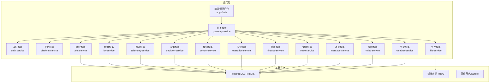
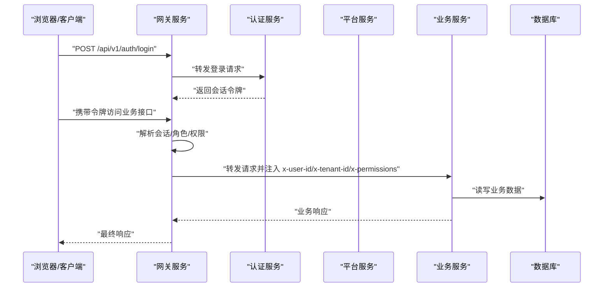
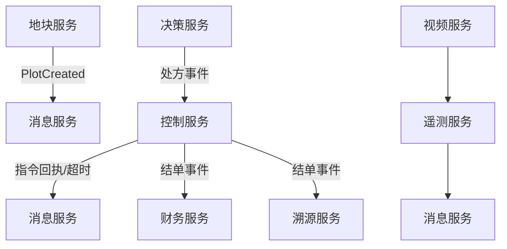

# 平台功能清单

<cite>
**本文引用的文件**   
- [README.md](file://README.md)
- [EXISTING_FEATURES.md](file://EXISTING_FEATURES.md)
- [IMPLEMENTATION_PROGRESS.md](file://IMPLEMENTATION_PROGRESS.md)
- [apps/web/src/views/agro/Index.vue](file://apps/web/src/views/agro/Index.vue)
- [apps/web/src/views/dashboard/Index.vue](file://apps/web/src/views/dashboard/Index.vue)
- [apps/web/src/views/system/User.vue](file://apps/web/src/views/system/User.vue)
- [apps/web/src/views/system/Role.vue](file://apps/web/src/views/system/Role.vue)
</cite>

## 目录
1. [引言](#引言)
2. [项目结构](#项目结构)
3. [核心组件](#核心组件)
4. [架构总览](#架构总览)
5. [详细功能清单](#详细功能清单)
6. [依赖关系分析](#依赖关系分析)
7. [性能与可靠性要点](#性能与可靠性要点)
8. [故障排查指南](#故障排查指南)
9. [结论](#结论)

## 引言
本文件面向“无人农场 AI 平台”的使用者与实施人员，把仓库中已落地的后端微服务、前端页面与跨服务业务链路整理成一份可检索的“平台功能清单”。文档以现有仓库说明与前端页面为事实依据，按系统管理、地块与空间、四情监控、设备与指令、作业与决策、财务与溯源、消息与视频、气象等维度组织，并给出关键业务流程图与参考实现位置。

## 项目结构
平台采用 pnpm workspace + Turborepo 多包工程：
- `packages/`：公共能力包（契约、配置、数据库、消息、观测、地块核心等）。
- `apps/`：15 个 HTTP 微服务 + Vue 管理后台。
- `infra/`：PostgreSQL/PostGIS 迁移、MinIO、Docker Compose 与边缘 nginx。
- `scripts/`：冒烟测试、健康检查、数据初始化与服务启动脚本。

图表来源
- [README.md:161-192](file://README.md#L161-L192)
- [EXISTING_FEATURES.md:7-25](file://EXISTING_FEATURES.md#L7-L25)

章节来源
- [README.md:1-10](file://README.md#L1-L10)
- [README.md:161-192](file://README.md#L161-L192)
- [EXISTING_FEATURES.md:7-25](file://EXISTING_FEATURES.md#L7-L25)

## 核心组件
- 网关：唯一对外入口，负责会话校验、权限判定、路由转发与健康汇总。
- 认证与会话：登录、登出、当前用户、会话；口令使用 scrypt 随机盐。
- 平台基础：租户、用户、角色、权限目录；是权限与租户隔离的数据源头。
- 地块核心：地块建档、边界面积重算、季次、设施线、管理分区、合并/拆分。
- 物联与遥测：设备档案、点位绑定、采集标准化、读数落库、阈值告警、虫情/灾情归档。
- 控制闭环：处方/规则 → 指令计划 → 下发 → 回执 → 超时收口 → 结单事件 → 财务记账。
- 作业与决策：覆盖路径规划、道路导航、任务状态机；规则引擎、处方签发与效果回流。
- 财务与溯源：投入产出明细、报表三维度、生产档案事件归档。
- 消息中心：模板渲染、订阅偏好过滤、主题去重与重试死信。
- 视频与文件：摄像头接入、PTZ、AI 识别转发、对象存储后端可插拔。
- 气象：和风天气同步、预警、逐小时、农事建议、田时。

章节来源
- [EXISTING_FEATURES.md:43-179](file://EXISTING_FEATURES.md#L43-L179)
- [README.md:215-353](file://README.md#L215-L353)

## 架构总览
平台遵循以下横切约定：
- 外部请求只到网关；下游服务不直接对外暴露。
- 身份与租户由网关注入可信头，下游不信任客户端自报。
- 鉴权在网关按「方法+路径→权限」拦截；服务侧守卫作为第二道闸。
- 事件与 Outbox 在同一事务内写入，消费侧按 eventId 幂等。
- 删除统一为软删除（`deleted_at`），历史行保留。
- 地块代码是跨表关联锚点；面积以边界几何现算为准。

图表来源
- [EXISTING_FEATURES.md:26-39](file://EXISTING_FEATURES.md#L26-L39)
- [README.md:336-344](file://README.md#L336-L344)

## 详细功能清单

### 一、系统管理与权限
- 用户管理：创建、编辑、停用/启用、重置密码、分页查询、关键词筛选。
- 角色管理：创建、编辑、启用/停用、分配权限组、关键字搜索。
- 权限目录：8 组 22 码，支持通配；网关与服务侧双重校验。
- 账号与角色分域存储：认证域与平台域分离；口令 scrypt 随机盐；支持内存/SQL 模式。

参考实现
- 用户页面：[apps/web/src/views/system/User.vue](file://apps/web/src/views/system/User.vue)
- 角色页面：[apps/web/src/views/system/Role.vue](file://apps/web/src/views/system/Role.vue)
- 权限与鉴权约定：[README.md:336-344](file://README.md#L336-L344)

章节来源
- [apps/web/src/views/system/User.vue:1-266](file://apps/web/src/views/system/User.vue#L1-L266)
- [apps/web/src/views/system/Role.vue:1-241](file://apps/web/src/views/system/Role.vue#L1-L241)
- [README.md:336-344](file://README.md#L336-L344)

### 二、地块与空间管理
- 地块台账：列表、详情、编辑边界、合并（凸包面积 delta 提示与手工改边界入口）、拆分、季次、设施线、管理分区。
- 地图一张图：天地图底图、图层可视、管线图例、绘制地块/片区/管线、弹窗操作、天气卡片。
- 面积口径：边界几何现算，前后端一致；合并/编辑后面积同步重算，地块代码不变。
- 片区：成员地块聚合、凸包范围、手绘边界、有成员地块不可删除。

参考实现
- 地图主界面与菜单面板：[apps/web/src/views/dashboard/Index.vue](file://apps/web/src/views/dashboard/Index.vue)
- 地块领域约定：[EXISTING_FEATURES.md:67-82](file://EXISTING_FEATURES.md#L67-L82)

章节来源
- [apps/web/src/views/dashboard/Index.vue:1-800](file://apps/web/src/views/dashboard/Index.vue#L1-L800)
- [EXISTING_FEATURES.md:67-82](file://EXISTING_FEATURES.md#L67-L82)

### 三、四情监控（苗情/土壤墒情/虫情/灾情）
- 苗情：最新读数、生育期时间轴、长势历史曲线、阈值规则维护。
- 土壤墒情：分层深度列展示、指标与深度历史曲线。
- 虫情：区域统计、趋势图、识别登记、治理方案与派单。
- 灾情：上报、核查、处置、归档；阈值告警联动。
- 阈值规则：全局默认与地块专属优先级，三级告警方向判定。

参考实现
- 四情页面：[apps/web/src/views/agro/Index.vue](file://apps/web/src/views/agro/Index.vue)
- 遥测服务逻辑：[EXISTING_FEATURES.md:122-131](file://EXISTING_FEATURES.md#L122-L131)

章节来源
- [apps/web/src/views/agro/Index.vue:1-800](file://apps/web/src/views/agro/Index.vue#L1-L800)
- [EXISTING_FEATURES.md:122-131](file://EXISTING_FEATURES.md#L122-L131)

### 四、设备、遥测与控制指令
- 设备与点位：设备档案、Modbus 点表、物模型、农田网关采集标准化。
- 遥测读数：标准化读数落库、阈值越限告警、虫情/灾情统一收口。
- 控制指令：处方/规则翻译为指令计划，下发、回执、超时收口、结单事件、财务记账。
- 现场协议：Modbus TCP 主站实现，线圈/反馈/故障/计量寄存器按剖面定义。

参考实现
- 控制服务闭环：[EXISTING_FEATURES.md:112-121](file://EXISTING_FEATURES.md#L112-L121)
- 物联与遥测：[EXISTING_FEATURES.md:103-131](file://EXISTING_FEATURES.md#L103-L131)

章节来源
- [EXISTING_FEATURES.md:103-131](file://EXISTING_FEATURES.md#L103-L131)

### 五、作业与决策
- 作业任务：覆盖路径规划（弓字形）、道路导航（2-opt + Dijkstra）、任务状态机与变更留痕。
- 决策引擎：规则热加载、处方签发、执行回传、结果归档与阈值建议。

参考实现
- 作业服务：[EXISTING_FEATURES.md:84-92](file://EXISTING_FEATURES.md#L84-L92)
- 决策服务：[EXISTING_FEATURES.md:94-102](file://EXISTING_FEATURES.md#L94-L102)

章节来源
- [EXISTING_FEATURES.md:84-102](file://EXISTING_FEATURES.md#L84-L102)

### 六、财务与溯源
- 财务核算：投入产出明细、报表（月/类别/地块）、利润计算、灌溉/施肥完成事件联动记账。
- 生产溯源：事件归档留痕，追溯码与作业档案关联。

参考实现
- 财务服务：[EXISTING_FEATURES.md:167-175](file://EXISTING_FEATURES.md#L167-L175)
- 溯源服务：[EXISTING_FEATURES.md:176-179](file://EXISTING_FEATURES.md#L176-L179)

章节来源
- [EXISTING_FEATURES.md:167-179](file://EXISTING_FEATURES.md#L167-L179)

### 七、消息中心
- 订阅偏好：租户+主题开关与最低级别门槛。
- 模板渲染：契约包消息模板，新增主题无需初始化数据。
- 去重与重试：分发器重试死信，落库唯一约束兜底。

参考实现
- 消息服务逻辑：[EXISTING_FEATURES.md:142-150](file://EXISTING_FEATURES.md#L142-L150)

章节来源
- [EXISTING_FEATURES.md:142-150](file://EXISTING_FEATURES.md#L142-L150)

### 八、视频与文件
- 视频接入：摄像头流、云台控制、AI 识别转发至遥测统一收口。
- 文件存储：本地/内存/S3 兼容后端，put 拒绝覆盖，元数据管理。

参考实现
- 视频服务：[EXISTING_FEATURES.md:151-158](file://EXISTING_FEATURES.md#L151-L158)
- 文件服务：[EXISTING_FEATURES.md:159-166](file://EXISTING_FEATURES.md#L159-L166)

章节来源
- [EXISTING_FEATURES.md:151-166](file://EXISTING_FEATURES.md#L151-L166)

### 九、气象服务
- 和风天气同步：每日定时拉取、调用上限保护、失败降级。
- 数据接口：五日预报、逐小时、预警、实时气象站、农事建议、历史曲线。
- 决策联动：处方 rainProbabilitySource=weather。

参考实现
- 气象服务逻辑：[EXISTING_FEATURES.md:132-141](file://EXISTING_FEATURES.md#L132-L141)
- 气象约定与运维接口：[README.md:352-353](file://README.md#L352-L353)

章节来源
- [EXISTING_FEATURES.md:132-141](file://EXISTING_FEATURES.md#L132-L141)
- [README.md:352-353](file://README.md#L352-L353)

## 依赖关系分析
- 网关依赖 auth/platform 内部接口解析会话与权限，再按权限目录判断是否放行。
- 控制服务依赖遥测/决策事件生成指令，结单事件驱动财务记账与溯源归档。
- 消息服务依赖契约包的消息模板与主题枚举，消费各服务事件。
- 地块服务发布 PlotCreated 事件，消息中心据此通知。

图表来源
- [EXISTING_FEATURES.md:199-205](file://EXISTING_FEATURES.md#L199-L205)
- [README.md:254-300](file://README.md#L254-L300)

章节来源
- [EXISTING_FEATURES.md:199-205](file://EXISTING_FEATURES.md#L199-L205)
- [README.md:254-300](file://README.md#L254-L300)

## 性能与可靠性要点
- 事件可靠投递：业务数据与待投递事件写同一事务，Outbox 中继投递，消费侧幂等。
- 指令回执与超时收口：在途指令定时扫描，合法跃迁置 FAILED，并发回执与收口竞争 version，先到先得。
- 面积与几何计算：前后端面积算法一致，避免台账漂移。
- 软删除与审计：删除即归档，变更追加式留痕，历史可查。
- 权限双闸：网关拦截 + 服务侧守卫，内部接口用 token 保护。

章节来源
- [README.md:254-300](file://README.md#L254-L300)
- [README.md:336-344](file://README.md#L336-L344)

## 故障排查指南
- 网关 401/403：检查会话是否有效、权限目录是否匹配、服务侧守卫是否开启。
- 指令未回执：查看 control_outbox 与 event_log，确认超时收口是否触发，核对设备回调 token 与路径前缀。
- 面积异常：检查边界几何是否闭合、是否走 polygonAreaMu 现算、合并预览是否通过。
- 消息未送达：检查消息模板是否注册、订阅偏好是否关闭、主题是否去重。
- 气象数据不可用：检查 QWEATHER_KEY、sync-status、dailyCallLimit 与 lastRefreshedAt。

章节来源
- [README.md:336-353](file://README.md#L336-L353)
- [EXISTING_FEATURES.md:26-39](file://EXISTING_FEATURES.md#L26-L39)

## 结论
该仓库已落地一套以地块为核心、覆盖感知—决策—执行—核算—溯源—消息的无人农场平台骨架。前端以“一张图”串联地块、管线、片区与业务面板；后端以网关为唯一入口，通过事件与 Outbox 打通跨服务链路。扩展新服务时，应遵循现有权限、事件、软删除与面积口径等横切约定，优先复用公共包与契约类型，确保构建链与冒烟用例可回归。