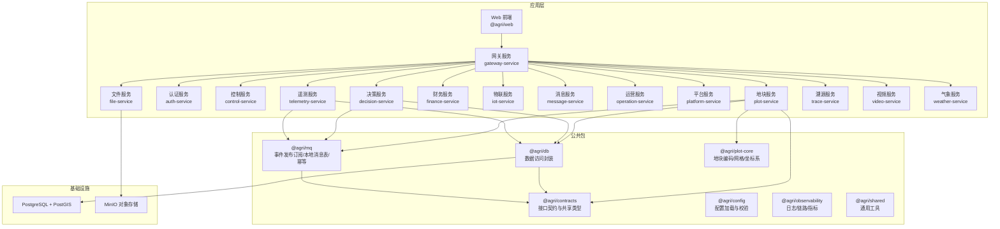
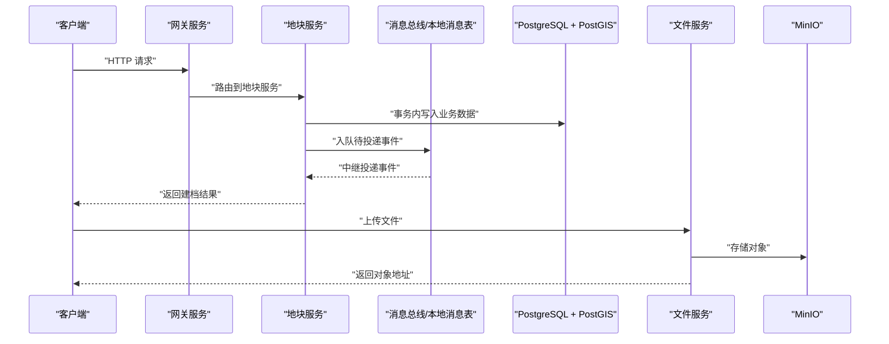
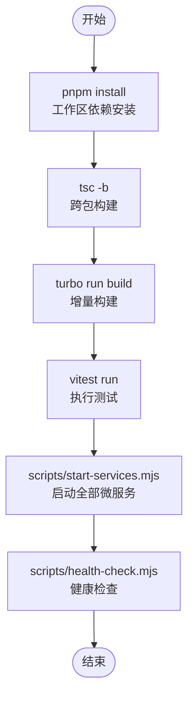
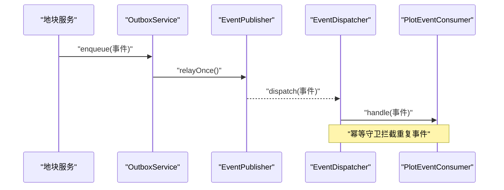
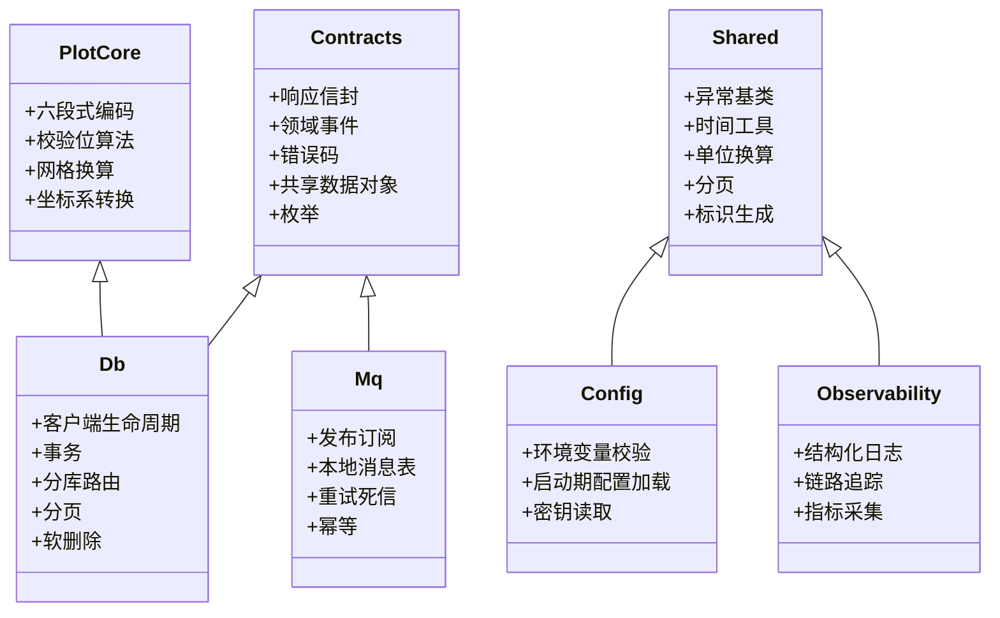
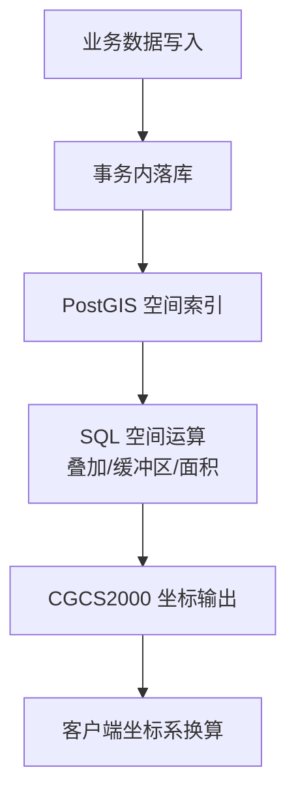
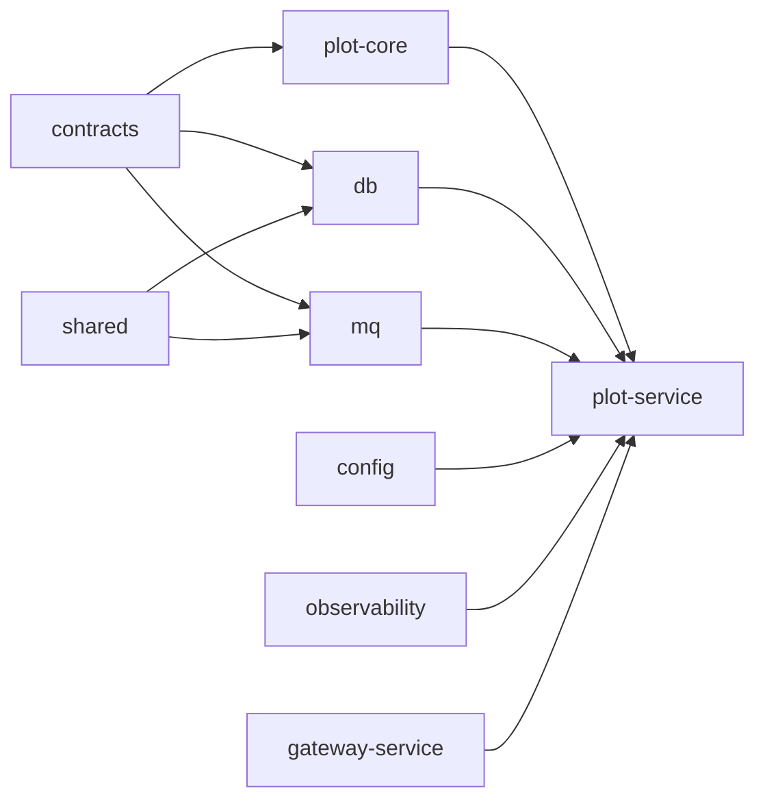

# 技术架构概览

<cite>
**本文引用的文件**   
- [README.md](file://README.md)
- [package.json](file://package.json)
- [turbo.json](file://turbo.json)
- [pnpm-workspace.yaml](file://pnpm-workspace.yaml)
- [apps/web/package.json](file://apps/web/package.json)
- [infra/docker-compose.yml](file://infra/docker-compose.yml)
- [apps/plot-service/src/main.ts](file://apps/plot-service/src/main.ts)
- [apps/gateway-service/src/main.ts](file://apps/gateway-service/src/main.ts)
- [packages/db/package.json](file://packages/db/package.json)
- [packages/mq/package.json](file://packages/mq/package.json)
- [packages/contracts/package.json](file://packages/contracts/package.json)
</cite>

## 目录
1. [引言](#引言)
2. [项目结构](#项目结构)
3. [核心组件](#核心组件)
4. [架构总览](#架构总览)
5. [详细组件分析](#详细组件分析)
6. [依赖关系分析](#依赖关系分析)
7. [性能与工程化特性](#性能与工程化特性)
8. [故障排查指南](#故障排查指南)
9. [结论](#结论)

## 引言
本仓库是“以地块为最小管理单元”的智慧农业平台 Node.js 工程脚手架，包含公共包、15 个 HTTP 微服务以及 Vue 管理后台。运行时采用 Node.js 24 LTS，后端框架为 NestJS 11 + TypeScript 5.9；前端使用 Vue 3 + Element Plus + Leaflet + ECharts；工程化基于 pnpm workspace + Turborepo + tsc -b 构建链，并通过 Vitest 完成测试。整体目标是提供可编译、可运行、可测试的现代化微服务骨架，同时沉淀公共能力与规范。

**章节来源**
- [README.md:1-10](file://README.md#L1-L10)

## 项目结构
仓库采用多包工作区组织：
- apps：业务微服务与前端应用，每个微服务独立入口与模块装配。
- packages：@agri/* 命名空间下的公共包，包括契约、数据库封装、消息总线、配置、可观测性、领域核心等。
- infra：基础设施编排（PostgreSQL + PostGIS、MinIO）。
- scripts：运维脚本（健康检查、初始化 MinIO、迁移、启动服务等）。

**图表来源**
- [README.md:58-84](file://README.md#L58-L84)
- [apps/plot-service/src/main.ts:11-31](file://apps/plot-service/src/main.ts#L11-L31)
- [apps/gateway-service/src/main.ts:1-15](file://apps/gateway-service/src/main.ts#L1-L15)
- [infra/docker-compose.yml:1-39](file://infra/docker-compose.yml#L1-L39)

**章节来源**
- [README.md:58-84](file://README.md#L58-L84)

## 核心组件
- 后端运行时与框架
  - Node.js 24 LTS：长期稳定版本，配合现代 ES 模块与性能优化。
  - NestJS 11 + TypeScript 5.9：模块化、装饰器驱动的微服务开发体验，类型安全与生态成熟。
- 前端技术栈
  - Vue 3 + Vite：组合式 API、单文件组件、快速热更新。
  - Element Plus：企业级 UI 组件库。
  - Leaflet：轻量地图渲染与交互。
  - ECharts：丰富的可视化图表能力。
- 工程化方案
  - pnpm workspace：统一依赖管理与工作区引用。
  - Turborepo：任务编排与增量构建。
  - tsc -b：跨包 TypeScript 构建与类型检查。
  - Vitest：统一的测试运行器。
- 数据存储
  - PostgreSQL + PostGIS：关系型数据与空间数据一体化，支持复杂地理查询。
  - MinIO：对象存储，承载文件与媒体资源。

**章节来源**
- [README.md:1-10](file://README.md#L1-L10)
- [apps/web/package.json:12-24](file://apps/web/package.json#L12-L24)
- [package.json:14-28](file://package.json#L14-L28)
- [infra/docker-compose.yml:1-39](file://infra/docker-compose.yml#L1-L39)

## 架构总览
系统采用“网关 + 微服务 + 公共包 + 基础设施”的分层架构：
- 网关服务作为统一入口，转发请求到各业务微服务。
- 业务微服务通过 @nestjs/platform-fastify 暴露 HTTP 接口，内部按领域划分职责。
- 公共包沉淀跨服务的通用能力与契约，避免重复实现。
- 基础设施由 Docker Compose 编排，提供数据库与对象存储服务。

**图表来源**
- [apps/gateway-service/src/main.ts:1-15](file://apps/gateway-service/src/main.ts#L1-L15)
- [apps/plot-service/src/main.ts:115-152](file://apps/plot-service/src/main.ts#L115-L152)
- [infra/docker-compose.yml:1-39](file://infra/docker-compose.yml#L1-L39)

## 详细组件分析

### 后端技术栈选型与优势
- Node.js 24 LTS：提供长期支持、性能提升与更现代的运行时能力，适合大规模微服务部署。
- NestJS 11：模块化容器、装饰器元数据、依赖注入与拦截器等机制，便于构建高内聚低耦合的服务。
- TypeScript 5.9：强类型约束、更好的 IDE 支持与重构能力，保障大型工程的代码质量。

**章节来源**
- [README.md:7-10](file://README.md#L7-L10)

### 前端技术组合
- Vue 3 + Vite：组合式 API 与极快的开发体验，适合复杂管理后台。
- Element Plus：丰富的表单、表格、弹窗等组件，加速页面开发。
- Leaflet：轻量地图引擎，用于地块边界、网格与坐标展示。
- ECharts：多维数据可视化，支撑仪表盘与趋势分析。

**章节来源**
- [apps/web/package.json:12-24](file://apps/web/package.json#L12-L24)

### 工程化方案：pnpm workspace + Turborepo
- pnpm workspace：集中管理依赖与工作区包，避免重复安装，提升安装与构建效率。
- Turborepo：任务编排与缓存，仅构建受影响子工程，缩短 CI/CD 时间。
- tsc -b：跨包构建与类型检查，保证公共包与服务间类型一致性。
- 脚本体系：build、test、start:services、health:services、init:minio、db:migrate 等命令覆盖全生命周期。

**图表来源**
- [package.json:14-28](file://package.json#L14-L28)
- [turbo.json:1-15](file://turbo.json#L1-L15)
- [pnpm-workspace.yaml:1-14](file://pnpm-workspace.yaml#L1-L14)

**章节来源**
- [package.json:14-28](file://package.json#L14-L28)
- [turbo.json:1-15](file://turbo.json#L1-L15)
- [pnpm-workspace.yaml:1-14](file://pnpm-workspace.yaml#L1-L14)

### 微服务架构设计与通信机制
- 15 个独立微服务：网关、认证、控制、决策、文件、财务、物联、消息、运营、平台、地块、遥测、溯源、视频、气象。
- 通信机制：
  - HTTP：网关与各微服务之间通过 HTTP 接口通信。
  - 事件驱动：本地消息表 + 事件总线，确保“不丢不重”，消费侧幂等去重，重试指数退避，失败转死信。
- 示例链路：地块建档 → 事务内写本地消息表 → 中继投递 → 消费处理 → 重复投递被幂等拦下。

**图表来源**
- [apps/plot-service/src/main.ts:115-152](file://apps/plot-service/src/main.ts#L115-L152)

**章节来源**
- [README.md:105-118](file://README.md#L105-L118)
- [apps/plot-service/src/main.ts:115-152](file://apps/plot-service/src/main.ts#L115-L152)

### 公共包体系与 @agri/* 命名空间
- @agri/contracts：接口契约与共享类型，仅依赖 zod，不依赖能力包，便于前后端共用。
- @agri/db：数据访问封装，提供客户端生命周期、事务、分库路由、分页与软删除。
- @agri/mq：消息与事件总线封装，提供发布订阅、本地消息表、重试死信与幂等。
- @agri/config：配置加载与校验，环境变量校验结构与密钥读取。
- @agri/observability：结构化日志、链路追踪、指标采集与运行期采集器。
- @agri/plot-core：地块领域模型与编码规则，六段式编码、校验位算法、网格换算、坐标系转换。
- @agri/shared：通用工具与常量，异常基类、时间、单位换算、分页、标识生成。
- @agri/testing：测试工具与夹具，测试数据库、内存事件总线、可控时钟、模块构造器。

**图表来源**
- [packages/contracts/package.json:1-42](file://packages/contracts/package.json#L1-L42)
- [packages/db/package.json:1-28](file://packages/db/package.json#L1-L28)
- [packages/mq/package.json:1-28](file://packages/mq/package.json#L1-L28)
- [README.md:86-103](file://README.md#L86-L103)

**章节来源**
- [README.md:86-103](file://README.md#L86-L103)
- [packages/contracts/package.json:1-42](file://packages/contracts/package.json#L1-L42)
- [packages/db/package.json:1-28](file://packages/db/package.json#L1-L28)
- [packages/mq/package.json:1-28](file://packages/mq/package.json#L1-L28)

### 空间数据存储方案：PostgreSQL + PostGIS
- 空间运算下沉数据库：叠加、缓冲区、面积计算在 PostGIS 中以 SQL 完成，坐标统一 CGCS2000（EPSG:4490），仅在出参方向换算为其他坐标系。
- 地块编码是数据关联锚点：六段式编码贯穿业务，所有空间数据与编码绑定，便于索引与检索。
- 时序数据不在 @agri/db 范围内：由物联感知服务直连时序库，缓存由各服务自行使用缓存中间件。

**图表来源**
- [README.md:112-118](file://README.md#L112-L118)
- [infra/docker-compose.yml:1-18](file://infra/docker-compose.yml#L1-L18)

**章节来源**
- [README.md:112-118](file://README.md#L112-L118)
- [infra/docker-compose.yml:1-18](file://infra/docker-compose.yml#L1-L18)

### 对象存储：MinIO 的使用场景
- 文件服务通过 S3 兼容接口将文件与媒体资源上传至 MinIO。
- 提供控制台端口与管理员账号，便于运维与调试。
- 健康检查与卷挂载确保数据持久化。

**章节来源**
- [infra/docker-compose.yml:19-39](file://infra/docker-compose.yml#L19-L39)

## 依赖关系分析
- 公共包依赖方向：
  - contracts 仅依赖 zod，无能力包依赖，保持契约纯净。
  - db 与 mq 依赖 contracts 与 shared，提供能力封装。
  - plot-core 依赖 contracts 与 shared，专注领域模型。
- 服务依赖：
  - 示例服务 plot-service 依赖 config、contracts、db、mq、observability、plot-core、shared。
  - gateway-service 作为网关，转发请求到各业务服务。

**图表来源**
- [packages/contracts/package.json:1-42](file://packages/contracts/package.json#L1-L42)
- [packages/db/package.json:1-28](file://packages/db/package.json#L1-L28)
- [packages/mq/package.json:1-28](file://packages/mq/package.json#L1-L28)
- [apps/plot-service/src/main.ts:11-31](file://apps/plot-service/src/main.ts#L11-L31)
- [apps/gateway-service/src/main.ts:1-15](file://apps/gateway-service/src/main.ts#L1-L15)

**章节来源**
- [packages/contracts/package.json:1-42](file://packages/contracts/package.json#L1-L42)
- [packages/db/package.json:1-28](file://packages/db/package.json#L1-L28)
- [packages/mq/package.json:1-28](file://packages/mq/package.json#L1-L28)
- [apps/plot-service/src/main.ts:11-31](file://apps/plot-service/src/main.ts#L11-L31)
- [apps/gateway-service/src/main.ts:1-15](file://apps/gateway-service/src/main.ts#L1-L15)

## 性能与工程化特性
- 构建性能：
  - tsc -b 按工程引用顺序构建，避免重复编译。
  - Turborepo 增量构建，仅构建受影响子工程。
- 依赖管理：
  - pnpm workspace 白名单允许 esbuild 等构建脚本执行，避免安装失败。
- 测试与验证：
  - Vitest 统一测试运行器，覆盖编码、事务、消息表、幂等、分页等关键路径。
  - 健康检查脚本验证全部 HTTP 服务状态。

**章节来源**
- [package.json:14-28](file://package.json#L14-L28)
- [turbo.json:1-15](file://turbo.json#L1-L15)
- [pnpm-workspace.yaml:5-14](file://pnpm-workspace.yaml#L5-L14)
- [README.md:120-145](file://README.md#L120-L145)

## 故障排查指南
- 安装阶段报错 ERR_PNPM_IGNORED_BUILDS：
  - 检查 pnpm-workspace.yaml 中 allowBuilds 是否放行 esbuild、vue-demi、element-plus 等依赖。
- 服务启动失败：
  - 确认环境变量 SERVICE_MODE、PORT、DB_URL、MQ_BROKERS 等配置正确。
  - 检查 PostgreSQL 与 MinIO 健康状态。
- 事件未消费或重复消费：
  - 确认 OutboxService 中继逻辑与 EventDispatcher 幂等守卫生效。
  - 查看消费者 handledEventIds 与发布者 published 计数。

**章节来源**
- [pnpm-workspace.yaml:5-14](file://pnpm-workspace.yaml#L5-L14)
- [apps/plot-service/src/main.ts:48-113](file://apps/plot-service/src/main.ts#L48-L113)
- [infra/docker-compose.yml:13-34](file://infra/docker-compose.yml#L13-L34)

## 结论
该工程脚手架以 Node.js 24 LTS + NestJS 11 + TypeScript 5.9 构建高性能后端，结合 Vue 3 + Element Plus + Leaflet + ECharts 打造现代化前端；通过 pnpm workspace + Turborepo + tsc -b 实现高效工程化；以 15 个微服务划分职责，借助本地消息表与事件总线实现可靠通信；依托 PostgreSQL + PostGIS 与 MinIO 提供强大的空间数据与对象存储能力。整体架构清晰、扩展性强，适合作为智慧农业平台的工程起点。