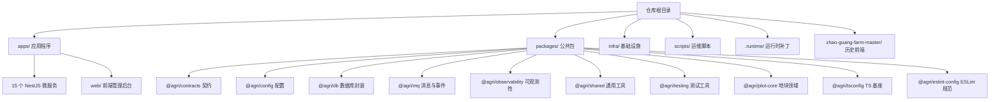
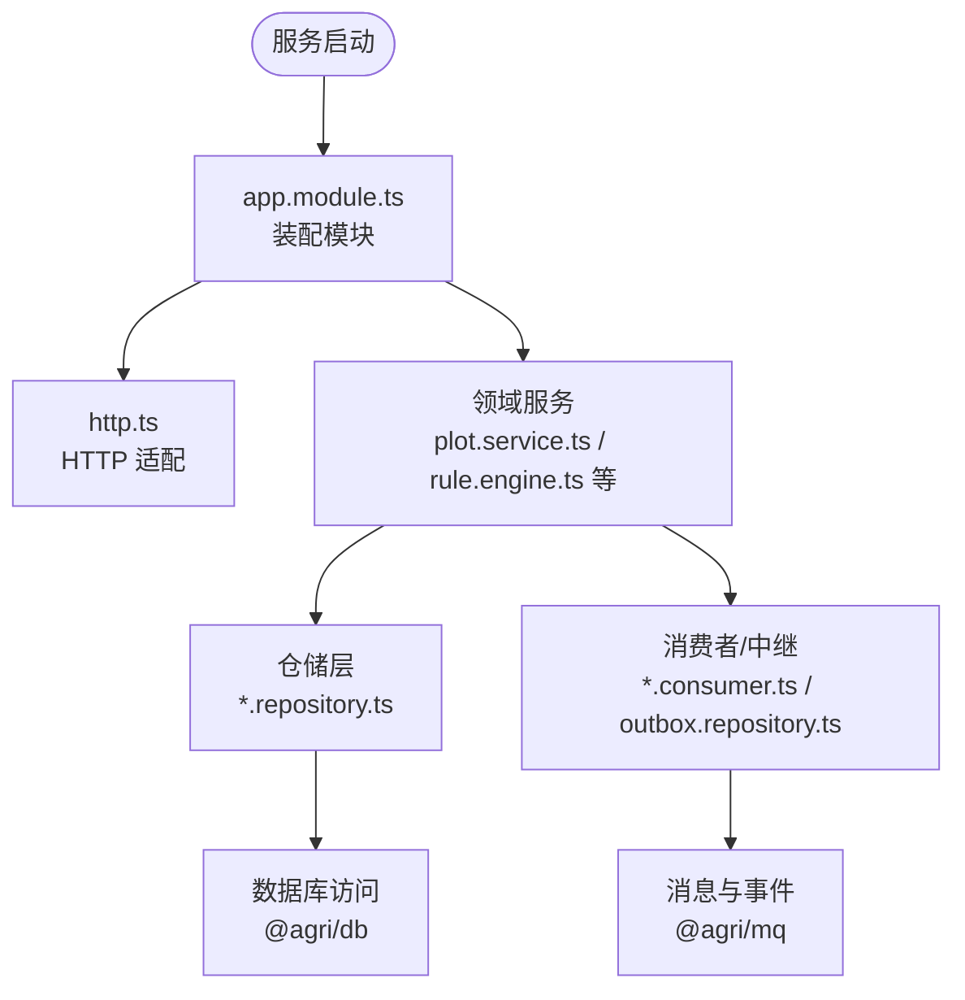
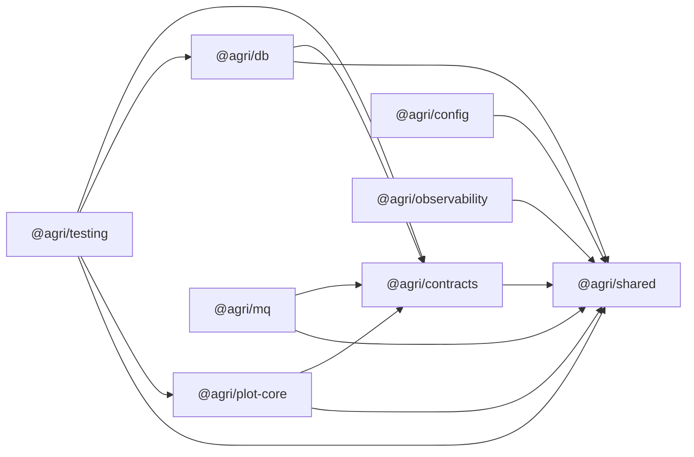
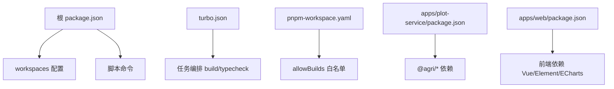
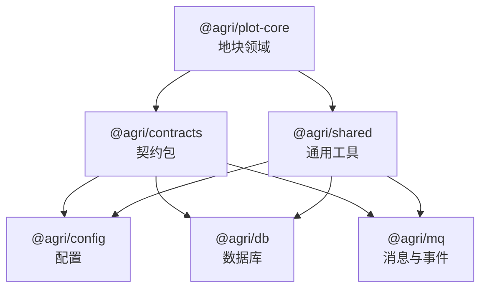
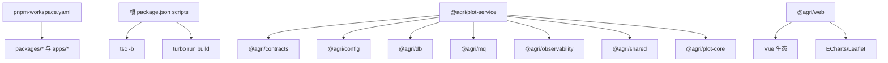

# 目录结构说明

<cite>
**本文引用的文件**   
- [README.md](file://README.md)
- [package.json](file://package.json)
- [turbo.json](file://turbo.json)
- [pnpm-workspace.yaml](file://pnpm-workspace.yaml)
- [apps/plot-service/package.json](file://apps/plot-service/package.json)
- [apps/web/package.json](file://apps/web/package.json)
- [packages/config/package.json](file://packages/config/package.json)
- [packages/contracts/package.json](file://packages/contracts/package.json)
- [packages/db/package.json](file://packages/db/package.json)
- [packages/mq/package.json](file://packages/mq/package.json)
- [packages/observability/package.json](file://packages/observability/package.json)
- [packages/shared/package.json](file://packages/shared/package.json)
- [packages/testing/package.json](file://packages/testing/package.json)
- [packages/plot-core/package.json](file://packages/plot-core/package.json)
</cite>

## 目录
1. [引言](#引言)
2. [项目结构总览](#项目结构总览)
3. [核心目录职责](#核心目录职责)
4. [微服务标准目录结构](#微服务标准目录结构)
5. [公共包组织与命名规范](#公共包组织与命名规范)
6. [关键配置文件说明](#关键配置文件说明)
7. [代码组织最佳实践与命名约定](#代码组织最佳实践与命名约定)
8. [依赖关系分析](#依赖关系分析)
9. [性能与构建特性](#性能与构建特性)
10. [故障排查指南](#故障排查指南)
11. [结论](#结论)

## 引言
本仓库是“智慧农业平台”的 Node.js 工程骨架，以地块为最小管理单元，提供可编译、可运行、可测试的后端能力。仓库采用 pnpm workspace + Turborepo + TypeScript 工程引用（tsc -b）的组织方式，包含：
- 15 个 NestJS HTTP 微服务
- 一个 Vue 前端管理后台
- 一组可复用的公共包
- 基础设施配置与运维脚本

该文档聚焦于目录结构与代码组织，帮助开发者快速理解根目录下各文件夹的职责、微服务的标准结构、公共包的职责与命名规范，以及关键配置文件的作用。

**章节来源**
- [README.md:1-10](file://README.md#L1-L10)

## 项目结构总览
仓库采用多包工作区模式，根目录下的主要目录职责如下：
- apps：所有应用程序，包括 15 个微服务与前端应用
- packages：可复用的公共包，如契约、配置、数据库封装、消息队列、可观测性、测试工具等
- infra：基础设施配置，如 PostgreSQL 迁移与 Docker Compose
- scripts：运维脚本，用于健康检查、服务启动、数据迁移、MinIO 初始化等
- .runtime：运行时补丁与冒烟脚本（非源码）
- zhao-guang-farm-master：历史前端工程（独立仓库，不在当前构建链中）

**图表来源**
- [README.md:58-84](file://README.md#L58-L84)

**章节来源**
- [README.md:58-84](file://README.md#L58-L84)

## 核心目录职责
- apps：承载业务实现，每个子目录是一个独立的 NestJS 服务或前端应用；示例服务 plot-service 展示了装配与消费链路。
- packages：沉淀跨服务共享能力，遵循“契约包与能力包分离”的原则，避免循环依赖。
- infra：定义数据库迁移与容器编排，便于本地与 CI 环境一致化。
- scripts：统一运维入口，封装健康检查、服务启动、数据迁移、MinIO 初始化等任务。
- .runtime：运行时补丁与冒烟脚本，辅助部署与验证。
- zhao-guang-farm-master：历史前端工程，独立维护，不纳入当前构建链。

**章节来源**
- [README.md:86-103](file://README.md#L86-L103)

## 微服务标准目录结构
每个 NestJS 微服务通常具备以下结构：
- src/app.module.ts：Nest 模块装配入口
- src/main.ts：进程启动入口
- src/http.ts：HTTP 适配器相关配置
- src/index.ts：服务导出入口（可选）
- test/：单元测试与集成测试
- nest-cli.json：Nest CLI 配置
- package.json：服务依赖与脚本
- tsconfig.json / tsconfig.build.json：TypeScript 编译配置

部分服务还包含领域仓储、消费者、工厂等扩展文件，例如：
- decision-service：rule.engine.ts、rule.repository.ts、outbox.repository.ts、prescription.repository.ts
- file-service：storage.ts
- finance-service：repository.ts
- plot-service：plot.service.ts、plot.repository.ts、plot.consumer.ts、plot-code.service.ts、prisma.factory.ts
- telemetry-service：reading.repository.ts、outbox.repository.ts
- trace-service：repository.ts

这些文件体现了“仓储层 + 服务层 + 消费者/中继”的分层组织方式，便于事务边界与事件投递控制。

**图表来源**
- [apps/plot-service/package.json:1-34](file://apps/plot-service/package.json#L1-L34)

**章节来源**
- [apps/plot-service/package.json:1-34](file://apps/plot-service/package.json#L1-L34)

## 公共包组织与命名规范
公共包统一使用 @agri/* 命名空间，职责清晰、依赖方向明确：
- @agri/contracts：接口契约与共享类型（响应信封、事件、错误码、DTO、枚举），仅依赖 zod，便于前端复用
- @agri/shared：通用工具与常量（异常、时间、单位换算、分页、标识生成）
- @agri/plot-core：地块领域模型与编码规则（六段式编码、校验位、网格换算、坐标系转换）
- @agri/config：配置加载与校验（环境变量校验结构、启动期配置加载、密钥读取）
- @agri/observability：结构化日志、链路追踪、指标采集与运行期采集器
- @agri/db：数据访问封装（客户端生命周期、事务、分库路由、分页与软删除）
- @agri/mq：消息与事件总线（发布订阅、本地消息表、重试死信与幂等）
- @agri/testing：测试工具与夹具（测试数据库、内存事件总线、可控时钟、模块构造器）
- @agri/tsconfig：TypeScript 编译配置基座
- @agri/eslint-config：代码规范与架构约束（依赖方向校验）

包之间禁止循环引用，契约包只依赖 zod，能力包之间通过单向依赖组合。

**图表来源**
- [packages/contracts/package.json:1-42](file://packages/contracts/package.json#L1-L42)
- [packages/shared/package.json:1-23](file://packages/shared/package.json#L1-L23)
- [packages/plot-core/package.json:1-27](file://packages/plot-core/package.json#L1-L27)
- [packages/config/package.json:1-28](file://packages/config/package.json#L1-L28)
- [packages/observability/package.json:1-27](file://packages/observability/package.json#L1-L27)
- [packages/db/package.json:1-28](file://packages/db/package.json#L1-L28)
- [packages/mq/package.json:1-28](file://packages/mq/package.json#L1-L28)
- [packages/testing/package.json:1-31](file://packages/testing/package.json#L1-L31)

**章节来源**
- [README.md:86-103](file://README.md#L86-L103)
- [packages/contracts/package.json:1-42](file://packages/contracts/package.json#L1-L42)
- [packages/shared/package.json:1-23](file://packages/shared/package.json#L1-L23)
- [packages/plot-core/package.json:1-27](file://packages/plot-core/package.json#L1-L27)
- [packages/config/package.json:1-28](file://packages/config/package.json#L1-L28)
- [packages/observability/package.json:1-27](file://packages/observability/package.json#L1-L27)
- [packages/db/package.json:1-28](file://packages/db/package.json#L1-L28)
- [packages/mq/package.json:1-28](file://packages/mq/package.json#L1-L28)
- [packages/testing/package.json:1-31](file://packages/testing/package.json#L1-L31)

## 关键配置文件说明
- 根 package.json：定义工作区、脚本命令（build、test、start:services、health:services、db:migrate 等）、开发依赖与运行时依赖
- turbo.json：Turborepo 任务编排，定义 build 与 typecheck 任务的依赖顺序与输出缓存
- pnpm-workspace.yaml：声明工作区包路径，并白名单允许 esbuild 等构建脚本执行
- tsconfig.json：根工程引用清单与编译入口（由 README 说明）
- vitest.config.ts：测试配置，支持 @agri/* 直连源码与装饰器语义（由 README 说明）
- 各包 package.json：声明 main/types/exports、构建脚本与依赖关系（如 @agri/config、@agri/contracts、@agri/db、@agri/mq、@agri/observability、@agri/shared、@agri/testing、@agri/plot-core）
- 应用 package.json：
  - apps/plot-service/package.json：示例服务依赖与脚本（build/dev/start/test）
  - apps/web/package.json：前端脚本（dev/build/preview/lint）与依赖（Vue、Element Plus、ECharts、Leaflet 等）

**图表来源**
- [package.json:1-46](file://package.json#L1-L46)
- [turbo.json:1-15](file://turbo.json#L1-L15)
- [pnpm-workspace.yaml:1-14](file://pnpm-workspace.yaml#L1-L14)
- [apps/plot-service/package.json:1-34](file://apps/plot-service/package.json#L1-L34)
- [apps/web/package.json:1-37](file://apps/web/package.json#L1-L37)

**章节来源**
- [package.json:1-46](file://package.json#L1-L46)
- [turbo.json:1-15](file://turbo.json#L1-L15)
- [pnpm-workspace.yaml:1-14](file://pnpm-workspace.yaml#L1-L14)
- [apps/plot-service/package.json:1-34](file://apps/plot-service/package.json#L1-L34)
- [apps/web/package.json:1-37](file://apps/web/package.json#L1-L37)

## 代码组织最佳实践与命名约定
- 包入口约定：每个包的 src/index.ts 是唯一对外入口，包内其他文件不构成公开契约
- 契约与能力分离：@agri/contracts 仅依赖 zod，不依赖任何能力包；能力包之间禁止循环引用
- 领域编码规范：地块编码为六段式，业务代码不得自行拼接，统一走 @agri/plot-core
- 空间运算下沉数据库：坐标统一 CGCS2000（EPSG:4490），叠加、缓冲区、面积在 PostGIS 完成
- 事件可靠性：业务数据与待投递事件写入同一事务（本地消息表），消费侧用 eventId 幂等去重，重试指数退避，超出次数转死信
- 软删除与分页：统一 deletedAt 字段；分页每页上限 200，排序字段必须命中服务端白名单
- 错误码分段：域缩写-分类码-序号，含义一经发布不得修改
- 时序数据与缓存：时序数据由物联感知服务直连时序库；缓存由各服务自行使用缓存中间件

**图表来源**
- [README.md:105-118](file://README.md#L105-L118)

**章节来源**
- [README.md:84-84](file://README.md#L84-L84)
- [README.md:105-118](file://README.md#L105-L118)

## 依赖关系分析
- 工作区范围：packages/* 与 apps/* 被纳入 pnpm workspace
- 构建链：根 package.json 的 scripts 调用 tsc -b 与 turbo run build；turbo.json 定义任务依赖与输出缓存
- 服务依赖：示例服务 @agri/plot-service 依赖多个 @agri/* 公共包，体现“契约 + 能力”的组合装配
- 前端依赖：@agri/web 使用 Vue 生态与可视化库，独立构建与预览

**图表来源**
- [pnpm-workspace.yaml:1-14](file://pnpm-workspace.yaml#L1-L14)
- [package.json:14-29](file://package.json#L14-L29)
- [turbo.json:1-15](file://turbo.json#L1-L15)
- [apps/plot-service/package.json:14-25](file://apps/plot-service/package.json#L14-L25)
- [apps/web/package.json:12-35](file://apps/web/package.json#L12-L35)

**章节来源**
- [pnpm-workspace.yaml:1-14](file://pnpm-workspace.yaml#L1-L14)
- [package.json:14-29](file://package.json#L14-L29)
- [turbo.json:1-15](file://turbo.json#L1-L15)
- [apps/plot-service/package.json:14-25](file://apps/plot-service/package.json#L14-L25)
- [apps/web/package.json:12-35](file://apps/web/package.json#L12-L35)

## 性能与构建特性
- 增量构建：tsc -b 按工程引用顺序编译，配合 turbo 的任务缓存提升构建速度
- 测试优化：vitest 支持监听模式与源码直连，减少打包开销
- 构建产物清理：scripts/clean.mjs 与 tsc -b --clean 协同清理 dist 与增量信息
- 前端构建：vue-tsc -b 与 vite build 组合，保证类型检查与生产构建质量

**章节来源**
- [README.md:12-53](file://README.md#L12-L53)
- [package.json:14-29](file://package.json#L14-L29)

## 故障排查指南
- 安装失败（ERR_PNPM_IGNORED_BUILDS）：检查 pnpm-workspace.yaml 的 allowBuilds 是否放行 esbuild 等构建脚本
- 服务健康检查：使用 health:services 脚本检查全部 HTTP 服务健康端点
- 基础设施检查：使用 health:infra 脚本检查 PostgreSQL 与 MinIO
- 数据库迁移：使用 db:migrate 脚本执行 PostgreSQL 初始化迁移
- 前端开发：使用 pnpm --filter @agri/web dev 启动前端开发服务器

**章节来源**
- [README.md:55-56](file://README.md#L55-L56)
- [README.md:37-53](file://README.md#L37-L53)

## 结论
本仓库通过清晰的目录划分与公共包抽象，将 15 个微服务与前端应用组织在一个可构建、可测试、可扩展的工程骨架中。开发者应遵循契约与能力分离、事件可靠性、软删除与分页等约定，借助 scripts 与 Turborepo 提升开发与交付效率。新增服务时，建议复制示例服务结构并在根 tsconfig.json 增加工程引用，按需装配配置、数据库与消息能力。