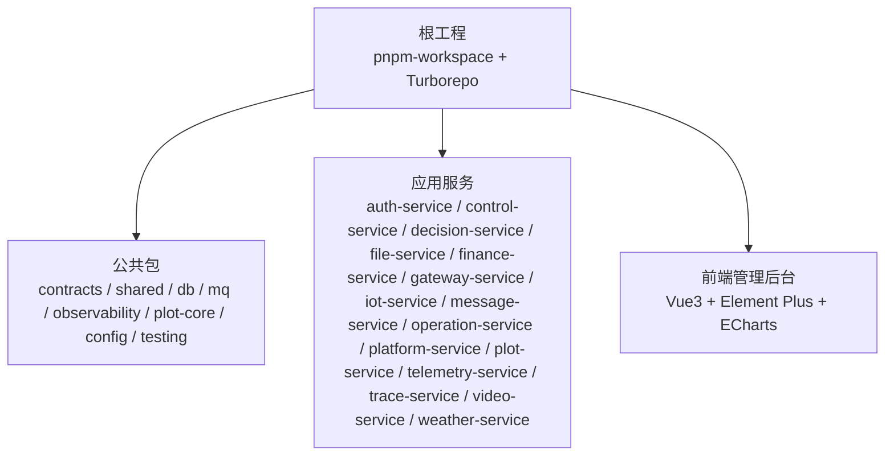
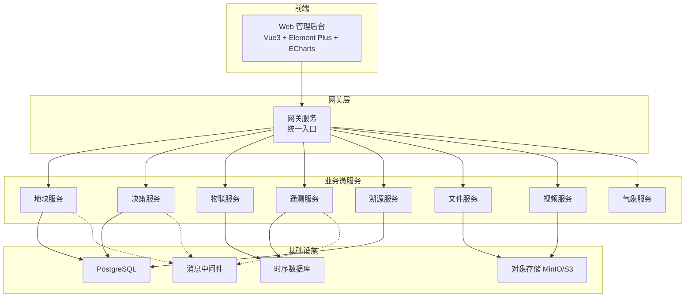
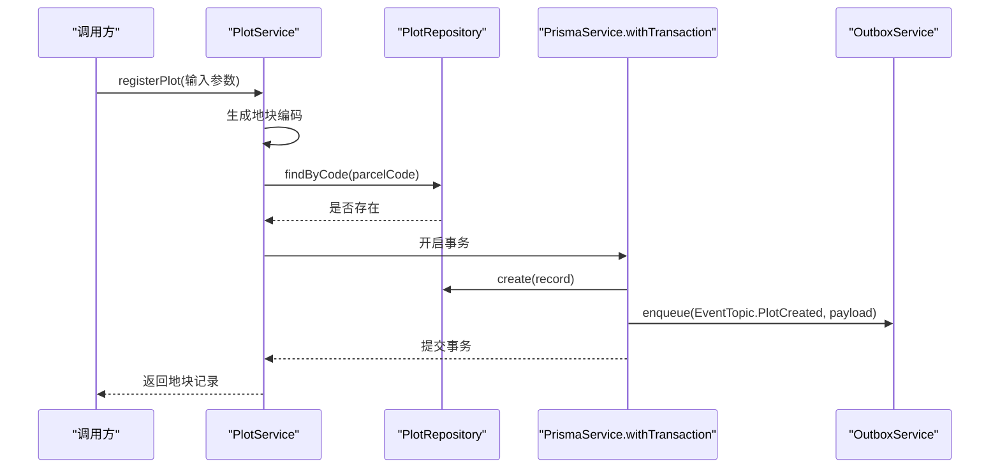
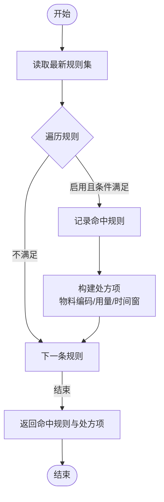
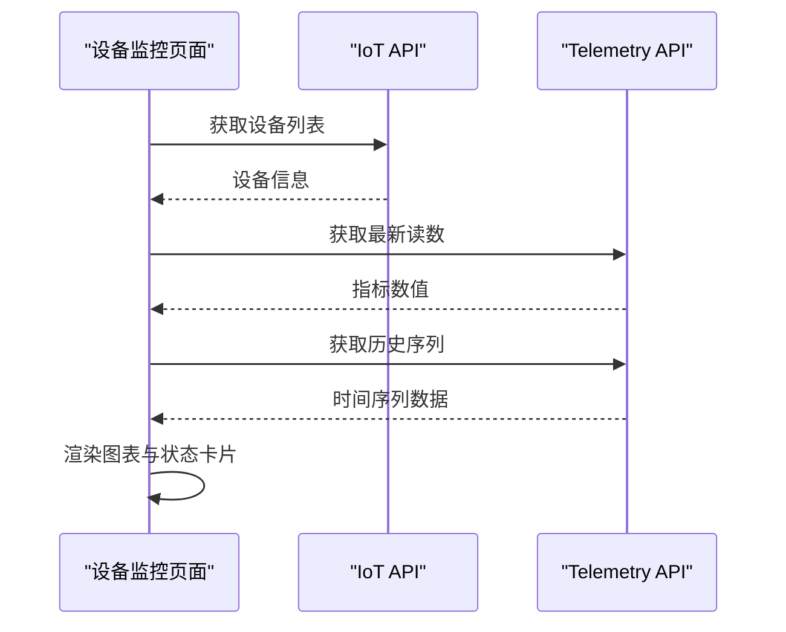
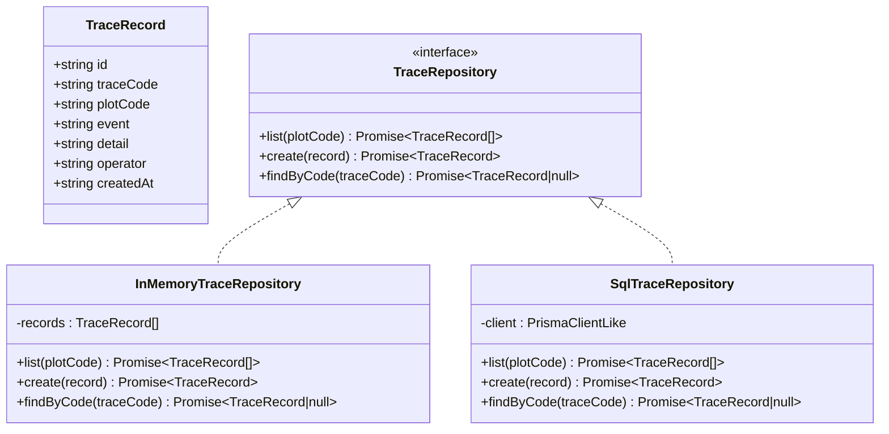
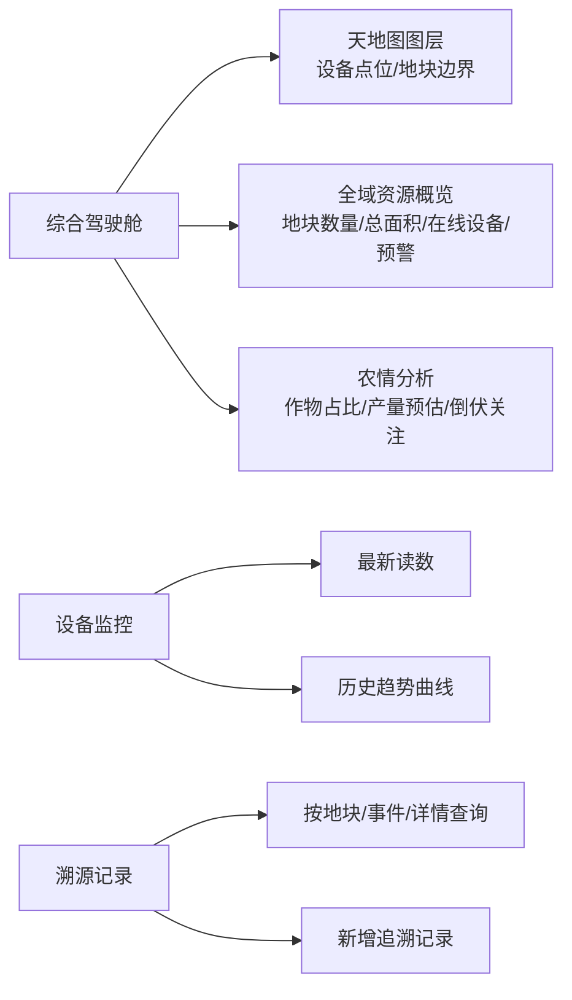
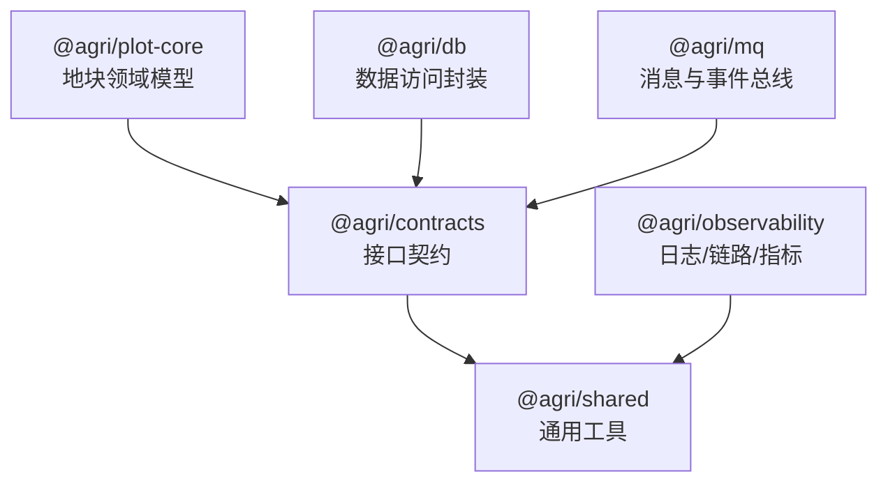

# 项目介绍与目标

<cite>
**本文引用的文件**   
- [README.md](file://README.md)
- [package.json](file://package.json)
- [apps/plot-service/src/plot.service.ts](file://apps/plot-service/src/plot.service.ts)
- [apps/decision-service/src/rule.engine.ts](file://apps/decision-service/src/rule.engine.ts)
- [apps/iot-service/src/main.ts](file://apps/iot-service/src/main.ts)
- [apps/trace-service/src/repository.ts](file://apps/trace-service/src/repository.ts)
- [apps/web/src/views/dashboard/Index.vue](file://apps/web/src/views/dashboard/Index.vue)
- [apps/web/src/views/device/Monitor.vue](file://apps/web/src/views/device/Monitor.vue)
- [apps/web/src/views/trace/Index.vue](file://apps/web/src/views/trace/Index.vue)
</cite>

## 目录
1. [引言](#引言)
2. [项目结构](#项目结构)
3. [核心组件](#核心组件)
4. [架构总览](#架构总览)
5. [详细组件分析](#详细组件分析)
6. [依赖关系分析](#依赖关系分析)
7. [性能与可扩展性](#性能与可扩展性)
8. [故障排查指南](#故障排查指南)
9. [结论](#结论)

## 引言
智慧农业平台以“地块”为最小管理单元，面向农场管理员、农业生产者与系统管理员，提供从数据采集、智能分析到精准决策的一体化能力。平台通过微服务架构与事件驱动机制，解决传统农业管理中地块边界不清、数据割裂、设备监控滞后、农事操作不可追溯等痛点，最终构建一个集数据采集、智能分析、精准决策于一体的现代化智慧农业管理系统。

- 核心目标
  - 以地块为中心组织资源、数据与流程，实现精细化、可度量、可追溯的农业生产管理。
  - 打通物联网感知、气象环境、农事作业、处方决策与溯源记录的全链路闭环。
  - 提供可视化驾驶舱与移动端友好的管理后台，支撑多角色协同。

- 业务价值
  - 提升地块级精细化管理效率，降低人工统计与沟通成本。
  - 基于规则引擎的智能决策支持，减少经验依赖，提高投入品使用效率。
  - 设备在线状态与历史趋势可视化，提前发现异常并快速响应。
  - 全量农事操作留痕与追溯码查询，满足质量与安全合规要求。

- 愿景
  - 构建统一的数据底座与事件总线，沉淀可复用的公共能力包，持续扩展更多农业场景服务。
  - 以高内聚、低耦合的微服务形态支撑规模化农场与区域级农业运营中心。

**章节来源**
- [README.md:1-10](file://README.md#L1-L10)

## 项目结构
仓库采用 pnpm workspace + Turborepo + TypeScript 工程引用组织方式，后端由多个 NestJS 微服务组成，前端为 Vue 管理后台。根脚本统一管理编译、测试、启动与健康检查；公共包集中在 packages 目录，业务服务集中在 apps 目录。

**图表来源**
- [README.md:58-84](file://README.md#L58-L84)
- [package.json:10-28](file://package.json#L10-L28)

**章节来源**
- [README.md:58-84](file://README.md#L58-L84)
- [package.json:1-28](file://package.json#L1-L28)

## 核心组件
- 地块服务：负责地块建档、编码生成、更新与删除，并通过本地消息表保证业务数据与事件写入同一事务，确保事件不丢不重。
- 决策服务：提供规则求值引擎，按地块、作物、生育期、墒情与气象条件匹配规则，输出处方清单与命中规则摘要。
- 物联服务：提供设备接入与 HTTP 模式启动能力，配合遥测服务采集最新读数与历史序列。
- 溯源服务：记录农事事件、操作人与时间，支持按地块或追溯码查询。
- 前端管理后台：包含地块管理、设备监控、溯源记录与综合驾驶舱，覆盖多角色使用场景。

**章节来源**
- [apps/plot-service/src/plot.service.ts:13-105](file://apps/plot-service/src/plot.service.ts#L13-L105)
- [apps/decision-service/src/rule.engine.ts:4-96](file://apps/decision-service/src/rule.engine.ts#L4-L96)
- [apps/iot-service/src/main.ts:4-12](file://apps/iot-service/src/main.ts#L4-L12)
- [apps/trace-service/src/repository.ts:3-19](file://apps/trace-service/src/repository.ts#L3-L19)
- [apps/web/src/views/dashboard/Index.vue:1-40](file://apps/web/src/views/dashboard/Index.vue#L1-L40)

## 架构总览
平台采用前后端分离与微服务架构：前端通过网关访问各业务服务；业务服务之间通过事件总线异步协作；数据库与时序库分别承载结构化数据与遥测数据；对象存储用于文件与视频资源。

**图表来源**
- [README.md:86-103](file://README.md#L86-L103)
- [apps/plot-service/src/plot.service.ts:95-102](file://apps/plot-service/src/plot.service.ts#L95-L102)
- [apps/iot-service/src/main.ts:4-12](file://apps/iot-service/src/main.ts#L4-L12)

## 详细组件分析

### 地块服务：以地块为最小管理单元
地块服务围绕“地块编码”这一数据锚点展开，提供建档、查询、更新与删除能力。建档过程中，地块记录与待投递事件在同一事务中写入，随后由中继任务投递事件，消费侧通过 eventId 幂等去重，保障事件不丢不重。

**图表来源**
- [apps/plot-service/src/plot.service.ts:53-105](file://apps/plot-service/src/plot.service.ts#L53-L105)

**章节来源**
- [apps/plot-service/src/plot.service.ts:13-105](file://apps/plot-service/src/plot.service.ts#L13-L105)

### 决策服务：规则引擎与处方生成
决策服务的规则引擎每次求值都从仓储读取最新规则集，无需重启即可生效。根据地块、作物、生育期、墒情与降雨概率等条件匹配规则，累计动作生成处方项，同时返回命中规则摘要供事后复核。

**图表来源**
- [apps/decision-service/src/rule.engine.ts:47-96](file://apps/decision-service/src/rule.engine.ts#L47-L96)

**章节来源**
- [apps/decision-service/src/rule.engine.ts:4-96](file://apps/decision-service/src/rule.engine.ts#L4-L96)

### 物联服务：设备接入与监控
物联服务支持 HTTP 模式启动，便于在示例环境中快速验证。结合遥测服务，前端可获取设备列表、最新读数与历史趋势，形成实时监控面板。

**图表来源**
- [apps/iot-service/src/main.ts:4-12](file://apps/iot-service/src/main.ts#L4-L12)
- [apps/web/src/views/device/Monitor.vue:82-128](file://apps/web/src/views/device/Monitor.vue#L82-L128)

**章节来源**
- [apps/iot-service/src/main.ts:4-12](file://apps/iot-service/src/main.ts#L4-L12)
- [apps/web/src/views/device/Monitor.vue:33-137](file://apps/web/src/views/device/Monitor.vue#L33-L137)

### 溯源服务：农事操作留痕与追溯
溯源服务提供农事事件的创建与查询能力，支持按地块编码筛选，并以追溯码作为唯一标识，便于对外展示与审计。

**图表来源**
- [apps/trace-service/src/repository.ts:3-19](file://apps/trace-service/src/repository.ts#L3-L19)

**章节来源**
- [apps/trace-service/src/repository.ts:3-19](file://apps/trace-service/src/repository.ts#L3-L19)

### 前端管理后台：多角色使用场景
- 地块管理：支持关键词搜索、类型与状态筛选、分页、新增、编辑、删除与批量删除。
- 设备监控：实时展示传感器指标，选择设备与指标查看历史趋势曲线。
- 溯源记录：按地块编码查询农事事件，支持新增记录并展示操作人、时间与详情。
- 综合驾驶舱：地图展示地块边界与设备点位，汇总地块数量、总面积、在线设备数与预警数量，并提供作物面积占比、产量预估与近七日趋势。

**图表来源**
- [apps/web/src/views/dashboard/Index.vue:1-40](file://apps/web/src/views/dashboard/Index.vue#L1-L40)
- [apps/web/src/views/device/Monitor.vue:1-31](file://apps/web/src/views/device/Monitor.vue#L1-L31)
- [apps/web/src/views/trace/Index.vue:1-19](file://apps/web/src/views/trace/Index.vue#L1-L19)

**章节来源**
- [apps/web/src/views/dashboard/Index.vue:1-40](file://apps/web/src/views/dashboard/Index.vue#L1-L40)
- [apps/web/src/views/device/Monitor.vue:33-137](file://apps/web/src/views/device/Monitor.vue#L33-L137)
- [apps/web/src/views/trace/Index.vue:22-33](file://apps/web/src/views/trace/Index.vue#L22-L33)

## 依赖关系分析
- 公共包职责清晰：契约包仅依赖 zod，能力包之间禁止循环引用；空间运算下沉至 PostGIS，坐标统一 CGCS2000（EPSG:4490）。
- 事件一致性：业务数据与待投递事件写入同一事务，消费侧通过 eventId 幂等去重，重试指数退避，失败转死信。
- 错误码规范：域缩写-分类码-序号，含义发布后不得修改。
- 软删除与分页：统一 deletedAt 字段，分页每页上限 200，排序字段服务端白名单校验。

**图表来源**
- [README.md:86-103](file://README.md#L86-L103)

**章节来源**
- [README.md:105-118](file://README.md#L105-L118)

## 性能与可扩展性
- 微服务架构：每个业务域独立部署与扩缩容，网关统一入口，便于横向扩展与灰度发布。
- 事件驱动：本地消息表与中继投递解耦生产与消费，提升吞吐与容错能力。
- 空间计算下沉：复杂叠加、缓冲区与面积计算在 PostGIS 完成，避免内存压力。
- 前端分离：Vue 管理后台与后端解耦，可通过网关聚合与缓存优化体验。

[本节为总体指导，不直接分析具体文件]

## 故障排查指南
- 地块建档冲突：当地块编码已存在时抛出冲突错误，需检查编码生成逻辑与重复建档请求。
- 地块不存在：查询、更新或删除时报未找到错误，需确认编码是否正确或服务端是否已软删除。
- 事件投递失败：检查本地消息表与中继任务，确认消费者幂等处理与重试策略。
- 设备监控无数据：确认设备列表拉取成功，遥测服务是否返回最新读数与历史序列。
- 溯源记录缺失：检查溯源记录创建接口与查询条件，确认事件与详情字段填写完整。

**章节来源**
- [apps/plot-service/src/plot.service.ts:61-64](file://apps/plot-service/src/plot.service.ts#L61-L64)
- [apps/plot-service/src/plot.service.ts:111-117](file://apps/plot-service/src/plot.service.ts#L111-L117)
- [apps/web/src/views/device/Monitor.vue:82-128](file://apps/web/src/views/device/Monitor.vue#L82-L128)
- [apps/web/src/views/trace/Index.vue:22-33](file://apps/web/src/views/trace/Index.vue#L22-L33)

## 结论
智慧农业平台以地块为核心，通过微服务与事件驱动架构，将物联网感知、气象环境、农事作业、处方决策与溯源记录串联成闭环。平台既解决了传统农业管理的痛点，也为规模化农场与区域运营提供了高可扩展、高可靠的技术底座。未来可在现有公共包与服务基础上，持续扩展更多农业场景，完善数据分析与智能决策能力，助力现代农业高质量发展。

[本节为总结性内容，不直接分析具体文件]