# 项目概述

<cite>
**本文引用的文件**   
- [README.md](file://README.md)
- [package.json](file://package.json)
- [turbo.json](file://turbo.json)
- [pnpm-workspace.yaml](file://pnpm-workspace.yaml)
- [apps/web/package.json](file://apps/web/package.json)
- [apps/plot-service/package.json](file://apps/plot-service/package.json)
- [packages/contracts/package.json](file://packages/contracts/package.json)
- [packages/shared/package.json](file://packages/shared/package.json)
- [packages/config/package.json](file://packages/config/package.json)
- [infra/postgres/migrations/044_reset_plots_lines.sql](file://infra/postgres/migrations/044_reset_plots_lines.sql)
- [infra/postgres/migrations/045_smoke_residue_cleanup.sql](file://infra/postgres/migrations/045_smoke_residue_cleanup.sql)
- [infra/postgres/migrations/057_video_recording_archives.sql](file://infra/postgres/migrations/057_video_recording_archives.sql)
- [apps/mobile/package.json](file://apps/mobile/package.json)
- [apps/mobile/vite.config.ts](file://apps/mobile/vite.config.ts)
- [apps/video-service/src/recording-archive.repository.ts](file://apps/video-service/src/recording-archive.repository.ts)
- [Dockerfile](file://Dockerfile)
- [infra/edge/nginx.conf](file://infra/edge/nginx.conf)
- [IMPLEMENTATION_PROGRESS.md](file://IMPLEMENTATION_PROGRESS.md)
</cite>

## 更新摘要
**已进行的更改**   
- **新增** P5版本发布完成：迁移057视频录制归档已应用，移动H5应用部署验证通过
- **新增** 18个A类功能全部完成：P1-P5所有批次均已交付并部署
- **新增** 移动H5应用架构说明：独立的@agri/mobile工程，支持驾驶舱、巡田、任务回执三大核心功能
- **新增** 视频录制归档功能：支持AI事件自动留档、人工补登、内部回填接口
- **更新** 数据层迁移编号：从001-057全部应用，包含最新的视频录制归档表结构
- **更新** 部署架构：Dockerfile和nginx配置已适配移动端H5应用的/m/路径部署

## 目录
1. [引言](#引言)
2. [项目结构](#项目结构)
3. [核心组件](#核心组件)
4. [架构总览](#架构总览)
5. [详细组件分析](#详细组件分析)
6. [依赖关系分析](#依赖关系分析)
7. [性能与工程化特性](#性能与工程化特性)
8. [快速开始指南](#快速开始指南)
9. [故障排查](#故障排查)
10. [结论](#结论)

## 引言
本仓库是一个以"地块"为最小管理单元的智慧农业平台 Node.js 工程骨架。它将方案文档落地为可编译、可运行、可测试的代码，包含公共包、15 个 HTTP 微服务以及一个 Vue 前端管理应用。**最新版本已完成P5发布，18个A类功能全部实现并部署上线**。整体目标是提供一套统一的技术栈、清晰的领域边界和可扩展的工程化体系，使团队可以在不破坏契约的前提下持续扩展新的业务服务。

项目的核心价值包括：
- 以地块编码作为数据关联锚点，贯穿建档、事件、遥测、决策、处方、作业、财务与追溯等全链路。
- 通过公共包沉淀配置、契约、数据库访问、消息总线、观测能力与测试工具，降低重复实现。
- 使用 pnpm workspace 与 Turborepo 构建跨包依赖图，结合 TypeScript 工程引用实现增量编译。
- 用 NestJS 11 + TypeScript 5.9 提供强类型、装饰器驱动的微服务装配体验。
- 通过 Vitest 3 覆盖编码规则、事务边界、分页白名单、消息中继与幂等消费等关键路径。
- **P5版本完成**：实现了完整的视频录制归档功能和移动端H5应用，支持多画面分屏监看、告警时刻前后录像片段自动留档，以及移动端驾驶舱、巡田登记、任务回执等核心功能。
- **完整功能覆盖**：18个A类功能全部实现，涵盖地图工具、快捷入口、告警处置、报表导出、任务调度、定时执行、指令类型扩展、授权管控、地块流转、线路属性、数据质量治理、AI事件契约、多画面视频、长势分布图、变量作业、审计留存策略、移动端和EC/pH闭环等。

**章节来源**
- [README.md:1-10](file://README.md#L1-L10)
- [IMPLEMENTATION_PROGRESS.md:828-831](file://IMPLEMENTATION_PROGRESS.md#L828-L831)

## 项目结构
仓库采用根级脚本与工作区组织方式，主要目录职责如下：
- `apps`：业务微服务与应用，例如认证、控制、决策、文件、财务、网关、物联网、消息、运营、平台、地块、遥测、追溯、视频、天气，以及前端 `web` 和移动端 `mobile`。
- `packages`：公共包，包括 TypeScript 配置、ESLint 规范、共享工具、接口契约、地块领域模型、配置加载、可观测性、数据库封装、消息队列封装与测试夹具。
- `infra`：基础设施相关脚本与迁移文件，例如 PostgreSQL 初始迁移与 Docker Compose。
- `scripts`：工程脚本，包括清理、健康检查、MinIO 初始化、PostgreSQL 迁移、服务注册、冒烟测试与服务启动编排。
- `.runtime`：运行时补丁与轻量冒烟脚本，用于补齐或验证部分运行期行为。

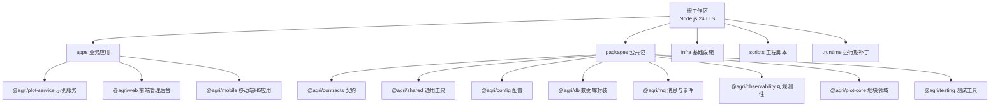

**图表来源**
- [README.md:58-84](file://README.md#L58-L84)
- [package.json:10-13](file://package.json#L10-L13)

**章节来源**
- [README.md:58-84](file://README.md#L58-L84)
- [package.json:10-13](file://package.json#L10-L13)

## 核心组件
智慧农业平台的核心由三类组件构成：公共包、微服务应用、前端管理后台和移动端H5应用。

### 公共包
公共包是平台的横切能力与领域基础，强调低耦合、高内聚与明确导出入口：
- `@agri/tsconfig`：TypeScript 编译配置基座，所有子工程继承统一编译策略。
- `@agri/eslint-config`：代码规范与架构约束，支持依赖方向校验。
- `@agri/shared`：异常基类、时间处理、单位换算、分页、标识生成等通用工具。
- `@agri/contracts`：接口契约与共享类型，包括响应信封、领域事件、错误码、DTO 与枚举；仅依赖 zod，便于前端低成本复用。
- `@agri/plot-core`：地块领域模型与编码规则，负责六段式编码、校验位、网格换算与坐标系转换。
- `@agri/config`：环境变量校验、启动期配置加载与密钥读取。
- `@agri/observability`：结构化日志、链路追踪、指标采集与运行期采集器。
- `@agri/db`：客户端生命周期、事务、分库路由、分页与软删除封装。
- `@agri/mq`：发布订阅、本地消息表、重试死信与幂等消费。
- `@agri/testing`：测试数据库、内存事件总线、可控时钟与模块构造器，提供真实农业场景夹具。

这些包的职责在 README 中已有清晰说明，并在各包的 `package.json` 中通过描述字段与依赖声明体现。

**章节来源**
- [README.md:86-103](file://README.md#L86-L103)
- [packages/contracts/package.json:1-42](file://packages/contracts/package.json#L1-L42)
- [packages/shared/package.json:1-23](file://packages/shared/package.json#L1-L23)
- [packages/config/package.json:1-28](file://packages/config/package.json#L1-L28)

### 微服务应用
仓库包含 15 个 HTTP 微服务，每个服务通常具备 NestJS 模块、HTTP 适配器入口、独立 `package.json` 与测试用例。示例服务 `@agri/plot-service` 展示了如何组合配置、契约、数据库、消息、观测与地块领域能力，并演示了建档、本地消息表写入、中继投递与消费幂等的全链路。

典型微服务职责划分（按目录命名）：
- 认证服务：用户身份与权限。
- 控制服务：设备控制指令下发。
- 决策服务：规则引擎、处方与决策记录。
- 文件服务：对象存储接入与文件上传下载。
- 财务服务：成本、收益与结算记录。
- 网关服务：统一入口与健康检查。
- 物联网服务：设备接入与协议适配。
- 消息服务：通知与站内消息。
- 运营服务：农事作业与任务编排。
- 平台服务：租户、组织与平台级配置。
- 地块服务：地块建档、事件消费与装配示范。
- 遥测服务：传感器读数与时序数据。
- 追溯服务：生产与流通追溯。
- 视频服务：视频监控、回放与录像留档。
- 天气服务：气象数据接入。

**章节来源**
- [README.md:79-84](file://README.md#L79-L84)
- [apps/plot-service/package.json:1-34](file://apps/plot-service/package.json#L1-L34)

### 前端管理后台
前端应用位于 `apps/web`，基于 Vue 3、Element Plus、ECharts、Leaflet、Pinia、Vue Router 与 Axios，提供地块、设备、农场、财务、追溯、视频等管理页面。其构建脚本使用 `vue-tsc -b && vite build`，开发服务器通过 Vite 启动。

**章节来源**
- [apps/web/package.json:1-37](file://apps/web/package.json#L1-L37)

### 移动端H5应用
**新增功能** 平台新增了独立的移动端H5应用 `apps/mobile`，基于 Vue 3 + Vite + TypeScript 构建，专为移动端优化设计。该应用不依赖UI库，手写m-*样式体系，与桌面端布局完全隔离。

#### 核心功能特性
- **驾驶舱**：展示地块总数、种植总面积、在线设备数、进行中任务等关键指标，以及待处置告警前5条
- **巡田登记**：支持地块筛选、事件类型选择、分页加载和现场情况登记
- **任务回执**：状态筛选、详情查看、开工/取消操作、回执提交（含完成面积和备注）

#### 技术架构特点
- **独立工程**：@agri/mobile，不混入apps/web桌面布局
- **轻量设计**：无UI库依赖，手写m-*样式体系，375px宽可用
- **路由模式**：hash路由 + vite base '/m/'，刷新不依赖服务端回落
- **权限隔离**：localStorage键`agri_mobile_token/user`与桌面端隔离互不踢线
- **API封装**：401自动回登录，与桌面端checkPermission同口径

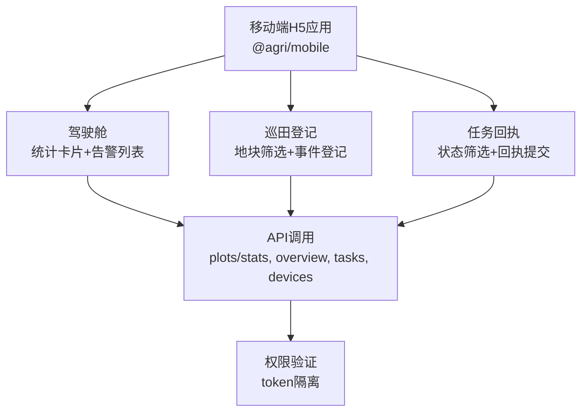

**图表来源**
- [apps/mobile/src/views/Cockpit.vue:1-90](file://apps/mobile/src/views/Cockpit.vue#L1-L90)
- [apps/mobile/src/views/Patrol.vue:1-157](file://apps/mobile/src/views/Patrol.vue#L1-L157)
- [apps/mobile/src/views/Tasks.vue:1-198](file://apps/mobile/src/views/Tasks.vue#L1-L198)

**章节来源**
- [apps/mobile/package.json:1-22](file://apps/mobile/package.json#L1-L22)
- [apps/mobile/vite.config.ts:1-24](file://apps/mobile/vite.config.ts#L1-L24)

## 架构总览
从系统视角看，平台采用微服务架构，前端通过网关或服务直调访问后端能力。公共包被多个服务复用，契约包对外暴露稳定类型，领域能力下沉到专用包，基础设施通过脚本与迁移文件统一管理。**P5版本新增了移动端H5应用和视频录制归档功能，完善了整个平台的功能生态**。

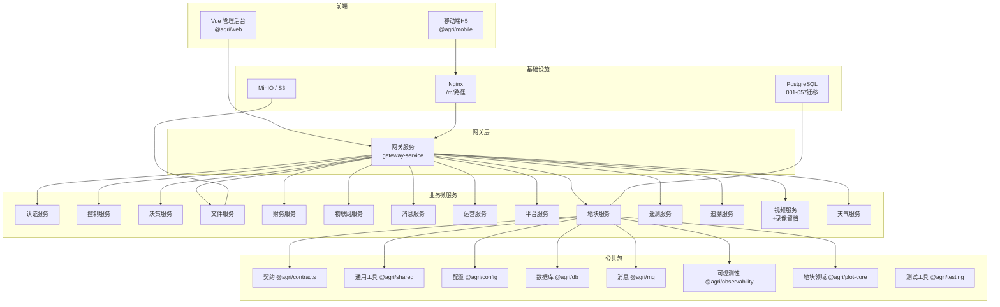

**图表来源**
- [README.md:79-84](file://README.md#L79-L84)
- [apps/plot-service/package.json:14-26](file://apps/plot-service/package.json#L14-L26)
- [Dockerfile:27-28](file://Dockerfile#L27-L28)
- [infra/edge/nginx.conf:66-72](file://infra/edge/nginx.conf#L66-L72)

## 详细组件分析

### 以地块为核心的领域设计
地块编码是平台的数据关联锚点，采用六段式结构，例如"区划码-农场码-片区号-地块序号-网格号-校验位"。地块级编码的网格段为空串，细分到网格时网格段非空。平台约定业务代码不得自行拼接编码，必须通过 `@agri/plot-core` 提供的能力进行生成与校验。空间运算下沉至 PostGIS，坐标统一 CGCS2000（EPSG:4490），仅在出参方向进行坐标系换算。

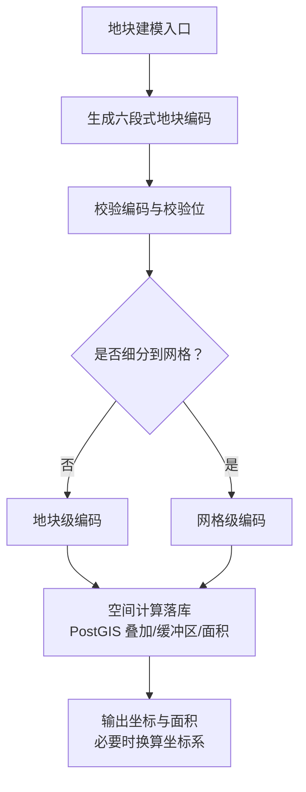

**图表来源**
- [README.md:105-118](file://README.md#L105-L118)

**章节来源**
- [README.md:105-118](file://README.md#L105-L118)

### 事件与本地消息表机制
平台要求事件"不丢也不重"：业务数据与待投递事件写入同一事务（本地消息表），事务提交后由中继投递；消费侧使用 eventId 做幂等去重，重试采用指数退避，超出次数转入死信。该机制在示例服务的建档链路中得到验证。

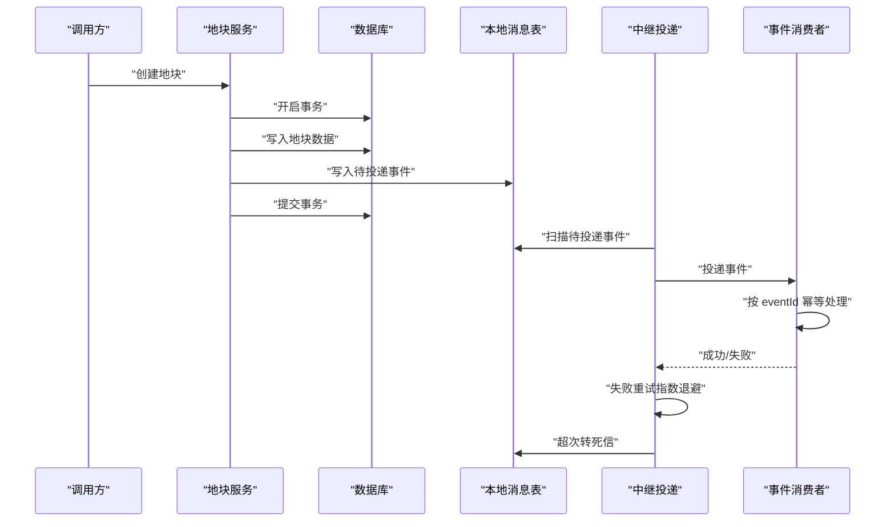

**图表来源**
- [README.md:114-115](file://README.md#L114-L115)
- [README.md:120-145](file://README.md#L120-L145)

**章节来源**
- [README.md:114-115](file://README.md#L114-L115)
- [README.md:120-145](file://README.md#L120-L145)

### 智能地块合并与边界编辑导航
当地块合并后出现正面积差异时，系统会直接导航到边界编辑界面，简化用户操作流程。

#### 合并预演与面积差异检测
系统在合并前会进行详细的预演分析，计算凸包面积与源面积合计的差异：
- 当凸包面积大于源面积合计时，表示合并后会圈入额外空地
- 系统通过 `deltaMu` 字段精确量化面积差异
- 前端实时显示差异信息，帮助用户做出明智决策

#### 直接边界编辑导航
当检测到正面积差异时，合并成功后系统会：
1. 弹出确认对话框，告知用户凸包圈入了额外空地
2. 提供"编辑合并后边界"的直接操作入口
3. 自动跳转到新地块的编辑页面 `/plot/edit/${parcelCode}`
4. 用户可直接重新绘制边界，消除多余的空地计入

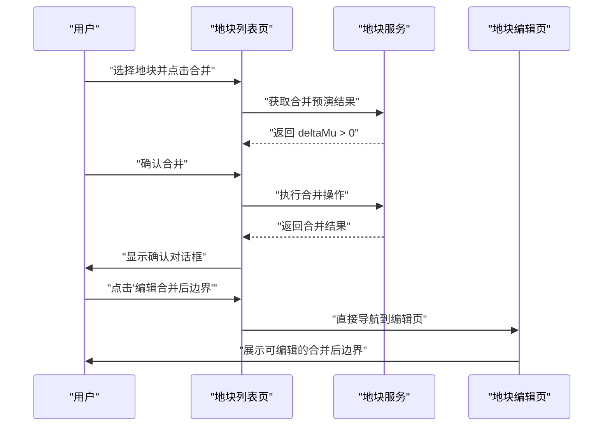

**图表来源**
- [apps/web/src/views/plot/List.vue:431-441](file://apps/web/src/views/plot/List.vue#L431-L441)
- [apps/plot-service/src/plot.service.ts:374-392](file://apps/plot-service/src/plot.service.ts#L374-L392)

#### 用户体验优化
- **智能提示**：合并预览界面明确显示"凸包比源面积和多出 X 亩"的警告信息
- **操作引导**：文案引导用户"若不想计入这块空地，合并成功后可手工修改合并后边界"
- **无缝衔接**：避免用户需要手动查找新地块编码和导航步骤
- **即时反馈**：面积差异实时显示，帮助用户理解合并影响

**章节来源**
- [apps/web/src/views/plot/List.vue:182-184](file://apps/web/src/views/plot/List.vue#L182-L184)
- [apps/web/src/views/plot/List.vue:431-441](file://apps/web/src/views/plot/List.vue#L431-L441)
- [apps/plot-service/src/plot.service.ts:374-392](file://apps/plot-service/src/plot.service.ts#L374-L392)

### 坐标转换与地图精度增强
平台实现了完整的坐标转换能力，解决了国内地图偏移问题，提升了农业监测精度。

#### 多坐标系支持
平台现在支持三种坐标参考系统：
- **CGCS2000 (EPSG:4490)**：国家大地坐标系，平台统一存储格式
- **WGS84 (EPSG:4326)**：GPS 原始观测与部分遥感产品使用
- **GCJ02**：互联网地图常用坐标系（火星坐标）

#### GCJ-02 显示投影
实现了高德地图底图与地块边界的精确对齐：
- 业务坐标（WGS84）先正算到 GCJ-02 再做墨卡托投影
- 屏幕点位逆算回 WGS84，确保入库坐标与面积计算不受影响
- 高德瓦片与地块边界自此在同一坐标系下显示
- 解决了数百米非线性偏移导致的地图错位问题

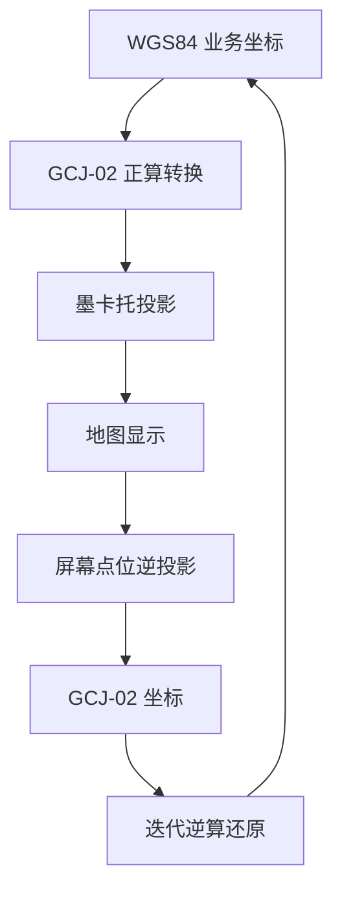

**图表来源**
- [packages/plot-core/src/crs.ts:97-116](file://packages/plot-core/src/crs.ts#L97-L116)
- [apps/web/src/views/dashboard/Index.vue:462-479](file://apps/web/src/views/dashboard/Index.vue#L462-L479)

#### 坐标转换算法
- **正向转换**：WGS84 → GCJ02，使用标准偏移算法
- **逆向转换**：GCJ02 → WGS84，采用迭代逼近消除正向变换带来的偏移
- **范围判断**：境外坐标（落不进中国范围）不做偏移处理
- **精度保证**：迭代收敛到 1e-9 度精度，远优于厘米级要求

#### 地图功能增强
- **底图热切换**：支持天地图、Esri、高德等多种底图无缝切换
- **坐标系自适应**：根据底图类型自动选择合适的 CRS
- **图层管理**：设备、地块、片区图层独立管理
- **交互优化**：绘制、编辑、缩放等操作流畅自然

**章节来源**
- [packages/plot-core/src/crs.ts:1-138](file://packages/plot-core/src/crs.ts#L1-L138)
- [apps/web/src/utils/gcj02.ts:1-61](file://apps/web/src/utils/gcj02.ts#L1-L61)
- [apps/web/src/views/dashboard/Index.vue:455-479](file://apps/web/src/views/dashboard/Index.vue#L455-L479)

### 视频录制归档功能（P5新增）
**新增功能** P5版本新增了完整的视频录制归档功能，支持告警时刻前后录像片段自动留档，完善了视频监控系统的能力。

#### 录像留档档案表结构
迁移057新增了`video_recording_archives`表，包含以下关键字段：
- **source**：三码枚举（AI_EVENT/ALERT/MANUAL）
- **status**：三态管理（PENDING/ARCHIVED/FAILED）
- **pre_seconds/post_seconds**：事件前后窗口（0-600秒）
- **storage_key/playback_url**：流媒体侧回填，未接入前为空串
- **settled_at**：归档完成时间戳

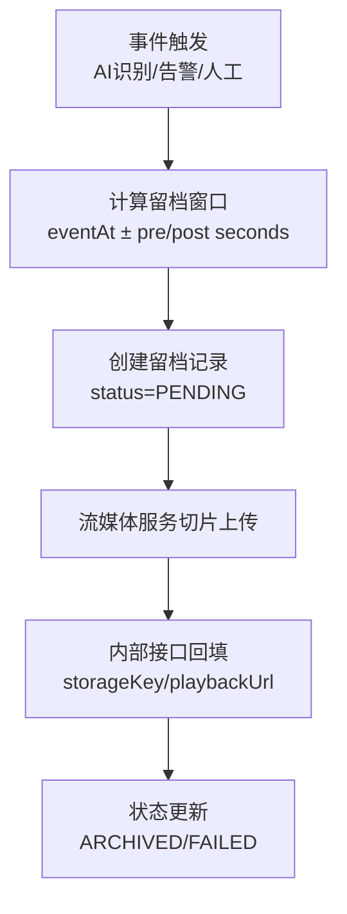

**图表来源**
- [infra/postgres/migrations/057_video_recording_archives.sql:10-30](file://infra/postgres/migrations/057_video_recording_archives.sql#L10-L30)
- [apps/video-service/src/recording-archive.repository.ts:56-60](file://apps/video-service/src/recording-archive.repository.ts#L56-L60)

#### 核心功能特性
- **AI事件自动留档**：POST /ai-events 落库后best-effort登记事件时刻±窗口档案
- **人工补登**：支持手动创建留档记录，校验摄像机存在性和窗口参数
- **内部回填接口**：供B类流媒体服务接入后回填storageKey/playbackUrl
- **多画面分屏**：1/2/4/9分屏监看，每屏独立换台、截图、云台控制
- **状态管理**：PENDING（待切片）→ ARCHIVED（已留档）/ FAILED（切片失败）

#### 技术实现要点
- **仓储双实现**：SQL和InMemory双实现，支持测试环境
- **窗口计算**：archiveWindow纯函数，与迁移CHECK约束保持一致
- **租户隔离**：所有查询和操作都基于tenantId进行数据隔离
- **索引优化**：tenant_id+created_at和camera_id+started_at复合索引

**章节来源**
- [infra/postgres/migrations/057_video_recording_archives.sql:1-36](file://infra/postgres/migrations/057_video_recording_archives.sql#L1-L36)
- [apps/video-service/src/recording-archive.repository.ts:1-164](file://apps/video-service/src/recording-archive.repository.ts#L1-L164)

### 地块/管线测试数据重置机制
平台新增了完整的地块/管线测试数据重置机制，通过卫星底图目视解译生成符合真实农业场景的小尺度田块数据。

#### 迁移 044：按卫星底图重建测试数据
迁移脚本 044 实现了完整的地块域重置流程：
- **旧编码业务引用改挂**：通过会话级临时表将设备绑定、农事任务、财务、溯源、遥测、告警、处方、指令等八张表的旧地块编码映射到新编码
- **清除旧地块域**：整体删除 `plot_records`/`infra_lines`/`plot_zones`/`plot_change_logs`（含软删行与旧留痕）
- **重建小尺度田块**：生成 13 块 1.25~3.85 亩的小田，符合丘陵梯田实际规模
- **重建基础设施**：生成 7 条管线（机耕道、灌溉管、电力线、通信线）和 2 个片区
- **面积与长度现算**：面积按边界几何 `polygonAreaMu` 现算，长度按 haversine 现算

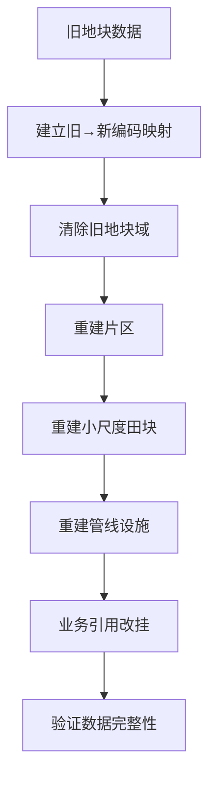

**图表来源**
- [infra/postgres/migrations/044_reset_plots_lines.sql:10-49](file://infra/postgres/migrations/044_reset_plots_lines.sql#L10-L49)
- [infra/postgres/migrations/044_reset_plots_lines.sql:57-90](file://infra/postgres/migrations/044_reset_plots_lines.sql#L57-L90)

#### 迁移 045：冒烟测试残留清理
迁移脚本 045 专门清理历史冒烟测试产生的悬空引用：
- 清理早期版本清理清单遗漏的 `trace_records` 和 `control_commands` 中的哨兵编码 `P-SMOKE-EVENTS`
- 防止因地块重置导致的历史数据成为悬空引用

#### 测试数据维护脚本
`seed-test-plots.mjs` 提供了对迁移 044 数据集的幂等维护能力：
- 守护迁移 044 重置后的 13 块小田必须全部存在
- 对三块样例田进行幂等重断言（同名同边界就地 PUT）
- 验证面积与边界的一致性，确保数据质量

**章节来源**
- [infra/postgres/migrations/044_reset_plots_lines.sql:1-90](file://infra/postgres/migrations/044_reset_plots_lines.sql#L1-L90)
- [infra/postgres/migrations/045_smoke_residue_cleanup.sql:1-7](file://infra/postgres/migrations/045_smoke_residue_cleanup.sql#L1-L7)
- [scripts/seed-test-plots.mjs:1-197](file://scripts/seed-test-plots.mjs#L1-L197)

### 测试基础设施增强
`@agri/testing` 包提供了更真实的农业场景夹具，使测试数据贴近真实量级，避免用极端值掩盖单位或量纲错误。

#### 真实农业场景夹具
测试夹具默认值取自达州本地的典型场景：
- **开江县示例区划**：使用真实的行政区划代码 `511723`
- **丘陵地块特征**：地块面积 12.5 亩，符合丘陵地区实际规模
- **水稻生育期**：作物季使用"分蘖期"等真实农学术语
- **土壤墒情**：遥测数据使用 28.4% 的真实土壤湿度值

#### 夹具类型
- `buildPlotCodeFixture()`：生成符合真实区划的地块编码
- `plotFixture()`：地块夹具，包含 parcelId、parcelName、areaMu、fertilityLevel 等字段
- `gridFixture()`：网格夹具，支持网格级别的测试数据
- `deviceFixture()`：设备夹具，包含设备类别、在线状态等属性
- `seasonFixture()`：作物季夹具，支持不同作物和生长阶段
- `telemetryFixture()`：遥测夹具，默认土壤墒情数据

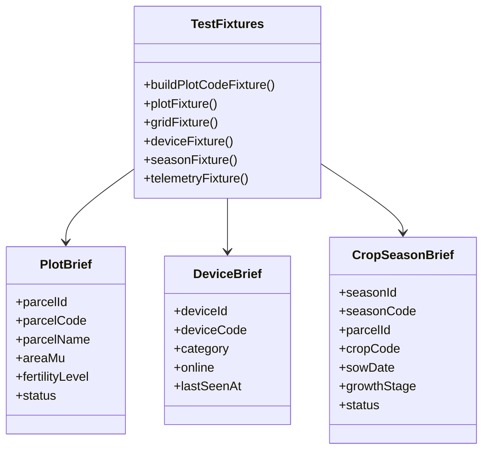

**图表来源**
- [packages/testing/src/fixtures.ts:1-101](file://packages/testing/src/fixtures.ts#L1-L101)

#### 测试数据质量保证
- **真实量级**：避免使用 1、2 这类极端值掩盖单位或量纲错误
- **业务语义**：使用真实的农学术语和业务场景
- **一致性**：所有夹具都遵循相同的业务规则和约束
- **可扩展性**：支持通过 overrides 参数定制特定测试场景

**章节来源**
- [packages/testing/src/fixtures.ts:1-101](file://packages/testing/src/fixtures.ts#L1-L101)

### 示例服务装配与扩展指引
示例服务 `@agri/plot-service` 展示了如何组合配置、契约、数据库、消息、观测与地块领域能力。新增业务服务时，应复制示例服务结构，在根 `tsconfig.json` 增加工程引用，并在 Nest 模块中按需导入配置、数据库与消息模块。HTTP 适配器建议使用 Fastify 以提升高并发场景性能。

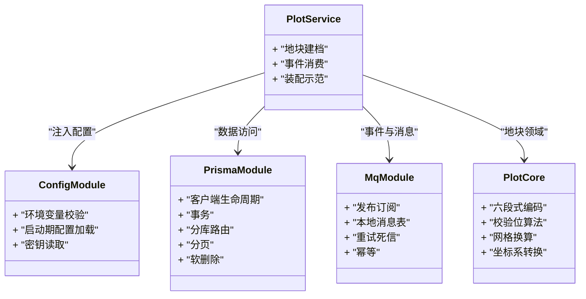

**图表来源**
- [README.md:147-155](file://README.md#L147-L155)
- [apps/plot-service/package.json:14-26](file://apps/plot-service/package.json#L14-L26)

**章节来源**
- [README.md:147-155](file://README.md#L147-L155)
- [apps/plot-service/package.json:14-26](file://apps/plot-service/package.json#L14-L26)

## 依赖关系分析
仓库通过 pnpm workspace 管理包关系，并通过 Turborepo 编排任务。根 `package.json` 定义了工作区范围、脚本与依赖；`turbo.json` 定义 build 与 typecheck 任务的依赖顺序与产物目录；`pnpm-workspace.yaml` 声明工作区包路径并放行 esbuild 等构建脚本。

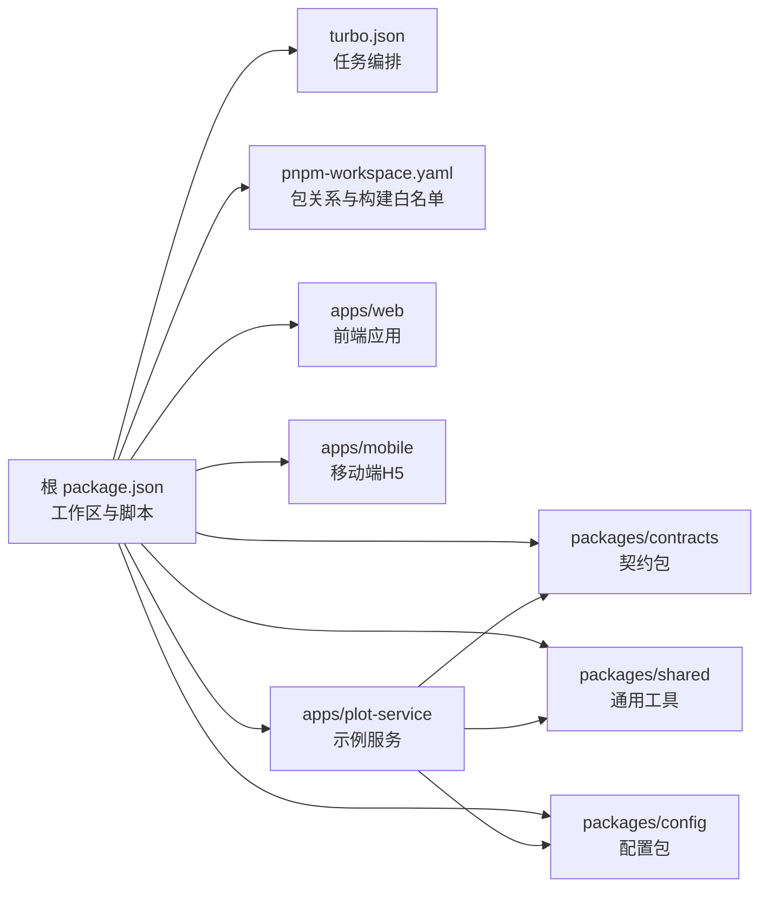

**图表来源**
- [package.json:10-28](file://package.json#L10-L28)
- [turbo.json:1-15](file://turbo.json#L1-L15)
- [pnpm-workspace.yaml:1-14](file://pnpm-workspace.yaml#L1-L14)
- [apps/plot-service/package.json:14-26](file://apps/plot-service/package.json#L14-L26)

**章节来源**
- [package.json:10-28](file://package.json#L10-L28)
- [turbo.json:1-15](file://turbo.json#L1-L15)
- [pnpm-workspace.yaml:1-14](file://pnpm-workspace.yaml#L1-L14)

## 性能与工程化特性
- **Node.js 24 LTS**：长期支持版本，提供更稳定的运行时环境与性能优化。
- **NestJS 11 + TypeScript 5.9**：强类型、装饰器驱动的模块化架构，适合微服务装配与依赖注入。
- **pnpm workspace + Turborepo**：高效依赖管理与并行任务执行，配合 TypeScript 工程引用实现增量编译。
- **Vitest 3**：现代化测试框架，支持源码直连与装饰器语义，提升测试效率。
- **Fastify 适配器建议**：在高并发场景中推荐使用 Fastify 以获得更好的吞吐表现。
- **空间计算下沉数据库**：将叠加、缓冲区、面积等复杂空间运算交由 PostGIS 完成，减少应用层压力。
- **分页上限与排序白名单**：每页上限 200，排序字段需命中服务端白名单，防止恶意查询。
- **P5版本增强**：新增了移动端H5应用和视频录制归档功能，完善了平台功能生态。
- **完整功能覆盖**：18个A类功能全部实现，涵盖从基础地图工具到高级视频监控的完整功能集。

**章节来源**
- [README.md:7-10](file://README.md#L7-L10)
- [README.md:112-118](file://README.md#L112-L118)
- [README.md:151-152](file://README.md#L151-L152)
- [IMPLEMENTATION_PROGRESS.md:828-831](file://IMPLEMENTATION_PROGRESS.md#L828-L831)

## 快速开始指南
以下命令与步骤与仓库 README 保持一致，适用于初学者快速上手，也满足有经验的开发者对工程化流程的需求。

### 环境准备
- 安装 Node.js 24 LTS。
- 安装 pnpm。
- 确保允许 esbuild 等构建脚本执行（已在 `pnpm-workspace.yaml` 中白名单化）。

### 安装依赖
```bash
pnpm install
```

### 全量编译
```bash
pnpm run build
```

### 运行测试
```bash
pnpm test
```

### 运行示例服务
示例服务演示建档、本地消息表写入、中继投递与消费幂等链路：
```bash
pnpm run start:plot
```

### 启动全部 HTTP 服务
```bash
pnpm start:services
```

### 检查全部 HTTP 服务健康状态
```bash
pnpm health:services
```

### 启动前端开发服务器
默认端口 3000：
```bash
pnpm --filter @agri/web dev
```

### 启动移动端H5开发服务器
默认端口 3001：
```bash
pnpm --filter @agri/mobile dev
```

### 其他常用脚本
- `pnpm run build:changed`：只编译受影响的子工程。
- `pnpm run test:watch`：测试监听模式。
- `pnpm run clean`：清理各子工程的 dist 与增量编译信息。
- `pnpm smoke:services`：使用隔离端口启动并验证全部 HTTP 服务。
- `pnpm init:minio`：创建 S3/MinIO bucket。
- `pnpm health:infra`：检查 PostgreSQL 和 MinIO。
- `pnpm db:migrate`：使用 `DB_URL` 执行 PostgreSQL 初始化迁移。
- `pnpm --filter @agri/web build`：构建前端生产包。
- `pnpm --filter @agri/mobile build`：构建移动端H5生产包。
- `pnpm seed:test-plots`：维护迁移 044 重置后的测试地块数据。

**章节来源**
- [README.md:12-54](file://README.md#L12-L54)

## 故障排查
常见问题与注意事项：
- **安装报错 ERR_PNPM_IGNORED_BUILDS**：检查 `pnpm-workspace.yaml` 中的 `allowBuilds` 是否保留 esbuild 等白名单项。
- **装饰器元数据差异**：生产编译已启用装饰器与元数据发射，测试期由 esbuild 转译仅启用前者；测试中构造提供者时应显式声明 inject，不要依赖类型元数据自动注入。
- **数据库与消息中间件替换**：示例工程使用内存实现替代真实中间件，仅用于验证装配关系与调用链；接入真实数据库时需实现 `PrismaClientFactory`，接入真实消息中间件时需实现 `EventPublisher` 与 `EventSubscriber`。
- **ESLint 未安装**：规范包已就位但未安装 ESLint 运行；启用前需在工程内加入 eslint 依赖并按需引用 base、typescript、nest、vue、architecture 配置。
- **地图坐标偏移**：如遇到高德地图坐标偏移问题，确认使用的是最新的坐标转换功能，并确保底图类型为高德地图。
- **测试数据不一致**：如遇到测试地块数量或面积不符合预期，执行 `pnpm seed:test-plots` 重新维护测试数据。
- **冒烟测试失败**：如冒烟测试报告悬空引用错误，确认已应用迁移 045 清理历史残留数据。
- **移动端H5无法访问**：确认已通过Docker构建并部署，访问地址为 https://localhost/m/。
- **视频录制归档功能异常**：检查迁移057是否已应用，确认video-service是否正确装配recording-archive.repository。

**章节来源**
- [README.md:55-56](file://README.md#L55-L56)
- [README.md:157-167](file://README.md#L157-L167)

## 结论
该智慧农业平台以地块为核心领域，通过公共包沉淀通用能力与领域模型，以 15 个微服务拆分业务边界，并以 Vue 前端提供管理界面。**P5版本的发布标志着平台功能的全面成熟**，新增了移动端H5应用和视频录制归档功能，实现了18个A类功能的全部交付和部署。

**P5版本核心成果**：
- **移动端H5应用**：独立的@agri/mobile工程，提供驾驶舱、巡田登记、任务回执三大核心功能，支持375px宽度的移动端体验
- **视频录制归档**：完整的录像留档档案表结构，支持AI事件自动留档、人工补登、内部回填接口
- **多画面分屏**：1/2/4/9分屏监看，每屏独立控制，播放器实例管理完善
- **完整功能覆盖**：从基础地图工具到高级视频监控，18个A类功能全部实现

**技术架构优势**：
- 采用 Node.js 24 LTS、NestJS 11、TypeScript 5.9、pnpm workspace 与 Turborepo，形成可编译、可测试、可扩展的工程化体系
- 通过 Dokerfile 双目标构建（app + edge）和 nginx 配置，支持桌面端和移动端H5的统一部署
- 数据层迁移从001到057全部应用，确保了数据结构的完整性和向后兼容性

对于初学者，可按快速开始指南逐步搭建与运行；对于有经验的开发者，可基于示例服务扩展新业务，遵循契约包与能力包分离、事件不丢不重、空间计算下沉数据库、坐标转换精确性等关键约定，保证系统的一致性与可维护性。**P5版本的完成为平台的后续发展奠定了坚实的基础**。