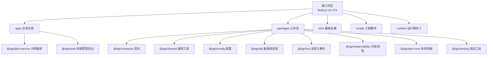
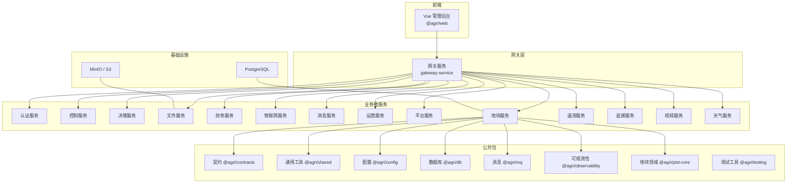
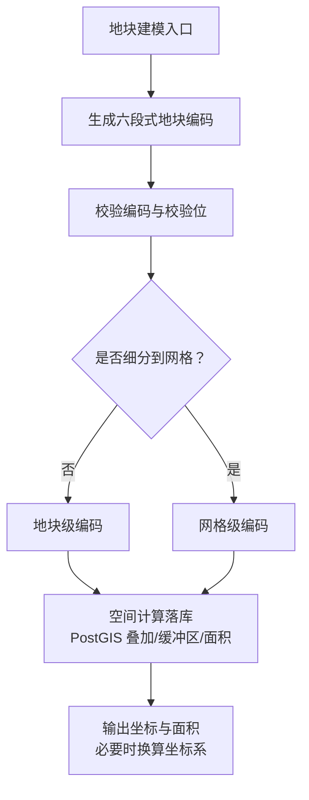
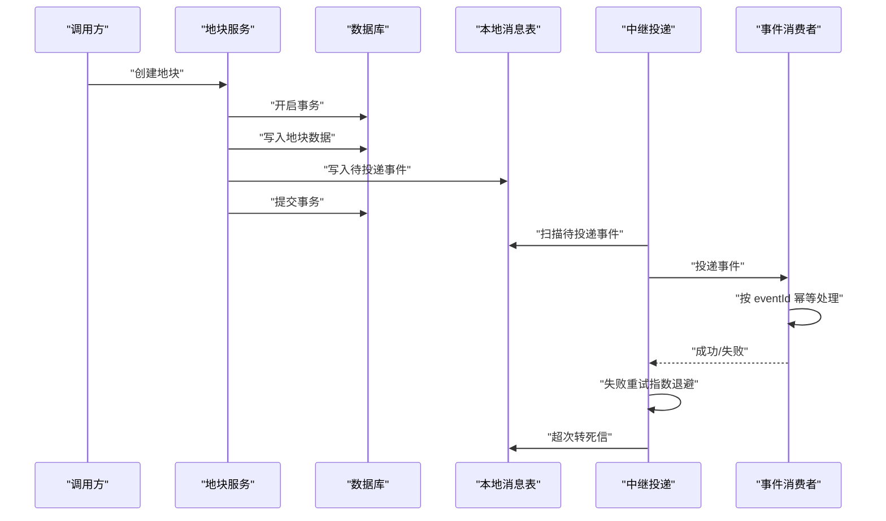
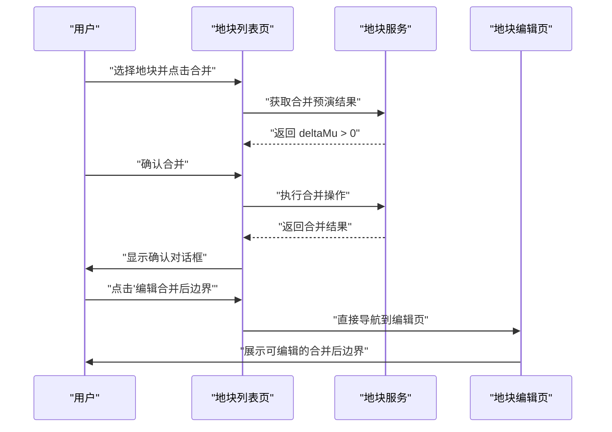
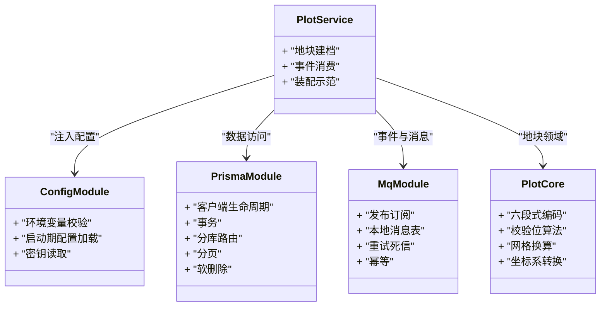
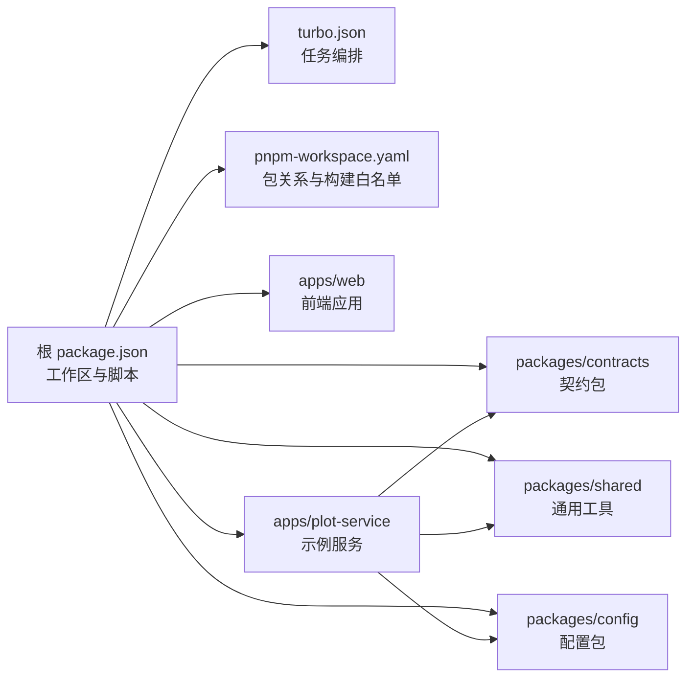

# 项目概述

<cite>
**本文引用的文件**   
- [README.md](file://README.md)
- [package.json](file://package.json)
- [turbo.json](file://turbo.json)
- [pnpm-workspace.yaml](file://pnpm-workspace.yaml)
- [apps/web/package.json](file://apps/web/package.json)
- [apps/plot-service/package.json](file://apps/plot-service/package.json)
- [packages/contracts/package.json](file://packages/contracts/package.json)
- [packages/shared/package.json](file://packages/shared/package.json)
- [packages/config/package.json](file://packages/config/package.json)
- [apps/web/src/views/plot/List.vue](file://apps/web/src/views/plot/List.vue)
- [apps/plot-service/src/plot.service.ts](file://apps/plot-service/src/plot.service.ts)
</cite>

## 更新摘要
**已进行的更改**   
- 更新了地块合并功能的用户交互流程，新增正面积差异时的直接边界编辑导航
- 增强了合并预览界面的用户体验，提供明确的边界修改引导
- 优化了凹形地块合并后的操作流程，减少用户操作步骤

## 目录
1. [引言](#引言)
2. [项目结构](#项目结构)
3. [核心组件](#核心组件)
4. [架构总览](#架构总览)
5. [详细组件分析](#详细组件分析)
6. [依赖关系分析](#依赖关系分析)
7. [性能与工程化特性](#性能与工程化特性)
8. [快速开始指南](#快速开始指南)
9. [故障排查](#故障排查)
10. [结论](#结论)

## 引言
本仓库是一个以"地块"为最小管理单元的智慧农业平台 Node.js 工程骨架。它将方案文档落地为可编译、可运行、可测试的代码，包含公共包、15 个 HTTP 微服务以及一个 Vue 前端管理应用。整体目标是提供一套统一的技术栈、清晰的领域边界和可扩展的工程化体系，使团队可以在不破坏契约的前提下持续扩展新的业务服务。

项目的核心价值包括：
- 以地块编码作为数据关联锚点，贯穿建档、事件、遥测、决策、处方、作业、财务与追溯等全链路。
- 通过公共包沉淀配置、契约、数据库访问、消息总线、观测能力与测试工具，降低重复实现。
- 使用 pnpm workspace 与 Turborepo 构建跨包依赖图，结合 TypeScript 工程引用实现增量编译。
- 用 NestJS 11 + TypeScript 5.9 提供强类型、装饰器驱动的微服务装配体验。
- 通过 Vitest 3 覆盖编码规则、事务边界、分页白名单、消息中继与幂等消费等关键路径。

**章节来源**
- [README.md:1-10](file://README.md#L1-L10)

## 项目结构
仓库采用根级脚本与工作区组织方式，主要目录职责如下：
- `apps`：业务微服务与应用，例如认证、控制、决策、文件、财务、网关、物联网、消息、运营、平台、地块、遥测、追溯、视频、天气，以及前端 `web`。
- `packages`：公共包，包括 TypeScript 配置、ESLint 规范、共享工具、接口契约、地块领域模型、配置加载、可观测性、数据库封装、消息队列封装与测试夹具。
- `infra`：基础设施相关脚本与迁移文件，例如 PostgreSQL 初始迁移与 Docker Compose。
- `scripts`：工程脚本，包括清理、健康检查、MinIO 初始化、PostgreSQL 迁移、服务注册、冒烟测试与服务启动编排。
- `.runtime`：运行时补丁与轻量冒烟脚本，用于补齐或验证部分运行期行为。



**图表来源**
- [README.md:58-84](file://README.md#L58-L84)
- [package.json:10-13](file://package.json#L10-L13)

**章节来源**
- [README.md:58-84](file://README.md#L58-L84)
- [package.json:10-13](file://package.json#L10-L13)

## 核心组件
智慧农业平台的核心由三类组件构成：公共包、微服务应用、前端管理后台。

### 公共包
公共包是平台的横切能力与领域基础，强调低耦合、高内聚与明确导出入口：
- `@agri/tsconfig`：TypeScript 编译配置基座，所有子工程继承统一编译策略。
- `@agri/eslint-config`：代码规范与架构约束，支持依赖方向校验。
- `@agri/shared`：异常基类、时间处理、单位换算、分页、标识生成等通用工具。
- `@agri/contracts`：接口契约与共享类型，包括响应信封、领域事件、错误码、DTO 与枚举；仅依赖 zod，便于前端低成本复用。
- `@agri/plot-core`：地块领域模型与编码规则，负责六段式编码、校验位、网格换算与坐标系转换。
- `@agri/config`：环境变量校验、启动期配置加载与密钥读取。
- `@agri/observability`：结构化日志、链路追踪、指标采集与运行期采集器。
- `@agri/db`：客户端生命周期、事务、分库路由、分页与软删除封装。
- `@agri/mq`：发布订阅、本地消息表、重试死信与幂等消费。
- `@agri/testing`：测试数据库、内存事件总线、可控时钟与模块构造器。

这些包的职责在 README 中已有清晰说明，并在各包的 `package.json` 中通过描述字段与依赖声明体现。

**章节来源**
- [README.md:86-103](file://README.md#L86-L103)
- [packages/contracts/package.json:1-42](file://packages/contracts/package.json#L1-L42)
- [packages/shared/package.json:1-23](file://packages/shared/package.json#L1-L23)
- [packages/config/package.json:1-28](file://packages/config/package.json#L1-L28)

### 微服务应用
仓库包含 15 个 HTTP 微服务，每个服务通常具备 NestJS 模块、HTTP 适配器入口、独立 `package.json` 与测试用例。示例服务 `@agri/plot-service` 展示了如何组合配置、契约、数据库、消息、观测与地块领域能力，并演示了建档、本地消息表写入、中继投递与消费幂等的全链路。

典型微服务职责划分（按目录命名）：
- 认证服务：用户身份与权限。
- 控制服务：设备控制指令下发。
- 决策服务：规则引擎、处方与决策记录。
- 文件服务：对象存储接入与文件上传下载。
- 财务服务：成本、收益与结算记录。
- 网关服务：统一入口与健康检查。
- 物联网服务：设备接入与协议适配。
- 消息服务：通知与站内消息。
- 运营服务：农事作业与任务编排。
- 平台服务：租户、组织与平台级配置。
- 地块服务：地块建档、事件消费与装配示范。
- 遥测服务：传感器读数与时序数据。
- 追溯服务：生产与流通追溯。
- 视频服务：视频监控与回放。
- 天气服务：气象数据接入。

**章节来源**
- [README.md:79-84](file://README.md#L79-L84)
- [apps/plot-service/package.json:1-34](file://apps/plot-service/package.json#L1-L34)

### 前端管理后台
前端应用位于 `apps/web`，基于 Vue 3、Element Plus、ECharts、Leaflet、Pinia、Vue Router 与 Axios，提供地块、设备、农场、财务、追溯、视频等管理页面。其构建脚本使用 `vue-tsc -b && vite build`，开发服务器通过 Vite 启动。

**章节来源**
- [apps/web/package.json:1-37](file://apps/web/package.json#L1-L37)

## 架构总览
从系统视角看，平台采用微服务架构，前端通过网关或服务直调访问后端能力。公共包被多个服务复用，契约包对外暴露稳定类型，领域能力下沉到专用包，基础设施通过脚本与迁移文件统一管理。



**图表来源**
- [README.md:79-84](file://README.md#L79-L84)
- [apps/plot-service/package.json:14-26](file://apps/plot-service/package.json#L14-L26)

## 详细组件分析

### 以地块为核心的领域设计
地块编码是平台的数据关联锚点，采用六段式结构，例如"区划码-农场码-片区号-地块序号-网格号-校验位"。地块级编码的网格段为空串，细分到网格时网格段非空。平台约定业务代码不得自行拼接编码，必须通过 `@agri/plot-core` 提供的能力进行生成与校验。空间运算下沉至 PostGIS，坐标统一 CGCS2000（EPSG:4490），仅在出参方向进行坐标系换算。



**图表来源**
- [README.md:105-118](file://README.md#L105-L118)

**章节来源**
- [README.md:105-118](file://README.md#L105-L118)

### 事件与本地消息表机制
平台要求事件"不丢也不重"：业务数据与待投递事件写入同一事务（本地消息表），事务提交后由中继投递；消费侧使用 eventId 做幂等去重，重试采用指数退避，超出次数转入死信。该机制在示例服务的建档链路中得到验证。



**图表来源**
- [README.md:114-115](file://README.md#L114-L115)
- [README.md:120-145](file://README.md#L120-L145)

**章节来源**
- [README.md:114-115](file://README.md#L114-L115)
- [README.md:120-145](file://README.md#L120-L145)

### 智能地块合并与边界编辑导航
**更新** 新增了智能化的地块合并用户体验，当地块合并后出现正面积差异时，系统会直接导航到边界编辑界面，简化用户操作流程。

#### 合并预演与面积差异检测
系统在合并前会进行详细的预演分析，计算凸包面积与源面积合计的差异：
- 当凸包面积大于源面积合计时，表示合并后会圈入额外空地
- 系统通过 `deltaMu` 字段精确量化面积差异
- 前端实时显示差异信息，帮助用户做出明智决策

#### 直接边界编辑导航
**新增功能** 当检测到正面积差异时，合并成功后系统会：
1. 弹出确认对话框，告知用户凸包圈入了额外空地
2. 提供"编辑合并后边界"的直接操作入口
3. 自动跳转到新地块的编辑页面 `/plot/edit/${parcelCode}`
4. 用户可直接重新绘制边界，消除多余的空地计入



**图表来源**
- [apps/web/src/views/plot/List.vue:431-441](file://apps/web/src/views/plot/List.vue#L431-L441)
- [apps/plot-service/src/plot.service.ts:374-392](file://apps/plot-service/src/plot.service.ts#L374-L392)

#### 用户体验优化
- **智能提示**：合并预览界面明确显示"凸包比源面积和多出 X 亩"的警告信息
- **操作引导**：文案引导用户"若不想计入这块空地，合并成功后可手工修改合并后边界"
- **无缝衔接**：避免用户需要手动查找新地块编码和导航步骤
- **即时反馈**：面积差异实时显示，帮助用户理解合并影响

**章节来源**
- [apps/web/src/views/plot/List.vue:182-184](file://apps/web/src/views/plot/List.vue#L182-L184)
- [apps/web/src/views/plot/List.vue:431-441](file://apps/web/src/views/plot/List.vue#L431-L441)
- [apps/plot-service/src/plot.service.ts:374-392](file://apps/plot-service/src/plot.service.ts#L374-L392)

### 示例服务装配与扩展指引
示例服务 `@agri/plot-service` 展示了如何组合配置、契约、数据库、消息、观测与地块领域能力。新增业务服务时，应复制示例服务结构，在根 `tsconfig.json` 增加工程引用，并在 Nest 模块中按需导入配置、数据库与消息模块。HTTP 适配器建议使用 Fastify 以提升高并发场景性能。



**图表来源**
- [README.md:147-155](file://README.md#L147-L155)
- [apps/plot-service/package.json:14-26](file://apps/plot-service/package.json#L14-L26)

**章节来源**
- [README.md:147-155](file://README.md#L147-L155)
- [apps/plot-service/package.json:14-26](file://apps/plot-service/package.json#L14-L26)

## 依赖关系分析
仓库通过 pnpm workspace 管理包关系，并通过 Turborepo 编排任务。根 `package.json` 定义了工作区范围、脚本与依赖；`turbo.json` 定义 build 与 typecheck 任务的依赖顺序与产物目录；`pnpm-workspace.yaml` 声明工作区包路径并放行 esbuild 等构建脚本。



**图表来源**
- [package.json:10-28](file://package.json#L10-L28)
- [turbo.json:1-15](file://turbo.json#L1-L15)
- [pnpm-workspace.yaml:1-14](file://pnpm-workspace.yaml#L1-L14)
- [apps/plot-service/package.json:14-26](file://apps/plot-service/package.json#L14-L26)

**章节来源**
- [package.json:10-28](file://package.json#L10-L28)
- [turbo.json:1-15](file://turbo.json#L1-L15)
- [pnpm-workspace.yaml:1-14](file://pnpm-workspace.yaml#L1-L14)

## 性能与工程化特性
- **Node.js 24 LTS**：长期支持版本，提供更稳定的运行时环境与性能优化。
- **NestJS 11 + TypeScript 5.9**：强类型、装饰器驱动的模块化架构，适合微服务装配与依赖注入。
- **pnpm workspace + Turborepo**：高效依赖管理与并行任务执行，配合 TypeScript 工程引用实现增量编译。
- **Vitest 3**：现代化测试框架，支持源码直连与装饰器语义，提升测试效率。
- **Fastify 适配器建议**：在高并发场景中推荐使用 Fastify 以获得更好的吞吐表现。
- **空间计算下沉数据库**：将叠加、缓冲区、面积等复杂空间运算交由 PostGIS 完成，减少应用层压力。
- **分页上限与排序白名单**：每页上限 200，排序字段需命中服务端白名单，防止恶意查询。

**章节来源**
- [README.md:7-10](file://README.md#L7-L10)
- [README.md:112-118](file://README.md#L112-L118)
- [README.md:151-152](file://README.md#L151-L152)

## 快速开始指南
以下命令与步骤与仓库 README 保持一致，适用于初学者快速上手，也满足有经验的开发者对工程化流程的需求。

### 环境准备
- 安装 Node.js 24 LTS。
- 安装 pnpm。
- 确保允许 esbuild 等构建脚本执行（已在 `pnpm-workspace.yaml` 中白名单化）。

### 安装依赖
```bash
pnpm install
```

### 全量编译
```bash
pnpm run build
```

### 运行测试
```bash
pnpm test
```

### 运行示例服务
示例服务演示建档、本地消息表写入、中继投递与消费幂等链路：
```bash
pnpm run start:plot
```

### 启动全部 HTTP 服务
```bash
pnpm start:services
```

### 检查全部 HTTP 服务健康状态
```bash
pnpm health:services
```

### 启动前端开发服务器
默认端口 3000：
```bash
pnpm --filter @agri/web dev
```

### 其他常用脚本
- `pnpm run build:changed`：只编译受影响的子工程。
- `pnpm run test:watch`：测试监听模式。
- `pnpm run clean`：清理各子工程的 dist 与增量编译信息。
- `pnpm smoke:services`：使用隔离端口启动并验证全部 HTTP 服务。
- `pnpm init:minio`：创建 S3/MinIO bucket。
- `pnpm health:infra`：检查 PostgreSQL 和 MinIO。
- `pnpm db:migrate`：使用 `DB_URL` 执行 PostgreSQL 初始化迁移。
- `pnpm --filter @agri/web build`：构建前端生产包。

**章节来源**
- [README.md:12-54](file://README.md#L12-L54)

## 故障排查
常见问题与注意事项：
- **安装报错 ERR_PNPM_IGNORED_BUILDS**：检查 `pnpm-workspace.yaml` 中的 `allowBuilds` 是否保留 esbuild 等白名单项。
- **装饰器元数据差异**：生产编译已启用装饰器与元数据发射，测试期由 esbuild 转译仅启用前者；测试中构造提供者时应显式声明 inject，不要依赖类型元数据自动注入。
- **数据库与消息中间件替换**：示例工程使用内存实现替代真实中间件，仅用于验证装配关系与调用链；接入真实数据库时需实现 `PrismaClientFactory`，接入真实消息中间件时需实现 `EventPublisher` 与 `EventSubscriber`。
- **ESLint 未安装**：规范包已就位但未安装 ESLint 运行；启用前需在工程内加入 eslint 依赖并按需引用 base、typescript、nest、vue、architecture 配置。

**章节来源**
- [README.md:55-56](file://README.md#L55-L56)
- [README.md:157-167](file://README.md#L157-L167)

## 结论
该智慧农业平台以地块为核心领域，通过公共包沉淀通用能力与领域模型，以 15 个微服务拆分业务边界，并以 Vue 前端提供管理界面。技术选型上采用 Node.js 24 LTS、NestJS 11、TypeScript 5.9、pnpm workspace 与 Turborepo，形成可编译、可测试、可扩展的工程化体系。

**最新更新** 平台新增了智能化的地块合并功能，当合并后出现正面积差异时，系统会自动导航到边界编辑界面，大幅简化了用户的操作流程。这一改进体现了平台对用户友好性的持续追求，通过智能预判和直接导航减少了不必要的操作步骤。

对于初学者，可按快速开始指南逐步搭建与运行；对于有经验的开发者，可基于示例服务扩展新业务，遵循契约包与能力包分离、事件不丢不重、空间计算下沉数据库等关键约定，保证系统的一致性与可维护性。