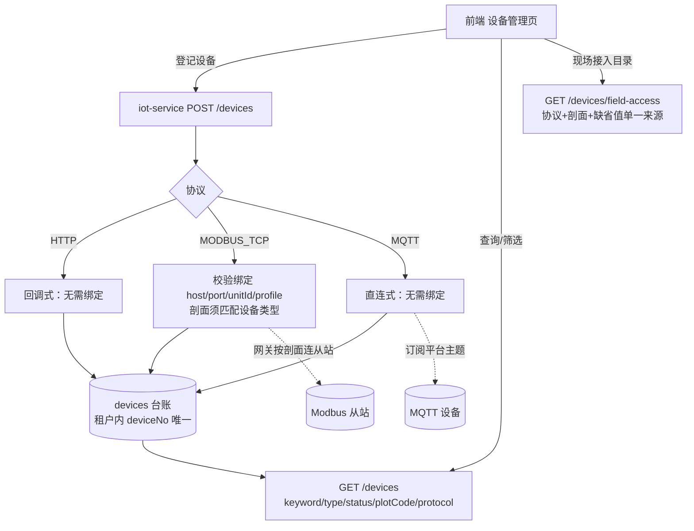
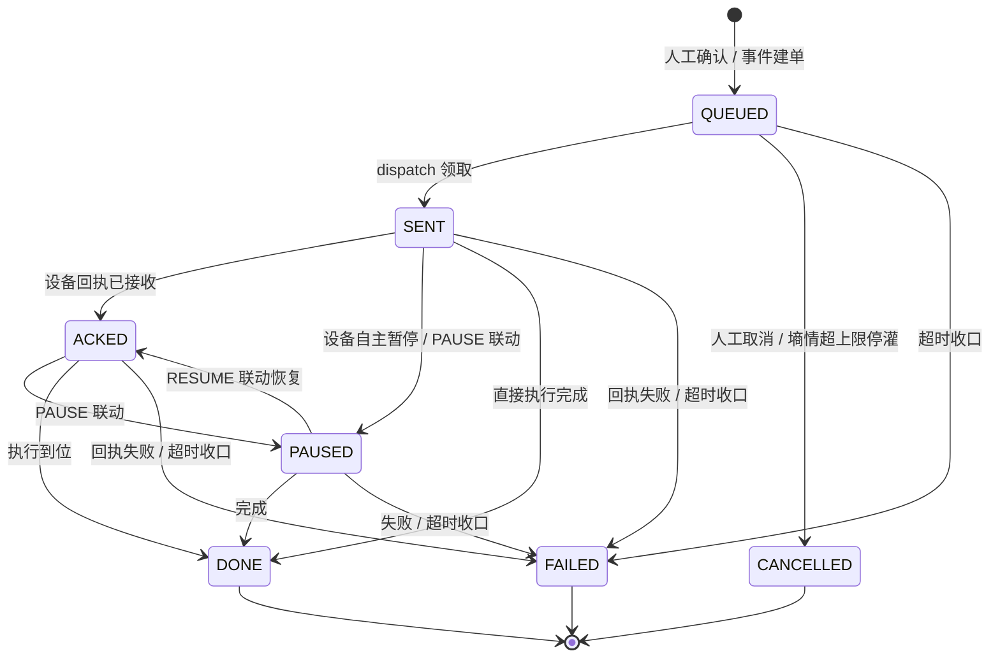
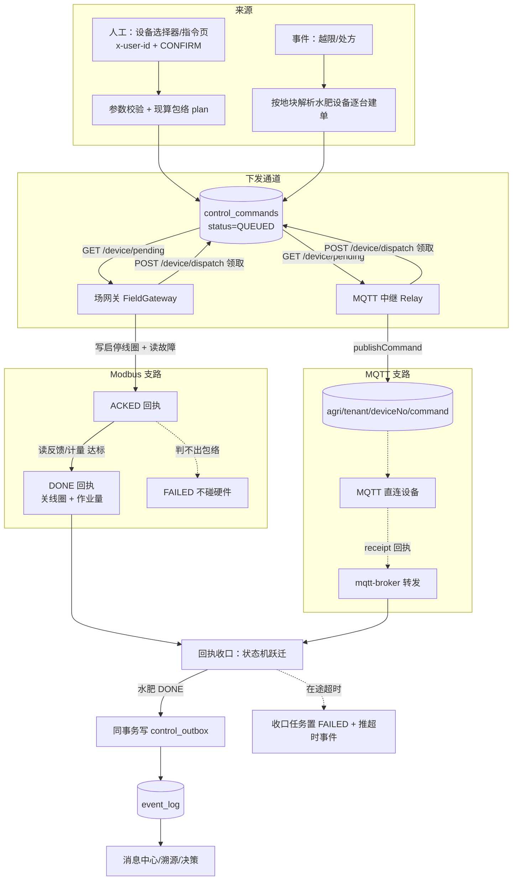
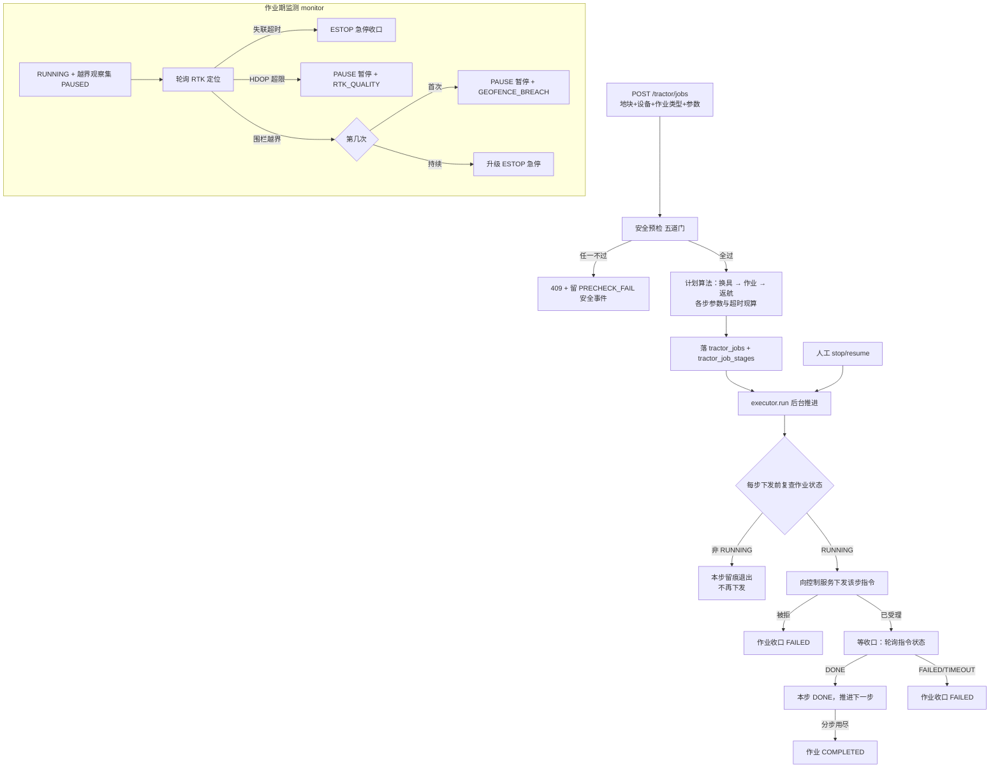
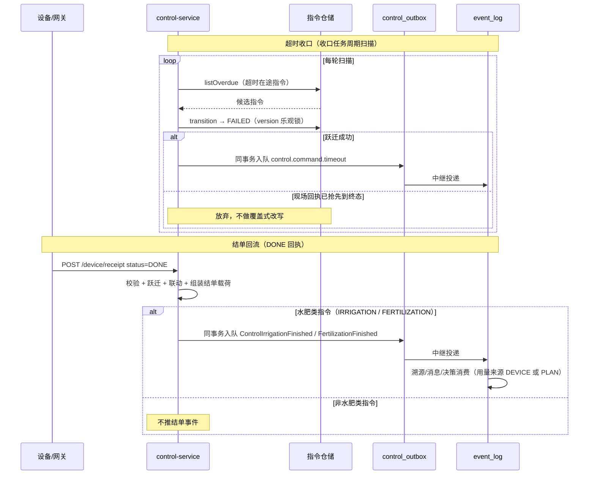

# 设备与指令链路

> 整理范围：无人农场 AI 平台中与「设备」和「指令」相关的全部逻辑，覆盖设备台账、接入协议、
> 现场协议网关、MQTT 接入与指令中继、指令生命周期、事件消费建单、超时收口、结单回流、
> 拖拉机作业编排与安全验证。
>
> 整理日期：2026-11-23。本文为链路梳理，代码细节以对应源文件为准。

## 核心约定

**指令状态机是唯一账本。** 现场协议网关、MQTT 中继、设备回调、拖拉机执行器全都是「回执方」，
走同一套 `/api/v1/control/device/*` 接口推进状态。因此人工回填、超时收口、结单事件不需要为
它们各改一套口径——多一条下发通道，只是多一个回执来源，账本不变。

## 一、参与方与职责

| 服务 | 端口 | 设备/指令相关职责 |
| --- | --- | --- |
| **iot-service** | 3003 | 设备台账（登记/查询/改绑）、接入协议与 Modbus 剖面、现场协议网关（Modbus 轮询下发）、MQTT 接入与**指令中继** |
| **control-service** | 3008 | **指令生命周期账本**、参数校验与执行包络、设备通道三接口、事件消费建单、超时收口、结单回流、作业授权 |
| **tractor-service** | 3015 | 拖拉机作业编排、作业前安全预检、作业期安全监测、分步执行器 |
| telemetry-service | 3004 | 遥测读数（RTK/墒情），被网关计量与拖拉机监测消费 |
| plot-service | 3002 | 地块档案与边界，被预检、围栏判定、自动指令包络消费 |
| 事件日志 / 消息中心 | — | 越限、处方、超时、结单事件回流 |

主要源文件：

- iot-service：[`apps/iot-service/src/device.repository.ts`](apps/iot-service/src/device.repository.ts)、[`device-binding.ts`](apps/iot-service/src/device-binding.ts)、[`field-gateway.ts`](apps/iot-service/src/field-gateway.ts)、[`mqtt-broker.ts`](apps/iot-service/src/mqtt-broker.ts)、[`command-relay.ts`](apps/iot-service/src/command-relay.ts)、[`http.ts`](apps/iot-service/src/http.ts)
- control-service：[`control.repository.ts`](apps/control-service/src/control.repository.ts)、[`command-spec.ts`](apps/control-service/src/command-spec.ts)、[`consumer.ts`](apps/control-service/src/consumer.ts)、[`receipt-sweeper.ts`](apps/control-service/src/receipt-sweeper.ts)、[`command-finished.ts`](apps/control-service/src/command-finished.ts)、[`http.ts`](apps/control-service/src/http.ts)
- tractor-service：[`plan.ts`](apps/tractor-service/src/plan.ts)、[`executor.ts`](apps/tractor-service/src/executor.ts)、[`safety.ts`](apps/tractor-service/src/safety.ts)、[`monitor.ts`](apps/tractor-service/src/monitor.ts)、[`job.repository.ts`](apps/tractor-service/src/job.repository.ts)、[`http.ts`](apps/tractor-service/src/http.ts)

## 二、设备相关逻辑

### 1. 台账与接入协议

设备台账由迁移 014 建表、035 补租户归属、038 补现场接入绑定，按租户隔离，`deviceNo` 租户内唯一。

三种接入协议，决定「谁主动开口」：

| 协议 | 接法 | 是否需要绑定 | 说明 |
| --- | --- | --- | --- |
| `HTTP` | 设备自己把遥测与回执 POST 回来 | 否 | 缺省协议，存量台账行为不变 |
| `MODBUS_TCP` | 平台侧网关主动连从站写线圈 | **是** | 需 host / port / unitId / profile |
| `MQTT` | 设备订阅平台主题直连 | 否 | 遥测上报与指令下发同链路（B2 拖拉机等） |

**剖面（profile）** 是设备手册寄存器表的代码化，点位只有一份权威定义（`MODBUS_PROFILES`）：
启停线圈（FC05）、运行反馈（FC02 离散输入）、故障输入（FC02）、累计计量（FC03 保持寄存器，
占两个寄存器按字序拼 32 位）。反馈位与故障位刻意不走线圈地址空间——线圈镜像跟着输出映像走，
用 FC01 读回来等于把刚写的值当反馈，急停会「立刻到位」。

`protocolRequiresBinding()` 是「要不要绑定」的唯一判定，建档校验、错误文案与前端表单都问这一个函数。

### 2. 现场协议网关

`FieldGateway` 服务 `MODBUS_TCP` 设备。Modbus 里主站问、从站答，从站永远不主动说话，因此这一侧
必须由平台开口。

- 轮询该协议设备的 `pending`，**每条指令一轮只推进一步**（写入或结单），不会既写线圈又立刻结单。
- **包络不猜**：判不出「开多久 / 开到多少」（既无 `plan.totalDurationMin` 也无 `plan.totalWaterVolume`）
  就不领取、不碰硬件，直接 `FAILED` 并把上游写明的原因原样回给台账。
- **作业联锁与电子围栏**：作业类指令执行前校验设备在线、且指令地块等于设备绑定地块；判不过直接
  `FAILED`，不碰硬件。急停/断电等控制类指令不受此限——它们是对在途作业的处置动作，必须能下达。
- **计量口径**：有累计寄存器时按计划作业量提前收口，回执上报**作业期间的增量**而非表计读数；
  网关重启拿不到基线就只报时长，不拿累计读数冒充用量。
- 写入线圈后撞上故障输入：先把线圈收回位再报失败，别让阀门挂在打开状态等人来关。

### 3. MQTT 接入与指令中继

`MqttBroker` 订阅 `agri/{tenant}/{deviceNo}/telemetry` 与 `.../receipt` 主题，转发到遥测/控制服务，
并提供 `publishCommand` 下发指令（QoS 1）。

`MqttCommandRelay` 补上「指令停在 QUEUED 无人下发」这一段：MQTT 直连设备不经场网关，由中继
按设备轮询 `pending`，**只领 QUEUED**（领取后即 SENT，下一轮不再重复发布），领取后发布到
`agri/{tenant}/{deviceNo}/command`。只处理 QUEUED 是为了避免设备收到重复指令。

## 三、指令相关逻辑

### 1. 生命周期状态机

```
QUEUED ──dispatch领取──> SENT ──回执已接收──> ACKED ──执行到位──> DONE
  │                      │  │                    │
  ├─取消/停灌──> CANCELLED │  ├─暂停──> PAUSED <──恢复(RESUME联动)──┘
  ├─超时收口──> FAILED     │  ├─DONE/FAILED
  └─超时收口──> FAILED     └──DONE/FAILED
```

- 合法跃迁只沿表走，**终态没有出边**；`CANCELLED` 只从 `QUEUED` 出发——已被网关领取的指令撤回不了，只能急停。
- 每次跃迁 `version +1`，**乐观锁兜住「设备网关与人工回填同时到达」的并发**，先到先得。
- `PAUSED` 仍属在途（方案 8.8 续作补作的前半段），可恢复、可结单、可被失败收口。
- 在途起点 = 最后一次状态推进时间（`ackedAt ?? sentAt`），定时指令取入队与预约时刻的较晚者——
  预约明早执行的指令不该今晚就被算成超时。

### 2. 两条来源

**人工下发**（`POST /api/v1/control/commands`）：

1. 需操作人身份（`x-user-id`）+ 二次确认（`x-confirm-action: CONFIRM`）；
2. 参数校验（水肥类细分校验分区/配比/搅拌，作业类校验面积与时长）；
3. 现算执行包络 `parameters.plan`；
4. **作业互锁**：同一设备同时只允许一条在途作业指令（SENT/ACKED），控制类指令不在此列；
5. **PAUSE/RESUME 目标校验**：目标必须存在、同设备、且处在可暂停/可恢复状态；
6. **授权范围校验**：启用授权后，人工下发必须命中「设备 + 地块 + 当前时刻」的授权窗口；
7. 入队，返回 202。

**事件建单**（`consumer.ts`）：

- **越限**：土壤含水率低于下限 → 自动补灌；高于上限 → 自动停灌（只撤未领取的 QUEUED 灌溉指令）。
  其它指标（温度、风速、降雨等）无法由水肥设备处置，交消息中心提醒人工。
- **处方**：灌溉/施肥处方转成对应水肥指令，植保处方不自动下发。
- **自动指令必须落到台账真实设备**：按地块向 iot-service 解析可执行该动作的水肥设备**逐台建单**，
  无设备时留跳过原因、不建单。不再产生 `auto-*` 伪设备——伪设备没有领取方，指令会永远停在 QUEUED。
- **去重粒度是（来源事件, 设备）**：同一事件对同一设备只建一条，同一事件的多设备建单各留一条。
  包络参数一致、设备标识各不相同。

### 3. 参数与执行包络

参数口径按**设备类型推断**：设备能执行什么动作，指令就需要什么参数，包络只由已确认口径现算，不猜。

| 设备类型 | 指令类型 | 包络来源 |
| --- | --- | --- |
| IRRIGATION_PUMP / IRRIGATION_VALVE | IRRIGATION | 分区面积 + 灌水定额 + 流量 → 水量与阀门时长 |
| FERTILIZER_VALVE | FERTILIZATION | 配比 + 水肥一体灌水定额 + 面积 + 流量 → 投肥量、水量与时长 |
| AUTO_TRACTOR | SEEDING / TILLAGE / WEEDING | 作业面积 + 作业时长 → 作业时长包络 |
| AGRICULTURAL_DRONE | SEEDING / WEEDING | 作业面积 + 作业时长 → 作业时长包络 |
| INSECT_LAMP | 开关型 | 按作业时长控制 |

暂停/恢复/急停/断电/返航/换具等联动指令对所有设备通用。包络在**入队时**算好写进
`parameters.plan`，现场网关据此判断开多久、开到多少，**不重算一遍**——否则亩转平方米、默认流量
这两个常数就有两份口径。

### 4. 设备通道三接口

| 接口 | 作用 |
| --- | --- |
| `GET /api/v1/control/device/pending?deviceId=` | 网关/中继轮询在途指令；只返回到期（`dueOnly`）、按创建**正序**（倒序翻页会把最早的指令饿死） |
| `POST /api/v1/control/device/dispatch` | 领取指令，QUEUED→SENT；已推进过的按幂等返回，免得重试拿 409 |
| `POST /api/v1/control/device/receipt` | 执行回执；急停/断电的 DONE 必须带 `result.confirmed=true` |

回执处理要点：报文先验完再查状态机；同态回执幂等返回先于联动校验；PAUSE/RESUME 结单时**同事务**
联动目标指令（目标已被抢先推进则整体回滚，不留「暂停指令已完成但目标还在跑」的分家状态）。

### 5. 超时收口与结单回流

**超时收口**（`receipt-sweeper.ts`）：超过阈值仍无回执的在途指令，按合法跃迁置 `FAILED`，
同事务写 `control_outbox` 推 `control.command.timeout` 事件。候选查询与列表 `overdue=true`
用**同一个超时谓词**，不存在「页面标红」和「后台收口」两套口径。先到先得，不覆盖现场迟到的真实回执。

**结单回流**（`command-finished.ts`）：水肥类指令 `DONE` 在同一事务写 `control_outbox`，
经事件日志回流溯源/消息/决策。用量口径——**设备实测优先，缺失则按方案现算并标注来源**
（`DEVICE` / `PLAN`）：灌溉记用水量，施肥记配方总投肥量，两类各说各的账，不互相混淆。

## 四、作业相关逻辑（拖拉机）

一次作业拆成三条分步指令，复用控制服务的指令生命周期逐条下发：**换具 → 作业 → 返航**。

### 1. 作业前安全预检（五道门）

全部通过才放行，任一不过给明确原因并留安全事件：

1. **设备**：须为在线拖拉机（`AUTO_TRACTOR` + `ONLINE`）；
2. **绑定**：设备台账绑定地块须等于本次作业地块；
3. **地块**：须为生效状态且边界完整；
4. **互锁**：该设备不得存在在途作业指令（SENT/ACKED）；
5. **RTK**：须有定位数据且 HDOP 达标。

### 2. 分步执行器

- 从当前分步继续（排程后启动与暂停恢复共用）。
- **每步下发前复查作业状态**：作业可能已被安全监测或人工处置改了状态，非 `RUNNING` 就在本步
  留痕后退出，不再下发后续步骤，绝不带着半步状态继续。
- 下发 → 记录 SENT → 轮询等收口（DONE / FAILED / TIMEOUT）；被拒或收口失败即收口作业为 FAILED。
- 分步各自持久化下发参数（换具带机具编码、作业带面积与时长、返航不带参数），下发时原样带上。

### 3. 作业期安全监测

对 `RUNNING` 作业与「越界观察集」中的 `PAUSED` 作业轮询 RTK 定位：

- **通信失联**（超时无定位上报）→ 急停收口；
- **RTK 质量劣化**（HDOP 超门限）→ 暂停；
- **电子围栏越界** → 首次暂停，暂停后仍持续越界**升级为急停**；回界内清零计数。

所有处置都留安全事件（`PRECHECK_FAIL` / `GEOFENCE_BREACH` / `RTK_QUALITY` / `COMM_LOSS` / `ESTOP`）
并发布事件日志。

### 4. 人工处置

`POST /tractor/jobs/:id/stop`（暂停 / 急停，急停留 CRITICAL 安全事件）；
`POST /tractor/jobs/:id/resume`（重新过预检后从断点续跑）。

## 五、业务流程图

### 图 1 · 设备接入与台账登记



### 图 2 · 指令生命周期状态机



### 图 3 · 指令下发主流程（双通道）



### 图 4 · 拖拉机作业全链路



### 图 5 · 超时收口与结单回流



## 六、关键约束（易踩点）

- **包络不猜**：网关判不出「开多久 / 开到多少」就拒绝动硬件，绝不默认开阀。
- **先到先得**：收口与回执抢同一 `version`，谁先到终态另一边拿 409，不做覆盖式改写。
- **自动指令必须落到真实设备**：伪设备没有领取方，指令会永远停在 QUEUED；去重粒度是（来源事件, 设备）。
- **急停必须到位确认**：`ESTOP` / `POWER_OFF` 的 DONE 必须带 `result.confirmed=true`，否则视为「没确认到位」不予结单。
- **作业互锁**：同一设备同时只允许一条在途作业指令；急停/暂停等控制类指令不受限。
- **单步单推进**：场网关一轮里每条指令至多推进一步，避免「写线圈又立刻结单」。
- **包络单一口径**：亩转平方米、默认流量等常数只在 `command-spec.ts` 算一次，网关不重算。
- **安全方向宁缺勿造**：围栏余量折算偏保守（宁可多判出界）；用量缺测就留空并标注来源，不拿估算值当实测值。
